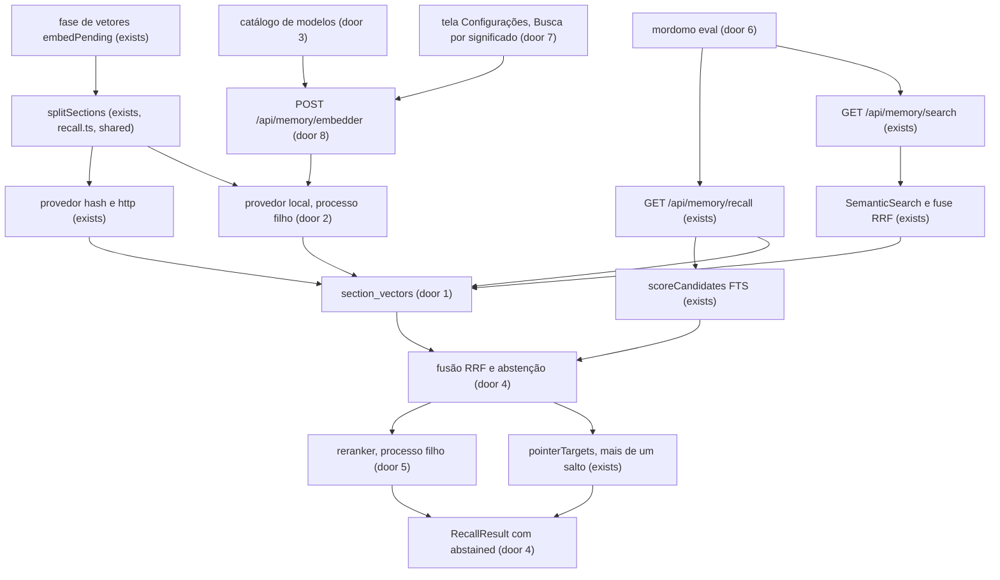
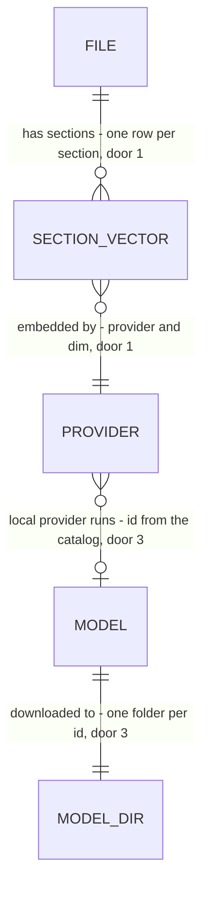

# Cérebro: busca por significado — modelo de verdade por seção, português nas palavras, recall híbrido com abstenção e reranker opcional

## Problem

A busca e o recall do Segundo Cérebro não entendem significado, e ninguém consegue medir isso. Levantamento no código em
`claude/beautiful-volta-6xmhok` (HEAD `c2b510b`) e uma medição feita para este plano:

- **O vetor padrão vê grafia, não significado.** O provedor `hash` (`core/src/memory/embeddings.ts:23-24`, 256 dimensões)
  junta plurais, mas não sinônimos. O corpus fixo mede o efeito: o híbrido acha 11 de 12 perguntas e um `OR` das palavras
  acha as mesmas 11 (`tests/memory.semantic.test.ts:246-284`, pergunta 16 da `cerebro-v2`); a pergunta por sinônimo falha de
  propósito.
- **Não há como ligar um modelo real sem editar o `settings.json`.** O provedor `http` existe (formato OpenAI
  `/v1/embeddings`, `embeddings.ts:117-249`), mas nenhuma tela o oferece (`apps/command-centre` não tem linha de embeddings,
  pergunta 5 da `cerebro-v2`) e o repositório não traz nem baixa modelo nenhum (`core/package.json:38-58`).
- **Um vetor por arquivo.** `vectors.ts:118` embute só os primeiros 8 000 caracteres (http) ou 20 000 (hash) de cada arquivo:
  numa nota longa, a seção que responde fica fora do vetor. O índice não guarda título de seção; o recall só separa seções
  na hora de abrir cada arquivo (`recall.ts:352-390`).
- **O português falha nas palavras.** O FTS usa o tokenizador `porter unicode61` (inglês). No corpus `semantic-morphology`,
  as 6 perguntas com o plural de `-ção` contra uma nota no singular dão `[palavras AND: não, OR: não, vetores: sim]`
  (`tests/memory.semantic.test.ts:286-310`); só o `hash` as junta. A faxina e a `cerebro-correcoes` deixaram isso para esta
  feature (`cerebro-correcoes/plan.md:190`).
- **O recall dos agentes não usa vetores.** `recall.ts` é FTS mais sinais de linha mais o roteador (cabeçalho `:20-36`): não
  chama `SemanticSearch`, não funde por RRF, segue só um nível de link e não tem teto de tokens. Quando algo casa fraco ele
  devolve mesmo assim; "não encontrei" só aparece quando nada casa (`mordomo.ts:75`).
- **Ninguém mede.** Há 12 perguntas em inglês e uma contagem de acertos no top 3; nenhuma pergunta em português com recall@k
  ou MRR, nenhum script de avaliação (`scripts/` não tem nenhum).

Medido para este plano, numa máquina Linux x64 com 4 CPUs e 16 GB, Node 22 e `@huggingface/transformers` 4.3.2:
EmbeddingGemma-300m q4 ocupa 209 MB em disco, carrega em 3 s, embute 8 trechos em cerca de 150 ms e ocupa cerca de 520 MB de
memória; a pergunta "quando abre a turma do curso?" fica a 0,775 do trecho certo e a 0,61-0,62 dos outros. O reranker
Qwen3-Reranker-0.6B q4 ocupa 1,2 GB em disco, carrega em 12 s, usa cerca de 1,8 GB de memória e leva 23,8 s para 50
candidatos (475 ms cada); acertou o trecho certo em primeiro (0,998). O pacote do runtime traz 548 MB de `onnxruntime-node`
para todas as plataformas (Linux x64 305 MB, dos quais 273 MB são CUDA e TensorRT que a CPU não usa; macOS arm64 86 MB;
Windows x64 64 MB), mais 141 MB de `onnxruntime-web` que o Node não usa, e **não tem binário para macOS Intel**.

Quando isto sair: o dono liga o significado de verdade na tela de Configurações, escolhendo entre um servidor seu (Ollama) e
um modelo baixado neste computador, a busca acha a seção que responde mesmo sem as mesmas palavras, o plural em português não
derruba mais a busca, o recall dos agentes diz "não encontrei" em vez de devolver um palpite fraco, e um comando mede, com as
perguntas do próprio dono, quanto cada passo ajuda.

## Flow

Reusa em vez de duplicar: a fase de vetores do índice (`embedPending`), o `VectorIndex` com `vec_distance_cosine`, a fusão RRF
de `SemanticSearch`, a divisão em seções do recall, os filtros de política e de público da C7 e o pointer-following do recall.

1. a fase de vetores de cada passada do índice (`embedPending`, exists) divide cada arquivo nas seções de `splitSections`
   (exists, passa a ser compartilhada por um módulo de seções, sem mudar o recall), monta o texto `Área > Nota > Seção` mais
   o corpo e o entrega ao provedor (`hash` e `http` exist; `local` é novo, door 2), e grava uma linha por seção em
   `section_vectors` (door 1), no lugar da linha por arquivo de `file_vectors`
2. o provedor `local` (door 2) roda num processo filho próprio com `@huggingface/transformers` e o modelo baixado em
   `<casa>/models/<id>/` (door 3); o serviço nunca carrega o runtime, e o filho sai depois de 120 s parado
3. `POST /api/memory/embedder` (door 8) baixa um modelo do catálogo com a soma de verificação fixada e o consentimento do dono;
   `GET /api/memory/embedder` mostra o catálogo e o estado
4. a busca (`GET /api/memory/search`, exists) lê as seções por `SemanticSearch` (exists): a pontuação de um arquivo é a da sua
   melhor seção, e o resultado diz qual seção foi; a fusão RRF e os filtros por público não mudam
5. o recall (`GET /api/memory/recall`, exists) soma aos candidatos de texto (`scoreCandidates`, exists) os arquivos das 50
   seções mais próximas, funde por RRF, decide a abstenção (door 4), opcionalmente reordena os melhores com o reranker (door
   5), abre as seções e segue links até `hops` saltos dentro do teto de tokens (`pointerTargets`, exists)
6. `mordomo eval <arquivo>` (door 6) roda as perguntas do dono contra o índice local e imprime as métricas por modo
7. a tela de Configurações (door 7) escolhe o provedor, baixa e remove modelos e testa a conexão

## Impact

| Front             | What changes                                                                                                                                                                                                                                                                                                                                                                                    |
| ----------------- | ----------------------------------------------------------------------------------------------------------------------------------------------------------------------------------------------------------------------------------------------------------------------------------------------------------------------------------------------------------------------------------------------- |
| domain            | novo termo: **seção** (`section`) - um trecho de um arquivo entre dois títulos ATX (H1 a H6) ou um bloco de 40 linhas fora de Markdown, com o caminho de títulos; vive no módulo de seções compartilhado                                                                                                                                                                                        |
| domain            | novo termo: **abstenção** (`abstention`) - o recall responde que não achou, em vez de devolver o melhor palpite; vive em `recall.ts`                                                                                                                                                                                                                                                            |
| domain            | novo termo: **modelo local** - um modelo do catálogo baixado para `<casa>/models/<id>/` e rodado num processo filho; vive no módulo do provedor local                                                                                                                                                                                                                                           |
| domain            | termo existente: `semantic.provider` era `hash` ou `http`, passa a ter `local`. Quem ramifica nele hoje: `embeddings.ts` (`chooseProvider`), `vectors.ts`, `semantic.ts`, `failClosed.ts`, `GET /api/memory/status`, `docs/security.md` e `legal/network-policy.json`; todos entram na construção                                                                                               |
| domain            | termo existente: o **vetor** era um por arquivo (`file_vectors`), passa a ser um por seção (`section_vectors`). Quem lê hoje: `vectors.ts` (`VectorIndex`, `countVectors`, `embedPending`), `semantic.ts`, o `status`, `indexer.ts` (remoção) e os testes de `memory.semantic.test.ts`                                                                                                          |
| domain            | termo existente: o resultado do recall era sempre uma lista; passa a poder ser **abstido** (`abstained: true`, lista vazia). Quem consome hoje: a ferramenta MCP `recall` (`mordomo.ts:59-79`), `mordomo recall` (`cli.ts:1546-1606`), `GET /api/memory/recall` e o painel de pergunta da C6b (`dashboard-answer`)                                                                              |
| stored data       | migração 34 `section-vectors` cria `section_vectors` e remove `file_vectors` (dado derivado); a primeira passada depois da migração recalcula todos os vetores. **Com o provedor `http` ligado, os textos de todas as seções saem de novo para o endereço configurado**, como já acontece a cada troca de provedor ou de dimensão (`vectors.ts:108-116`); o `legal/PRIVACY.md` já cobre o envio |
| rede              | um host novo na política de rede, o do repositório de modelos, só com o dono pedindo um download (`gate.setting`: `memory.embeddings.local.model`); o `provider.embed` continua com um só ponto de chamada em `semantic.ts` (C52 da `cerebro-v2`)                                                                                                                                               |
| instalador        | o runtime vai como dependência opcional exata, só a parte de CPU de cada plataforma (Linux x64 sem CUDA e TensorRT: 46 MB em vez de 305 MB), sem `onnxruntime-web`; **macOS Intel não tem runtime**: a opção "neste computador" aparece indisponível, com o motivo, e `http` e `hash` seguem. Nenhum peso de modelo vai no instalador                                                           |
| contratos e pinos | 2 rotas novas (171 → 173); migração 33 → 34; 1 código de erro novo por recusa nomeada; `memory.embeddings` ganha `local` e `memory.recall` é novo (as chaves do topo ficam 30); a lista dos booleanos ligados por padrão não muda (tudo vem desligado); `legal.network` (43 pontos, 18 hosts) e `THIRD_PARTY_NOTICES.md` movem; o comando `mordomo eval` é novo                                 |
| peso              | teto novo acima de `cerebro-rituais` (AD-047 h), proposto em Assumptions                                                                                                                                                                                                                                                                                                                        |

## Relations

One-way constraints: uma seção de um arquivo é identificada por `(arquivo, ordem)` e a ordem é a da leitura (door 1); o
provedor e a dimensão de cada linha são os do momento em que foi calculada, e qualquer diferença com o provedor ativo
recalcula (door 1); o `id` de um modelo é o do catálogo e nomeia a pasta (door 3). No columns and no types here.

## Surface

Só as rotas que esta feature acrescenta ou cuja assinatura muda.

| Route                           | In                                                                      | Out                                                                                                                                                                                                     | Status                            |
| ------------------------------- | ----------------------------------------------------------------------- | ------------------------------------------------------------------------------------------------------------------------------------------------------------------------------------------------------- | --------------------------------- |
| `GET /api/memory/embedder`      | -                                                                       | `active` · `platform` (`ok` · `reason?`) · `models[]` (`id` · `kind` · `name` · `bytes` · `dimensions?` · `license` (`name` · `acceptRequired`) · `state` · `progress?` (`done` · `total`) · `reason?`) | `200`, `403`                      |
| `POST /api/memory/embedder`     | `action` (`install`, `cancel`, `remove`, `test`), `id?`, `acceptTerms?` | `state` · `model?` · `test?` (`ok` · `dimensions` · `ms` · `kind?`)                                                                                                                                     | `200`, `400`, `403`, `404`, `409` |
| `GET /api/memory/recall` (muda) | query ganha `rerank?`                                                   | ganha `abstained` · `abstainReason` · `rerank`                                                                                                                                                          | `200`, `400`, `404`               |
| `GET /api/memory/search` (muda) | -                                                                       | cada resultado ganha `section?` · `line?`                                                                                                                                                               | `200`, `400`, `404`, `409`        |
| `GET /api/memory/status` (muda) | -                                                                       | `semantic` ganha `sections` · `model?` · `local?`                                                                                                                                                       | `200`                             |

## Landing

| One-way door                          | Literal shape                                                                                                                                                                                                                                                                                                                                                                                                                                                                                                                                                                                                                                                                                                                           | Alternative rejected                                                                                                                                                                                                                                                                                                                                                                                                                                                                                                                 |
| ------------------------------------- | --------------------------------------------------------------------------------------------------------------------------------------------------------------------------------------------------------------------------------------------------------------------------------------------------------------------------------------------------------------------------------------------------------------------------------------------------------------------------------------------------------------------------------------------------------------------------------------------------------------------------------------------------------------------------------------------------------------------------------------- | ------------------------------------------------------------------------------------------------------------------------------------------------------------------------------------------------------------------------------------------------------------------------------------------------------------------------------------------------------------------------------------------------------------------------------------------------------------------------------------------------------------------------------------ |
| 1. Vetores por seção                  | migração 34 `section-vectors`: `section_vectors(file_id INTEGER NOT NULL, ord INTEGER NOT NULL, heading TEXT NOT NULL, start_line INTEGER NOT NULL, end_line INTEGER NOT NULL, provider TEXT NOT NULL, dim INTEGER NOT NULL, vec BLOB NOT NULL, mtime INTEGER NOT NULL, size INTEGER NOT NULL, PRIMARY KEY (file_id, ord))`; o BLOB é Float32 little-endian com norma 1, lido por `vec_distance_cosine` ou pelo cálculo em JavaScript, como `file_vectors`; no máximo 64 linhas por arquivo (as 64 primeiras seções); o texto embutido é `<área> > <título da nota> > <caminho de títulos>\n<corpo>`, cortado em `maxChars` do provedor; a mesma migração apaga `file_vectors`                                                          | `vec0` do sqlite-vec: fixa a dimensão no esquema e torna a extensão obrigatória, o que a migração 21 recusou de propósito (`migrations.ts:512-513`), e uma troca de modelo mudaria a dimensão; janelas fixas de caracteres: cortam no meio de uma frase e não dizem a que título pertencem, e o recall já divide por título; manter `file_vectors` ao lado: dois lugares para o mesmo vetor, e a leitura por público teria de olhar os dois                                                                                          |
| 2. Provedor local em processo filho   | `memory.embeddings.provider: "local"` e `memory.embeddings.local = { model: <id do catálogo> }`; `@huggingface/transformers` `4.3.2` como dependência opcional exata do pacote `core`, carregado só dentro de um processo filho (`child_process.fork`) que fala por mensagens (`embed`, `rerank`, `ping`, `exit`), em lotes de 8, com a pasta de cache apontada para `<casa>/models/`, e que sai depois de 120 s sem pedido; o instalador leva só os arquivos de CPU da plataforma do alvo e nenhum `onnxruntime-web`                                                                                                                                                                                                                   | carregar no serviço: uma falha nativa derruba o serviço inteiro e a memória medida (520 MB com o embedder, 1,8 GB com o reranker) fica ao lado do banco; rodar no worker do índice: o teto de 512 MB do V8 (`indexHost.ts:31`) não vale para a memória nativa do runtime, então o teto não protegeria, e uma falha nativa derrubaria a passada; só Ollama pelo `http`: continua oferecido, mas pede ao dono instalar e manter outro programa; `onnxruntime-node` sozinho: obriga a escrever o tokenizador e o pooling de cada modelo |
| 3. Catálogo de modelos                | uma lista literal em código: `{ id, kind: "embedder" \| "reranker", repo, dtype, files: [{ path, bytes, sha256 }], hosts: [...], dimensions?, maxChars, minSimilarity, license: { name, url, acceptRequired }, queryPrefix?, documentPrefix? }`, com `embeddinggemma-300m-q4` (`onnx-community/embeddinggemma-300m-ONNX`, 768 dimensões, licença Gemma com `acceptRequired: true`), `qwen3-embedding-0.6b-q4f16` (`onnx-community/Qwen3-Embedding-0.6B-ONNX`, Apache-2.0) e `qwen3-reranker-0.6b-q4` (`onnx-community/Qwen3-Reranker-0.6B-ONNX`, Apache-2.0); a soma SHA-256 de cada arquivo é fixada na construção, e um download com soma diferente é apagado; só os `hosts` do catálogo são aceitos, inclusive nos redirecionamentos | baixar o que o repositório de modelos estiver servindo no momento: um modelo trocado lá passaria a rodar aqui sem o dono ver; o dono digitar o nome de um repositório: o `id` nomeia uma pasta e a licença do modelo precisa ser mostrada antes do download, o que um nome livre não permite                                                                                                                                                                                                                                         |
| 4. Contrato do recall com abstenção   | `RecallResult` ganha `abstained: boolean`, `abstainReason: "no_match" \| "weak" \| null` e `rerank: "off" \| "used" \| "skipped" \| "timeout" \| "failed"`; `answerContext[]` não muda de forma; `settings.memory.recall = { abstain: true, hops: 2, tokenBudget: 3000, rerank: { enabled: false, candidates: 20, timeoutMs: 15000 } }` (`hops` 1 a 3, `tokenBudget` 500 a 20000, `candidates` 1 a 50, `timeoutMs` 1000 a 120000); a regra de abstenção é: sem palavras-chave ou sem candidato, `no_match`; senão, com `abstain` ligado, `weak` quando nenhuma seção casa pelo menos metade das palavras-chave **e** a melhor seção tem cosseno abaixo do `minSimilarity` do provedor (ou não há vetores)                               | devolver `answerContext: []` sem dizer por quê: o agente não distingue "não existe" de "o índice está desligado"; um campo `confidence` numérico: cada modelo tem uma escala de cosseno, e um número solto vira limiar copiado entre modelos                                                                                                                                                                                                                                                                                         |
| 5. Reranker opcional                  | o reranker é um modelo `kind: "reranker"` do catálogo, rodado no mesmo processo filho (mensagem `rerank`), com a probabilidade de "yes" contra "no" do último token do prompt do modelo; só reordena as `candidates` melhores **seções** da fusão (depois do filtro de política e de público), só no recall e nunca na caixa de busca; passado `timeoutMs`, a ordem da fusão vale                                                                                                                                                                                                                                                                                                                                                       | um endpoint `http` de rerank: não há formato de rede comum (Cohere, Jina e TEI diferem) e o texto do dono sairia da máquina; reranquear na caixa de busca: a medição deu 475 ms por candidato, longe do que uma caixa de busca aguenta                                                                                                                                                                                                                                                                                               |
| 6. Formato do arquivo de avaliação    | um JSON que o dono escreve: `{ "v": 1, "queries": [{ "q": "<pergunta>", "kind": "single" \| "multi" \| "latest" \| "window" \| "abstain", "expect": ["<caminho relativo a memory/ ou à pasta indexada>", ...] }] }`; `mordomo eval <arquivo> [--json]` imprime, por modo (`and`, `or`, `semantic`, `hybrid`, `rerank` quando ligado), `1-recall@20`, `mrr`, `hit@3` e, para `abstain`, `abstainCorrect`; sai com 0, e com 2 e uma mensagem se o arquivo não obedece ao formato                                                                                                                                                                                                                                                          | uma tabela no banco: a pergunta e a resposta esperada são do dono e precisam ser versionadas junto das notas; contar só "achou" ou "não achou": esconde a posição, e as perguntas por valor mais recente só diferem pela ordem                                                                                                                                                                                                                                                                                                       |
| 7. Valores persistidos de `provider`  | `memory.embeddings.provider` aceita `hash`, `http` e `local`; o valor `local` com um `local.model` que não está pronto lê como `blocked: "model_missing"`; um `local.model` fora do catálogo é recusado em `PUT /api/settings` (`400`) e lido como ausente num arquivo editado à mão; `local` em plataforma sem runtime lê como `blocked: "platform_unsupported"`                                                                                                                                                                                                                                                                                                                                                                       | um quarto valor para cada modelo (`gemma`, `qwen`): o catálogo cresce sem migrar valores já gravados                                                                                                                                                                                                                                                                                                                                                                                                                                 |
| 8. Contrato do gerenciador de modelos | as duas rotas da `Surface`, ambas com escopo `owner`; `action: "install"` exige `id` e, quando `license.acceptRequired`, `acceptTerms: true` (`400 terms_not_accepted`); erros `400 validation`, `403 owner_only`, `404 model_not_found`, `409 local_unavailable`, `409 model_in_use`, `409 download_in_progress`; o download é um por vez e o progresso sai pelo `GET`                                                                                                                                                                                                                                                                                                                                                                 | uma rota por ação: quatro rotas para um gerenciador de uma tela; escopo `content` para o `GET`: o estado de um download e o caminho da casa não são de um dispositivo                                                                                                                                                                                                                                                                                                                                                                |

- Nothing else in this change is hard to reverse: o corte das seções além do limite de 64, as regras de número do
  radicalizador, o tamanho do lote, o tempo de ociosidade do processo filho, os textos da tela e a ordem das listas mudam por
  refatoração

## Criteria

### S1: medir a busca (P1)

O dono e o repositório medem, em português, quanto cada passo ajuda, sem rede e sem modelo.

**Acceptance Criteria**

1. The system SHALL ship a Portuguese evaluation corpus in `tests/fixtures/` with 40 notes and 60 queries, 12 of each kind `single`, `multi`, `latest`, `window` and `abstain`, each with the `expect` paths the door 6 format asks for.
2. WHEN `mordomo eval <file>` runs over a valid file THEN the system SHALL print, for each of the modes `and`, `or`, `semantic` and `hybrid`, the values `1-recall@20`, `mrr` and `hit@3` with 3 decimals, and the value `abstainCorrect` as `n/total`, and SHALL exit with 0.
3. WHEN `--json` is given THEN the system SHALL print one JSON object with the same values per mode and no other text.
4. IF the file is not valid JSON or does not obey the door 6 format THEN the system SHALL print the position of the first bad query (or `file`) on standard error, print nothing on standard output and exit with 2.
5. WHEN two runs use the same file and the same index THEN the system SHALL print identical numbers.
6. WHERE a query is of kind `abstain` THEN the system SHALL count it correct only if the recall answers `abstained: true`, and SHALL NOT count it in `1-recall@20` or `mrr`.
7. WHILE the provider is `hash` or `off` the system SHALL run `mordomo eval` with no network access and no model.
8. WHEN the `rerank` mode is on THEN the system SHALL print its row after `hybrid`, and WHEN it is off THEN the row SHALL be absent.

**Independent test:** rodar `mordomo eval tests/fixtures/pt-queries.json` sobre o corpus em português; saem quatro linhas de métricas e `abstainCorrect`.

### S2: o português nas palavras (P1)

O plural e o singular se encontram na busca por palavras, sem mudar o índice.

**Acceptance Criteria**

9. WHEN a keyword of 4 letters or more, after accent folding, ends in one of the number endings of the table below THEN the system SHALL build the text query for it as the OR of the word and its counterparts: `ao` with `oes`, `aes` and `aos`; `oes` with `ao`; `al` with `ais`; `ais` with `al`; `el` with `eis`; `eis` with `el`; `il` with `is`; `ol` with `ois`; `m` with `ns`; `ns` with `m`; `r` and `z` with `res` and `zes`; `s` alone with the word without the `s`.
10. WHEN the question is "devoluções reclamações solicitações" and a note holds "devolução reclamação solicitação" THEN `GET /api/memory/search` in `mode=text` SHALL list the note, and the six `other-number` questions of the `semantic-morphology` corpus SHALL find their note by words (AND) and by words (OR).
11. WHEN the keyword has 3 letters after folding THEN the system SHALL NOT add counterparts, and WHEN it has exactly 4 THEN it SHALL.
12. WHILE `mode=text` has a strict query (the words as typed) the system SHALL NOT expand it, and the strict AND baseline of AD-037 SHALL give the same results as before.
13. The system SHALL NOT change `hashEmbed` or the id `hash-v1:256`, so no stored vector is recomputed by this slice.

**Independent test:** buscar "devoluções" no corpus `semantic-morphology` e achar a nota "devolução".

### S3: a seção é a unidade do significado (P1)

Cada seção de cada nota tem o seu vetor, com o contexto da nota e do título.

**Acceptance Criteria**

14. WHEN the index pass runs with the embeddings on THEN the system SHALL write one `section_vectors` row per non-empty section of each `.md`, `.markdown` and `.txt` file, in reading order from `ord` 0, where a section is the text between two ATX headings H1 to H6 outside fences, the preamble before the first heading is the section `(top)`, and a non-Markdown file is cut in blocks of 40 lines.
15. WHEN a file has 64 sections THEN all 64 SHALL have a row, and WHEN it has 65 THEN only the first 64 SHALL.
16. The system SHALL embed, for each section, the text `<área> > <título da nota> > <caminho de títulos>` followed by a line break and the body, cut to the `maxChars` of the provider, where `<caminho de títulos>` is the section's own title preceded by those of its ancestors, joined by `>`.
17. WHEN a file changes (its `mtime` or size) THEN the system SHALL recompute only that file's sections and delete the rows of the sections that no longer exist, and WHEN its sections are unchanged in text THEN the row of the unchanged section MAY be rewritten.
18. WHEN the provider, the dimension or the local model differs from that of a stored row THEN the system SHALL recompute every row, and WHEN `memory.embeddings.enabled` is false THEN it SHALL empty `section_vectors`.
19. IF the provider fails during a pass THEN the system SHALL keep the rows already written, record `index.semantic_error` with the failure kind, and finish the pass, as for `file_vectors` before.
20. WHILE the provider is `http` the system SHALL NOT send to the endpoint any section of a file that today's policy hides from the caller's audience, and WHILE any provider is on the system SHALL NOT count, rank or name such a file's sections in any answer.
21. WHEN `GET /api/memory/search` runs in `semantic` or `auto` THEN each hit's score SHALL be that of the file's best section and the hit SHALL carry `section` (the heading path) and `line` (its first line).
22. WHEN migration 34 runs over a database with `file_vectors` rows THEN the table SHALL be gone, `GET /api/memory/status` SHALL read `semantic.vectors` 0 and `sections` 0, and the next index pass SHALL fill `section_vectors`.
23. The system SHALL answer `GET /api/memory/status` with `semantic.sections`, the count of sections the caller may see, and `semantic.model` (the id of the local model or `null`).
24. WHEN hiding N more files from an audience THEN every answer of `search` about the visible files SHALL stay equal, including `semantic.sections` and the order of the hits.

**Independent test:** uma nota com 3 títulos gera 3 linhas com o caminho de títulos; a busca por uma frase da segunda seção devolve a nota com `section` e `line` da segunda.

### S4: um modelo de verdade, neste computador ou no seu servidor (P1)

O dono baixa um modelo do catálogo, com consentimento e verificação, e o usa sem que nada saia da máquina.

**Acceptance Criteria**

25. WHEN `GET /api/memory/embedder` is called THEN the system SHALL answer `active`, `platform` and one entry of `models[]` for each catalog entry with `id`, `kind`, `name`, `bytes`, `license`, `state` (`absent`, `downloading`, `ready` or `failed`) and, while `downloading`, `progress`.
26. WHERE the platform has no runtime (macOS Intel, or a build without the optional dependency) THEN `platform` SHALL be `{ ok: false, reason: "platform_unsupported" }`, and `POST` with `action: "install"` SHALL answer `409 local_unavailable` and download nothing.
27. WHEN `POST /api/memory/embedder` with `action: "install"`, a catalog `id` and, if its license asks, `acceptTerms: true` is called THEN the system SHALL download each file of the entry to `<casa>/models/<id>/`, verify its SHA-256 against the catalog, answer `200` with `state: "downloading"` at once, and read `state: "ready"` when every file passes.
28. IF the license asks for acceptance and `acceptTerms` is not `true` THEN the system SHALL answer `400 terms_not_accepted` and download nothing.
29. IF the SHA-256 of a downloaded file differs from the catalog THEN the system SHALL delete the file, read `state: "failed"` with `reason: "checksum"` and SHALL NOT activate the model.
30. IF a download redirects to a host that is not in the entry's `hosts` THEN the system SHALL stop, delete the partial files and read `state: "failed"` with `reason: "host_not_allowed"`.
31. WHEN `action: "install"` comes while another download runs THEN the system SHALL answer `409 download_in_progress`, and an unknown `id` SHALL answer `404 model_not_found`.
32. WHEN `action: "cancel"` comes during a download THEN the system SHALL stop it, delete the partial files and read `state: "absent"`.
33. WHEN `action: "remove"` names a model that is not the active embedder THEN the system SHALL delete its folder and read `state: "absent"`, and IF it is the active embedder THEN the system SHALL answer `409 model_in_use` and delete nothing.
34. WHEN `memory.embeddings.provider` is `local` and its model is `ready` THEN the system SHALL embed in batches of 8 through a child process that the service starts on the first need, and the service process SHALL NOT load the runtime.
35. WHEN no request comes to the child process for 120 s THEN the system SHALL end it, and the next request SHALL start it again.
36. IF the child process ends without being asked during a pass THEN the system SHALL record `index.semantic_error` with kind `local_crashed`, restart it for the next batch at most 3 times in that pass, and finish the pass.
37. WHILE the provider is `local` the system SHALL make no network request when it embeds or searches, and the only network use of the local mode SHALL be the download of `action: "install"`.
38. WHEN `action: "test"` is called THEN the system SHALL embed one fixed phrase through the active provider (`http` or `local`) and answer `test: { ok, dimensions, ms }`, and IF it fails THEN `test: { ok: false, kind }` with the `EmbeddingError` kind or `local_crashed`.
39. IF `memory.embeddings.provider` is `local` and the model is not `ready` THEN the system SHALL read `blocked: "model_missing"`, and IF the platform has no runtime THEN `blocked: "platform_unsupported"`, and in both cases `auto` SHALL answer as `text`.
40. IF `PUT /api/settings` sets `memory.embeddings.local.model` to an id outside the catalog THEN the system SHALL answer `400 validation` and keep the settings.
41. WHILE the caller is a paired device or a run credential, both routes SHALL answer `403` (`owner_only` for a device) and download or delete nothing.
42. WHERE the catalog entry has `queryPrefix` or `documentPrefix` THEN the system SHALL put the prefix before the question or before each section text when it embeds, and the `hash` and `http` providers SHALL embed the text as before.

**Independent test:** instalar `embeddinggemma-300m-q4` aceitando os termos; o estado vai a `ready`, uma passada preenche `section_vectors` e `status.semantic.model` diz o id.

### S5: recall híbrido que sabe dizer "não encontrei" (P1)

O agente recebe seções achadas por palavras e por significado, e uma abstenção clara quando nada responde.

**Acceptance Criteria**

43. WHILE the provider is ready THEN `GET /api/memory/recall` SHALL add to its text candidates the files of the 50 sections nearest to the question, fuse the two rankings by RRF with k 60 (ties by the lower file id), and keep every filter of today (`isReadable`, `within`, the context, the audience) on each candidate.
44. WHEN a fused file has a vector-nearest section THEN `openFile` SHALL prefer that section when it scores no lower than the best text section, and the context SHALL name that section.
45. The system SHALL answer every `GET /api/memory/recall` with `abstained`, `abstainReason` and `rerank`.
46. IF the question has no keywords or no candidate THEN the system SHALL answer `abstained: true`, `abstainReason: "no_match"` and `answerContext: []`.
47. WHILE `memory.recall.abstain` is true, WHEN no section matches at least half of the keywords (exactly half counts as a match) and the best section's cosine is below the provider's `minSimilarity` (equal counts as not below), or there are no vectors, THEN the system SHALL answer `abstained: true`, `abstainReason: "weak"` and `answerContext: []`.
48. WHILE `memory.recall.abstain` is false the system SHALL answer a weak match as today, with `abstained: false`.
49. WHEN the answer is not abstained THEN `abstained` SHALL be `false` and `abstainReason` SHALL be `null`, and each `answerContext[]` entry SHALL keep the keys `path`, `section`, `excerpt`, `score`, `why`, `via`, `natureza`, `escopo` with the values it has today.
50. WHEN a section holds a link or `[[wikilink]]` to an indexed file the caller may read THEN the system SHALL follow it for up to `memory.recall.hops` levels (2 by default, 1 to 3), taking at each level only a section that scores higher than the one that pointed to it, and SHALL set `via` to the path that pointed.
51. WHILE the excerpts already chosen add up to `memory.recall.tokenBudget` tokens (characters divided by 4, 3000 by default) the system SHALL NOT add another excerpt, and an excerpt that does not fit SHALL be dropped, so `tokensEstimate` never exceeds the budget.
52. WHEN the answer is abstained THEN the MCP tool `recall` SHALL return the text `Nothing found: no indexed section answers this (<reason>).` with `<reason>` the `abstainReason`, and `mordomo recall` SHALL print the same line and exit with 0.
53. WHEN hiding N more files from an audience THEN every `recall` answer about the visible files SHALL stay equal, including `abstained`, `candidatesConsidered` and the order of `answerContext`.
54. IF `memory.recall` is absent or unreadable in `settings.json` THEN the system SHALL read the defaults of door 4, and IF a value is outside its bounds THEN `PUT /api/settings` SHALL answer `400 validation`.

**Independent test:** a pergunta por sinônimo do corpus acha a seção certa com o modelo ligado; a pergunta de abstenção volta `abstained: true` e a linha `Nothing found:`.

### S6: reranker local opcional (P2)

Quem aceita o custo reordena as melhores seções com um modelo que as lê, só no recall.

**Acceptance Criteria**

55. WHERE `memory.recall.rerank.enabled` is true and a reranker is `ready`, and `rerank` is not `false` in the query, THEN `GET /api/memory/recall` SHALL send the best `candidates` (20 by default, 1 to 50) fused sections to the reranker, order them by its probability of "yes" and put the rest after them in the fused order.
56. The system SHALL answer `rerank: "used"` when the reranker ordered the candidates, `"off"` when it is disabled or `rerank=false`, `"skipped"` when it is enabled but no reranker is `ready` or the platform has no runtime, `"timeout"` when it exceeded `timeoutMs` and `"failed"` when the child process failed.
57. IF the reranker takes longer than `memory.recall.rerank.timeoutMs` (15 000 ms by default, 1 000 to 120 000) THEN the system SHALL stop waiting, keep the fused order and answer `rerank: "timeout"`.
58. The system SHALL send to the reranker only sections that pass the policy, the context and the audience of the caller, and hiding N more files from an audience SHALL leave every answer about the visible files equal.
59. WHILE the caller is `GET /api/memory/search` the system SHALL NOT call the reranker.
60. WHEN `mordomo eval` has the reranker on THEN its `rerank` row SHALL be computed with the same candidates, and a `rerank: "timeout"` answer SHALL count with the fused order.

**Independent test:** com o reranker pronto, o recall do corpus devolve `rerank: "used"` e a seção certa em primeiro; com `timeoutMs` 1 000 devolve `rerank: "timeout"` e a ordem da fusão.

### S7: a tela "Busca por significado" (P1)

O dono escolhe o provedor, baixa o modelo e testa, sem editar arquivo nenhum.

**Acceptance Criteria**

61. WHEN the person opens Settings › Memory THEN the screen SHALL show a section "Busca por significado" with the state "Desligada" or "Ligada", an on/off control, and three provider options with a one-line description each: "Palavras e vetor simples (neste computador)", "Servidor seu (Ollama ou outro)" and "Modelo neste computador".
62. WHEN "Modelo neste computador" is chosen THEN the screen SHALL list the catalog models with name, size in MB, license, state and the actions "Baixar", "Cancelar", "Remover" and, on a ready model that is not the active one, "Usar este modelo" (which saves `memory.embeddings.local.model`), and a model whose license asks for acceptance SHALL open a dialog with the license name, its link and the checkbox "Li e aceito os termos" before "Baixar" is enabled.
63. WHILE a model downloads THEN the row SHALL show "Baixando: N de M MB" in text with a progress bar and "Cancelar", and the screen SHALL read the progress every second.
64. WHEN the platform has no runtime THEN the option "Modelo neste computador" SHALL be disabled with the reason "Este computador não tem o runtime do modelo local (macOS Intel). Use um servidor seu." beside an icon.
65. WHEN "Servidor seu" is chosen THEN the screen SHALL show the fields endereço, modelo, dimensões, nome da variável da chave and the checkbox "Permitir servidor fora deste computador", with the warning text of the design beside the checkbox, and the button "Testar conexão", which shows "OK: N dimensões, M ms" or the failure kind in text.
66. WHEN the person changes the provider, the model or the dimensions of a ready index THEN the screen SHALL ask for confirmation naming the number of sections to recompute and, for `http`, that their texts will be sent again, and SHALL save only on "Continuar".
67. WHEN the reranker row is shown THEN it SHALL be off by default, SHALL show the text "Mais lento: cerca de meio segundo por seção candidata. Só vale para agentes." and SHALL be on only if a reranker model is `ready`.
68. WHILE the screen loads it SHALL show a spinner with "Carregando…", IF a read or an action fails it SHALL show the error with "Tentar de novo", and a failed download SHALL show its reason (`checksum`, `host_not_allowed` or the network error) in text.
69. The screen SHALL be 12px minimum, use colors only from tokens, turn off every motion under `prefers-reduced-motion`, be keyboard-operable, and SHALL pass axe at WCAG A/AA in both themes and both shells.

**Independent test:** Configurações › Memória › "Busca por significado": baixar o modelo, ligar, ver "Ligada" e "Testar conexão" devolver "OK: 768 dimensões".

## Out of scope

| Excluded                                                                                   | Why                                                                                                                                                                                                   |
| ------------------------------------------------------------------------------------------ | ----------------------------------------------------------------------------------------------------------------------------------------------------------------------------------------------------- |
| Bloco de contexto escrito por modelo antes de cada seção ("Contextual Retrieval" completo) | custa uma execução por seção e a pesquisa mede ganho com ele; o prefixo `Área > Nota > Título` desta feature é a versão determinística, e o bloco por modelo entra depois, medido pelo `mordomo eval` |
| Late chunking e vetores esparsos (bge-m3)                                                  | exigem as saídas por token do modelo, que um endpoint `http` não devolve (`recuperacao_resumo.md`)                                                                                                    |
| Reescrita da pergunta e HyDE                                                               | a própria pesquisa mede ganho baixo; o radicalizador da S2 é a versão barata                                                                                                                          |
| Reranker por endpoint `http`                                                               | não há formato de rede comum e o texto do dono sairia da máquina (door 5)                                                                                                                             |
| Aceleração por GPU (CUDA, TensorRT, WebGPU)                                                | é o que pesa 273 MB no Linux x64 e o instalador não leva; o modo é CPU                                                                                                                                |
| Runtime local para macOS Intel e para Windows ARM                                          | o `onnxruntime-node` 1.30.0 não tem binário para macOS Intel; as duas ficam com `http` e `hash`                                                                                                       |
| Baixar o modelo sem o dono pedir, ou levar pesos no instalador                             | consentimento e licença por modelo; o instalador já passa de 100 MB sem peso nenhum                                                                                                                   |
| Mais de um modelo ativo ao mesmo tempo                                                     | uma troca recalcula todos os vetores; dois modelos dobrariam a tabela e a fusão                                                                                                                       |
| Camada de entidades, PageRank e resumos por área                                           | são da `cerebro-entidades-resumos` (C11)                                                                                                                                                              |
| A tela "Perguntar ao cérebro" com citações, modo "raciocine primeiro" e provocações        | é da `cerebro-perguntar` (C10); esta feature dá a ela o recall com abstenção                                                                                                                          |
| Ferramentas MCP novas                                                                      | o MCP só ganha o texto da abstenção; as ferramentas de busca, links e higiene são da C10                                                                                                              |
| Trocar o tokenizador do FTS ou acrescentar uma coluna de radicais                          | outra porta de esquema; o radicalizador da S2 vive só na consulta                                                                                                                                     |
| Julgar a avaliação por um modelo                                                           | o `expect` é uma lista de caminhos; um juiz por modelo gasta execuções e erra em silêncio                                                                                                             |

## Assumptions

| Assumption                      | Chosen default                                                                                                                                                                          | Rationale                                                                                                                                                                | Confirmed? |
| ------------------------------- | --------------------------------------------------------------------------------------------------------------------------------------------------------------------------------------- | ------------------------------------------------------------------------------------------------------------------------------------------------------------------------ | ---------- |
| Provedor padrão                 | continua `hash`, desligado: nada muda para quem não ligar                                                                                                                               | AD-047 (a) e a regra de que nada sai da máquina sem pedido; o dono liga na tela                                                                                          | n          |
| Modelo recomendado              | `embeddinggemma-300m-q4` marcado "Recomendado" na tela, com a licença Gemma mostrada e aceita antes do download                                                                         | 209 MB em disco e cerca de 520 MB de memória, contra 567 MB de arquivo e 1 024 dimensões do Qwen3; o MordomoOS não redistribui o peso, o dono o baixa e aceita os termos | n          |
| Modelo sem restrição de licença | `qwen3-embedding-0.6b-q4f16` (Apache-2.0) fica no catálogo ao lado                                                                                                                      | quem não quer os termos Gemma tem a alternativa; a revisão jurídica do dono decide qual fica                                                                             | n          |
| Abstenção ligada por padrão     | `memory.recall.abstain: true`                                                                                                                                                           | é a categoria de abstenção da avaliação e o objetivo da feature; o dono desliga em `settings.json`                                                                       | n          |
| Limiar de abstenção             | o `minSimilarity` de cada provedor (`hash` 0,2); o do modelo local é gravado no catálogo pela construção a partir de `mordomo eval` sobre o corpus em português                         | um limiar de cosseno vale só para o seu modelo; a medição fixa o número e o registra                                                                                     | n          |
| Saltos e teto do recall         | `hops: 2`, `tokenBudget: 3000`                                                                                                                                                          | a pesquisa pede mais de um salto sob teto de tokens; 3 000 tokens são 12 000 caracteres, o dobro de 3 trechos de 1 500                                                   | n          |
| Reranker                        | desligado, 20 candidatas, 15 000 ms                                                                                                                                                     | medido em 475 ms por candidata; 20 candidatas ficam perto de 9,5 s; só o recall dos agentes o usa                                                                        | n          |
| Ociosidade do processo filho    | 120 s                                                                                                                                                                                   | o modelo leva 3 s a 12 s para carregar e ocupa 520 MB a 1,8 GB; manter por 2 minutos cobre uma conversa e libera a memória depois                                        | n          |
| Lote do embedder local          | 8 seções                                                                                                                                                                                | o lote medido (8 trechos em 150 ms); o do `http` continua 16                                                                                                             | n          |
| Seções por arquivo              | no máximo 64                                                                                                                                                                            | uma nota com mais de 64 títulos é um índice, não um texto a embutir; a tabela cresce com o número de seções                                                              | n          |
| Prompts do modelo               | o texto da seção com o prefixo do cartão do modelo quando o catálogo o traz (`queryPrefix`, `documentPrefix`); a construção lê o cartão de cada modelo e `mordomo eval` mostra o efeito | EmbeddingGemma e Qwen3-Embedding pedem instruções diferentes para pergunta e documento; não verifiquei os textos exatos neste plano                                      | n          |
| Custo de busca em JavaScript    | a leitura de todas as linhas por pergunta é O(seções); a construção mede com 20 000 seções e para para perguntar se a busca passar de 1 s                                               | `file_vectors` tinha uma linha por arquivo e a tabela passa a ter cerca de 8 vezes mais                                                                                  | n          |
| Teto de peso (AD-047 h)         | 12 KB de JS gzip e 2 KB de CSS gzip acima de `cerebro-rituais` (604 839 B e 83 496 B em `scripts/bundle-baseline.json`); a construção para e pergunta se passar                         | uma seção de Configurações com três blocos; a sobra de CSS da C8 é de cerca de 400 B, então o CSS da seção precisa de espaço próprio                                     | n          |
| Crescimento do instalador       | a construção mede o instalador de cada alvo; se o runtime somar mais de 120 MB em um alvo, para e pergunta                                                                              | medido: Linux x64 46 MB sem CUDA e TensorRT, macOS arm64 86 MB, Windows x64 64 MB                                                                                        | n          |
| Hosts do download               | só os do repositório de modelos, descobertos na construção (inclusive os dos redirecionamentos) e listados no catálogo e em `legal/network-policy.json`                                 | um host fora da lista é recusado (AC 30); não sei hoje quais hosts de entrega o repositório usa                                                                          | n          |

**Open questions:**

| #   | Kind           | Question                                                                                                                                                                                                                                                                                                                                                                                     | Until answered                                                                                       |
| --- | -------------- | -------------------------------------------------------------------------------------------------------------------------------------------------------------------------------------------------------------------------------------------------------------------------------------------------------------------------------------------------------------------------------------------- | ---------------------------------------------------------------------------------------------------- |
| 1   | blocks go-live | O texto jurídico (`legal/PRIVACY.md`, `legal/network-policy.json`, `THIRD_PARTY_NOTICES.md`) para o download de modelos e para os termos da licença Gemma é minuta para o dono e para a revisão jurídica; o MordomoOS não redistribui o peso, mas mostra e registra a aceitação. Recomendo manter o EmbeddingGemma como recomendado, com a aceitação na tela, e o Qwen3 (Apache-2.0) ao lado | AC 27, 28 e 62 valem como escritos; o texto jurídico sai como minuta, como o das features anteriores |
| 2   | open           | macOS Intel fica sem o modelo "neste computador" (o `onnxruntime-node` 1.30.0 não traz binário para ele) e usa `http` ou `hash`. Recomendo aceitar: a `distribuicao` mantém macOS Intel como alvo, e uma versão mais nova do runtime pode trazer o binário depois                                                                                                                            | AC 26 e 64 escritos com essa recusa; trocar é só a lista de plataformas da dependência               |
| 3   | open           | A sessão curta de andar as telas com o dono (ainda não aconteceu, `cerebro-v3-status.md` 4.1) deve incluir esta tela, e a de Configurações é a primeira em que o dono baixa 200 MB                                                                                                                                                                                                           | a verificação roda sem ela; o passo 5 de `verify.md` fica registrado como não feito                  |

## Observable

| Surface                                                     | Decision                                  | Landing                                                                                                                              |
| ----------------------------------------------------------- | ----------------------------------------- | ------------------------------------------------------------------------------------------------------------------------------------ |
| screen Configurações, Busca por significado                 | empty state                               | AC 64 (sem runtime) e AC 62 (nenhum modelo baixado)                                                                                  |
| screen Configurações, Busca por significado                 | loading state                             | AC 68                                                                                                                                |
| screen Configurações, Busca por significado                 | error state                               | AC 68                                                                                                                                |
| screen Configurações, Busca por significado                 | unauthorised                              | AC 41; a interface do dono usa o token do dono                                                                                       |
| screen Configurações, Busca por significado                 | density and ordering                      | AC 61, AC 62 (a ordem do catálogo é a da door 3)                                                                                     |
| screen Configurações, Busca por significado                 | destructive action confirms               | AC 66 (recalcular e reenviar); "Remover" não apaga dado do dono, só o modelo baixado, e o `409 model_in_use` protege o ativo (AC 33) |
| screen Configurações, Busca por significado                 | what the person does next                 | AC 63 e AC 38 (o teste de conexão diz se funciona)                                                                                   |
| API `GET /api/memory/embedder`                              | error shape and codes                     | AC 41                                                                                                                                |
| API `POST /api/memory/embedder`                             | error shape and codes                     | AC 26, AC 28, AC 31, AC 33, AC 41                                                                                                    |
| API `GET /api/memory/embedder`, `POST /api/memory/embedder` | who may call                              | AC 41                                                                                                                                |
| API `GET /api/memory/embedder`, `POST /api/memory/embedder` | versioning, rate limits                   | n/a - `/api/v1` é o mesmo conjunto de rotas (api-v1); o download único (AC 31) é o limite                                            |
| API `GET /api/memory/recall`                                | response shape                            | AC 45, AC 49                                                                                                                         |
| API `GET /api/memory/recall`                                | error shape and codes                     | AC 54; `400 validation` para `rerank` que não é booleano                                                                             |
| API `GET /api/memory/search`                                | response shape                            | AC 21                                                                                                                                |
| API `GET /api/memory/status`                                | response shape                            | AC 23                                                                                                                                |
| all new and changed `/api/memory/*` routes                  | retries and duplicates                    | AC 31 (um download por vez), AC 17 (a passada refeita não duplica linhas)                                                            |
| command `mordomo eval`                                      | output, flags, exit codes                 | AC 2, AC 3, AC 4                                                                                                                     |
| command `mordomo recall`                                    | output on abstention                      | AC 52                                                                                                                                |
| document arquivo de avaliação                               | structure                                 | door 6, AC 4                                                                                                                         |
| document texto da abstenção do MCP                          | structure, what the reader does next      | AC 52                                                                                                                                |
| scheduled task a passada do índice                          | output, failure halfway                   | AC 19, AC 36                                                                                                                         |
| collection seções por arquivo                               | grouping, ordering, duplicates, exception | AC 14 (ordem de leitura), AC 15 (o limite de 64), a exceção é o arquivo sem título (`(top)`)                                         |
| collection candidatas do recall                             | grouping, ordering, duplicates            | AC 43 (RRF, empate pelo menor id), um arquivo aparece uma vez                                                                        |

## Sources

- `.specs/roadmap.md`, linha C9 - o escopo: conjunto de avaliação em PT, embedder local real por seção, radicalização PT,
  recall híbrido com abstenção, reranker opcional
- `reports/Segundo cérebro para agentes.md` (M1 a M3, A5) e `research_notes/Segundo cérebro para agentes/recuperacao_resumo.md`
  - a receita BM25 mais vetores por RRF (k 60), os modelos locais com dado em português e o ganho medido do reranker
- `.specs/STATE.md`, `cerebro-v2` perguntas 4, 5 e 16 e `distribuicao` item 4 - a pergunta do provedor, o limite do `hash` e as
  plataformas do instalador
- `.specs/features/cerebro-busca-significado/design.md` - binding para a tela desta feature
