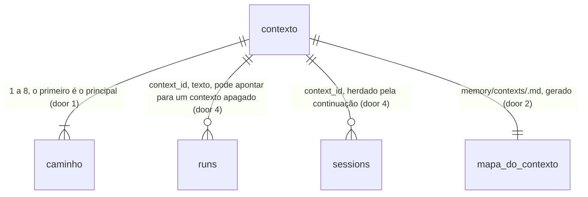

# Cérebro: contextos de trabalho — escolher a pasta inteira ou um projeto, e o cérebro e os agentes passam a valer para ele

## Problem

Toda pergunta ao Segundo Cérebro e toda execução de agente valem para o acervo inteiro, e a pessoa não tem como dizer "agora estou
neste projeto". Levantamento no código em `chore/cerebro-v3-roteiro`:

- **Não existe escopo que se escolha uma vez.** As peças estão soltas e cada uma pede o seu filtro, a cada chamada: a busca e o
  grafo aceitam `dir` (`core/src/memory/search.ts:52-55`, `graph.ts:53-56`), o recall aceita `area` (`recall.ts:37-38`), a
  execução aceita `cwd` (`contracts/src/api/runs.ts:29-36`, `skills.ts:40-47`). A interface não guarda nenhuma escolha: o chat
  da moldura e as telas do cérebro chamam sem filtro, e a pasta de trabalho de uma execução sem `cwd` é `<home>/workspace`
  (`core/src/runs/runManager.ts:447-454`).
- **O filtro por pasta que existe erra a fronteira.** `dir LIKE '<pasta>%'` faz `/projetos/app` casar com `/projetos/app-antigo`
  (`search.ts:52-55`).
- **O agente recebe o mapa do acervo inteiro.** O prompt de uma skill de memória aponta para `memory/`, `MEMORY.md` e o diário
  (`core/src/skills/catalog.ts:405-420`); o `AGENTS.md`/`CLAUDE.md` compilado leva o corpo do `ROUTER.md` global
  (`core/src/sync/compiler.ts:301-342`). Num projeto, o agente gasta contexto com áreas que não importam e o recall devolve
  trechos de outros projetos, porque nada diz qual é o projeto.
- **Uma conversa continuada não sabe onde estava.** A continuação recupera provedor e `cwd` da sessão
  (`apps/api/src/routes/sessions.ts:27-35`), e nada mais.

Nenhuma métrica de uso foi dada. O pedido do dono, literal: "um mecanismo de contexto, o de posso selecionar minha pasta de
trabalho completa, ou subpasta de contexto (tipo um projeto específico) para usar o segundo cérebro, deixando muito mais
otimizado e inteligente".

Quando isto sair: a pessoa cria um contexto a partir de uma pasta ou subpasta ("App do cliente X"), escolhe-o uma vez, e a busca,
o recall, o grafo, os relacionados e as execuções iniciadas pela interface passam a valer só para ele, com um resumo e um mapa
curto do contexto no prompt do agente; "Todo o cérebro" fica a um clique; e o mapa do contexto pode ser compilado no
`CLAUDE.md`/`AGENTS.md` da pasta do projeto.

## Flow

Reutiliza o `SettingsStore` e a leitura tolerante de campos (AD-013), o `UiPreferencesStore`, o `rowFilter` do indexador, o
`resolveCwd` e o `skillContext` do `RunManager` (AD-011, AD-012), o `generateRouters` (os mapas gerados e o orçamento em tokens do
diário), o `SyncCompiler` com backup, diff e aprovação por arquivo, a tabela `API` com `bind` (AD-024), o `NoteEditor` e o registro
de comandos (AD-014); nenhuma segunda política de caminhos, de escrita ou de compilação.

1. Definir → `POST`/`PATCH`/`DELETE /api/contexts` (new, door 3) → `core/src/memory/contexts.ts` (new, no door - placement per
   conventions) confere cada caminho (realpath dentro de uma pasta indexada habilitada ou de `memory/`, permitido pelo filtro) e
   grava em `settings.contexts` pelo `SettingsStore` (exists), persiste `contexts` (door 1).
2. Escolher → a interface grava `UiPreferences.activeContext` (door 5) por `PUT /api/ui-preferences` (exists); a CLI lê o mesmo
   campo.
3. Ler com escopo → as rotas `memory.search` (exists), `memory.recall` (exists), `memory.graph` (exists), `memory.related` (exists) e `memory.status` (exists, as facetas) recebem
   `context` (door 3); `contexts.ts` traduz o id nos caminhos reais e o teste de pertença (door 6) entra junto do `rowFilter` como
   o `allow` que as funções de `core/src/memory` (exist) já recebem.
4. Executar com escopo → `POST /api/runs` (exists), `POST /api/skills/:slug/run` (exists) e `POST /api/sessions/:id/continue` (exists) recebem
   `contextId` (door 3); o `RunManager` (exists) resolve o `cwd` para o caminho principal do contexto pelo `resolveCwd` (exists),
   soma os outros caminhos e a pasta de notas do contexto aos `readDirs`, guarda `context_id` na execução e na sessão (door 4) e o
   `SkillCatalog.buildRunPrompt` (exists) põe o bloco do contexto antes do resto.
5. Recall da execução → a rota de recall, chamada com a credencial de uma execução que tem contexto e sem `context`, usa o
   contexto da execução (door 7).
6. Mapa → `generateRouters` (exists) escreve `memory/contexts/<id>.md` por contexto (door 2), sob o orçamento em tokens; o
   `SyncCompiler` (exists) ganha `context` em `sync.plan`/`sync.apply` e compila esse mapa, em vez do `ROUTER.md`, no `CLAUDE.md`/
   `AGENTS.md` da pasta principal.
7. Interface → o seletor de contexto (design.md) nos dois shells, o chip no chat, "Novo contexto…" e Configurações › Memória ›
   Contextos chamam as rotas por `apiCall` (exists); o comando "Trocar de contexto" entra no registro (exists).

## Impact

| Front         | What changes                                                                                                                                                                                                                                                                                                                                                                                     |
| ------------- | ------------------------------------------------------------------------------------------------------------------------------------------------------------------------------------------------------------------------------------------------------------------------------------------------------------------------------------------------------------------------------------------------ |
| domain        | new term: `contexto` (de trabalho) - um escopo nomeado, persistente, definido pelo dono: até 8 caminhos (o primeiro é o principal), cada um uma pasta indexada, uma subpasta de uma, ou uma pasta de `memory/`; tem uma pasta de notas `memory/notes/<id>/`, um resumo opcional `memory/notes/<id>/_resumo.md` e um mapa gerado `memory/contexts/<id>.md`; vive em `core/src/memory/contexts.ts` |
| domain        | new term: `contexto ativo` - o contexto que a interface e a CLI desta máquina usam quando a chamada não diz outro; nenhum = "Todo o cérebro"                                                                                                                                                                                                                                                     |
| domain        | nome que já existe e não muda: `context` de uma rotina (`isolated` \| `main`, `contracts/src/routines.ts:95-96`) e de um objetivo (`ObjectiveContext`, `core/src/objectives/objectiveStore.ts`) — por isso o campo das execuções se chama `contextId`, e nenhuma rotina ganha contexto nesta feature                                                                                             |
| domain        | existing term: nota editável (AD-031) era um `.md` sob `memory/` fora de `ROUTER.md`, `areas/` e `journal/`; `contexts/` entra na lista dos gerados (`core/src/memory/notes.ts:31-32`) — quem ramifica hoje: `GET /api/memory/note` (`editable`), `PUT /api/memory/notes`, o preview e o editor                                                                                                  |
| domain        | existing term: prompt de execução começava pelo bloco de lugares; com contexto, começa pelo bloco do contexto — quem lê hoje: `SkillCatalog.buildRunPrompt`, os testes de prompt de `tests/core.capabilities.test.ts`                                                                                                                                                                            |
| stored data   | `settings.json` ganha `contexts` (padrão `[]`; uma entrada ilegível é descartada sozinha, como os outros campos da AD-013); `ui-preferences.json` ganha `activeContext` (padrão `null`); a migração 23 acrescenta `runs.context_id` e `sessions.context_id` (`TEXT NULL`), e execuções e sessões antigas leem `null`                                                                             |
| arquivos      | `memory/contexts/` e `memory/notes/<id>/` passam a existir quando há contexto; apagar um contexto não apaga nenhum dos dois                                                                                                                                                                                                                                                                      |
| contrato REST | quatro rotas novas; `context` em cinco rotas de leitura de memória (`search`, `recall`, `graph`, `related`, `status`) e em `sync.plan`/`sync.apply`; `contextId` nos corpos de três rotas de execução e em `RunRecord`                                                                                                                                                                           |

## Relations

One-way constraints: o `id` de um contexto é único e nunca muda depois de criado (door 1); `context_id` é texto e não tem chave
estrangeira, porque um contexto vive em `settings.json` e uma execução antiga continua legível depois que o contexto some (door 4).

## Surface

| Route                                                                                     | In                                 | Out                                                                                                                     | Status                        |
| ----------------------------------------------------------------------------------------- | ---------------------------------- | ----------------------------------------------------------------------------------------------------------------------- | ----------------------------- |
| `GET /api/contexts`                                                                       | —                                  | `contexts[]`: `id` · `name` · `paths[]` (`path` · `state`) · `notesDir` · `brief` (caminho ou `null`) · `map` · `files` | `200`                         |
| `POST /api/contexts`                                                                      | `name`, `paths[]`, `id?`           | o contexto                                                                                                              | `201`, `400`, `409`           |
| `PATCH /api/contexts/:id`                                                                 | `name?`, `paths[]?`                | o contexto                                                                                                              | `200`, `400`, `404`           |
| `DELETE /api/contexts/:id`                                                                | —                                  | `deleted` · `id`                                                                                                        | `200`, `404`                  |
| `GET /api/memory/search`, `recall`, `graph`, `related`, `status` (mudam)                  | query `context?` (`<id>` ou `all`) | as mesmas respostas, só com arquivos do contexto                                                                        | os de hoje, mais `404`        |
| `POST /api/runs`, `POST /api/skills/:slug/run`, `POST /api/sessions/:id/continue` (mudam) | `contextId?`                       | a execução; `RunRecord.contextId`                                                                                       | os de hoje, mais `404`, `409` |
| `GET /api/sync/plan`, `POST /api/sync/apply` (mudam)                                      | `context?`                         | o plano e o resultado de hoje, com o mapa do contexto                                                                   | os de hoje, mais `404`        |

## Landing

| One-way door                        | Literal shape                                                                                                                                                                                                                                                                                                                                                                     | Alternative rejected                                                                                                                                                                                                                                                              |
| ----------------------------------- | --------------------------------------------------------------------------------------------------------------------------------------------------------------------------------------------------------------------------------------------------------------------------------------------------------------------------------------------------------------------------------- | --------------------------------------------------------------------------------------------------------------------------------------------------------------------------------------------------------------------------------------------------------------------------------- |
| 1. Onde o contexto vive             | `settings.contexts: Array<{ id: /^[a-z0-9][a-z0-9-]{0,39}$/; name: string (1 a 60, sem quebra de linha); paths: string[] (1 a 8, absolutos, sem repetição; `paths[0]` é o principal) }>`, até 50 entradas, `id` único; `id` derivado do nome como o nome de nota (`cerebro-v2` AC 3) quando não vem, `-2` a `-99` em colisão                                                      | uma tabela no banco: o banco é índice e estado de execução, derivado ou operacional, e o contexto é configuração que o dono edita à mão e que o backup e o `settings.changed` já cobrem; `UiPreferences`: o motor nunca interpreta esse arquivo, e a execução precisa do contexto |
| 2. Arquivos do contexto             | `memory/notes/<id>/` (pasta de notas, editável), `memory/notes/<id>/_resumo.md` (resumo, editável, front matter `type: brief`; criado só quando a pessoa pede), `memory/contexts/<id>.md` (mapa, gerado, não editável, cabeçalho `<!-- generated by MordomoOS -->`)                                                                                                               | o mapa dentro da pasta do projeto: escrever em pasta do usuário sem revisão contraria a pergunta 1 do dono no `cerebro-v2`; quem leva o mapa para a pasta é o `mordomo sync`, com backup, diff e aprovação                                                                        |
| 3. Contrato: nomes                  | rotas `contexts.list`, `contexts.create`, `contexts.update`, `contexts.delete` (escopo `content` para listar, `owner` para o resto); query `context` (um `id` ou o literal `all`) nas leituras; campo `contextId` nos corpos de execução e em `RunRecord`; erros `context_not_found` (404), `context_path_not_indexed` (400), `context_exists` (409), `context_unavailable` (409) | o nome `context` no corpo de execução: colide com `context` das rotinas (`isolated`/`main`) e dos objetivos; um cabeçalho `X-Mordomo-Context`: a tabela `API` e o OpenAPI descrevem corpo e consulta, não cabeçalho de pedido (a mesma razão do `cerebro-v2`, door 5)             |
| 4. Contexto da execução e da sessão | migração `version: 23`: `ALTER TABLE runs ADD COLUMN context_id TEXT`; `ALTER TABLE sessions ADD COLUMN context_id TEXT`; a continuação de uma sessão usa o `context_id` da sessão e recusa um `contextId` diferente com `409 context_unavailable`                                                                                                                                | só no texto do prompt: a continuação e o recall da execução não teriam de onde ler o contexto; chave estrangeira: o contexto vive fora do banco                                                                                                                                   |
| 5. Contexto ativo                   | `UiPreferences.activeContext: string \| null` (de primeiro nível, `.catch(null)`), um por máquina, o mesmo para a moldura, o Núcleo e a CLI                                                                                                                                                                                                                                       | um por shell: os dois shells mostram os mesmos dados (AD-005) e trocar de shell mudaria o escopo sem a pessoa ver; guardado no servidor como estado implícito das rotas: uma chamada sem `context` passaria a depender de quem clicou por último em outra janela                  |
| 6. Pertença a um contexto           | um arquivo é do contexto quando o realpath do seu `path` é igual a um realpath dos `paths` do contexto ou começa por ele seguido do separador da plataforma; comparado como a plataforma compara nomes (o `grantedReadScope` de hoje)                                                                                                                                             | `dir LIKE '<pasta>%'`, o filtro de hoje: casa `/projetos/app-antigo` com `/projetos/app`                                                                                                                                                                                          |
| 7. Recall e busca da execução       | chamadas com a credencial de uma execução que tem `context_id` e sem `context` usam o contexto da execução; `context=all` volta ao acervo inteiro; chamadas com o token do dono e sem `context` valem para o acervo inteiro                                                                                                                                                       | o agente decidir pelo prompt: o recall seria um pedido que o agente pode esquecer de filtrar; a credencial da execução nunca vale fora do contexto: um agente que precisa de uma nota geral (o `MEMORY.md`) ficaria sem ela                                                       |

- Nothing else in this change is hard to reverse: o texto do bloco do contexto no prompt, a ordem dos arquivos do mapa, o
  desenho do seletor e os atalhos mudam por refatoração.

## Criteria

### S1: definir contextos (P1)

O dono cria, renomeia, muda os caminhos e apaga contextos, e o sistema recusa o que não pode valer.

**Acceptance Criteria**

1. WHEN the owner calls `POST /api/contexts` with `{ "name": "App do cliente X", "paths": ["<pasta indexada>/clientes/x"] }` THEN the system SHALL answer `201` with `id` `app-do-cliente-x`, the path as given, `notesDir` `<home>/memory/notes/app-do-cliente-x`, `brief` `null` and `map` `<home>/memory/contexts/app-do-cliente-x.md`, and SHALL store it in `settings.contexts`.
2. WHEN the derived `id` already exists THEN the system SHALL use `-2` up to `-99`, and IF the request gives an `id` that exists THEN it SHALL answer `409 context_exists` and store nothing.
3. IF a path does not resolve inside an enabled indexed folder or inside `memory/`, or today's policy hides it (the home's `config/` or `logs/`, a user exclude, a secret name), or it holds a link into the home's `config/` or `logs/` THEN the system SHALL answer `400 context_path_not_indexed` naming the path and store nothing.
4. IF `name` is empty after trimming, longer than 60 characters or holds a line break, or `paths` is empty, has more than 8 entries or repeats a real path, or `settings.contexts` already has 50 entries THEN the system SHALL answer `400 validation` and store nothing.
5. WHEN the owner calls `PATCH /api/contexts/:id` with `name` or `paths` THEN the system SHALL change only those fields, keep the `id`, and check the new paths as AC 3 does.
6. WHEN the owner calls `DELETE /api/contexts/:id` THEN the system SHALL remove it from `settings.contexts`, SHALL leave `memory/notes/<id>/` and every file in it unchanged, SHALL delete `memory/contexts/<id>.md`, and SHALL set `UiPreferences.activeContext` to `null` when it named that context.
7. WHEN `GET /api/contexts` is called THEN each path SHALL carry `state` `ok`, `missing` (the folder no longer exists) or `not_indexed` (it exists and is no longer inside an enabled indexed folder, or the policy hides it), and `files` SHALL be the number of indexed rows that belong to the context by door 6.
8. WHILE `settings.json` holds a `contexts` entry this version cannot read THEN the system SHALL drop that entry, keep the others and start.
9. WHILE a paired device calls `POST`, `PATCH` or `DELETE /api/contexts` the system SHALL answer `403 owner_only`, and `GET /api/contexts` SHALL answer for a device that holds `content`.

**Independent test:** criar dois contextos, um com uma subpasta e outro com uma pasta fora das indexadas; o segundo é recusado,
o primeiro aparece na lista com `state: ok` e a contagem de arquivos.

### S2: as leituras valem para o contexto (P1)

**Acceptance Criteria**

10. WHEN `GET /api/memory/search?context=<id>` is called THEN every hit SHALL belong to the context by door 6, and a file under `<pasta>/app-antigo` SHALL NOT be a hit of a context whose path is `<pasta>/app`.
11. WHEN `GET /api/memory/recall?context=<id>` is called THEN every candidate and every section in `answerContext` SHALL belong to the context, and a pointer to a file outside it SHALL NOT be followed.
12. WHEN `GET /api/memory/graph?context=<id>` is called THEN every node SHALL belong to the context, every edge SHALL join two of them, and `totalFiles` SHALL count only the context's files.
13. WHEN `GET /api/memory/related?context=<id>&id=<X>` is called THEN no related file outside the context SHALL be returned, and IF X is outside the context THEN the route SHALL answer `404 not_found`.
14. WHEN `GET /api/memory/status?context=<id>` is called THEN `facets` (areas, extensions, tags and `total`) SHALL count only the context's files, and the rest of the answer SHALL stay as today.
15. IF `context` names no context THEN those five routes SHALL answer `404 context_not_found`; WHEN `context` is `all` or absent on a call with the owner token THEN they SHALL answer for the whole index as today.
16. WHEN a context path is `missing` or `not_indexed` THEN the reads SHALL answer from its other paths and SHALL NOT fail.

**Independent test:** indexar `projetos/app` e `projetos/app-antigo`, criar um contexto com o primeiro e buscar uma palavra que
os dois têm: só os arquivos de `app` voltam.

### S3: execuções com contexto (P1)

**Acceptance Criteria**

17. WHEN `POST /api/runs` or `POST /api/skills/:slug/run` carries `contextId` and no `cwd` THEN the run SHALL start with `cwd` equal to the real path of the context's first path that is `ok`, checked by `resolveCwd`, and `RunRecord.contextId` SHALL be the id.
18. WHEN the run starts THEN its other `ok` paths and the context's `notesDir` (when it exists) SHALL be in `readDirs`, in that order, together with the folders the run already receives today.
19. WHEN `cwd` and `contextId` are both given THEN `cwd` SHALL win and SHALL be accepted only inside one of the context's paths; IF it is outside them THEN the route SHALL answer `400 validation` and start nothing.
20. IF `contextId` names no context THEN the three routes SHALL answer `404 context_not_found`, and IF none of its paths is `ok` THEN they SHALL answer `409 context_unavailable`, starting nothing.
21. WHEN a run with a context is built THEN its prompt SHALL begin with a block that holds the line `Work context: <name>`, the context's paths, the path of `memory/contexts/<id>.md`, and the first 2 000 characters of `_resumo.md` when it exists, and SHALL say that the global router is in `memory/ROUTER.md` for anything outside the context.
22. WHEN a run with a context calls `GET /api/memory/recall` or `GET /api/memory/search` with its run credential and no `context` THEN the answer SHALL be scoped to the run's context, and WHEN it sends `context=all` the answer SHALL be for the whole index.
23. WHEN `POST /api/sessions/:id/continue` continues a session whose first run had a context THEN the new run SHALL have the same `contextId`, and IF the body carries a different `contextId` THEN the route SHALL answer `409 context_unavailable`.
24. WHILE a run's context is deleted after the run was recorded the system SHALL keep `RunRecord.contextId` as it was, and the run detail SHALL show the id with the text "Contexto apagado".
25. WHEN migration 23 runs on a database with runs and sessions THEN it SHALL add `context_id` to both tables with `NULL` in every existing row and change no other column, and running it twice SHALL leave the same schema.

**Independent test:** criar um contexto e iniciar pela API uma execução de prompt com `contextId`; o `cwd`, os `readDirs` e o
começo do prompt registrados na execução são os do contexto, e o recall pela credencial dela só devolve arquivos dele.

### S4: o mapa do contexto (P2)

**Acceptance Criteria**

26. WHEN `generateRouters` runs THEN it SHALL write `memory/contexts/<id>.md` for every context with the generated header, the context name, its paths with their `state`, a link to `_resumo.md` when it exists, and up to 30 key files of the context (the ones most linked to from inside the context by `note_links`, then the most recently modified), each as `- <título ou nome> → <caminho>`.
27. The context map SHALL hold at most 4 800 characters, and WHEN the list does not fit THEN it SHALL end with the line `…(N arquivos a mais; use o recall com o contexto)`.
28. WHEN a context is deleted or renamed THEN the next `generateRouters` SHALL delete the map of a context that no longer exists and SHALL rewrite the map whose name changed.
29. IF a path under `memory/contexts/` is asked for by `PUT /api/memory/notes` THEN the system SHALL answer `403 note_not_editable`, and `GET /api/memory/note` SHALL answer `editable: false` with a `reason`.
30. WHEN the owner calls `GET /api/sync/plan?context=<id>` THEN the plan SHALL target the context's first `ok` path and the rules files in it SHALL hold the context map's body in the place of the `ROUTER.md` body, and `POST /api/sync/apply` with `context` SHALL write it with the backup, the diff and the per-file conflict approval of today.

**Independent test:** criar um contexto, regenerar os roteadores e ler `memory/contexts/<id>.md`; pedir o plano de sync com o
contexto e ver o `CLAUDE.md` da pasta do projeto com o mapa dele.

### S5: escolher e gerenciar na interface (P1)

**Acceptance Criteria**

31. WHEN the person opens the context selector (moldura: top of the sidebar; Núcleo: beside the voice line) THEN it SHALL list "Todo o cérebro" first and each context by name with its file count, mark the active one, and offer "Novo contexto…" and "Gerenciar contextos".
32. WHEN the person chooses a context THEN the system SHALL store it in `UiPreferences.activeContext`, and the Second Brain screen, the Núcleo brain scene, the command palette's Files section and the chat SHALL send `context=<id>` or `contextId` on their next request.
33. WHILE a context is active the chat composer SHALL show a chip "Neste contexto: <nome>" with a button that turns the context off for the whole machine, and a new run started there SHALL carry `contextId`.
34. WHEN the person chooses "Novo contexto…" THEN a dialog SHALL ask for a name and one or more folders, offering the indexed folders and their subfolders from the index, and "Criar" SHALL create the context and make it active.
35. IF a folder typed in the dialog is not inside an indexed folder THEN the dialog SHALL say "Esta pasta não está indexada." with "Indexar e criar", which SHALL add it to `indexedFolders` (owner write), start an index pass, and create the context after it.
36. WHEN the person opens Configurações › Memória › Contextos THEN the screen SHALL list each context with its paths and their state as icon plus text (`Ok`, `Pasta sumiu`, `Fora das pastas indexadas`), "Editar", "Editar resumo" (opens the note editor on `_resumo.md`, creating it from the template when missing) and "Apagar", which SHALL ask for confirmation saying that the notes stay.
37. WHILE no context exists the selector SHALL show "Todo o cérebro" and the line "Crie um contexto para focar o cérebro num projeto.", and WHILE the list loads it SHALL show a spinner with "Carregando…", and IF it fails it SHALL show the error with "Tentar de novo".
38. WHEN the active context is deleted elsewhere or `GET /api/contexts` no longer lists it THEN the screens SHALL fall back to "Todo o cérebro" and show the notice "O contexto ativo não existe mais."
39. The command registry SHALL hold "Trocar de contexto" (palette, `global`) and "Todo o cérebro" (palette, `global`), with no new keyboard listener outside the registry.
40. The new text SHALL be 12px minimum, colors only from tokens, state never by color alone, and the selector, the dialog and the settings screen SHALL pass axe at WCAG A/AA in both themes.

**Independent test:** criar um contexto pela interface, escolhê-lo, buscar no cérebro e mandar uma mensagem no chat: a busca
volta só com arquivos dele e a execução registrada tem o `contextId`.

### S6: CLI e MCP (P2)

**Acceptance Criteria**

41. WHEN the owner runs `mordomo context list` THEN the command SHALL print one line per context with `id`, name, file count and the state of each path, marking the active one with `*`, and exit 0.
42. WHEN the owner runs `mordomo context use <id>` THEN it SHALL set `UiPreferences.activeContext`, and `mordomo context use --none` SHALL set it to `null`; IF the id does not exist THEN it SHALL print `context_not_found` on stderr and exit 1.
43. WHEN the owner runs `mordomo context show <id>` THEN it SHALL print the context map's body.
44. WHEN `mordomo recall "<pergunta>"` or `mordomo run <skill>` runs with `--context <id>` THEN it SHALL scope as the API does, and WITHOUT `--context` it SHALL use the active context of the machine, and `--context all` SHALL use the whole index.
45. WHEN an MCP client calls `recall` or `skills_run` with `context` THEN the server SHALL pass it to the route, and a client that sends none SHALL get the whole index.

**Independent test:** `mordomo context use <id>` seguido de `mordomo recall` devolve só seções do contexto; com `--context all`,
do acervo inteiro.

### Cross-cutting (P1)

**Acceptance Criteria**

46. The system SHALL declare every new and changed route in the `API` table with its schemas, scope and errors, regenerate the OpenAPI document, list the new routes in `EXPECTED_ROUTE_SCOPES` and `docs/security.md`, and give every new route a scenario in the refusal probe.
47. The system SHALL add no raw `fs` read or write outside `tests/security-reads.test.ts`'s list and no module-level mutable state outside the list of `tests/sdk.instances.test.ts`.

## Out of scope

| Excluded                                                       | Why                                                                                                                                                 |
| -------------------------------------------------------------- | --------------------------------------------------------------------------------------------------------------------------------------------------- |
| Rotina com contexto                                            | `context` já é um campo das rotinas com outro sentido; um `contextId` de rotina entra com os rituais (`cerebro-rituais`, C8), que são o caso de uso |
| Contexto ativo por conversa no chat (um por aba)               | o padrão é um por máquina (door 5); a conversa já guarda o seu (door 4), e um seletor por conversa é refinamento de interface                       |
| Resumo do contexto escrito pelo agente                         | o resumo é do dono; a skill `organize-brain` (`cerebro-organizar`, C3) propõe o texto pela entrevista                                               |
| Organizar e limpar as pastas do contexto                       | é a `cerebro-faxina-guiada` (C5), que opera sobre um contexto                                                                                       |
| Árvore de notas do contexto                                    | é a vista de notas (`cerebro-vista-notas`, C4), que usa o contexto ativo                                                                            |
| Permissão por pasta dentro de um contexto (esconder do agente) | é da `cerebro-memoria-confiavel` (C7)                                                                                                               |
| Resumo abstrativo do contexto gerado por LLM                   | é da `cerebro-entidades-resumos` (C11); o mapa desta feature é de ponteiros                                                                         |
| Contexto compartilhado com outras pessoas                      | o produto é de um dono só                                                                                                                           |

## Assumptions

| Assumption                                  | Chosen default                                                                      | Rationale                                                                                                                                            | Confirmed? |
| ------------------------------------------- | ----------------------------------------------------------------------------------- | ---------------------------------------------------------------------------------------------------------------------------------------------------- | ---------- |
| Orçamento do mapa do contexto               | 4 800 caracteres (cerca de 1 200 tokens), o mesmo do bloco do diário no `ROUTER.md` | o mapa é ponteiro, não documentação; o recall com o contexto busca o resto                                                                           | y          |
| Tamanho do resumo no prompt                 | os primeiros 2 000 caracteres de `_resumo.md`                                       | o resumo é o "o que importa" do dono; mais que isso é conteúdo, que o agente lê pelo caminho                                                         | y          |
| Pasta de `memory/` como caminho de contexto | aceita (um contexto pode ser só um conjunto de notas)                               | o dono pode querer um contexto de notas sem pasta de projeto; a pasta de trabalho de uma execução dele é a pasta de notas, que o `resolveCwd` aceita | y          |
| Execução iniciada por dispositivo pareado   | pode levar `contextId`, com a mesma regra de provedor de hoje (`assertMayStart`)    | o contexto só estreita o que a execução lê; não amplia                                                                                               | y          |

**Open questions:** none - all resolved or logged above. As perguntas 1 (contexto ativo por máquina) e 2 (a execução com contexto também lê as notas gerais) foram respondidas pelo dono em 29/10/2026 com os padrões recomendados.

## Observable

| Surface                                                | Decision                                 | Landing                                                                            |
| ------------------------------------------------------ | ---------------------------------------- | ---------------------------------------------------------------------------------- |
| screen seletor de contexto (moldura e Núcleo)          | empty state                              | AC 37                                                                              |
| screen seletor de contexto                             | loading state                            | AC 37                                                                              |
| screen seletor de contexto                             | error state                              | AC 37, AC 38                                                                       |
| screen seletor de contexto                             | unauthorised                             | n/a - a interface do dono usa o token do dono; um dispositivo só lista (AC 9)      |
| screen seletor de contexto                             | density and ordering                     | AC 31                                                                              |
| screen seletor de contexto                             | destructive action confirms              | n/a - trocar de contexto não perde nada                                            |
| screen diálogo "Novo contexto"                         | empty, loading, error states             | AC 34, AC 35; erro de validação mostrado no diálogo como no novo-nota              |
| screen Configurações › Memória › Contextos             | empty, loading, error states             | AC 36, AC 37                                                                       |
| screen Configurações › Memória › Contextos             | destructive action confirms              | AC 36                                                                              |
| screen chat (chip)                                     | density and ordering                     | AC 33                                                                              |
| API `/api/contexts*`                                   | error shape and codes                    | AC 2, AC 3, AC 4, AC 9                                                             |
| API leituras de memória com `context`                  | error shape and codes                    | AC 15, AC 16                                                                       |
| API execuções com `contextId`                          | error shape and codes                    | AC 19, AC 20, AC 23                                                                |
| all new `/api/contexts*`                               | who may call                             | AC 9                                                                               |
| all new `/api/contexts*`                               | versioning, rate limits                  | n/a - `/api/v1` é o mesmo conjunto de rotas e nenhuma ganha limite próprio         |
| command `mordomo context`                              | output, flags, exit codes                | AC 41, AC 42, AC 43                                                                |
| command `mordomo recall` e `mordomo run` (`--context`) | flags and defaults                       | AC 44                                                                              |
| MCP tools `recall`, `skills_run`                       | output and errors                        | AC 45                                                                              |
| document mapa do contexto `memory/contexts/<id>.md`    | structure, what the reader does next     | AC 26, AC 27                                                                       |
| document bloco do contexto no prompt                   | structure, what the reader does next     | AC 21                                                                              |
| collection contextos                                   | naming, ordering, duplicates, exceptions | AC 1, AC 2, AC 4 (ordem: a de `settings.contexts`); caminho que sumiu: AC 7, AC 16 |

## Sources

- Pedido do dono nesta conversa (citado em Problem) e `.specs/roadmap.md`, C2.
- `.specs/STATE.md` AD-011 e AD-012 (onde um agente pode começar e o que lê), AD-015 (escopos), AD-024 (tabela `API`), AD-031
  (o que é nota editável) — as regras que o contexto estreita sem ampliar.
- `.specs/features/cerebro-contextos/design.md` — binding para o seletor, o diálogo, a tela de configurações e o chip.
