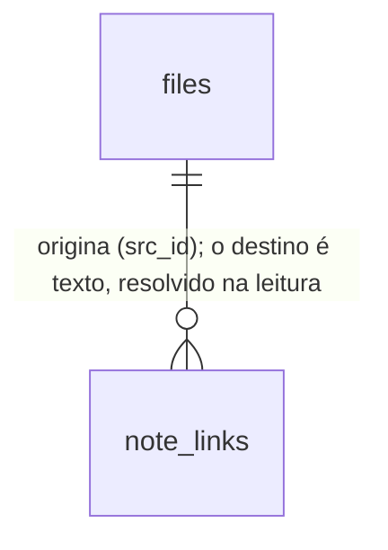

# Cérebro: correções de base — uma só verdade sobre links, política em toda leitura, busca por palavras que acha frases

## Problem

O Segundo Cérebro mostra à pessoa e aos agentes um retrato do acervo que não é o que o acervo diz. Levantamento no código em
`chore/cerebro-v3-roteiro` (a partir de `main` em `b2f1e70`), confirmado pela pesquisa de 29/10/2026
(`reports/Segundo cérebro para agentes.md`, inventário `research_notes/Segundo cérebro para agentes/mordomoos_atual.md`):

- **Um `[[wikilink]]` não liga nada.** O indexador guarda os links duas vezes: em `note_links` (wikilinks e links Markdown,
  fora de blocos de código, resolvidos na hora da consulta) e em `file_links` (só `[x](caminho)`, extraído por uma expressão
  regular que não pula bloco de código, resolvido para um id na hora da escrita e com um mapa de pendentes em `meta`). O grafo
  (`core/src/memory/graph.ts:72-84`), os relacionados (`graph.ts:176-198`), as órfãs da higiene (`hygiene.ts:94-103`) e os
  ponteiros do recall (`recall.ts:423-440`) leem só o segundo. Uma nota ligada só por `[[…]]` não tem aresta no grafo e é
  contada como órfã; um exemplo de link dentro de um bloco de código vira aresta.
- **O grafo e os relacionados mostram o que a política já esconde.** `GET /api/memory/search` e `GET /api/memory/links` filtram
  cada linha pela política de hoje (`rowFilter`); `GET /api/memory/graph` e `GET /api/memory/related` não
  (`apps/api/src/routes/memory.ts:108-120`). Um arquivo que o dono acabou de excluir (ou que passou a ser privado) continua
  com nome, caminho, título e etiquetas no grafo até a próxima passada completa.
- **A busca devolve menos do que pede.** O `LIMIT` corta no SQL e o filtro de política vem depois (`search.ts:74-101`); com
  linhas excluídas entre as primeiras, a página volta curta ou vazia, embora haja resultados permitidos.
- **Uma pergunta em frase não acha nada.** A busca da interface exige todas as palavras, com prefixo e sem tirar palavras
  vazias (`search.ts:30-38`): "o que decidimos sobre o orçamento" exige `"o"*`, `"que"*`, `"decidimos"*`… e devolve zero
  linhas. O teste do próprio projeto mede: no corpus fixo, a busca estrita acha 5 de 12 perguntas e o `OR` das palavras acha
  11 (`tests/memory.semantic.test.ts:245-275`). O recall dos agentes já tira as palavras vazias e pontua por cobertura
  (`recall.ts:142-160`, `234-257`); a tela não.
- **Um erro de busca parece "nenhum resultado".** As duas telas descartam a falha com `.catch(() => undefined)` e continuam
  mostrando os resultados velhos (`apps/command-centre/src/views/SecondBrain.tsx:324-328`,
  `nucleo/scenes/BrainScene.tsx:693-698` e `782-786`).
- **O mapa que os agentes leem envelhece.** `ROUTER.md` e `areas/*.md` só são regenerados pelo botão, pela rota
  `POST /api/memory/routers` ou pela CLI `mordomo index`; a reindexação pela rota e pelo sentinela `fsWatch` não os toca
  (`routes/memory.ts:94-98`, `sentinels/fsWatch.ts:126-131`). E `generateRouters` grava sempre, mesmo sem mudança
  (`routers.ts:126-150`), o que impede ligá-lo ao fim de uma passada sem que o sentinela veja a própria escrita.

Ninguém deu métrica de uso; o número medido é o do corpus fixo (5 contra 11 de 12).

Quando isto sair: o grafo, a higiene, os relacionados e o recall contam os mesmos links que o painel de backlinks; nada que a
política esconde aparece em rota alguma; uma frase acha as notas que têm parte das palavras, na ordem de quantas têm; um erro
de busca aparece como erro; e o `ROUTER.md` acompanha o índice sem laço de reindexação.

## Flow

Reutiliza `note_links` e o resolvedor de `core/src/memory/links.ts` (`resolveWikilink`), o `extractLinks` de `linkParser.ts`,
o `rowFilter` do `MemoryIndexer`, as palavras vazias e a dobra de `extractKeywords` (`recall.ts`) e o padrão de erro com
"Tentar de novo" da seção de links (`LinksSection`); nenhuma segunda implementação de resolução, de política ou de palavras.

1. Leitura de links → `linkEdges` (new, door 2) em `core/src/memory/links.ts` (exists) lê `note_links`, resolve cada destino na
   hora (caminho absoluto para o link Markdown, `resolveWikilink` em lote para o wikilink) e devolve arestas entre ids
   permitidos pelo `allow` recebido.
2. `buildGraph`, `relatedFiles` (exists, `graph.ts`) e as órfãs de `memoryHygiene` (exists, `hygiene.ts`) passam a ler
   `linkEdges` e a receber o `allow`; os ponteiros do recall (exists, `recall.ts`) leem os links da seção vencedora por
   `extractLinks` e os resolvem pelo mesmo resolvedor.
3. Escrita → `MemoryIndexer` (exists) deixa de escrever `file_links` e o mapa `index.pending_links`; a migração 22 (door 1)
   apaga os dois.
4. Busca → `searchFiles` (exists) monta a consulta pelas palavras de `extractKeywords`, pede ao FTS o `AND` e, se faltar, o
   `OR` (door 3), aplica o `allow` antes de cortar no `limit`; `SemanticSearch.search` (exists) recebe as linhas já filtradas.
5. Rotas `memory.graph` e `memory.related` (exists, `apps/api/src/routes/memory.ts`) passam `ctx.indexer.rowFilter()`;
   `memory.related` responde `404 not_found` para um id que a política recusa ou que não existe (door 4).
6. Fim de passada → `memory.index` (exists) e `FsWatchSentinel.flush` (exists) chamam `generateRouters` (exists) quando a
   passada mudou alguma linha; `generateRouters` grava um arquivo só quando os bytes diferem.
7. Interface → `SecondBrain.tsx` (exists) e `BrainScene.tsx` (exists) guardam o erro da busca e dos relacionados e o mostram no lugar
   da lista, com "Tentar de novo".

## Impact

| Front         | What changes                                                                                                                                                                                                                                                                                                                                                                                                                             |
| ------------- | ---------------------------------------------------------------------------------------------------------------------------------------------------------------------------------------------------------------------------------------------------------------------------------------------------------------------------------------------------------------------------------------------------------------------------------------- |
| domain        | existing term: aresta `markdown-link` do grafo significava "link `[x](y)` resolvido na escrita"; agora significa "link Markdown de `note_links` resolvido na leitura" e ganha a irmã `wikilink` — quem ramifica hoje: `brain/engine/world.ts` (tipos desconhecidos viram "other"), `nucleo/scenes/brainReading.ts:151`, as legendas de `BrainScene.tsx:132`, `BrainSceneMenu.tsx:25`, `brain/PreviewPanel.tsx:57-63`                     |
| domain        | existing term: `same-area` era um tipo de aresta declarado e nunca emitido (`graph.ts:25`, `contracts/src/api/memory.ts:140`); sai do contrato e das três tabelas de rótulos da interface                                                                                                                                                                                                                                                |
| domain        | existing term: busca `mode=text` significava "todas as palavras, com prefixo"; agora significa "as palavras que importam, primeiro todas, depois qualquer uma" — quem ramifica hoje: as duas telas do cérebro, a paleta (`CommandPalette.tsx:363`), `useUniversalSearch.ts:32`, `SemanticSearch.search` (a metade de texto da fusão) e o C46 do `cerebro-v2` (`tests/memory.semantic.test.ts:245-275`), que afirma 5 de 12 para o `text` |
| domain        | existing term: órfã da higiene significava "sem link `[x](y)` nos dois sentidos"; agora significa "sem link de `note_links` que resolva, nos dois sentidos" — quem lê hoje: `GET /api/memory/hygiene` (a interface calcula as próprias órfãs em `brain/engine/graph.ts:106-126` e não muda)                                                                                                                                              |
| stored data   | migração 22 apaga `file_links` e a chave `index.pending_links` de `meta`; nada a reconstruir: `note_links` já tem todo link desde a migração 20 e o preenchimento sem reler o disco (`indexer.ts:874-898`). Um banco que volte a uma versão anterior do código não acha `file_links` (ver `Landing`, door 1)                                                                                                                             |
| contrato REST | `GET /api/memory/related` passa a declarar `404`; `GET /api/memory/graph` passa a ter arestas `wikilink`; nenhuma rota nova                                                                                                                                                                                                                                                                                                              |
| arquivos      | `ROUTER.md` e `areas/*.md` passam a ser regravados ao fim de uma passada que mudou linhas, e só quando mudam; o `mtime` deles deixa de mudar a cada clique em "Atualizar"                                                                                                                                                                                                                                                                |

## Relations

One-way constraints: `file_links` deixa de existir (door 1); nenhuma aresta entre arquivos é guardada com o id do destino.

## Surface

| Route                            | In                | Out                                                                      | Status       |
| -------------------------------- | ----------------- | ------------------------------------------------------------------------ | ------------ |
| `GET /api/memory/related` (muda) | query `id`        | `file` · `why` por linha, só arquivos que a política permite             | `200`, `404` |
| `GET /api/memory/graph` (muda)   | query sem mudança | `edges[].kind` ∈ `markdown-link`, `wikilink`, `same-dir`, `related`      | `200`        |
| `GET /api/memory/search` (muda)  | query sem mudança | as linhas na ordem: todas as palavras, depois mais palavras, depois BM25 | `200`, `409` |

## Landing

| One-way door             | Literal shape                                                                                                                                                                                                                                                                        | Alternative rejected                                                                                                                                                                                                                        |
| ------------------------ | ------------------------------------------------------------------------------------------------------------------------------------------------------------------------------------------------------------------------------------------------------------------------------------ | ------------------------------------------------------------------------------------------------------------------------------------------------------------------------------------------------------------------------------------------- |
| 1. Fim de `file_links`   | migração `version: 22`: `DROP TABLE IF EXISTS file_links; DELETE FROM meta WHERE key = 'index.pending_links';` (o `CREATE TABLE file_links` das migrações antigas fica, como história); nenhum código lê ou escreve a tabela                                                         | manter a tabela parada: uma segunda verdade que o próximo leitor volta a usar (foi o que aconteceu com o grafo); continuar escrevendo nas duas: o defeito de hoje, e a regra de `cerebro-v2` door 1 já recusou guardar o id do destino      |
| 2. Arestas lidas na hora | `linkEdges(db, allow, ids?) → Array<{ source: number; target: number; kind: "markdown-link" \| "wikilink"; line: number }>`, um par por (origem, destino, tipo), sem laço; o resolvedor carrega `files` uma vez por chamada e resolve em memória                                     | resolver cada link com uma consulta (o `resolveWikilink` de hoje, por linha): com 3 000 nós e dezenas de milhares de links são dezenas de milhares de consultas por grafo; uma tabela materializada de destinos: volta ao defeito da door 1 |
| 3. Consulta de palavras  | `extractKeywords(q)` (até 8, sem palavras vazias PT/EN, dobradas); consulta 1 `"k1"* "k2"*…` (todas); se devolver menos que `limit`, consulta 2 `"k1"* OR "k2"* OR …`; ordem final: as linhas da 1, depois as da 2 por número de palavras presentes (desc) e BM25 (asc), sem repetir | só o `OR`: perde a ordem "tem tudo primeiro" que a busca estrita dá de graça; reescrever a pergunta por LLM ou HyDE: rede e custo para a busca de cada tecla, e a pesquisa mede ganho pequeno (Anthropic, 2024)                             |
| 4. `404` de relacionados | `memory.related`: `errors: [notFound("The file")]`, igual a `memory.links`; um id recusado pela política responde como um id que não existe                                                                                                                                          | responder `200` com lista vazia: diz "não há relacionados" sobre um arquivo que a pessoa não pode ver, e diverge da rota de links                                                                                                           |

- Nothing else in this change is hard to reverse: a mensagem de erro das telas, a ordem das linhas dentro do mesmo número de
  palavras e o lugar da regeneração dos roteadores mudam por refatoração.

## Criteria

### S1: uma só verdade sobre links (P1)

O grafo, os relacionados, as órfãs e os ponteiros do recall contam os mesmos links que o painel de backlinks.

**Acceptance Criteria**

1. WHEN note A holds `[[B]]` and B is an indexed Markdown file THEN `GET /api/memory/graph` SHALL return one edge `{ source: A, target: B, kind: "wikilink" }` while both are among the nodes.
2. WHEN note A holds `[texto](./b.md#parte)` and `b.md` is indexed THEN the graph SHALL return one edge `kind: "markdown-link"` from A to B, and WHEN A holds the same link twice THEN the graph SHALL return that edge once.
3. IF a link sits inside a fenced code block or an inline code span THEN the graph, the related files, the orphan count and the recall pointers SHALL ignore it.
4. WHEN a wikilink key matches several files THEN the graph SHALL draw only the edge to the file `GET /api/memory/links` resolves it to.
5. WHEN B is renamed to C after A was indexed THEN the next graph SHALL have no edge from A to C and no edge from A to the old id, and WHEN a file named B is created later THEN the next graph SHALL have the edge from A to it, with no pass over A in between.
6. WHEN note A's only links are wikilinks to and from other notes THEN `GET /api/memory/hygiene` SHALL NOT list A as `orphan`; WHEN a Markdown file has no link of `note_links` that resolves, in either direction, THEN it SHALL list it.
7. WHEN `GET /api/memory/related?id=A` is called and A has a wikilink to B THEN the answer SHALL list B with `why` "Connected by a wikilink.", and a Markdown link SHALL keep "Connected by a markdown link."
8. WHEN the winning section of a recall holds `[[B]]` THEN the recall SHALL follow it to B like a Markdown link, under the same `pointerLimit`.
9. WHEN migration 22 runs on a database that has `file_links` rows and the key `index.pending_links` THEN it SHALL drop the table and delete the key, change no row of `files` or `note_links`, and running it on a database without them SHALL succeed.
10. The system SHALL contain no read or write of `file_links` outside `core/src/db/migrations.ts`.
11. The graph contract SHALL list the edge kinds `markdown-link`, `wikilink`, `same-dir` and `related`, and SHALL NOT list `same-area`.
12. WHEN the graph is built for 3 000 nodes with 20 000 `note_links` rows THEN `linkEdges` SHALL issue a fixed number of queries that does not grow with the number of links.

**Independent test:** indexar um acervo com notas ligadas só por wikilinks e um link dentro de um bloco de código; o grafo
mostra as arestas `wikilink`, a higiene não lista as notas como órfãs e o bloco de código não gera aresta.

### S2: a política em toda leitura (P1)

Nada que a política de hoje esconde aparece no grafo, nos relacionados ou numa página de busca curta.

**Acceptance Criteria**

13. IF an indexed row's file is excluded by today's policy (a user exclude added after the pass, the home's `config/` or `logs/`, a secret name) THEN `GET /api/memory/graph` SHALL NOT return it as a node, SHALL NOT return an edge that touches it, and SHALL NOT count it in `totalFiles`.
14. IF the `id` of `GET /api/memory/related` names a row the policy excludes, or no row THEN the route SHALL answer `404 not_found`; WHEN it names an allowed row THEN no file in the answer SHALL be one the policy excludes.
15. WHEN excluded rows are among the best text matches of `GET /api/memory/search` THEN the route SHALL return up to `limit` allowed rows, as many as exist among the matches, in the same order the matches would have without the excluded rows.
16. WHEN the query is empty THEN `GET /api/memory/search` SHALL return up to `limit` allowed rows by `mtime` descending, with excluded rows skipped before the cut.

**Independent test:** indexar, acrescentar um exclude que cobre metade dos arquivos sem reindexar, e pedir grafo,
relacionados e busca: nenhum nome excluído aparece e a busca devolve a página cheia dos permitidos.

### S3: uma frase acha notas (P1)

A busca por palavras tira o que não importa e, quando não há nota com todas as palavras, devolve as que têm mais.

**Acceptance Criteria**

17. WHEN the query is "o que decidimos sobre o orçamento" THEN the system SHALL search only the words `extractKeywords` keeps (no `o`, `que`, `sobre`), and a note that holds "orçamento" and not "decidimos" SHALL be returned.
18. WHEN at least one note holds every kept word THEN the notes that hold every word SHALL come before any note that holds only some of them.
19. WHEN no note holds every kept word THEN the system SHALL return the notes that hold at least one, ordered by how many of the kept words they hold (more first) and then by BM25.
20. WHILE the evaluation corpus is the fixed one (`tests/fixtures/semantic-corpus.json`, 24 notes, 12 questions) and the semantic search is off, `GET /api/memory/search` SHALL put the expected note in the first three for at least 11 of the 12 questions.
21. IF every word of the query is a stopword or punctuation THEN the system SHALL search the words as typed (the strict query of today), and IF nothing is left after that THEN it SHALL answer the empty-query listing.
22. The system SHALL return each file at most once per answer.

**Independent test:** a pergunta em frase do corpus fixo, com a busca semântica desligada, devolve a nota esperada entre as
três primeiras.

### S4: erro de busca é erro (P1)

**Acceptance Criteria**

23. IF the search request of the Second Brain screen or of the Núcleo brain scene fails (network, `4xx`, `5xx`) THEN the screen SHALL replace the hit list with the message "A busca falhou." / "Search failed." beside an icon and a "Tentar de novo" / "Try again" button, and SHALL NOT show the hits of an earlier query.
24. WHEN the person chooses "Tentar de novo" THEN the screen SHALL repeat the request for the current text, and WHEN it succeeds THEN the message SHALL go away and the new hits SHALL show.
25. IF the related-files request of the Núcleo brain scene fails THEN the scene SHALL show "Não foi possível carregar os relacionados." / "Could not load related files." with "Tentar de novo" in the place of the list, and SHALL NOT show the related files of the previously selected node.
26. The new text SHALL be 12px minimum, colors only from tokens, the error announced with `role="alert"`, and the screens SHALL pass axe at WCAG A/AA in both themes.

**Independent test:** derrubar a rota de busca no teste da interface e digitar; a mensagem e o botão aparecem e os
resultados velhos somem.

### S5: o mapa acompanha o índice (P2)

**Acceptance Criteria**

27. WHEN `POST /api/memory/index` or a pass started by the `fsWatch` sentinel finishes with `added + updated + removed > 0` THEN the system SHALL regenerate `memory/ROUTER.md` and `memory/areas/*.md` before announcing `index.finished`.
28. WHEN a router file would be written with the bytes it already holds THEN `generateRouters` SHALL NOT write it, and its `mtime` SHALL stay the same.
29. WHEN the regeneration of a finished pass rewrites `ROUTER.md` and the `fsWatch` sentinel indexes again THEN the second pass SHALL finish with no router file written, so the sentinel fires at most once for one regeneration.
30. IF the regeneration fails (a router path is a link out of `memory/`, the disk refuses the write) THEN the pass SHALL still answer its `stats`, `index.finished` SHALL still be announced, and the failure SHALL be logged with the code `routers_failed`.

**Independent test:** mudar uma nota, reindexar pela rota, e ver o `ROUTER.md` com o dia novo; reindexar de novo sem mudança
e ver o `mtime` igual.

## Out of scope

| Excluded                                                                        | Why                                                                                                                         |
| ------------------------------------------------------------------------------- | --------------------------------------------------------------------------------------------------------------------------- |
| Radicalização (stemming) em português no FTS                                    | exige um tokenizador próprio ou uma coluna de termos dobrados (outra door de esquema); entra em `cerebro-busca-significado` |
| Escolher os nós do grafo por conexão em vez de `mtime`, grafo local como padrão | é mudança de exibição; entra em `cerebro-vista-notas`                                                                       |
| Normalizar sujeito e predicado dos fatos (R8 da pesquisa)                       | é da camada de fatos; entra em `cerebro-memoria-confiavel` com a bi-temporalidade                                           |
| Consolidação com diff, proveniência e teto do `MEMORY.md` (R6, R7)              | idem                                                                                                                        |
| Reescrever links ao renomear                                                    | decisão do dono já registrada (cerebro-v2, pergunta 3); a feature mostra o link quebrado, não reescreve                     |

## Assumptions

| Assumption                         | Chosen default                                                                                                                                                                                                                      | Rationale                                                                                                                                                                 | Confirmed? |
| ---------------------------------- | ----------------------------------------------------------------------------------------------------------------------------------------------------------------------------------------------------------------------------------- | ------------------------------------------------------------------------------------------------------------------------------------------------------------------------- | ---------- |
| Ordem do novo roteiro              | correções (esta) → contextos de trabalho → skill de organização → vista de notas → faxina guiada → memória confiável → rituais → busca por significado → perguntar ao cérebro → entidades e resumos (`.specs/roadmap.md`, C1 a C10) | o que está quebrado e o vazamento de política vêm antes; o contexto vem logo depois porque a skill, a vista e a faxina operam sobre um contexto; o resto segue a pesquisa | n          |
| Peso das palavras na ordem do `OR` | contagem simples de palavras presentes, sem peso por raridade                                                                                                                                                                       | o BM25 já pesa raridade como desempate; um segundo peso é ajuste fino que o conjunto de avaliação da feature de busca vai medir                                           | n          |
| Mensagens de erro                  | texto fixo, sem a mensagem técnica do servidor                                                                                                                                                                                      | a mensagem do servidor é inglês técnico e às vezes cita caminho; o detalhe vai ao console, como nas outras telas                                                          | n          |

**Open questions:**

| #   | Kind   | Question                                                                                                                                                                                                                                                                                                                                                                                                                                                                                                                       | Until answered                                                                                 |
| --- | ------ | ------------------------------------------------------------------------------------------------------------------------------------------------------------------------------------------------------------------------------------------------------------------------------------------------------------------------------------------------------------------------------------------------------------------------------------------------------------------------------------------------------------------------------ | ---------------------------------------------------------------------------------------------- |
| 1   | blocks | O C46 do `cerebro-v2` (aprovado) afirma que a busca `text` acha **5** de 12 perguntas. Esta feature faz o `text` achar ao menos 11 (AC 20). Recomendo emendar o C46 por uma decisão nova (AD-037): o número 5 passa a ser medido pela consulta estrita, que continua existindo como a primeira das duas consultas (door 3). A alternativa é manter o `text` estrito e dar a busca relaxada só ao modo `auto`, o que contraria o AC 43 do `cerebro-v2` ("`auto` com a busca semântica desligada devolve o `text` sem mudança"). | AC 20 não pode ser provado sem mudar um teste aprovado; a construção não começa sem a resposta |

## Observable

| Surface                                              | Decision                                   | Landing                                                                                         |
| ---------------------------------------------------- | ------------------------------------------ | ----------------------------------------------------------------------------------------------- |
| screen Segundo Cérebro (busca)                       | empty state                                | existing - sem texto, a lista não aparece (`BrainPanel.tsx:163`)                                |
| screen Segundo Cérebro (busca)                       | loading state                              | n/a - busca enquanto digita, com 180 ms de espera; a lista anterior some no erro (AC 23)        |
| screen Segundo Cérebro (busca)                       | error state                                | AC 23, AC 24                                                                                    |
| screen Segundo Cérebro (busca)                       | unauthorised                               | n/a - a interface do dono usa o token do dono; um dispositivo sem `content` cai no erro (AC 23) |
| screen Segundo Cérebro (busca)                       | density and ordering                       | AC 18, AC 19                                                                                    |
| screen Segundo Cérebro (busca)                       | destructive action confirms                | n/a - nada é apagado                                                                            |
| screen Núcleo, cena do cérebro (busca, relacionados) | empty, loading, error, unauthorised states | AC 23, AC 25; vazio e carregando como hoje                                                      |
| screen Núcleo, cena do cérebro                       | density and ordering                       | existing - limite de 8 resultados                                                               |
| API `GET /api/memory/related`                        | error shape and codes                      | AC 14                                                                                           |
| API `GET /api/memory/graph`                          | error shape and codes                      | existing - sem erro novo; AC 13 decide o que sai                                                |
| API `GET /api/memory/search`                         | error shape and codes                      | existing - `409 semantic_disabled` do `cerebro-v2`                                              |
| API `GET /api/memory/hygiene`                        | response shape                             | AC 6                                                                                            |
| all changed `/api/memory/*` routes                   | who may call                               | existing - escopo `content`, sem mudança                                                        |
| all changed `/api/memory/*` routes                   | versioning, rate limits                    | n/a - `/api/v1` é o mesmo conjunto de rotas e nenhuma ganha limite próprio                      |
| command `mordomo index`                              | output, flags, exit codes                  | existing - já regenera os roteadores (`cli.ts:1394`); AC 28 só evita a escrita igual            |
| collection arestas do grafo                          | grouping, naming, ordering, duplicates     | AC 1, AC 2, AC 4, AC 11                                                                         |
| document `ROUTER.md`                                 | structure, what the reader does next       | existing - o conteúdo não muda; AC 27 decide quando é regravado                                 |

## Sources

- `reports/Segundo cérebro para agentes.md`, roteiro R1 a R5 e R9 — o escopo desta feature.
- `.specs/features/cerebro-v2/plan.md` door 1 (destino guardado como texto, resolvido na leitura) — a regra que esta feature
  estende ao grafo, à higiene e ao recall.
- `.specs/features/design-system/design.md` e `.specs/features/cerebro-v2/design.md` — binding para o texto e o estado de erro
  das telas.
