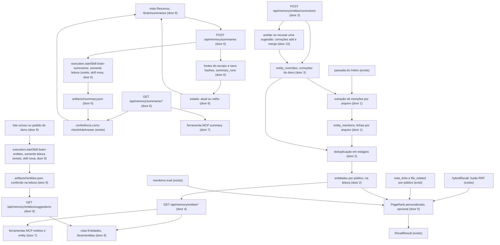
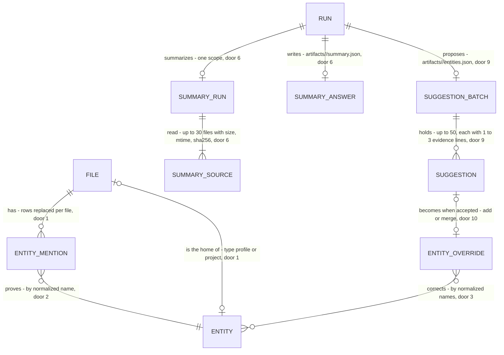

# Cérebro: entidades e resumos — pessoas, projetos, tags e termos derivados das notas, PageRank personalizado no recall, e resumos por área e contexto que sabem quando ficaram velhos

## Problem

O Segundo Cérebro não sabe de quem nem de quê as notas falam, e não tem uma visão curta do que cada área ou contexto diz.
Levantamento no código em `claude/clever-gates-o2zm4x` (HEAD `6c3f3d4`, depois da C10):

- **O nó é o arquivo, e só o arquivo.** Uma linha de `files` é a única unidade do índice (`core/src/db/migrations.ts:66-80`);
  a extração guarda título, até 20 tags e os campos do cabeçalho (`core/src/memory/indexer.ts:918-960`). Não há tabela de
  pessoas, clientes, projetos ou conceitos. A nota de uma pessoa (`type: profile`) e a de um projeto (`type: project`), que
  o guia da C3 define (`skills/organize-brain/resources/guia.md:25-37`), são arquivos como qualquer outro: nada junta as
  notas que falam da mesma pessoa.
- **O mesmo nome escrito de duas formas são duas coisas.** `#Cliente-X`, `cliente x` e `Cliente X` não se encontram fora da
  busca por palavras; a deduplicação que existe é a de arquivos quase iguais da faxina (`core/src/memory/minhash.ts`, 5
  palavras por telha) e a de fatos por sujeito normalizado (C7). A pesquisa do roteiro (A3) registra que a normalização
  prévia sozinha corta de 10% a 30% das entidades e que a deduplicação de ponta roda em estágios (exato, portão de
  entropia, MinHash de 3-gramas com Jaccard ≥ 0,9), só com CPU.
- **O recall não usa o grafo.** O recall híbrido da C9 funde palavras e vetores por RRF e segue links dentro do teto
  (`core/src/memory/recall.ts:970` em diante); `note_links` e `file_related` não pesam na ordem. A pesquisa cita o
  HippoRAG 2, em que o PageRank personalizado sobre o grafo ajuda a expandir e reordenar (tirar as passagens derruba o
  Recall@5 de 87,1 para 81,0), e diz que essa transferência para cofres pessoais é inferência, sem benchmark.
- **Nenhum resumo diz o que uma área ou um contexto contém.** O mapa de contexto da C2 lista até 30 arquivos como
  `título → caminho` (`core/src/memory/routers.ts:245-300`) e o índice de área lista os mais recentes: são listagens, não
  resumos. O `_resumo.md` de um contexto é o texto que o dono escreve na entrevista da C3 (`skills/organize-brain/SKILL.md:132-135`),
  não uma síntese do que as notas dizem. A pesquisa (A4) pede resumos sob demanda, com o hash das fontes e marca de
  "velho", e registra a ressalva de que resumos genéricos deram "ganhos limitados" na recuperação (Anthropic).

A fonte não traz número de uso, de suporte ou prazo; a prioridade é a do roteiro (C11, fase P3, a última linha).

Quando isto sair: o dono abre "Entidades" no cérebro e vê as pessoas, os projetos, as tags e os termos que as notas citam,
cada um com as notas e as linhas onde aparece; junta duas grafias da mesma coisa, separa o que o sistema juntou errado e tira
o que não é entidade, e isso vale nas próximas indexações. O recall pode usar o grafo para achar a nota vizinha que responde.
E em "Resumos" o dono pede um resumo de uma área ou de um contexto, lê parágrafos com as citações, e vê quando ele ficou
velho porque as notas mudaram.

## Flow

Reusa em vez de duplicar: a passada do índice e o padrão de linhas por arquivo de `note_links`/`note_tasks` (o indexador
substitui as linhas de cada arquivo e uma chave de versão em `meta` faz a passada de preenchimento depois da migração), a
dobra de acentos de `mentions.ts`, o MinHash de `minhash.ts` (com parâmetros próprios para nomes), a ordem "mais ligado por
dentro, depois mais recente" do mapa de contexto (`renderContextMap`), o recall híbrido da C9 e o `mordomo eval`, as tabelas
de arestas por público da C7, a skill somente leitura com resposta conferida na leitura da C10 (`checkAskAnswer`,
`execution.startSkill`), e as regras de pasta e de público (`accessView`).

1. a passada do índice (exists), ao gravar um arquivo Markdown, extrai as menções dele (door 1): o próprio arquivo quando é
   uma nota `type: profile` ou `type: project` (com os `aliases`), cada link resolvido de `note_links` para uma nota dessas,
   cada tag com a linha onde está escrita, e cada termo de 2 a 4 palavras com inicial maiúscula; grava as linhas desse
   arquivo em `entity_mentions` (door 1), substituindo as anteriores, como `note_links`
2. a leitura das entidades (door 2) junta as menções que o público de quem pede vê, normaliza cada nome, aplica a
   deduplicação em estágios e as correções do dono (`entity_overrides`, door 3), e devolve entidades com uma chave estável
   (`<tipo>:<nome normalizado canônico>`); nada disso é guardado: é recalculado e guardado em cache por passada e por público
3. `GET /api/memory/entities` e `GET /api/memory/entities/:key` (door 4) respondem à vista Entidades (door 8) e às ferramentas
   MCP `entities` e `entity` (door 7); `POST /api/memory/entities/corrections` (door 3) grava uma correção do dono
4. o recall híbrido (`hybridRecall`, exists), com `memory.recall.graph.enabled`, roda o PageRank personalizado (door 5) a
   partir dos arquivos da fusão, sobre as arestas que o público vê (`note_links`, `file_related` por público, exist) e as
   coocorrências de entidade, e funde a ordem resultante com a da fusão; `mordomo eval` (exists) ganha o modo `graph`
5. `POST /api/memory/summaries` (door 6) escolhe as fontes do escopo (até 30 arquivos, a ordem do mapa de contexto), grava o
   nome, o tamanho, o `mtime` e o SHA-256 de cada uma em `summary_runs` e inicia a skill `brain-summarize` (door 6) por
   `execution.startSkill` (exists), somente leitura; a skill escreve `artifacts/<run>/summary.json`
6. `GET /api/memory/summaries` e `GET /api/memory/summaries/:scope` (door 6) leem a execução mais nova de cada escopo, conferem o
   arquivo como a C10 confere a resposta (exists) e comparam as fontes gravadas com o índice de hoje: o resumo é `fresh` ou
   `stale`, com quantas fontes mudaram, saíram e quantos arquivos novos entraram; a vista Resumos (door 8) e a ferramenta MCP
   `summary` (door 7) leem dali
7. com `memory.entities.llm.enabled` (door 9), depois de uma passada do índice, sem nenhuma execução aberta e com o último lote
   iniciado há mais de 24 h, ou quando o dono pede, o serviço inicia a skill `brain-entities` (door 9) sobre até 20 arquivos que
   mudaram desde o último lote; a skill escreve `artifacts/<run>/entities.json`, que `GET /api/memory/entities/suggestions`
   confere na leitura (cada evidência precisa estar na linha citada); o dono aceita ou recusa cada sugestão na vista Entidades
   pela rota de correções (door 10): uma entidade aceita vira a correção `add`, e a passada seguinte passa a achar os nomes dela
   no texto (prova `nome`)

## Impact

| Front             | What changes                                                                                                                                                                                                                                                                                                                                                                |
| ----------------- | --------------------------------------------------------------------------------------------------------------------------------------------------------------------------------------------------------------------------------------------------------------------------------------------------------------------------------------------------------------------------- |
| domain            | novo termo: **entidade** (`entity`) - uma pessoa, um cliente ou um negócio (`perfil`), um projeto (`projeto`), uma tag (`tag`) ou um termo (`termo`) que as notas citam, com as menções que a provam; derivada, nunca escrita numa nota; vive em `core/src/memory/entities.ts` (placement)                                                                                  |
| domain            | novo termo: **menção** (`mention`) - um arquivo e uma linha onde uma entidade aparece, com o tipo de prova (`nota`, `link`, `tag`, `termo`, `nome`)                                                                                                                                                                                                                         |
| domain            | novo termo: **correção** - uma decisão do dono sobre a deduplicação (`juntar`, `separar`, `ignorar`, `renomear`), guardada pelo nome normalizado e aplicada a cada leitura                                                                                                                                                                                                  |
| domain            | novo termo: **resumo** (`summary`) - a síntese de uma área ou de um contexto que uma execução de `brain-summarize` escreveu, com citações, e o retrato das fontes que leu; **não é uma nota** e não entra em `memory/`                                                                                                                                                      |
| domain            | novo termo: **resumo velho** (`stale`) - um resumo cujas fontes mudaram, saíram do índice ou do escopo, ou cujo escopo ganhou arquivos depois dele                                                                                                                                                                                                                          |
| domain            | novo termo: **sugestão** (`suggestion`) - uma entidade, um apelido ou uma junção que uma execução de `brain-entities` propôs, com a linha que a prova; só vale depois que o dono aceita, e uma recusada não volta                                                                                                                                                           |
| domain            | termo existente: `type: profile` e `type: project` eram valores do vocabulário do guia da C3 sem efeito; passam a fazer da nota a casa de uma entidade. Quem ramifica em `fields.type` hoje: a faxina (`cleanupScan.ts`), a revisão semanal (projetos, `weeklyReview.ts`) e os painéis (`sources.ts`); nenhum muda                                                          |
| domain            | termo existente: a ordem do recall era a da fusão RRF (C9); com o grafo ligado, passa a ser a fusão da ordem RRF com a do PageRank. Quem consome: a ferramenta MCP `recall`, `mordomo recall`, `GET /api/memory/recall`, as skills `dashboard-answer` e `brain-ask` (C10). Desligado por padrão, nada muda                                                                  |
| stored data       | migração 35 `entidades-resumos` cria `entity_mentions`, `entity_overrides` e `summary_runs`; as menções dos arquivos que não mudaram são preenchidas na primeira passada depois da migração, lendo o texto guardado, como a migração 26 fez com `note_tasks` (`indexer.ts:1190-1215`); nenhuma tabela existente muda                                                        |
| configurações     | `memory.entities = { enabled: true, llm: { enabled: false } }` e `memory.recall.graph = { enabled: false }` (as chaves do topo ficam 30); `memorySkills` padrão ganha `brain-summarize` e `brain-entities`, e casas que gravam a lista a mantêm, como a C10 fez com `brain-ask`                                                                                             |
| custo             | a extração e a deduplicação são CPU da passada do índice; cada resumo e cada lote de sugestões gasta uma execução do provedor padrão: o resumo só quando o dono pede, o lote quando o dono liga a extração por LLM (no máximo um a cada 24 h) ou pede um; o texto dos arquivos do lote vai ao provedor, como em qualquer execução de skill                                  |
| contratos e pinos | 8 rotas novas (177 → 185); migração 34 → 35; códigos de erro novos por recusa nomeada; 3 ferramentas MCP novas (13 → 16) e `MCP_ROUTES` 11 → 14; 2 skills embutidas novas (17 → 19); exportações novas de `@mordomo/contracts`; `docs/memory-guide.md`, `docs/user-manual.md`, `docs/security.md` e `legal/PRIVACY.md` (o texto dos arquivos do lote vai ao provedor) mudam |
| peso              | teto novo acima de `cerebro-perguntar` (AD-047 h), proposto em Assumptions; cada vista é um pedaço próprio, carregado na primeira vez                                                                                                                                                                                                                                       |

## Relations

One-way constraints: uma menção é `(arquivo, linha, tipo de prova, nome normalizado)` e some com o arquivo (door 1); uma
entidade não tem linha própria: é a leitura das menções e das correções, identificada pela chave `<tipo>:<nome normalizado
canônico>` (door 2); uma correção guarda nomes normalizados, nunca ids de entidade, e sobrevive a qualquer reindexação (door
3); um resumo é exatamente uma execução de `brain-summarize`, julgada na leitura, e o retrato das fontes é gravado no início
da execução (door 6); uma sugestão é julgada na leitura e só muda as entidades pela correção que o dono aceita, e uma
sugestão recusada fica guardada pelo nome normalizado para não voltar (doors 9 e 10). No columns and no types here.

## Surface

Só as rotas que esta feature acrescenta ou cuja assinatura muda.

| Route                                   | In                                                                                                                                  | Out                                                                                                                                                                                                                                                                | Status                            |
| --------------------------------------- | ----------------------------------------------------------------------------------------------------------------------------------- | ------------------------------------------------------------------------------------------------------------------------------------------------------------------------------------------------------------------------------------------------------------------ | --------------------------------- |
| `GET /api/memory/entities`              | `kind?`, `q?`, `context?`, `limit?`, `offset?`                                                                                      | `items[]` (`key` · `kind` · `name` · `aliases` · `files` · `mentions`) · `total`                                                                                                                                                                                   | `200`, `400`, `404`               |
| `GET /api/memory/entities/:key`         | `context?`                                                                                                                          | `key` · `kind` · `name` · `aliases` · `home?` (`fileId` · `path`) · `mentions[]` (`fileId` · `path` · `name` · `line` · `proof` · `excerpt`) · `related[]` (`key` · `name` · `kind` · `shared`) · `duplicates[]` (`key` · `name` · `similarity`) · `corrections[]` | `200`, `400`, `404`               |
| `POST /api/memory/entities/corrections` | `action` (`merge`, `separate`, `ignore`, `rename`, `undo`, `accept`, `reject`) · `key` · `other?` · `name?` · `id?` · `suggestion?` | `correction` (`id` · `action` · `names` · `createdAt`) · `entity?`                                                                                                                                                                                                 | `200`, `400`, `403`, `404`, `409` |
| `GET /api/memory/entities/suggestions`  | -                                                                                                                                   | `items[]` (`id` · `kind` · `name` · `aliases` · `mergeWith?` · `evidence[]` (`fileId` · `path` · `line` · `excerpt`) · `state`) · `lastBatch?` (`id` · `status` · `startedAt` · `finishedAt?` · `reason?`) · `nextBatchAt?`                                        | `200`, `403`                      |
| `POST /api/memory/entities/suggestions` | -                                                                                                                                   | `id` · `status`                                                                                                                                                                                                                                                    | `202`, `403`, `409`               |
| `GET /api/memory/summaries`             | -                                                                                                                                   | `items[]` (`scope` (`kind` · `id` · `name`) · `state` · `generatedAt?` · `changes?` (`changed` · `removed` · `added`) · `running` · `lastError?`)                                                                                                                  | `200`, `403`                      |
| `GET /api/memory/summaries/:kind/:id`   | -                                                                                                                                   | `scope` · `state` · `generatedAt?` · `changes?` · `paragraphs[]?` · `sources[]` (`fileId?` · `path` · `name` · `state`) · `run?` (`id` · `provider` · `startedAt` · `finishedAt?`) · `running` · `lastError?`                                                      | `200`, `403`, `404`               |
| `POST /api/memory/summaries`            | `scope` (`kind` · `id`)                                                                                                             | `id` · `status`                                                                                                                                                                                                                                                    | `202`, `400`, `403`, `404`, `409` |
| `GET /api/memory/recall` (muda)         | -                                                                                                                                   | cada item de `answerContext` ganha `graph?` (o lugar no PageRank) quando o grafo está ligado                                                                                                                                                                       | `200`, `400`, `404`               |

## Landing

| One-way door                              | Literal shape                                                                                                                                                                                                                                                                                                                                                                                                                                                                                                                                                                                                                                                                                                                                                                                                                                                                                                                                                                                                                                                                                                                                                                                                                                                                                                                                                                                                                                                                                                                                                                                                                                                                                                                                                                                                                                                                                 | Alternative rejected                                                                                                                                                                                                                                                                                                                              |
| ----------------------------------------- | --------------------------------------------------------------------------------------------------------------------------------------------------------------------------------------------------------------------------------------------------------------------------------------------------------------------------------------------------------------------------------------------------------------------------------------------------------------------------------------------------------------------------------------------------------------------------------------------------------------------------------------------------------------------------------------------------------------------------------------------------------------------------------------------------------------------------------------------------------------------------------------------------------------------------------------------------------------------------------------------------------------------------------------------------------------------------------------------------------------------------------------------------------------------------------------------------------------------------------------------------------------------------------------------------------------------------------------------------------------------------------------------------------------------------------------------------------------------------------------------------------------------------------------------------------------------------------------------------------------------------------------------------------------------------------------------------------------------------------------------------------------------------------------------------------------------------------------------------------------------------------------------- | ------------------------------------------------------------------------------------------------------------------------------------------------------------------------------------------------------------------------------------------------------------------------------------------------------------------------------------------------- |
| 1. Menções por arquivo                    | migração 35 `entidades-resumos`: `entity_mentions(src_id INTEGER NOT NULL REFERENCES files(id) ON DELETE CASCADE, line INTEGER NOT NULL, proof TEXT NOT NULL CHECK (proof IN ('nota','link','tag','termo','nome')), kind TEXT NOT NULL CHECK (kind IN ('perfil','projeto','tag','termo')), name TEXT NOT NULL, norm TEXT NOT NULL, PRIMARY KEY (src_id, line, proof, norm))`, índice em `norm`; as linhas de um arquivo são substituídas a cada vez que ele é gravado, e a chave `index.entity_mentions` de `meta` faz a passada de preenchimento depois da migração; as regras de extração: (a) `nota`: o próprio arquivo, linha 1, quando `type` é `profile` (`perfil`) ou `project` (`projeto`), com o título (ou o nome sem extensão) e cada `alias` como nomes; (b) `link`: cada link resolvido de `note_links` para uma nota dessas, na linha do link; (c) `tag`: cada tag de `files.tags`, na linha onde está escrita (a do `tags:` do cabeçalho); (d) `termo`: cada sequência de 2 a 4 palavras seguidas, na mesma linha, cada uma começando por letra maiúscula (`\p{Lu}`) e com pelo menos 2 letras, fora do cabeçalho, de blocos e trechos de código e de endereços de link, depois de tirar as palavras vazias do começo (as do recall, PT e EN); no máximo 200 menções por arquivo                                                                                                                                                                                                                                                                                                                                                                                                                                                                                                                                                                                               | extrair com um LLM na passada: custa tokens a cada mudança de nota (a pesquisa mede 9,2 milhões de tokens para indexar o MuSiQue no HippoRAG 2) e faz o índice depender de rede; guardar a entidade com id próprio na passada: um id muda a cada reindexação e as correções do dono passariam a apontar para nada                                 |
| 2. Nome normalizado, chave e deduplicação | `norm(nome)` = NFC → minúsculas → sem diacríticos (a dobra de `mentions.ts`) → todo caractere que não é letra ou dígito vira espaço → espaços juntos → `trim`; a chave de uma entidade é `<kind>:<norm canônico>`; os estágios, nesta ordem: (1) mesmo `norm` é a mesma entidade, e o `kind` é o de maior precedência entre as menções (`perfil` > `projeto` > `tag` > `termo`); (2) portão: um `norm` com menos de 6 caracteres sem espaços, ou com entropia de Shannon dos caracteres abaixo de 2,0 bits, nunca entra no passo 3; (3) MinHash sobre os 3-gramas de caracteres do `norm` (com os espaços), 32 permutações, LSH em 8 bandas de 4 linhas: Jaccard estimado ≥ 0,9 junta automaticamente, entre 0,7 e 0,9 vira "talvez seja a mesma" (`duplicates`), abaixo de 0,7 nada; o nome mostrado é o da menção `nota`, senão o mais frequente; um `termo` só é entidade com menções em pelo menos 2 arquivos que o público vê; uma entidade com menções em mais de 50 arquivos é um "hub" e não entra nas arestas da door 5                                                                                                                                                                                                                                                                                                                                                                                                                                                                                                                                                                                                                                                                                                                                                                                                                                                              | reusar `minhashSignature` de `minhash.ts` como está: suas telhas são de 5 palavras (para notas), e um nome de duas palavras não tem telha nenhuma; aceitar Jaccard ≥ 0,8 como a faxina: em nomes curtos junta "Ana Souza" e "Ana Sousa", duas pessoas possíveis, e a pesquisa (Graphiti) usa 0,9                                                  |
| 3. Correções do dono                      | `entity_overrides(id INTEGER PRIMARY KEY, action TEXT NOT NULL CHECK (action IN ('merge','separate','ignore','rename','add','reject')), a TEXT NOT NULL, b TEXT, name TEXT, created_at INTEGER NOT NULL, undone_at INTEGER)`, em nomes normalizados: `merge a b` junta as entidades de `a` e `b` (vence sobre o passo 3 e sobre o portão), `separate a b` impede que `a` e `b` se juntem pelo passo 3 (nunca separa um `norm` igual), `ignore a` tira `a` das entidades (as menções ficam), `rename a name` troca o nome mostrado; `undo id` grava `undone_at` e a correção deixa de valer; `POST /api/memory/entities/corrections` com escopo `owner`; aplicadas a cada leitura, na ordem de `created_at`; `409 correction_conflict` para `merge` de um par que tem `separate` ativo (e o contrário); no máximo 2 000 correções ativas (`409 too_many_corrections`)                                                                                                                                                                                                                                                                                                                                                                                                                                                                                                                                                                                                                                                                                                                                                                                                                                                                                                                                                                                                                          | editar as notas (escrever `aliases` no cabeçalho): mexe no texto do dono por uma decisão de índice, e um termo ou uma tag não tem nota onde escrever; guardar por chave de entidade: a chave muda quando a canônica muda, e a correção se perderia                                                                                                |
| 4. Contrato das rotas de entidades        | as três rotas de entidades da `Surface`; as de leitura com escopo `content` e julgadas por público (dono, dispositivo, credencial de execução e principal `mcp` da C10, cada um vendo só as menções de arquivos que lê, com as regras de pasta e a política de hoje), a de correção `owner`; `kind` um de `perfil`, `projeto`, `tag`, `termo` (`400 validation`); `limit` 1 a 200 (padrão 50), `offset` 0 a 100 000; `q` casa o `norm` por prefixo de palavra; `context` restringe as menções ao contexto (`404 context_not_found`); a ordem da lista é por número de arquivos, depois por nome; `:key` que nenhuma entidade tem para esse público é `404 not_found`, igual para uma que não existe e uma só de arquivos escondidos; `excerpt` é a linha da menção cortada em 160 caracteres em volta do nome (`MENTION_EXCERPT_MAX`)                                                                                                                                                                                                                                                                                                                                                                                                                                                                                                                                                                                                                                                                                                                                                                                                                                                                                                                                                                                                                                                         | uma rota por tipo de entidade: quatro rotas iguais para uma tabela; devolver as entidades do acervo inteiro a um dispositivo: um nome que só aparece numa pasta escondida dele vazaria pelo índice                                                                                                                                                |
| 5. PageRank personalizado no recall       | `memory.recall.graph = { enabled: false }`; com ele ligado, depois da fusão RRF e antes de abrir as seções: sementes = os 20 primeiros arquivos da fusão, cada um com peso `1/(60 + lugar)`, normalizados; arestas sobre os arquivos que o público vê: `note_links` resolvido nos dois sentidos (peso 1), `file_related` do público (peso = a nota da aresta), coocorrência de entidade não-hub (peso 0,5 por entidade em comum, nos dois sentidos); amortecimento 0,85, até 30 iterações ou até a soma das mudanças ficar abaixo de 1e-6; a ordem final é a fusão RRF (k = 60) da ordem da fusão com a do PageRank; entram no máximo 3 arquivos que não estavam na fusão, todos passando por todos os filtros do recall; nunca roda quando o recall se abstém; `mordomo eval` ganha o modo `graph` (as métricas do recall com o grafo ligado), impresso depois de `hybrid`                                                                                                                                                                                                                                                                                                                                                                                                                                                                                                                                                                                                                                                                                                                                                                                                                                                                                                                                                                                                                   | ligado por padrão: não há medida em cofre pessoal (a pesquisa diz que a transferência é inferência), e o dono decide pelo `mordomo eval` com as próprias perguntas; comunidades e resumos de comunidade (GraphRAG): perdem para o RAG simples em perguntas pontuais e alucinam em perguntas sem resposta (19,27 contra 96,01)                     |
| 6. Resumos: execução, fontes e estado     | escopo `{ kind: "area", id: <nome da área de settings.areas> }` ou `{ kind: "context", id: <id do contexto> }`; `POST /api/memory/summaries` (`owner`) escolhe até 30 fontes do escopo na ordem do mapa de contexto (mais ligadas por dentro por `note_links`, depois mais recentes), só arquivos que o público `agents` lê, grava `summary_runs(run_id TEXT PRIMARY KEY REFERENCES runs(id) ON DELETE CASCADE, scope_kind TEXT NOT NULL CHECK (scope_kind IN ('area','context')), scope_id TEXT NOT NULL, sources TEXT NOT NULL, started_at INTEGER NOT NULL)` com `sources` = JSON `[{ "path", "size", "mtime", "sha256" }]`, e inicia `skills/brain-summarize/SKILL.md` (`mode: read_only`, entradas `scope` e `sources`, esta como a lista de caminhos) por `execution.startSkill`; `memorySkills` padrão ganha `brain-summarize`; `202 { id, status: "running" }`; `400 validation`, `403 owner_only`, `404 scope_not_found` (área ou contexto que não existe), `409 summary_in_progress` (uma execução desse escopo em `queued`, `running` ou `waiting_approval`), `409 skill_unavailable`, `409 empty_scope` (nenhuma fonte); o arquivo `artifacts/<run>/summary.json` = `{ "v": 1, "paragraphs": [{ "text": ≤ 1200, "citations": [1 a 6 { "path", "section" }] }] (1 a 10) }`, no máximo 64 KB, conferido na leitura pelas regras da door 3 da C10 com o escopo = as fontes gravadas; o resumo atual de um escopo é a execução mais nova cuja resposta passa hoje; o estado: `missing` sem nenhum, `fresh`, ou `stale` quando uma fonte saiu do índice ou do escopo (`removed`), quando o tamanho ou o `mtime` de uma fonte mudou **e** o SHA-256 também (`changed`), ou quando o escopo tem arquivos com `mtime` depois do início da execução que não são fontes (`added`); `running` e `lastError` falam da execução mais nova quando ela não é a atual; `GET` com escopo `content` | guardar o resumo como nota em `memory/` (para o recall achar): a IA passaria a escrever no cérebro do dono por padrão, o que a pesquisa do roteiro e a C10 evitam, e a Anthropic mediu ganhos limitados de indexar resumos; regerar sozinho na rotina noturna: cada resumo é uma execução paga, e a consolidação noturna vem desligada (AD-045 b) |
| 7. Ferramentas MCP novas                  | `entities` (`query?`, `kind?`, `limit?` 1 a 50, padrão 20) → uma linha por entidade `<nome> (<tipo>, <n> arquivos)`; `entity` (`name` ou `key` obrigatório) → o nome, o tipo, os apelidos, até 20 menções `<caminho>:<linha> — <trecho>` e as relacionadas; `summary` (`area` ou `context` obrigatório) → o estado e a data numa linha (`Resumo atual de 23/11/2026.` ou `Resumo velho: 3 fontes mudaram, 1 saiu, 2 arquivos novos.`) e os parágrafos com `(<caminho> § <seção>)`; as três leem como agente pelo principal `mcp` (C10, door 5) e entram em `MCP_ROUTES`                                                                                                                                                                                                                                                                                                                                                                                                                                                                                                                                                                                                                                                                                                                                                                                                                                                                                                                                                                                                                                                                                                                                                                                                                                                                                                                       | uma ferramenta que escreve correções: decidir que duas pessoas são a mesma é do dono, e uma sessão de agente com essa ferramenta mudaria o índice dele sem passar pela revisão                                                                                                                                                                    |
| 8. Rotas e lugar das telas                | a vista Entidades é o modo `entities` de `BrainMode`, rota `/brain/entities` (com `?key=` para uma entidade aberta), e a vista Resumos é o modo `summaries`, rota `/brain/summaries` (com `?kind=&id=`), as duas nos dois shells, com as entradas da Revisão semanal (botão da barra do cérebro, linha do menu da cena, comando `global` da paleta); o painel da nota ganha a dobra "Entidades" com as entidades daquela nota                                                                                                                                                                                                                                                                                                                                                                                                                                                                                                                                                                                                                                                                                                                                                                                                                                                                                                                                                                                                                                                                                                                                                                                                                                                                                                                                                                                                                                                                 | uma aba nas Configurações: entidades e resumos são conteúdo do cérebro, lidos como notas, não preferências                                                                                                                                                                                                                                        |
| 9. Sugestões por LLM                      | `memory.entities.llm = { enabled: false }`; `skills/brain-entities/SKILL.md` (`mode: read_only`, entradas `files`, a lista de caminhos do lote, e `known`, os nomes das entidades que já existem e os recusados, para não repetir); o lote: até 20 arquivos Markdown que o público `agents` lê, com `mtime` depois do início do último lote, os mais novos primeiro; com a extração ligada, o serviço inicia um lote ao fim de uma passada do índice quando nenhuma execução está aberta e o último lote começou há mais de 24 h; `POST /api/memory/entities/suggestions` (`owner`) inicia um agora (`202`), com `409 suggestions_in_progress` (um lote aberto), `409 skill_unavailable`, `409 entities_disabled` e `409 nothing_to_read` (nenhum arquivo novo); a extração desligada não impede o pedido do dono; `artifacts/<run>/entities.json` = `{ "v": 1, "suggestions": [{ "kind": "perfil" \| "projeto" \| "termo", "name": 2 a 80 caracteres, "aliases"?: [até 5], "mergeWith"?: <key>, "evidence": [1 a 3 { "path", "line" }] }] (até 50) }`, no máximo 64 KB; conferido na leitura, sugestão por sugestão: uma evidência precisa ser um arquivo do lote, que a política de hoje mostra e fora das pastas escondidas dos agentes, e a linha citada precisa conter o `norm` do nome ou de um apelido (como palavra inteira, depois da dobra); `mergeWith` precisa ser uma chave que existe hoje; uma sugestão que falha sai sozinha, com o motivo no registro do lote, e as outras ficam; uma sugestão cujo `norm` já é de uma entidade (sem `mergeWith`) ou já foi recusado não aparece                                                                                                                                                                                                                                                                                             | aplicar as sugestões sem o dono: um LLM que junta duas pessoas ou inventa um cliente muda o índice e o recall dos agentes sem ninguém ver, o que a C7 proíbe para as escritas de agente; a caixa de revisão da C7 (`memory_proposals`): ela guarda escritas em arquivos, e uma sugestão de entidade não escreve arquivo nenhum                    |
| 10. Aceitar e recusar                     | a rota de correções ganha `accept` e `reject` com `suggestion` (o id); `accept` de uma sugestão sem `mergeWith` grava a correção `add` (`a` = `norm` do nome, `name`, e os apelidos no campo `b` como JSON), com `kind`; com `mergeWith`, grava `merge`; `reject` grava `reject` com o `norm`, que impede a mesma sugestão de voltar; `entity_overrides.action` passa a aceitar `add` e `reject` (migração 35 já nasce com eles); uma entidade `add` entra na leitura com o `kind` da sugestão, e a extração (door 1) ganha a regra (e) `nome`: cada ocorrência, como palavra inteira depois da dobra, de um nome ou apelido de uma entidade `add`, fora do cabeçalho e do código, com a linha; a chave `index.entity_mentions` inclui o SHA-256 da lista ordenada desses nomes, de modo que aceitar ou desfazer um `add` faz a passada seguinte reextrair todos os arquivos pelo texto guardado, sem abrir arquivo; `undo` de um `add` tira a entidade e as menções `nome` dela na passada seguinte                                                                                                                                                                                                                                                                                                                                                                                                                                                                                                                                                                                                                                                                                                                                                                                                                                                                                          | casar os nomes aceitos na hora da leitura, pelo FTS: o custo cresce com o número de entidades aceitas a cada leitura de cada público, e a passada já faz esse trabalho uma vez                                                                                                                                                                    |

- Nothing else in this change is hard to reverse: as palavras vazias do começo de um termo, o corte de 160 caracteres do
  trecho, a ordem e os textos das telas, as frases dos dois `SKILL.md`, o número de menções por página e o tamanho do cache
  mudam por refatoração

## Criteria

### S1: as entidades saem das notas, sem LLM (P1)

Cada passada do índice grava, por arquivo, quem e o quê aquele arquivo cita, e a leitura junta as grafias da mesma coisa.

**Acceptance Criteria**

1. WHEN uma nota Markdown com `type: profile`, título `Ana Souza` e `aliases: [Ana, A. Souza]` é indexada THEN o sistema SHALL gravar uma menção `nota` na linha 1 para cada um dos três nomes, com `kind` `perfil`
2. WHEN uma nota com `type: project` é indexada THEN o sistema SHALL gravar a menção `nota` com `kind` `projeto` e o título como nome, ou o nome do arquivo sem extensão quando não há título
3. WHEN uma nota tem um link que `note_links` resolve para uma nota `perfil` ou `projeto` THEN o sistema SHALL gravar uma menção `link` na linha do link, com o nome da nota de destino
4. WHEN uma nota tem a tag `Cliente-X`, no cabeçalho ou no texto THEN o sistema SHALL gravar uma menção `tag` com o nome `Cliente-X` e o `norm` `cliente x`, na linha onde a tag está escrita
5. WHEN uma linha de texto tem `Reunião com Banco Central do Brasil` THEN o sistema SHALL gravar a menção `termo` `Banco Central`, e SHALL NOT gravar `Reunião` nem `Brasil` sozinhas (uma palavra só)
6. The system SHALL NOT tirar termos do cabeçalho, de blocos e trechos de código, nem de endereços de link, e SHALL tirar do começo de um termo as palavras vazias do recall (`O Projeto Atlas` dá `Projeto Atlas`)
7. The system SHALL gravar no máximo 200 menções por arquivo, as primeiras na ordem do texto
8. WHEN um arquivo é gravado de novo pela passada THEN o sistema SHALL substituir todas as menções dele, e WHEN ele sai do índice THEN as menções dele SHALL sumir
9. WHEN a migração 35 roda sobre um índice já cheio THEN a primeira passada depois dela SHALL preencher as menções dos arquivos que não mudaram, lendo o texto guardado e sem abrir arquivo, e a segunda passada SHALL NOT recalcular nenhuma
10. The system SHALL normalizar cada nome por NFC, minúsculas, sem diacríticos, todo caractere que não é letra ou dígito como espaço, espaços juntos e `trim` (`#Cliente-X`, `cliente x` e `CLIENTE  X` dão `cliente x`)
11. WHEN duas menções têm o mesmo `norm` THEN o sistema SHALL lê-las como uma entidade, com o `kind` de maior precedência (`perfil` > `projeto` > `tag` > `termo`)
12. IF um `norm` tem menos de 6 caracteres sem espaços, ou entropia de Shannon dos caracteres abaixo de 2,0 bits THEN o sistema SHALL NOT juntá-lo a outro pelo MinHash
13. WHEN dois `norm` têm Jaccard estimado ≥ 0,9 sobre os 3-gramas de caracteres (32 permutações, 8 bandas de 4) THEN o sistema SHALL lê-los como uma entidade
14. WHEN dois `norm` têm Jaccard estimado entre 0,7 (inclusive) e 0,9 THEN o sistema SHALL mantê-los separados e listar um nos `duplicates` do outro com a `similarity`
15. The system SHALL mostrar como nome de uma entidade o da menção `nota` quando há, senão o nome mais frequente entre as menções, e no empate o primeiro em ordem alfabética
16. IF um `termo` tem menções em menos de 2 arquivos que o público vê THEN o sistema SHALL NOT listá-lo como entidade
17. WHERE `memory.entities.enabled` é `false` the system SHALL NOT gravar menções, e as rotas de entidades SHALL responder `409 entities_disabled`

**Independent test:** indexar um acervo de seis notas (um perfil com dois apelidos, um projeto, duas notas que ligam para eles, uma com `#Cliente-X` e outra com `cliente x` em tag, duas que citam `Banco Central do Brasil`) e ler a lista: cinco entidades, `cliente x` junta as duas tags, e o termo aparece com dois arquivos.

### S2: as correções do dono valem nas próximas indexações (P1)

O dono junta, separa, ignora e renomeia, e desfaz, e a leitura respeita isso para sempre.

**Acceptance Criteria**

18. WHEN o dono manda `merge` de duas entidades THEN o sistema SHALL lê-las como uma, inclusive quando o portão ou o MinHash as separariam, e depois de uma reindexação completa
19. WHEN o dono manda `separate` de duas entidades que o MinHash juntou THEN o sistema SHALL lê-las como duas, e SHALL NOT listar uma nos `duplicates` da outra
20. IF o dono manda `separate` de dois nomes com o mesmo `norm` THEN o sistema SHALL responder `400 validation`
21. WHEN o dono manda `ignore` de uma entidade THEN o sistema SHALL NOT listá-la nem usá-la nas arestas do grafo, e as menções dela SHALL continuar gravadas
22. WHEN o dono manda `rename` com `name` THEN o sistema SHALL mostrar esse nome, e a chave SHALL continuar a do `norm` canônico
23. WHEN o dono manda `undo` com o `id` de uma correção THEN o sistema SHALL deixar de aplicá-la e mantê-la na lista com `undoneAt`
24. IF o dono manda `merge` de um par que tem `separate` ativo, ou `separate` de um par que tem `merge` ativo THEN o sistema SHALL responder `409 correction_conflict`
25. IF já há 2 000 correções ativas THEN o sistema SHALL responder `409 too_many_corrections`
26. IF quem chama a rota de correções não é o dono THEN o sistema SHALL responder `403 owner_only`
27. IF `key` ou `other` não é uma entidade que o dono vê THEN o sistema SHALL responder `404 not_found`
28. The system SHALL aplicar as correções ativas na ordem de `created_at`, e `GET /api/memory/entities/:key` SHALL listar em `corrections` as que tocam a entidade

**Independent test:** juntar `Ana Souza` e `A. Sousa`, reindexar tudo e ver uma entidade; desfazer e ver duas; separar um par que o MinHash juntou e ver duas.

### S3: as entidades pela API e pelo MCP, por público (P1)

Cada um vê só as entidades e as menções dos arquivos que lê.

**Acceptance Criteria**

29. WHEN alguém pede `GET /api/memory/entities` THEN o sistema SHALL devolver as entidades ordenadas por número de arquivos e depois por nome, cada uma com `key`, `kind`, `name`, `aliases`, `files` e `mentions`, e `total`
30. The system SHALL aceitar `kind` (um dos quatro), `q` (prefixo de palavra do `norm`), `limit` de 1 a 200 (padrão 50) e `offset` de 0 a 100 000, e SHALL responder `400 validation` fora disso
31. WHEN o pedido traz `context` THEN o sistema SHALL contar só as menções de arquivos do contexto, e IF o contexto não existe THEN `404 context_not_found`
32. WHEN alguém pede `GET /api/memory/entities/:key` THEN o sistema SHALL devolver a entidade com `home` quando a nota casa é visível, as menções com arquivo, linha, prova e trecho de até 160 caracteres, as relacionadas (as que dividem arquivos, por número de arquivos em comum, até 10) e os `duplicates`
33. The system SHALL calcular as entidades de um dispositivo, de uma credencial de execução e do principal `mcp` só sobre as menções de arquivos que esse público lê, de modo que um nome que só aparece numa pasta escondida dele não está em nenhuma lista, contagem ou relacionada
34. IF a `:key` não é de uma entidade que o público vê THEN o sistema SHALL responder `404 not_found`, igual para uma que não existe e uma só de arquivos escondidos
35. IF a nota casa de uma entidade está escondida de quem pede THEN o sistema SHALL devolver a entidade sem `home`, e só com as menções visíveis
36. WHEN um agente chama a ferramenta MCP `entities` THEN o sistema SHALL devolver até `limit` (1 a 50, padrão 20) linhas `<nome> (<tipo>, <n> arquivos)`
37. WHEN um agente chama a ferramenta MCP `entity` com `name` ou `key` THEN o sistema SHALL devolver o nome, o tipo, os apelidos, até 20 menções `<caminho>:<linha> — <trecho>` e as relacionadas, e IF nenhuma entidade casa THEN o texto de erro `Entity not found: <nome>`
38. The system SHALL guardar em cache as entidades de cada público até a próxima passada do índice ou a próxima correção

**Independent test:** com uma pasta escondida dos dispositivos onde está a única nota que cita `Projeto Sigilo`, a lista do dono tem o termo, a de um dispositivo não tem, e `GET /api/memory/entities/termo:projeto sigilo` do dispositivo é `404`.

### S4: o grafo ajuda o recall, quando o dono liga (P2)

O PageRank personalizado acha a nota vizinha que responde e reordena, sem nunca tirar o "não encontrei".

**Acceptance Criteria**

39. WHILE `memory.recall.graph.enabled` é `false` the system SHALL devolver o recall exatamente como a C9 devolve, sem o campo `graph`
40. WHEN o grafo está ligado THEN o sistema SHALL rodar o PageRank com amortecimento 0,85, sementes nos 20 primeiros arquivos da fusão com peso `1/(60 + lugar)`, até 30 iterações ou até a mudança somada ficar abaixo de 1e-6
41. The system SHALL montar as arestas do PageRank só sobre os arquivos que o público de quem pede vê: `note_links` resolvido nos dois sentidos (peso 1), `file_related` do público (o peso da aresta) e coocorrência de entidades não-hub e não ignoradas (0,5 por entidade em comum)
42. The system SHALL NOT usar como aresta uma entidade com menções em mais de 50 arquivos
43. WHEN o grafo está ligado THEN a ordem final SHALL ser a fusão RRF (k = 60) da ordem da fusão com a do PageRank, e cada item de `answerContext` SHALL trazer `graph` com o seu lugar no PageRank
44. The system SHALL acrescentar no máximo 3 arquivos que não estavam na fusão, e só arquivos que passam por todos os filtros do recall (política, público, contexto, natureza, escopo)
45. WHEN o recall se abstém THEN o sistema SHALL NOT rodar o PageRank, e a abstenção SHALL ficar como está
46. WHEN o dono roda `mordomo eval` com o grafo ligado THEN o sistema SHALL imprimir a linha do modo `graph` depois da de `hybrid`, com as mesmas três métricas, e sem o grafo ligado SHALL NOT imprimi-la

**Independent test:** num acervo em que a nota que responde só é ligada à nota que casa as palavras, o recall com o grafo desligado não a traz e com o grafo ligado a traz entre os 3 primeiros; com uma pergunta sem palavra do índice, o recall se abstém nos dois modos.

### S5: resumos por área e por contexto, que sabem quando ficaram velhos (P1)

O dono pede um resumo, recebe parágrafos citados, e vê quando as notas mudaram depois dele.

**Acceptance Criteria**

47. WHEN o dono manda `POST /api/memory/summaries` com o escopo de uma área ou de um contexto THEN o sistema SHALL escolher até 30 fontes na ordem do mapa de contexto, gravar o caminho, o tamanho, o `mtime` e o SHA-256 de cada uma, iniciar a skill `brain-summarize` somente leitura com `scope` e `sources`, e responder `202` com o `id` da execução
48. The system SHALL escolher como fontes só arquivos que o público `agents` lê, que a política de hoje mostra e que estão no escopo
49. IF o escopo não existe THEN o sistema SHALL responder `404 scope_not_found`, e IF não tem nenhuma fonte THEN `409 empty_scope`
50. IF já há uma execução de `brain-summarize` desse escopo em `queued`, `running` ou `waiting_approval` THEN o sistema SHALL responder `409 summary_in_progress`, e uma de outro escopo SHALL NOT bloquear
51. IF a skill `brain-summarize` não existe, está desligada ou não está em `memorySkills` THEN o sistema SHALL responder `409 skill_unavailable`
52. IF quem chama `POST /api/memory/summaries` não é o dono THEN o sistema SHALL responder `403 owner_only`
53. WHEN a execução termina em `done` e `summary.json` passa na conferência THEN `GET /api/memory/summaries/:kind/:id` SHALL devolver os parágrafos com cada citação levando `path`, `section`, `name`, `fileId` e a `natureza` quando a nota é `plano`, `hipotese` ou `opiniao`
54. IF `summary.json` cita um arquivo que não é uma das fontes gravadas, uma seção que o arquivo não tem, um arquivo que a política de hoje exclui ou uma pasta escondida dos agentes, passa de 64 KB ou foge do esquema (mais de 10 parágrafos, parágrafo sem citação, mais de 6 citações, texto acima de 1200 caracteres) THEN o sistema SHALL NOT tomá-lo como resumo, e SHALL devolver o motivo em `lastError`
55. The system SHALL tomar como resumo atual de um escopo a execução mais nova cuja resposta passa hoje, e IF uma execução mais nova ainda está aberta THEN `running: true` com o resumo atual mantido
56. WHEN nenhuma execução do escopo passa THEN o estado SHALL ser `missing`
57. WHEN uma fonte saiu do índice ou do escopo THEN o estado SHALL ser `stale` com `changes.removed` contando-a
58. WHEN o tamanho ou o `mtime` de uma fonte mudou e o SHA-256 também THEN o estado SHALL ser `stale` com `changes.changed` contando-a, e WHEN só o `mtime` mudou e o SHA-256 é o mesmo THEN a fonte SHALL contar como igual
59. WHEN o escopo tem arquivos com `mtime` depois do início da execução que não são fontes THEN o estado SHALL ser `stale` com `changes.added` contando-os
60. WHEN nenhuma das três coisas aconteceu THEN o estado SHALL ser `fresh`
61. WHEN o dono pede `GET /api/memory/summaries` THEN o sistema SHALL devolver um item por área de `settings.areas` e por contexto, nessa ordem, cada um com o estado, `generatedAt`, `changes`, `running` e `lastError`
62. WHEN um agente chama a ferramenta MCP `summary` com `area` ou `context` THEN o sistema SHALL devolver a linha de estado (`Resumo atual de <dia>.`, `Resumo velho: <n> fontes mudaram, <n> saíram, <n> arquivos novos.` ou `Ainda não há resumo de <nome>.`) e os parágrafos com `(<caminho> § <seção>)`
63. The system SHALL dar `GET /api/memory/summaries*` com escopo `content`, julgado pelo público de quem pede: um dispositivo SHALL NOT receber um parágrafo que cita um arquivo escondido dele, e o estado dele SHALL contar só fontes que ele vê

**Independent test:** pedir o resumo de uma área de três notas com um adaptador de teste que escreve um `summary.json` válido, ler `fresh`; editar uma das notas e ler `stale` com `changed: 1`; criar uma nota nova na área e ler `added: 1`.

### S6: a vista Entidades (P1)

As entidades, as menções e as correções numa vista do cérebro, nos dois shells, como `design.md` desenha.

**Acceptance Criteria**

64. WHEN o dono aperta o botão "Entidades" da barra do cérebro (moldura), escolhe a linha "Entidades" do menu da cena do cérebro (Núcleo) ou usa o comando "Entidades" da paleta THEN o sistema SHALL abrir `/brain/entities`
65. WHEN a vista abre THEN o sistema SHALL mostrar as abas Perfis, Projetos, Tags e Termos com a contagem de cada uma, a busca e a lista ordenada por número de arquivos, como `design.md` desenha
66. WHEN o dono escolhe uma entidade THEN o sistema SHALL abrir o painel dela com nome, tipo, apelidos, a nota casa, as menções (arquivo · linha · trecho), "Aparece junto com" e "Talvez seja a mesma", e gravar `?key=` na rota
67. WHEN o dono clica numa menção THEN o sistema SHALL abrir o arquivo como a citação de um painel abre (`/brain?sel=<fileId>`)
68. WHEN o dono aperta "Juntar" num item de "Talvez seja a mesma" THEN o sistema SHALL pedir a confirmação do `design.md`, mandar `merge` e mostrar o aviso "Juntadas." com "Desfazer" por 8 s
69. WHEN o dono aperta "São diferentes" THEN o sistema SHALL mandar `separate` e tirar o item de "Talvez seja a mesma"
70. WHEN o dono aperta "Não é uma entidade" THEN o sistema SHALL pedir a confirmação, mandar `ignore` e mostrar o aviso com "Desfazer"
71. WHEN o dono aperta "Renomear" THEN o sistema SHALL abrir o campo com o nome atual, e "Salvar" SHALL mandar `rename`
72. WHEN uma correção volta `409` THEN o sistema SHALL mostrar a mensagem do `design.md` para `correction_conflict` e para `too_many_corrections`
73. WHEN não há entidade nenhuma THEN o sistema SHALL mostrar o estado vazio do `design.md`, que explica de onde as entidades vêm
74. WHEN as entidades estão desligadas (`409 entities_disabled`) THEN o sistema SHALL mostrar o estado "Entidades desligadas" com o botão "Ligar", que grava `memory.entities.enabled: true`
75. The system SHALL mostrar o carregando e o erro com "Tentar de novo" do `design.md`
76. WHEN uma nota é aberta na vista de notas THEN o painel dela SHALL ter a dobra "Entidades" com as entidades daquela nota, cada uma abrindo `/brain/entities?key=`

### S7: a vista Resumos (P1)

Os resumos de cada área e contexto, o estado deles e o botão para gerar, numa vista do cérebro.

**Acceptance Criteria**

77. WHEN o dono aperta o botão "Resumos" da barra do cérebro, escolhe a linha "Resumos" do menu da cena ou usa o comando "Resumos" da paleta THEN o sistema SHALL abrir `/brain/summaries`
78. WHEN a vista abre THEN o sistema SHALL listar as áreas e depois os contextos, cada um com o estado em ícone e texto ("Atual", "Velho: …", "Sem resumo", "Gerando…") e o botão "Gerar" ou "Atualizar", como `design.md` desenha
79. WHEN o dono abre um escopo THEN o sistema SHALL mostrar os parágrafos com as citações `nome § seção` clicáveis e o rótulo de natureza, a data, a linha de estado, as fontes com o estado de cada uma (igual, mudou, saiu) e o cartão "Como este resumo foi feito"
80. WHEN o resumo está `stale` THEN o sistema SHALL mostrar a faixa do `design.md` com as três contagens e o botão "Atualizar"
81. WHILE uma execução do escopo está aberta the system SHALL mostrar "Gerando…" com "Cancelar", mantendo o resumo atual visível
82. WHEN a execução mais nova falhou ou foi recusada THEN o sistema SHALL mostrar a linha de erro com `lastError` e "Tentar de novo", mantendo o resumo atual
83. WHEN o `POST` volta `409 skill_unavailable` THEN o sistema SHALL mostrar "Resumos está desligado" com o botão "Ligar", que acrescenta `brain-summarize` a `memorySkills` sem tirar nenhum item
84. WHEN não há área nem contexto THEN o sistema SHALL mostrar o estado vazio do `design.md`, com o caminho para criar uma área nas Configurações
85. The system SHALL ter todos os textos das duas vistas e da dobra nas duas línguas (`pt-BR` e `en`, as mesmas chaves), passar no axe WCAG A/AA nos dois shells e nos dois temas, e carregar cada vista num pedaço próprio, buscado na primeira vez

### S8: sugestões de entidades por LLM, que só valem quando o dono aceita (P2)

Uma skill lê lotes de notas e propõe entidades, apelidos e junções; o dono aceita ou recusa cada uma, e o que é aceito passa a
ser achado no texto.

**Acceptance Criteria**

86. WHILE `memory.entities.llm.enabled` é `false` the system SHALL NOT iniciar lote nenhum sozinho
87. WHILE a extração por LLM está ligada, WHEN uma passada do índice termina, nenhuma execução está aberta e o último lote começou há mais de 24 h THEN o sistema SHALL iniciar a skill `brain-entities`, somente leitura, sobre até 20 arquivos Markdown que o público `agents` lê, com `mtime` depois do início do último lote, os mais novos primeiro
88. IF nenhum arquivo mudou desde o último lote THEN o sistema SHALL NOT iniciar o lote sozinho, e `POST /api/memory/entities/suggestions` SHALL responder `409 nothing_to_read`
89. WHEN o dono manda `POST /api/memory/entities/suggestions` THEN o sistema SHALL iniciar um lote agora e responder `202` com o `id`, ligada ou não a extração por LLM
90. IF já há um lote aberto THEN o sistema SHALL responder `409 suggestions_in_progress`, e IF a skill não existe, está desligada ou não está em `memorySkills` THEN `409 skill_unavailable`
91. IF quem chama as rotas de sugestões não é o dono THEN o sistema SHALL responder `403 owner_only`
92. The system SHALL dar à skill, como entrada `known`, os nomes das entidades que o público `agents` vê e os nomes recusados
93. WHEN o lote termina em `done` THEN `GET /api/memory/entities/suggestions` SHALL devolver as sugestões que passam na conferência, cada uma com `kind`, `name`, `aliases`, `mergeWith` quando há, e as evidências com arquivo, linha e trecho
94. IF a linha citada por uma evidência não contém o nome nem um apelido da sugestão, como palavra inteira depois da dobra THEN o sistema SHALL tirar essa sugestão, manter as outras e registrar o motivo no lote
95. IF uma evidência cita um arquivo que não é do lote, que a política de hoje exclui ou que está numa pasta escondida dos agentes THEN o sistema SHALL tirar essa sugestão
96. IF `entities.json` passa de 64 KB, não é JSON ou foge do esquema da door 9 THEN o sistema SHALL NOT mostrar sugestão nenhuma do lote e SHALL devolver o motivo em `lastBatch.reason`
97. The system SHALL NOT mostrar uma sugestão cujo nome normalizado já é de uma entidade (sem `mergeWith`), já foi recusado, ou cujo `mergeWith` não existe hoje
98. WHEN o dono aceita uma sugestão sem `mergeWith` THEN o sistema SHALL gravar a correção `add`, e a entidade SHALL aparecer na lista com o `kind` da sugestão
99. WHEN uma entidade `add` existe THEN a passada seguinte SHALL gravar uma menção `nome` em cada linha onde um nome ou apelido dela aparece como palavra inteira, fora do cabeçalho e do código, reextraindo todos os arquivos pelo texto guardado e sem abrir arquivo
100.  WHEN o dono aceita uma sugestão com `mergeWith` THEN o sistema SHALL gravar a correção `merge` com a entidade indicada
101.  WHEN o dono recusa uma sugestão THEN o sistema SHALL gravar `reject` com o nome normalizado, e a mesma sugestão SHALL NOT aparecer de novo em nenhum lote
102.  WHEN o dono desfaz um `add` THEN a entidade SHALL sair da lista, e as menções `nome` dela SHALL sumir na passada seguinte
103.  WHEN a vista Entidades abre e há sugestões THEN o sistema SHALL mostrar a seção "Sugestões (N)" do `design.md`, cada sugestão com o tipo, o nome, os apelidos, as linhas de prova clicáveis e os botões "Aceitar" e "Recusar"
104.  The system SHALL mostrar na vista o interruptor "Sugestões por IA" (que grava `memory.entities.llm.enabled`), o botão "Pedir sugestões agora", o estado do último lote e, com a extração ligada, quando o próximo lote pode começar
105.  The system SHALL dizer em `legal/PRIVACY.md` e em `docs/security.md` que, com as sugestões por IA ligadas ou pedidas, o texto de até 20 arquivos por lote vai ao provedor padrão, e que pastas escondidas dos agentes nunca entram

**Independent test:** com a extração ligada e um adaptador de teste que escreve um `entities.json` com três sugestões (uma com
prova certa, uma com a linha errada, uma junção), a lista de sugestões mostra duas; aceitar a primeira faz a entidade aparecer, e
depois da passada seguinte as notas que citam o nome dela no texto ganham a menção; recusar a junção a faz não voltar.

## Out of scope

| Excluded                                                                                | Why                                                                                                                                         |
| --------------------------------------------------------------------------------------- | ------------------------------------------------------------------------------------------------------------------------------------------- |
| Aplicar sugestões de entidade sem o dono                                                | um LLM que junta duas pessoas ou inventa um cliente mudaria o índice e o recall sem ninguém ver (door 9)                                    |
| Briefings antecipatórios no passe noturno (agenda, compromissos, perguntas recorrentes) | estão na A4 da pesquisa, mas não na linha C11 do roteiro, e a consolidação noturna vem desligada (AD-045 b)                                 |
| Comunidades e resumos de comunidade (GraphRAG)                                          | perdem para o RAG simples em perguntas pontuais e alucinam em perguntas sem resposta (door 5)                                               |
| Relações tipadas entre entidades ("trabalha em", "cliente de")                          | exigem extração por LLM ou escrita do dono; esta feature só mostra coocorrência                                                             |
| Escrever `aliases` nas notas a partir de uma correção                                   | a correção é decisão de índice (door 3)                                                                                                     |
| Menções em texto corrido de nomes de uma palavra só ("Ana")                             | sem análise de linguagem, uma palavra com maiúscula é começo de frase; a nota de perfil com o apelido e os links a cobrem                   |
| Indexar os resumos na busca e no recall                                                 | ganhos limitados medidos (Anthropic); os agentes os leem pela ferramenta `summary` (door 7)                                                 |
| Regerar resumos sozinho                                                                 | cada resumo é uma execução paga (door 6)                                                                                                    |
| Atalhos de tecla para abrir as duas vistas                                              | a paleta e a barra as abrem; as letras livres de `view:brain` ficam para depois (dentro de cada vista, `j`/`k` movem, como `design.md` diz) |
| Renomear um arquivo e reescrever os links que apontam para ele                          | fora do roteiro desde a `cerebro-v2`                                                                                                        |

## Assumptions

| Assumption                             | Chosen default                                                                                                                               | Rationale                                                                                                 | Confirmed? |
| -------------------------------------- | -------------------------------------------------------------------------------------------------------------------------------------------- | --------------------------------------------------------------------------------------------------------- | ---------- |
| Entidades ligadas por padrão           | `memory.entities.enabled: true`                                                                                                              | é CPU da passada, nada sai do computador, e as telas sem entidades não teriam o que mostrar               | n          |
| PageRank desligado por padrão          | `memory.recall.graph.enabled: false`                                                                                                         | sem medida em cofre pessoal; o `mordomo eval` com as perguntas do dono decide                             | n          |
| Fontes de um resumo                    | até 30, na ordem do mapa de contexto                                                                                                         | é o mesmo corte que o mapa de contexto já usa e cabe no contexto de uma execução                          | n          |
| Uma execução por escopo                | `409 summary_in_progress` por escopo, várias áreas ao mesmo tempo                                                                            | gerar os resumos de todas as áreas de uma vez é um uso esperado; cada uma é uma execução                  | n          |
| Teto de peso                           | 20 KB de JS gzip e 3 KB de CSS gzip acima de `cerebro-perguntar` (as duas vistas, a dobra, as entradas, as histórias da galeria e os textos) | a C10 mediu 14,4 KB para uma vista e uma aba; esta tem duas vistas e uma dobra                            | n          |
| Sessão de telas com o dono             | junta-se à pendente da C8, da C9 e da C10 (AD-048 c)                                                                                         | uma sessão só                                                                                             | n          |
| Sugestões por IA desligadas por padrão | `memory.entities.llm.enabled: false`, com "Pedir sugestões agora" sempre disponível                                                          | cada lote é uma execução paga e manda o texto de até 20 notas ao provedor; ligar é uma escolha consciente | n          |
| Ritmo e tamanho do lote                | no máximo um lote a cada 24 h, sozinho, com até 20 arquivos                                                                                  | "lotes ociosos" da pesquisa; o dia limita o custo e 20 arquivos cabem numa execução                       | n          |

**Open questions:** none - all resolved or logged above. As duas perguntas do plano foram respondidas pelo dono em 24/11/2026: a extração por LLM entra nesta feature (S8, doors 9 e 10, desligada por padrão e sempre revisada pelo dono) e os resumos ficam fora de `memory/` (door 6).

## Observable

| Surface                                                    | Decision                                              | Landing                                                                                                                                   |
| ---------------------------------------------------------- | ----------------------------------------------------- | ----------------------------------------------------------------------------------------------------------------------------------------- |
| screen Entidades                                           | empty state                                           | AC 73                                                                                                                                     |
| screen Entidades                                           | loading state                                         | AC 75                                                                                                                                     |
| screen Entidades                                           | error state                                           | AC 72, AC 75                                                                                                                              |
| screen Entidades                                           | disabled state                                        | AC 74                                                                                                                                     |
| screen Entidades                                           | unauthorised state                                    | n/a - a vista só existe no Command Centre do dono; a rota de correções é `owner` (AC 26) e as de leitura são julgadas por público (AC 33) |
| screen Entidades                                           | density and ordering                                  | AC 29, AC 65, AC 66                                                                                                                       |
| screen Entidades                                           | destructive action confirms                           | AC 68, AC 70 (com "Desfazer" por 8 s)                                                                                                     |
| screen Resumos                                             | empty state                                           | AC 84                                                                                                                                     |
| screen Resumos                                             | loading state                                         | AC 81 e o carregando do `design.md`                                                                                                       |
| screen Resumos                                             | error state                                           | AC 82, AC 83                                                                                                                              |
| screen Resumos                                             | unauthorised state                                    | n/a - a vista é do dono; `POST` é `owner` (AC 52)                                                                                         |
| screen Resumos                                             | density and ordering                                  | AC 61, AC 78, AC 79                                                                                                                       |
| screen Resumos                                             | destructive action confirms                           | n/a - gerar de novo não apaga o resumo atual (AC 55)                                                                                      |
| dobra Entidades da nota                                    | empty state                                           | `design.md` ("Nenhuma entidade nesta nota.")                                                                                              |
| API `GET /api/memory/entities*`                            | error shape and codes                                 | AC 17, AC 30, AC 31, AC 34; o envelope de erro único de `api-v1`                                                                          |
| API `POST /api/memory/entities/corrections`                | error shape and codes                                 | AC 20, AC 24-27                                                                                                                           |
| API `POST /api/memory/summaries`                           | error shape and codes                                 | AC 49-52                                                                                                                                  |
| API `GET /api/memory/summaries*`                           | error shape and codes                                 | AC 54 (`lastError`, `200`), `404 scope_not_found`                                                                                         |
| all new `/api/memory/entities*` e `/api/memory/summaries*` | who may call it                                       | AC 26, AC 33, AC 52, AC 63                                                                                                                |
| all new `/api/memory/entities*` e `/api/memory/summaries*` | versioning                                            | existing - as rotas também respondem em `/api/v1`, como todas da tabela `API`                                                             |
| all new `/api/memory/entities*` e `/api/memory/summaries*` | rate limit                                            | existing - o rate limit de `api-v1`; o custo de um resumo é limitado por um por escopo (AC 50)                                            |
| ferramentas MCP `entities`, `entity`, `summary`            | output format                                         | AC 36, AC 37, AC 62                                                                                                                       |
| ferramentas MCP `entities`, `entity`, `summary`            | what it prints when it fails                          | AC 37; o `isError` do servidor MCP (`stdio.ts`)                                                                                           |
| comando `mordomo eval`                                     | output format and flags                               | AC 46; o resto é o da C9                                                                                                                  |
| copy `SKILL.md` de `brain-summarize`                       | structure, tone, what the reader does next            | door 6; lido por um agente: o formato de `summary.json` e a regra de só citar as fontes                                                   |
| copy das vistas e da dobra                                 | structure, tone                                       | `design.md`, seção "Texto"                                                                                                                |
| collection entidades                                       | grouping, naming, ordering, duplicates, the exception | AC 11-16, AC 29; a exceção é a correção do dono (S2)                                                                                      |
| screen Entidades, seção Sugestões                          | empty state                                           | `design.md` (a seção some sem sugestões; "Nenhuma sugestão nova." depois de um lote vazio)                                                |
| screen Entidades, seção Sugestões                          | loading and error                                     | AC 104 (estado do último lote, com o motivo)                                                                                              |
| API `GET`/`POST /api/memory/entities/suggestions`          | error shape and codes, who may call it                | AC 88, AC 90, AC 91                                                                                                                       |

## Sources

- `.specs/roadmap.md`, linha C11 - o escopo: entidades com deduplicação em estágios e PageRank personalizado; resumos por área e
  contexto com marca de desatualização; a decisão pendente da extração por LLM
- `reports/Segundo cérebro para agentes.md`, A3 e A4, e as seções "O nó certo é a nota de origem" e "Resumos devem ser
  navegacionais" - a evidência e os números dos estágios de deduplicação
- `design.md` desta pasta - as duas vistas e a dobra (binding para `ui`)

## Emendas depois da aprovação, registradas em vez de reescritas

1. **AC 5, exemplo corrigido pelo orquestrador em 24/11/2026, ao derivar os checks:** o exemplo dizia que `Reunião com Banco
Central do Brasil` dá o termo `Banco Central do Brasil`, mas a regra da door 1, aprovada, junta só palavras seguidas com
   inicial maiúscula, e `do` é minúscula: o termo é `Banco Central`. A regra ficou; o exemplo mudou. Aceitar conectores
   minúsculos (`de`, `da`, `do`, `das`, `dos`, `e`) entre palavras com maiúscula seria mudar a door 1 e fica para o dono.
