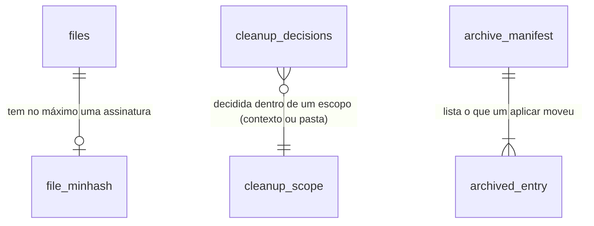

# Cérebro: faxina guiada — ver o que tem num contexto, perguntar o que está obsoleto e arquivar com desfazer

## Problem

Uma pasta de contexto cresce sem que ninguém olhe para ela inteira. Hoje, no código de `chore/cerebro-v3-roteiro`:

- **Não há como ver o que um contexto tem.** O Segundo Cérebro mostra um grafo de até 3 000 arquivos e uma lista de busca de 8
  resultados; não existe resumo por tipo, idade, tamanho ou subpasta de uma pasta escolhida. Para saber "o que tem aqui" a
  pessoa abre o explorador de arquivos.
- **A higiene acha pouco e não pergunta nada.** `GET /api/memory/hygiene` (`core/src/memory/hygiene.ts:59-170`) lista órfãs
  (por `file_links`, que a `cerebro-correcoes` troca por `note_links`), ponteiros do roteador sem destino e arquivos sem
  mudança há 90 dias, sobre o índice inteiro e sem escopo. Não acha duplicatas nem quase-duplicatas, pastas vazias, arquivos
  grandes ou notas sem título, e a interface nem chama a rota (inventário da pesquisa, `research_notes/Segundo cérebro para
agentes/mordomoos_atual.md`).
- **Nada que se decide fica decidido.** Não existe "manter isto" nem "revisar depois": cada passada da higiene devolve o mesmo
  achado, e a pessoa não tem onde dizer o que importa numa pasta.
- **Não há como arquivar.** O primitivo seguro de escrita sabe criar, substituir e acrescentar (`safeWrite.ts:34`), não sabe
  mover; tirar um arquivo velho do caminho é o shell ou o explorador, sem registro e sem desfazer. Apagar não existe, e deve
  continuar não existindo.

A pesquisa de 29/10/2026 (`reports/Segundo cérebro para agentes.md`, M4) mostra que o acúmulo sem revisão é o que mata um
segundo cérebro ("a manutenção cresce mais rápido que o valor", Karpathy, 2026) e que a faxina que funciona é um ritual curto
com perguntas, não um relatório. Nenhuma métrica de uso foi dada.

Quando isto sair: a pessoa escolhe um contexto (ou uma pasta dentro dele), vê numa tela animada o que ele tem, responde uma
pergunta por achado com um clique (manter, arquivar, juntar, revisar depois, não sei), escreve o que importa ali, confere a
lista do que vai mudar e aplica; o que foi arquivado volta com um clique, e o que ela decidiu não volta a ser perguntado.

## Flow

Reutiliza o índice (`files`, `files_fts`, `file_related`, `note_links`), o resolvedor de links da `cerebro-correcoes`
(`linkEdges`), o `rowFilter` do `MemoryIndexer`, o primitivo seguro (`writeWorkspaceFile`, `homeReadScope`), as rotas de nota
(`saveNote` com `baseVersion`), o `RestoreLock`, o barramento com `EVENT_VERSIONS`, a tabela `API` e `bind`, as primitivas
(`Modal`, `Tabs`) e o `useTweenNumber`; nenhuma segunda indexação, política ou escrita.

1. Entrada → o seletor de contexto, a paleta ("Faxina guiada") ou o botão da tela do Segundo Cérebro abrem o
   `CleanupWizard` (new, no door - placement per conventions) com um contexto ou uma pasta.
2. Inventário → `GET /api/memory/cleanup/inventory` (door 5) → `cleanupInventory` (new, no door) agrega as linhas de `files`
   do escopo, já filtradas pelo `rowFilter`, sem abrir arquivo: contagem por tipo, tamanho, faixas de idade, maiores pastas,
   grupos por subpasta e por termos de `file_related`.
3. Varredura → `POST /api/memory/cleanup/scans` (door 5) → `CleanupScanner` (new, no door) roda em blocos que cedem o laço,
   segurando o `RestoreLock` compartilhado (exists); calcula assinaturas MinHash do texto do FTS e as guarda em `file_minhash`
   (door 2); lê `linkEdges` (exists após `cerebro-correcoes`) para órfãs e links quebrados; descarta achados já decididos em
   `cleanup_decisions` (door 3); anuncia `cleanup.progress`/`cleanup.finished`/`cleanup.failed` (door 6).
4. Perguntas → `GET /api/memory/cleanup/scans/:id` (door 5) devolve os achados; `PUT /api/memory/cleanup/decisions` grava cada resposta
   em `cleanup_decisions` (door 3) e o texto "o que importa aqui" vai para a nota-resumo do contexto por `saveNote` (exists),
   com `baseVersion`.
5. Aplicar → `POST /api/memory/cleanup/apply` (door 5) → `moveWorkspaceFile` (new, door 1) move para o arquivo de `memory/`
   cada arquivo marcado, conferindo o hash de agora contra o da varredura; grava o manifesto (door 4); pede ao
   `MemoryIndexer.requestIndexPaths` (exists) a passada dos caminhos de origem e de destino. Fora de `memory/`, o plano vira
   uma lista de propostas em `artifacts/` (pergunta 1).
6. Desfazer → `POST /api/memory/cleanup/undo` (door 5) lê o manifesto e move de volta o que ainda está como foi deixado.
7. out: a tela mostra o resultado (movidos, pulados com o motivo, propostas) e o botão "Desfazer".

## Impact

| Front       | What changes                                                                                                                                                                                                                                                                                  |
| ----------- | --------------------------------------------------------------------------------------------------------------------------------------------------------------------------------------------------------------------------------------------------------------------------------------------- |
| domain      | new term: `achado` (finding) — um fato sobre um ou mais arquivos do escopo que pede uma decisão (`duplicate`, `near-duplicate`, `stale`, `orphan`, `broken-link`, `empty-folder`, `large-file`, `untitled`), com uma chave estável `kind:sha-dos-membros`, vive em `core/src/memory/cleanup*` |
| domain      | new term: `decisão de faxina` — `keep`, `archive`, `merge`, `snooze`, `unsure` sobre a chave de um achado; vale até a chave mudar (um membro mudou de bytes) ou, para `snooze`, até a data                                                                                                    |
| domain      | new term: `arquivo` (archive) — `memory/archive/AAAA-MM-DD-<id>/` com os arquivos movidos na mesma forma de caminho relativo e um `manifest.json`; indexado, fora dos achados e fora do escopo padrão de um contexto                                                                          |
| domain      | existing term: `higiene` (`GET /api/memory/hygiene`) continua igual para o que é de sistema (skills, rotinas, conectores); os achados de arquivo desta feature são uma rota própria e escopada — quem lê a higiene hoje: nenhuma tela; a CLI `doctor` não a usa                               |
| stored data | migração 23 cria `file_minhash` e `cleanup_decisions` (`CREATE TABLE IF NOT EXISTS`, nada altera linha existente); as assinaturas se calculam na primeira varredura de cada escopo e somem com o arquivo (o `removeFile` do indexador ganha o `DELETE`)                                       |
| stored data | `memory/archive/` passa a existir no primeiro arquivamento; `ROUTER.md` e `areas/*.md` não o listam (é lido como pasta gerada pelo roteador, igual a `journal/`)                                                                                                                              |
| eventos     | três tipos novos no barramento: `cleanup.progress`, `cleanup.finished`, `cleanup.failed` (`v: 1`); `docs/events.md` regenerado                                                                                                                                                                |

## Relations

One-way constraints: a assinatura é por arquivo, de um só algoritmo e tamanho (door 2); uma decisão é única por (escopo, chave do
achado) (door 3); o manifesto é a única fonte do desfazer (door 4). Nada aqui guarda o conteúdo dos arquivos.

## Surface

| Route                               | In                                                                   | Out                                                                                             | Status                     |
| ----------------------------------- | -------------------------------------------------------------------- | ----------------------------------------------------------------------------------------------- | -------------------------- |
| `GET /api/memory/cleanup/inventory` | query `context?` ou `dir?`                                           | `scope` · `total` · `byKind[]` · `bySize` · `byAge[]` · `topFolders[]` · `clusters[]`           | `200`, `400`, `404`        |
| `POST /api/memory/cleanup/scans`    | `context?` ou `dir?`                                                 | `scanId`                                                                                        | `202`, `400`, `404`, `409` |
| `GET /api/memory/cleanup/scans/:id` | param `id`                                                           | `status` · `phase` · `findings[]` (`key`, `kind`, `files[]`, `detail`, `suggested`) · `decided` | `200`, `404`               |
| `PUT /api/memory/cleanup/decisions` | `scanId`, `decisions[]` (`key`, `decision`, `keepFileId?`, `until?`) | `saved`                                                                                         | `200`, `400`, `404`, `409` |
| `POST /api/memory/cleanup/apply`    | `scanId`                                                             | `manifest` · `moved[]` · `skipped[]` (`path`, `reason`) · `proposals?`                          | `200`, `404`, `409`        |
| `POST /api/memory/cleanup/undo`     | `manifest`                                                           | `restored[]` · `skipped[]` (`path`, `reason`)                                                   | `200`, `400`, `404`, `409` |

## Landing

| One-way door             | Literal shape                                                                                                                                                                                                                                                                                                                                                                               | Alternative rejected                                                                                                                                                                                                                          |
| ------------------------ | ------------------------------------------------------------------------------------------------------------------------------------------------------------------------------------------------------------------------------------------------------------------------------------------------------------------------------------------------------------------------------------------- | --------------------------------------------------------------------------------------------------------------------------------------------------------------------------------------------------------------------------------------------- |
| 1. Mover com segurança   | `moveWorkspaceFile(scope, from, to, { expectSha256 })` em `core/src/security/safeWrite.ts`: recusa link no caminho e destino existente (`EEXIST`), confere o hash no descritor aberto, `rename` no mesmo dispositivo; em outro dispositivo copia por `writeWorkspaceFile(..., { mode: "create" })`, confere o hash da cópia e só então remove a origem; nunca apaga sem uma cópia conferida | `fs.rename` direto: segue link e não confere que o arquivo é o que a pessoa viu; copiar e apagar sempre: dobra o disco e perde a atomicidade do `rename` onde ela existe; lixeira do sistema: três APIs de plataforma e nenhum desfazer nosso |
| 2. Assinaturas           | `file_minhash(file_id INTEGER PRIMARY KEY, algo TEXT NOT NULL, sig BLOB NOT NULL, mtime INTEGER NOT NULL, size INTEGER NOT NULL)`; `algo` = `minhash-v1:64:w5` (64 funções, shingles de 5 palavras dobradas, `Uint32` little-endian); recalculada quando `mtime`/`size`/`algo` mudam; quase-duplicata = Jaccard estimado ≥ 0,8 por LSH de 16 faixas de 4                                    | comparar os textos par a par: quadrático num contexto de milhares de arquivos; vetores de embeddings: desligados por padrão (`cerebro-v2` pergunta 4) e o `hash` lê grafia como o MinHash, com mais custo                                     |
| 3. Decisões persistentes | `cleanup_decisions(scope TEXT NOT NULL, key TEXT NOT NULL, decision TEXT NOT NULL, keep_file_id INTEGER, until INTEGER, decided_at INTEGER NOT NULL, PRIMARY KEY (scope, key))`; `scope` = `context:<id>` ou `dir:<caminho absoluto>`; `key` = `<kind>:<sha256 dos caminhos e hashes dos membros, ordenados>`; `decision` ∈ `keep`, `archive`, `merge`, `snooze`, `unsure`                  | decisão guardada no navegador: some ao trocar de máquina ou limpar o perfil, e o servidor voltaria a perguntar; decisão por caminho: um arquivo que mudou herdaria um "manter" dado à versão antiga                                           |
| 4. Arquivo e manifesto   | `memory/archive/AAAA-MM-DD-<8 hex>/<caminho relativo à raiz de origem>` e `manifest.json` = `{ v: 1, createdAt, scope, entries: [{ from, to, sha256, size }] }`; o desfazer move `to` → `from` só se `to` ainda tem o `sha256` e `from` não existe                                                                                                                                          | um `_arquivo/` ao lado de cada pasta: espalha o que foi arquivado por N pastas e põe escrita dentro das pastas do usuário; guardar o manifesto no banco: um backup restaurado sem o banco perderia o desfazer                                 |
| 5. Contrato REST         | as seis rotas da `Surface`, escopo `owner` para `scans`, `decisions`, `apply` e `undo`, `content` para `inventory` e o `GET` da varredura; erros nomeados: `400 scope_required`, `404 context_not_found`, `409 scan_running`, `409 scan_stale`, `409 restore_in_progress`, `409 undo_conflict`                                                                                              | uma rota só que faz tudo: mistura leitura de dispositivo (`content`) com escrita do dono (`owner`), que AD-015 separa por rota                                                                                                                |
| 6. Eventos               | `cleanup.progress` `{ scanId, phase: "inventory" \| "signatures" \| "links" \| "findings", done, total }`, `cleanup.finished` `{ scanId, findings }`, `cleanup.failed` `{ scanId, code }`, todos `v: 1` em `EVENT_VERSIONS`                                                                                                                                                                 | sondar `GET /scans/:id` a cada segundo: o padrão do projeto é o barramento (`index.progress`), e a sondagem não serve à CLI nem ao MCP                                                                                                        |

- Nothing else in this change is hard to reverse: o desenho do assistente, os limiares de "parado" e "grande", a ordem dos
  achados e os textos das perguntas mudam por refatoração ou configuração.

## Criteria

### S1: o que tem aqui (P1)

A pessoa vê, sem abrir arquivo, o retrato de um contexto ou de uma pasta.

**Acceptance Criteria**

1. WHEN the owner calls `GET /api/memory/cleanup/inventory?context=<id>` THEN the system SHALL answer `200` with `total`, `byKind` (count and bytes per extension group: notas `.md`/`.markdown`, texto, PDF, imagem, código, outros), `byAge` (counts for 0-30, 31-90, 91-365 and more than 365 days since `mtime`), `topFolders` (the 10 folders with the most bytes) and `clusters` (up to 12 groups), computed from the index rows only.
2. The inventory SHALL open no file for reading, and SHALL count only rows that today's policy (`rowFilter`) allows and whose path is inside the scope.
3. WHEN `dir=<path>` names a folder inside an indexed root or under `memory/` THEN the inventory SHALL use that folder and its subfolders as the scope; IF it names a folder outside every indexed root THEN the route SHALL answer `400 scope_required` with no counts.
4. IF the `context` id does not exist THEN the route SHALL answer `404 context_not_found`; IF neither `context` nor `dir` is given THEN it SHALL answer `400 scope_required`.
5. WHEN a scope has files under two or more subfolders THEN `clusters` SHALL hold one group per first-level subfolder with its count and its top 3 shared terms from `file_terms`, and WHEN it has one folder only THEN the groups SHALL come from connected components of `file_related` edges with score ≥ 0.3.
6. WHILE the inventory is the scope of the wizard THEN the screen SHALL show the numbers as they are counted up from zero with `useTweenNumber`, and under `prefers-reduced-motion: reduce` SHALL show the final numbers at once.

**Independent test:** pedir o inventário de uma pasta com notas de idades e tipos diferentes e conferir contagens, faixas e
grupos contra o índice; a interface mostra os cartões.

### S2: os achados (P1)

Uma varredura escopada acha o que pede decisão, sem repetir o que já foi decidido.

**Acceptance Criteria**

7. WHEN the owner calls `POST /api/memory/cleanup/scans` with a scope THEN the system SHALL answer `202` with `scanId`, announce `cleanup.progress` with `phase` and `done`/`total` while it runs, and `cleanup.finished` with the number of findings when it ends.
8. WHEN two allowed files of the scope have the same bytes THEN the scan SHALL report one `duplicate` finding with both files, and WHEN their estimated Jaccard similarity over 5-word shingles is at least 0.8 THEN it SHALL report one `near-duplicate` finding with the estimate in `detail`.
9. The MinHash signature of a file SHALL be the same bytes on every run and platform for the same text, and SHALL be recomputed only when the file's `mtime`, `size` or the algorithm id changes.
10. WHEN a file's `mtime` is older than `memory.cleanup.staleDays` (default 180) THEN the scan SHALL report it as `stale`, and WHEN its front matter has `last_reviewed` older than the same bound THEN it SHALL report it as `stale` by that date even if `mtime` is recent.
11. WHEN a Markdown file of the scope has no `note_links` link in either direction that resolves THEN the scan SHALL report it as `orphan`, and WHEN it holds a link that resolves to nothing THEN it SHALL report one `broken-link` finding per such link with the line.
12. WHEN a folder of the scope holds no indexed file and no non-empty subfolder THEN the scan SHALL report it as `empty-folder`; WHEN a file is larger than `memory.cleanup.largeBytes` (default 5 MiB) THEN as `large-file`; WHEN a Markdown file has no title (no front matter `title`, no `# ` heading) THEN as `untitled`.
13. WHEN a finding's key has a stored decision `keep`, `archive` or `merge` for the scope, or `snooze` whose `until` is later than now, THEN the scan SHALL NOT report it, and WHEN any member file changed its bytes THEN the key SHALL change and the finding SHALL be reported again.
14. The scan SHALL ignore files under `memory/archive/`, `memory/ROUTER.md`, `memory/areas/` and `memory/journal/`, and SHALL report no file that today's policy excludes.
15. IF a scan is already running for the same scope THEN `POST /api/memory/cleanup/scans` SHALL answer `409 scan_running` with the running `scanId`, and IF a restore holds the exclusive restore lock THEN it SHALL answer `409 restore_in_progress`.
16. WHILE a scan runs over 3 000 files THEN it SHALL yield the event loop between blocks of at most 200 files, and SHALL hold the shared restore lock until it ends however it ends.
17. IF the scan fails THEN the system SHALL announce `cleanup.failed` with a code, keep every signature already stored, and `GET /api/memory/cleanup/scans/:id` SHALL answer `status: "failed"` with the code.

**Independent test:** indexar uma pasta com dois arquivos iguais, dois quase iguais, um velho, uma nota órfã, um link
quebrado e uma pasta vazia; a varredura devolve um achado de cada, e depois de "manter" o primeiro ele não volta.

### S3: perguntar e decidir (P1)

Uma pergunta por achado, respondida com um clique, e um lugar para dizer o que importa.

**Acceptance Criteria**

18. WHEN the scan finishes THEN the wizard SHALL show one question card per finding, grouped by kind, each with the files (name, folder, age, size), the reason in one sentence and the answers that fit the kind: "Manter", "Arquivar", "Revisar depois", "Não sei", and "Juntar" for `duplicate` and `near-duplicate`.
19. WHEN the person chooses "Juntar" THEN the card SHALL ask which file to keep (the newest preselected), and the decision SHALL be stored as `merge` with `keepFileId` and the other members marked to archive.
20. WHEN the person answers a card THEN the system SHALL store the decision through `PUT /api/memory/cleanup/decisions` before the card leaves the screen, and IF the request fails THEN the card SHALL stay with the message "Não foi possível guardar a resposta." and "Tentar de novo".
21. WHEN the person chooses "Revisar depois" THEN the decision SHALL be `snooze` with `until` 30 days later, and "Não sei" SHALL store `unsure`, which does not hide the finding from the next scan.
22. WHEN the person answers every card of a group with "Aplicar a todos deste tipo" THEN the system SHALL store the same decision for each finding of that group in one request.
23. WHEN the person writes in "O que importa aqui?" and the context names a brief note THEN the system SHALL append the text under a `## O que importa` heading of that note through `PUT /api/memory/notes` with its `baseVersion`, and IF the save answers `409 edit_conflict` THEN the field SHALL keep the text and offer "Carregar de novo".
24. IF the scope has no brief note (a `dir` scope, or a context without one) THEN the field SHALL be disabled with the reason "Este escopo não tem nota-resumo." and nothing SHALL be written.
25. IF `PUT /api/memory/cleanup/decisions` names a key that the scan did not report THEN it SHALL answer `400 validation` and store nothing; IF the scan was replaced by a newer one for the scope THEN it SHALL answer `409 scan_stale`.

**Independent test:** responder um cartão de cada tipo, recarregar a tela e ver as respostas guardadas; escrever o que
importa e ver o texto na nota-resumo do contexto.

### S4: conferir, aplicar e desfazer (P1)

**Acceptance Criteria**

26. WHEN the person reaches the preview step THEN the wizard SHALL list every change the apply would make, one line per file: origin path, destination path under `memory/archive/…` or "proposta" for a file outside `memory/`, and the decision that caused it, with the totals.
27. WHEN the owner calls `POST /api/memory/cleanup/apply` THEN the system SHALL move each file under `memory/` marked `archive` (or not kept by a `merge`) to `memory/archive/AAAA-MM-DD-<id>/<caminho relativo>` with `moveWorkspaceFile`, and SHALL write `manifest.json` listing each move with its `sha256`.
28. IF a file's bytes differ from the ones the scan saw, or the file is gone, THEN the apply SHALL skip it with `reason` `changed` or `missing` and SHALL move the rest.
29. IF a path on the way is a symbolic link, or the destination exists, THEN `moveWorkspaceFile` SHALL refuse it, the apply SHALL list it in `skipped` with `reason` `forbidden_path` or `exists`, and SHALL leave both paths unchanged.
30. WHERE the files to archive are outside `memory/` (the person's own folders) the system SHALL NOT move or write them, and SHALL write a proposal list `artifacts/cleanup/AAAA-MM-DD-<id>.md` (one checkbox line per file with the decision and the reason) and return its path in `proposals`.
31. WHEN the apply ends THEN the system SHALL request an index pass for every origin and destination path, so the next search and the next scan reflect the moves once `index.finished` is announced.
32. WHEN the owner calls `POST /api/memory/cleanup/undo` with a manifest of this feature THEN the system SHALL move each entry back to `from` when `to` still has the recorded `sha256` and `from` does not exist, list the others in `skipped` with `reason` `changed`, `missing` or `exists`, and remove the archive folder only when it is left empty.
33. The system SHALL contain no call that deletes a user file: an apply and an undo SHALL only move, and SHALL never remove a file whose copy was not confirmed by hash.
34. IF the undo is called with a path that is not a `manifest.json` under `memory/archive/` THEN it SHALL answer `400 validation`; IF the manifest's `v` is not 1 THEN `409 undo_conflict`.
35. WHEN the apply finishes THEN the wizard SHALL show the totals (moved, skipped with reasons, proposals with a link to the artifact) and a "Desfazer" button that calls the undo for that manifest.

**Independent test:** arquivar três notas de `memory/notes`, ver os arquivos em `memory/archive/…` com o manifesto, mudar
uma delas lá e desfazer: duas voltam, a mudada fica e aparece como pulada.

### S5: o assistente visual (P1)

**Acceptance Criteria**

36. WHEN the person opens "Faxina guiada" from the context selector, the command palette or the Second Brain screen of either shell THEN the system SHALL open one `Modal` wizard with the steps "Escopo", "O que tem aqui", "Achados", "Conferir" and "Pronto", the current step shown as text and as a numbered step bar.
37. WHILE a scan runs the wizard SHALL show the phase as text ("Lendo o índice", "Calculando assinaturas", "Conferindo links", "Separando achados") and `done`/`total`, and a "Cancelar" button that closes the wizard without applying anything.
38. WHEN the scan finds nothing THEN the wizard SHALL show "Nada para decidir aqui. Este contexto está em ordem." with the inventory still visible and no preview step.
39. IF the inventory or the scan fails THEN the wizard SHALL show the failure as text beside an icon, with "Tentar de novo", and SHALL keep the answers already stored.
40. WHILE the wizard has answers not yet applied, closing it SHALL keep them (they are stored), and reopening the same scope within 24 hours SHALL resume at the "Achados" step with the remaining cards.
41. The wizard SHALL keep every animation inside `@media (prefers-reduced-motion: no-preference)` in `ui/ui.css` or in a stylesheet with the same rule, and every state SHALL be readable without animation (text and icon, never color or motion alone).
42. The wizard SHALL use text at 13px for prose and 12px minimum, colors only from tokens, and SHALL pass axe at WCAG A/AA in both themes and both shells.
43. The wizard chunk SHALL load only when it is first opened (a dynamic `import()`), and the entry JS SHALL grow by no more than the recorded baseline allows (`bundle:check`).
44. The command "Faxina guiada" SHALL be registered in the command registry with scope `global`, and no keyboard listener SHALL be added outside the registry.

**Independent test:** abrir a faxina pela paleta, percorrer as cinco etapas num contexto de teste com o movimento reduzido
ligado e desligado, e ver o mesmo texto de estado nas duas.

### Cross-cutting (P1)

**Acceptance Criteria**

45. The system SHALL declare the six routes in the `API` table with schemas, scope and errors, regenerate the OpenAPI document and `docs/events.md`, list the routes in `EXPECTED_ROUTE_SCOPES` and in `docs/security.md`, and give each route a scenario in the refusal probe.
46. WHILE a call comes from a paired device or a run credential, `scans`, `decisions`, `apply` and `undo` SHALL answer `403` (`owner_only` for a device), and `inventory` and `GET /scans/:id` SHALL answer for a device that holds `content`.
47. The system SHALL add no raw `fs` read or write outside `tests/security-reads.test.ts`'s list and no module-level mutable state outside `tests/sdk.instances.test.ts`'s list.

## Out of scope

| Excluded                                                                                                                                                                         | Why                                                                                                                                                                                           |
| -------------------------------------------------------------------------------------------------------------------------------------------------------------------------------- | --------------------------------------------------------------------------------------------------------------------------------------------------------------------------------------------- |
| Mover ou escrever nas pastas do usuário fora de `memory/`                                                                                                                        | hoje elas são somente leitura (`cerebro-v2`, pergunta 1); esta feature as trata por propostas até o dono decidir (pergunta 1 abaixo)                                                          |
| Apagar arquivos                                                                                                                                                                  | nada no produto apaga arquivo do usuário; arquivar com desfazer cobre o caso, e a lixeira do sistema é escolha da pessoa                                                                      |
| Juntar o texto de duas notas numa só                                                                                                                                             | fundir conteúdo é edição de significado, que é da pessoa (pesquisa, "o agente cuida da estrutura, a pessoa do significado"); "Juntar" mantém um e arquiva os outros                           |
| Resumo e pergunta escritos por IA para cada grupo                                                                                                                                | depende da skill `organize-brain` (`cerebro-organizar`, C3) e de uma execução por grupo; entra como passo opcional em `cerebro-rituais` (C8)                                                  |
| Menções não linkadas, hubs e PageRank no lint                                                                                                                                    | são sugestões de ligação, não de limpeza; entram em `cerebro-rituais` (C8) e `cerebro-entidades-resumos` (C11)                                                                                |
| Revisão semanal agendada que abre a faxina sozinha                                                                                                                               | é o ritual de `cerebro-rituais` (C8), que reusa as rotas daqui                                                                                                                                |
| Desfazer de um arquivamento feito por outra versão do produto ou à mão                                                                                                           | o manifesto `v: 1` é a fonte do desfazer; o que não tem manifesto se move de volta pelo explorador                                                                                            |
| Distribuição por natureza (`fato`, `opiniao`, `plano`, `hipotese`, `relato`) e escopo (`pessoal`, `equipe`, `externo`) nos cartões, com a contagem de notas sem classificação    | os campos `natureza` e `escopo` nascem em `cerebro-natureza` (C6), que vem depois desta; C6 acrescenta os cartões ao inventário desta feature (as rotas e o assistente já existem)            |
| Achados "plano antigo" (natureza `plano` sem revisão há muito tempo) e "nota sem natureza", com a pergunta de um clique (Ainda é plano / Virou realidade / Abandonado / Ignorar) | idem: dependem dos campos de C6; C6 os acrescenta ao lint desta feature como dois `kind` novos                                                                                                |
| Fila de revisão periódica (`review_every`) de opiniões, status e conceitos, e o prazo de "parado" por nota                                                                       | é de `cerebro-natureza` (C6); até lá o achado `stale` usa o limite fixo `memory.cleanup.staleDays` e o `last_reviewed` (AC 10), e C6 passa a respeitar `review_every` quando a nota o declara |
| Membros, papéis e faxina compartilhada                                                                                                                                           | o produto é de um dono só (AD-015 cobre dispositivos)                                                                                                                                         |

## Assumptions

| Assumption                         | Chosen default                                                                                                     | Rationale                                                                                                                                        | Confirmed? |
| ---------------------------------- | ------------------------------------------------------------------------------------------------------------------ | ------------------------------------------------------------------------------------------------------------------------------------------------ | ---------- |
| Dependência de features anteriores | esta feature começa depois de `cerebro-correcoes` (`linkEdges`) e `cerebro-contextos` (o contexto e a nota-resumo) | órfãs e links quebrados precisam da verdade única de links; o escopo `context` precisa do contexto; sem eles só o escopo `dir` funcionaria       | n          |
| Limiares                           | parado = 180 dias; grande = 5 MiB; quase-duplicata = Jaccard ≥ 0,8; `snooze` = 30 dias                             | valores comuns da prática (revisão semestral, Graphiti usa Jaccard 0,9 para nomes; texto longo tolera menos); ficam em `settings.memory.cleanup` | n          |
| Arquivo indexado                   | `memory/archive/` continua indexado e buscável, mas fora dos achados e do escopo padrão de um contexto             | PARA mantém o Arquivo consultável; tirá-lo do índice esconderia o que a pessoa quis só tirar do caminho                                          | n          |
| Retomada                           | reabrir o mesmo escopo em até 24 horas retoma a varredura; depois disso, uma varredura nova                        | o índice muda; uma varredura de mais de um dia mostraria achados velhos                                                                          | n          |
| Grupos por termos                  | componentes de `file_related` com pontuação ≥ 0,3, no máximo 12                                                    | `file_related` já existe e é barato; um agrupamento semântico de verdade é da `cerebro-busca-significado` (C9)                                   | n          |
| Lugar do assistente                | `Modal` em tela larga nos dois shells, com a mesma composição                                                      | as primitivas já resolvem foco, Esc e camadas (AD-017); uma página nova em cada shell dobraria o trabalho                                        | n          |

**Open questions:**

| #   | Kind           | Question                                                                                                                                                                                                                                                                                                                                     | Until answered                                                                                                    |
| --- | -------------- | -------------------------------------------------------------------------------------------------------------------------------------------------------------------------------------------------------------------------------------------------------------------------------------------------------------------------------------------- | ----------------------------------------------------------------------------------------------------------------- |
| 1   | blocks go-live | Nas pastas do usuário fora de `memory/` a faxina deve só propor (lista de verificação em `artifacts/`, recomendado agora) ou mover de verdade para um `_arquivo/` dentro da própria pasta, com aprovação do dono a cada aplicar e o mesmo manifesto e desfazer? A segunda amplia o raio do token do dono para escrita nas pastas do usuário. | só propostas (AC 30); a faxina de uma pasta do usuário termina numa lista que a pessoa executa                    |
| 2   | open           | "Arquivar" dentro de `memory/` deve pedir confirmação a cada aplicar (um `Modal` "Mover N arquivos para o arquivo?") ou basta a etapa "Conferir"?                                                                                                                                                                                            | a etapa "Conferir" é a confirmação (AC 26) e o "Desfazer" fica na tela final (AC 35); nenhuma segunda confirmação |

## Observable

| Surface                                      | Decision                               | Landing                                                                                                 |
| -------------------------------------------- | -------------------------------------- | ------------------------------------------------------------------------------------------------------- |
| screen assistente de faxina                  | empty state                            | AC 38                                                                                                   |
| screen assistente de faxina                  | loading state                          | AC 37, AC 6                                                                                             |
| screen assistente de faxina                  | error state                            | AC 39, AC 20                                                                                            |
| screen assistente de faxina                  | unauthorised                           | n/a - a interface do dono usa o token do dono; um dispositivo recebe `403` nas rotas de escrita (AC 46) |
| screen assistente de faxina                  | density and ordering                   | AC 18 (agrupado por tipo), AC 26 (uma linha por arquivo)                                                |
| screen assistente de faxina                  | destructive action confirms            | AC 26, AC 35 - nada é apagado (AC 33); "Conferir" antes de aplicar e "Desfazer" depois                  |
| screen cartões de pergunta                   | error state                            | AC 20, AC 23                                                                                            |
| API `GET /api/memory/cleanup/inventory`      | error shape and codes                  | AC 3, AC 4                                                                                              |
| API `POST /api/memory/cleanup/scans`         | error shape and codes                  | AC 15, AC 17                                                                                            |
| API `PUT /api/memory/cleanup/decisions`      | error shape and codes                  | AC 25                                                                                                   |
| API `POST /api/memory/cleanup/apply`, `undo` | error shape and codes                  | AC 28, AC 29, AC 34                                                                                     |
| all new `/api/memory/cleanup/*` routes       | who may call                           | AC 46                                                                                                   |
| all new `/api/memory/cleanup/*` routes       | versioning, rate limits                | n/a - `/api/v1` é o mesmo conjunto de rotas e nenhuma ganha limite próprio além do da API               |
| events `cleanup.*`                           | versioning                             | AC 7, door 6                                                                                            |
| document lista de propostas em `artifacts/`  | structure, what the reader does next   | AC 30 - uma linha marcável por arquivo, com a decisão e o motivo; a pessoa executa                      |
| document `manifest.json`                     | structure                              | door 4                                                                                                  |
| collection achados                           | grouping, naming, ordering, duplicates | AC 18, AC 13 (chave estável, um achado por conjunto de membros)                                         |
| collection arquivo `memory/archive/`         | grouping, naming, what does not fit    | AC 27 (uma pasta por aplicar, caminho relativo preservado), AC 29 (destino que existe é pulado)         |
| command "Faxina guiada"                      | document or copy a person reads        | AC 36, AC 44                                                                                            |

## Sources

- `reports/Segundo cérebro para agentes.md`, roteiro M4 (lint de higiene) e a seção sobre manutenção — o escopo do lint.
- `.specs/roadmap.md`, C5 — a entrega desta feature.
- `.specs/features/cerebro-faxina-guiada/design.md` — binding para as telas.
