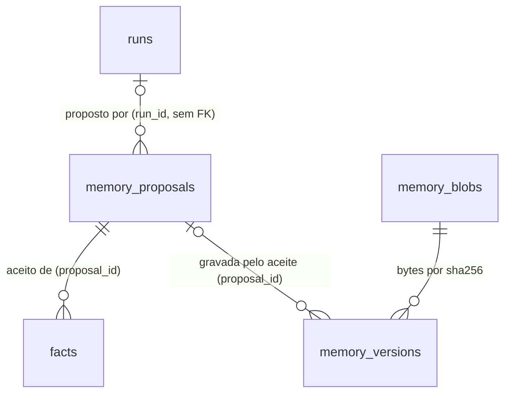

# Cérebro: memória confiável — fatos com tempo e origem, caixa de revisão, histórico por nota, permissão por pasta

## Problem

O que o agente escreve na memória de longo prazo chega lá sem que o dono veja, sem dizer de onde veio, e sem volta. O que
o dono escreve também não tem volta, e o que ele guarda fica aberto a todo agente e a todo dispositivo pareado. Levantamento
no código em `chore/cerebro-v3-roteiro` (`08de8f5`):

- **A consolidação não tem semântica única nem saída aplicável.** A documentação diz que a rotina noturna "is **disabled by
  default**" e que propõe o novo `MEMORY.md` como artefato (`docs/memory-guide.md:175-177`); o arquivo empacotado diz
  `"enabled": true` (`routines/nightly-consolidation.json:34`), e o `seedHome` copia esse valor para toda instalação nova sem
  nunca mais tocá-lo (`core/src/paths.ts:178-200`). No perfil padrão (`review_before_write`) uma rotina roda em modo leitura
  (`core/src/routines/scheduler.ts:384-385`), então a skill escreve "o `MEMORY.md` proposto inteiro" como artefato e para
  (`skills/consolidate-memory/SKILL.md:30`): nenhuma tela aplica esse artefato, e o dono teria que copiar à mão. Num perfil
  que escreve, a mesma skill acrescenta linhas direto no `MEMORY.md` e afirma fatos pela API, sem revisão.
- **O `MEMORY.md` não exige origem, autoria nem tamanho.** A skill pede só `(journal 2026-09-03)` ao fim da linha
  (`SKILL.md`, passo 3) e "nunca apaga"; não há teto. O Claude Code carrega só as primeiras 200 linhas ou 25 KB desse tipo de
  arquivo (pesquisa, `reports/Segundo cérebro para agentes.md`, R7). As "Reflections" do agente ficam no arquivo com o mesmo
  peso das decisões do dono.
- **Os fatos se confundem e apagam a própria história.** A normalização é `trim()` (`core/src/memory/facts.ts:54-58`) e a
  contradição exige texto idêntico (`facts.ts:83`): "Cliente X" e "cliente x" viram dois fatos abertos. Um fato afirmado com
  `validFrom` anterior ao de um fato aberto fecha esse fato em `max(validFrom, f.validFrom)` (`facts.ts:91`), isto é, no
  próprio início dele: o fato antigo passa a valer por zero milissegundos e some de toda consulta `asOf`. Não há tempo de
  retratação ("nunca foi verdade" é indistinguível de "deixou de ser").
- **Escrita de agente parece escrita do dono.** `mordomo mcp` chama a API com o token do dono (`apps/api/src/cli.ts:1518`):
  `facts_assert`, `note_create`, `note_save` e `journal_append` de uma sessão do Claude Code são, para o MordomoOS, o dono. A
  credencial de uma execução afirma fatos e acrescenta linhas no diário direto (`apps/api/src/server.ts:251`,
  `apps/api/src/routes/memory.ts:353-389`), e a consolidação promove "qualquer linha de Decisions" do diário
  (`heuristics.md`). A pesquisa mede o risco: injeção na memória com mais de 95% de sucesso (MINJA) e cargas plantadas em
  arquivos de memória atacando sessões futuras (A2).
- **Não há histórico.** Salvar uma nota é um `replace` guardado por versão (`core/src/memory/notes.ts:421`); o arquivo
  anterior deixa de existir. O backup copia o home inteiro (`core/src/backup.ts:43`, retenção 10): voltar uma nota é restaurar
  tudo. O desfazer da faxina volta só os movimentos que ela fez (`core/src/memory/cleanupApply.ts:207-212`), e o `restore` das
  revisões volta só uma linha de `review_state` (`core/src/memory/reviewDecisions.ts:24`).
- **Não há permissão por pasta.** Um dispositivo com `content` lê tudo o que o dono concedeu (`contracts/src/devices.ts:7`);
  uma execução de skill de memória lê `memory/` inteira; o único jeito de tirar uma pasta ("Financeiro") do agente e do
  celular é tirá-la do índice, o que a esconde do próprio dono. `cerebro-contextos` deixou isso para cá
  (`.specs/features/cerebro-contextos/plan.md:236`).
- **Não há como levar uma pasta de notas para fora nem trazer uma para dentro.** Só skills têm importação
  (`apps/api/src/routes/skills.ts:149-171`).

Ninguém deu métrica de uso; a evidência é a do relatório de pesquisa de 29/10/2026 (R6, R7, R8, M8, A2) e o código acima.

Quando isto sair: nada que um agente escreve chega ao `MEMORY.md`, aos fatos ou às notas sem passar por uma caixa de
revisão com diff, origem, autor e marca de confiança; cada linha nova do `MEMORY.md` diz de onde veio, quem escreveu e
quando, e o arquivo tem teto; os fatos se reconhecem apesar de maiúsculas e acentos e guardam as duas linhas do tempo; toda
nota de `memory/` tem histórico com restauração de uma versão, inclusive de nota apagada; o dono decide, por pasta, o que
agentes e dispositivos leem, escrevem ou nem veem; e uma pasta sai como cópia verificável e entra como pasta nova.

### Parts and recommended cut

A linha C7 do roteiro junta sete entregas. Este plano as divide em duas partes, na ordem em que dependem uma da outra, e
recomenda construí-las em lotes sequenciais (o `## Handoff` de `checks.md` corta na fronteira de superfície entre elas):

| Parte                     | Fatias     | Entrega                                                                                                           | Por que nesta ordem                                                                           |
| ------------------------- | ---------- | ----------------------------------------------------------------------------------------------------------------- | --------------------------------------------------------------------------------------------- |
| A — memória confiável     | S1, S2, S3 | R8 e M8 (fatos), histórico e restauração, caixa de revisão com a consolidação, R7 (formato e teto do `MEMORY.md`) | a caixa grava versões (S2) e afirma fatos com proveniência (S1); é o núcleo de R6-R8, M8 e A2 |
| B — fronteiras da memória | S4, S5     | permissão por pasta para agentes e dispositivos, exportar e importar pasta                                        | o export respeita o que S4 esconde; S4 toca todo caminho de leitura e merece o próprio lote   |

A pergunta 6 deixa ao dono adiar a parte B para depois da verificação da parte A, sem mudar a linha do roteiro.

## Flow

Reutiliza o primitivo de escrita guardado (`writeWorkspaceFile` com `expectSha256`, `versionOf`), a cópia segura
(`copyTreeWithoutLinks` e `DEFAULT_COPY_LIMITS`), o filtro de política (`makeWorkspaceFilter`, `MemoryIndexer.rowFilter`), a
pertença por realpath (`contextMembership`, AD-040(b)), o laço horário dos sentinelas, a tela "Revisões" com abas e o painel
da nota, o diff unificado (`core/src/sync/diff.ts`) e o leitor de diff da interface (`apps/command-centre/src/runs/diff.ts`),
o `assertFact`, o gancho de `run.finished` (o padrão de `installJournalHooks`) e a credencial de execução com o mesmo
conjunto de rotas. Não reutiliza as aprovações: expiram em 7 dias (`limits.approvalTtlDays`), um dispositivo com `approve`
as decide, e o payload delas é lançar uma execução, enquanto aqui o payload é conteúdo e decidir é do dono (AD-031). Não
reutiliza o manifesto da faxina: ele move arquivos e não guarda conteúdo.

**Parte A**

1. `POST /api/memory/facts` -> `assertFact` (exists) - calcula as chaves normalizadas (door 1), aplica a regra de
   sobreposição dos intervalos (door 2) e grava `facts` com autor, confiança e linha de origem (door 2); com a credencial de
   uma execução, a rota grava uma proposta em vez do fato (door 9).
2. `GET /api/memory/facts` -> `queryFacts` (exists) - ganha `knownAt` e `includeRetracted` (door 2), omite o fato cuja origem
   a política recusa e resolve `sourceFileId` pela linha de `files` com o mesmo caminho.
3. `saveNote`, `createNote`, `saveProperties`, `saveTask`, `decideReview`, `applyCleanup` e `undoCleanup` (exists, todos) ->
   depois de cada escrita bem-sucedida sob `memory/`, o histórico (door 4) grava a versão com autor e origem.
4. Passada do índice -> `MemoryIndexer` (exists) - num arquivo versionado de `memory/` cujo sha256 difere da versão mais
   nova, grava uma versão `external` (ou `baseline`, quando o caminho não tinha nenhuma); num que sumiu, uma `removed` (door 4).
5. `GET /api/memory/history`, `GET /api/memory/history/:id`, `POST /api/memory/history/restore` (new, door 10) - leem o
   histórico e restauram pelo `writeWorkspaceFile` (exists), em `replace` guardado ou em `create` quando o arquivo não existe.
6. `run.finished` de `consolidate-memory` -> gancho de propostas (new, door 6) - lê `artifacts/<runId>/proposal.json` com
   `readWorkspaceText` (exists), valida pelo esquema e grava `memory_proposals` (door 5).
7. `run.started` e `run.finished` de toda execução em modo `write` -> guarda do `MEMORY.md` (new, door 8) - se o arquivo
   mudou durante a execução sem uma versão do dono, devolve os bytes do início e grava a mudança como proposta `memory_edit`.
8. Ferramentas MCP `facts_assert`, `note_create`, `note_save` (exists, `apps/api/src/mcp/mordomo.ts`) -> `POST
/api/memory/proposals` (new, door 10); `journal_append` (exists) manda `author: "agent"` (door 9).
9. `GET /api/memory/proposals/:id` (new, door 10) - aplica as operações válidas em memória sobre o `MEMORY.md` atual e devolve
   o `unifiedDiff` (exists) com a `baseVersion` usada.
10. `POST /api/memory/proposals/:id/decide` (new, door 10) - numa transação do banco: `assertFact` (exists) de cada fato
    escolhido, a escrita do `MEMORY.md` e dos tópicos (door 7) por `writeWorkspaceFile` (exists) com `expectSha256`, as versões
    (door 4) e o novo estado da proposta; se a escrita do arquivo lança, nada do banco fica.
11. `SentinelRunner.hourly` (exists) -> sentinela `proposalsPending` (door 11) - uma vez por dia, com registro do dia que
    sobrevive ao dono apagar a notificação; o gravador de notificações (exists) cria a linha do inbox.
12. Interface -> `ReviewsScreen` (exists) ganha a aba "Do agente"; `NotePanel` (exists) ganha a seção "Histórico"; o diálogo
    "Histórico da memória" e o diálogo de restauração são novos (new, no door - placement per conventions).

**Parte B**

13. `settings.folderAccess` (door 12) -> o nível de cada pasta por público (new, no door - placement per conventions) alimenta
    o `rowFilter` (exists) e os escopos de leitura (`grantedReadScope`, `homeReadScope`, exists) de cada principal; o
    `RunManager` (exists) confere pasta de trabalho e pastas entregues ao criar e ao lançar; o adaptador do Claude (exists)
    recebe as regras de negação da pasta escondida (door 13).
14. `POST /api/memory/export` e `POST /api/memory/import` (new, door 14 e door 15) -> `copyTreeWithoutLinks` (exists) para
    `artifacts/exports/…` ou para uma pasta nova de `memory/notes/`; a importação grava versões `import` (door 4).
15. out: a árvore de notas (`GET /api/memory/tree`, exists) marca as pastas restritas, e as telas leem as rotas acima.

## Impact

| Front         | What changes                                                                                                                                                                                                                                                                                                                                   |
| ------------- | ---------------------------------------------------------------------------------------------------------------------------------------------------------------------------------------------------------------------------------------------------------------------------------------------------------------------------------------------- |
| domain        | new term: `proposta` - o que um agente quer escrever na memória (`consolidation`, `memory_edit`, `fact`, `note_create`, `note_save`), pendente até o dono aceitar (tudo ou parte) ou recusar; vive em `memory_proposals`                                                                                                                       |
| domain        | new term: `versão` - os bytes de um arquivo versionado de `memory/` num instante, com autor e origem; vive em `memory_versions`/`memory_blobs`                                                                                                                                                                                                 |
| domain        | new term: `confiança` - `usuario`, `ferramenta`, `inferido`; calculada pelo sistema a partir da origem, nunca declarada pelo agente                                                                                                                                                                                                            |
| domain        | new term: `acesso da pasta` - `write`, `read` ou `hide`, por público (`agents`, `devices`); ausente = `write`, que é o acesso de hoje                                                                                                                                                                                                          |
| domain        | existing term: `valid_to` de um fato continua sendo o tempo do mundo; "nunca foi verdade" passa a ser `retracted_at` - quem lê hoje: `queryFacts`, o widget de fatos (`desktop/widgets/FactsWidget.tsx`), os painéis (`core/src/dashboards`), "Virou realidade" (`reviewDecisions.ts`)                                                         |
| domain        | existing term: `POST /api/memory/facts` com a credencial de uma execução passa de `201` (fato gravado) a `202` (proposta) - quem chama hoje: a skill `consolidate-memory` (passo 4) e qualquer skill de memória                                                                                                                                |
| domain        | existing term: as ferramentas MCP de escrita deixam de gravar e passam a propor - quem usa: sessões do Claude Code, Cursor e Codex com `mordomo mcp`                                                                                                                                                                                           |
| domain        | existing term: `consolidate-memory` passa a `mode: read_only` e a devolver `proposal.json` - quem lê: a rotina `nightly-consolidation`, o catálogo de skills; os homes empacotados mantêm a cópia antiga (o `seedHome` nunca sobrescreve), e a guarda do door 8 cobre essa cópia                                                               |
| domain        | existing term: uma linha do diário escrita por agente termina com ` (autor:: agente)` - quem lê: a consolidação (não a promove pela regra de "Decisions"), a natureza das seções (`recall.ts`, não muda)                                                                                                                                       |
| stored data   | migração 28: `facts` ganha `subject_key`, `predicate_key`, `retracted_at`, `source_line`, `author`, `trust`, `proposal_id`; as chaves e o autor dos fatos que existem são calculados uma vez (backfill em JavaScript, sem mudar `valid_from`, `valid_to` nem `object`); dois fatos abertos que passam a dividir a chave ficam os dois abertos  |
| stored data   | migração 29: `memory_versions` e `memory_blobs`, vazias; a primeira passada do índice grava a versão `baseline` de cada arquivo versionado, limitada pelo teto de bytes                                                                                                                                                                        |
| stored data   | migração 30: `memory_proposals`, vazia                                                                                                                                                                                                                                                                                                         |
| settings      | `settings.memory.history.maxBytes` (padrão 268435456), `settings.sentinels.proposalsPending.enabled` (padrão ligado), `settings.folderAccess` (padrão `[]`)                                                                                                                                                                                    |
| contrato REST | rotas novas de histórico, propostas, exportar e importar; `GET`/`POST /api/memory/facts`, `POST /api/memory/facts/:id/retract` e `POST /api/memory/journal/append` mudam de forma aditiva; o enum `SentinelId` ganha `proposalsPending` e `docs/events.md` é regenerado; `GET /api/settings` para um dispositivo omite o que a parte B esconde |
| arquivos      | `MEMORY.md` ganha linhas no formato do door 7 e pode ganhar `memory/topics/<slug>.md`; o `routines/nightly-consolidation.json` empacotado passa a `"enabled": false` (pergunta 1); `docs/memory-guide.md` e `docs/security.md` dizem o mesmo que o código                                                                                      |
| execuções     | toda execução em modo `write` tem o sha256 do `MEMORY.md` lido no início e no fim (door 8); com a parte B, uma execução pode ser recusada pela pasta (`403 folder_hidden`, `403 folder_read_only`, `409 folder_hide_unsupported`)                                                                                                              |

## Relations

One-way constraints: `subject_key` e `predicate_key` não nulos e calculados por uma só função (door 1); um blob é chaveado
pelo sha256 dos bytes descomprimidos e guardado uma vez (door 4); uma versão é chaveada pelo caminho relativo a `memory/`,
não por `files.id`, e sobrevive a uma reindexação e à remoção do arquivo (door 4); `status`, `kind`, `origin`, `author` e
`trust` são vocabulários fechados (doors 2, 4 e 5); `run_id` e `proposal_id` são texto sem chave estrangeira, porque as
execuções são podadas pela retenção (`limits.runRetentionDays`).

## Surface

Só rotas novas ou cuja assinatura muda. O envelope de erro é o de sempre (`errorBody`), e `/api/v1/…` vale para todas.

| Route                                                  | In                                                              | Out                                                                                                                 | Status                                                                                 |
| ------------------------------------------------------ | --------------------------------------------------------------- | ------------------------------------------------------------------------------------------------------------------- | -------------------------------------------------------------------------------------- |
| `GET /api/memory/facts` (muda)                         | query ganha `knownAt?`, `includeRetracted?`                     | cada fato ganha `recordedAt` · `retractedAt` · `sourceLine` · `author` · `trust` · `proposalId` · `sourceFileId`    | `200`, `400`                                                                           |
| `POST /api/memory/facts` (muda)                        | body ganha `validTo?`, `sourceLine?`                            | dono: `fact` · `invalidated` · `unchanged`; credencial de execução: `proposal`                                      | `200`, `201`, `202`, `400`, `409`, `429`                                               |
| `POST /api/memory/facts/:id/retract` (muda)            | body `reason?` (`ended`, `wrong`)                               | o fato                                                                                                              | `200`, `400`, `404`                                                                    |
| `POST /api/memory/journal/append` (muda)               | body ganha `author?` (`agent`)                                  | o dia                                                                                                               | `200`, `400`, `429`                                                                    |
| `GET /api/memory/history`                              | query `path?`, `limit?`                                         | `versions[]` (`id` · `path` · `at` · `author` · `origin` · `size` · `sha256` · `exists`)                            | `200`, `400`, `403`                                                                    |
| `GET /api/memory/history/:id`                          | —                                                               | `id` · `path` · `at` · `author` · `origin` · `content` · `diff` · `current` (`version` ou `null`)                   | `200`, `403`, `404`                                                                    |
| `POST /api/memory/history/restore`                     | `id`, `baseVersion?`                                            | `path` · `version`                                                                                                  | `200`, `400`, `403`, `404`, `409`                                                      |
| `GET /api/memory/proposals`                            | query `status?` (`pending`, `decided`), `limit?`                | `items[]` (`id` · `kind` · `status` · `author` · `runId` · `createdAt` · `summary` · `opCount`) · `total`           | `200`, `400`                                                                           |
| `GET /api/memory/proposals/:id`                        | —                                                               | a proposta · `ops[]` (`op` · `section` · `text` · `source` · `trust` · `state`, `reason?`) · `diff` · `baseVersion` | `200`, `404`                                                                           |
| `POST /api/memory/proposals`                           | `kind` (`fact`, `note_create`, `note_save`) e o corpo do tipo   | `proposal`                                                                                                          | `201`, `400`, `403`, `429`                                                             |
| `POST /api/memory/proposals/:id/decide`                | `action` (`accept`, `reject`), `ops?` (índices), `baseVersion?` | `proposal` · `written[]` (`path` · `version`) · `facts[]`                                                           | `200`, `400`, `403`, `404`, `409`, `413`                                               |
| `POST /api/memory/export`                              | `folder`                                                        | `path` · `files` · `bytes`                                                                                          | `200`, `400`, `403`, `404`, `413`                                                      |
| `POST /api/memory/import`                              | `sourceDir`, `folder?`                                          | `folder` · `files` · `bytes` · `skipped[]`                                                                          | `200`, `400`, `403`, `404`, `409`, `413`                                               |
| `GET /api/memory/tree` (muda)                          | —                                                               | cada pasta ganha `access?` (`agents` · `devices`)                                                                   | `200`, `400`                                                                           |
| `POST /api/runs`, `POST /api/skills/:slug/run` (mudam) | —                                                               | —                                                                                                                   | ganham `403` (`folder_hidden`, `folder_read_only`) e `409` (`folder_hide_unsupported`) |

## Landing

| One-way door                                       | Literal shape                                                                                                                                                                                                                                                                                                                                                                                                                                                                                                                                                                                                                                                                                                                                                                                                                                                                                                          | Alternative rejected                                                                                                                                                                                                                                                                                                                                                                                                                                                                                                                                                                                                                                                                                                       |
| -------------------------------------------------- | ---------------------------------------------------------------------------------------------------------------------------------------------------------------------------------------------------------------------------------------------------------------------------------------------------------------------------------------------------------------------------------------------------------------------------------------------------------------------------------------------------------------------------------------------------------------------------------------------------------------------------------------------------------------------------------------------------------------------------------------------------------------------------------------------------------------------------------------------------------------------------------------------------------------------- | -------------------------------------------------------------------------------------------------------------------------------------------------------------------------------------------------------------------------------------------------------------------------------------------------------------------------------------------------------------------------------------------------------------------------------------------------------------------------------------------------------------------------------------------------------------------------------------------------------------------------------------------------------------------------------------------------------------------------- |
| 1. Chave dos fatos                                 | `factKey(s) = s.normalize("NFKD").replace(/\p{M}/gu, "").toLowerCase().replace(/\s+/g, " ").trim()`; `facts.subject_key TEXT NOT NULL`, `facts.predicate_key TEXT NOT NULL`, `CREATE INDEX idx_facts_key ON facts(subject_key, predicate_key)`; a contradição e o filtro `subject`/`predicate` de `GET /api/memory/facts` comparam chaves; `subject` e `predicate` guardam o texto como veio (aparado); o `object` é comparado com espaços colapsados e maiúsculas preservadas                                                                                                                                                                                                                                                                                                                                                                                                                                         | `lower()` ou `COLLATE NOCASE` do SQLite: só ASCII, "É" continua diferente de "é"; reescrever `subject` normalizado: perde a grafia que o dono escreveu e que a tela mostra                                                                                                                                                                                                                                                                                                                                                                                                                                                                                                                                                 |
| 2. Fatos bi-temporais                              | colunas novas `retracted_at INTEGER`, `source_line INTEGER`, `author TEXT NOT NULL` (`owner`, `run:<id>`, `mcp`, `unknown`), `trust TEXT NOT NULL` (`usuario`, `ferramenta`, `inferido`), `proposal_id TEXT`; `recordedAt` é o `created_at` que já existe (o JSON mantém `createdAt`); afirmar `[T, U)` com as mesmas chaves e outro objeto: fato que começa antes de `T` e se sobrepõe ganha `valid_to = T`; fato que começa em `T` ou depois e se sobrepõe a um novo sem `U` ganha `retracted_at = agora`; fato que começa em `U` ou depois não muda; novo fechado estritamente dentro de um fato existente é `409 fact_overlap`; `retract` com `reason: "wrong"` grava `retracted_at`, sem `reason` ou `ended` grava `valid_to` como hoje                                                                                                                                                                           | só `valid_to`: não distingue "deixou de valer" de "nunca valeu", e é o defeito de hoje (`facts.ts:91`); dividir o fato antigo em dois ao redor do novo: cria uma linha que ninguém afirmou e cuja proveniência seria inventada                                                                                                                                                                                                                                                                                                                                                                                                                                                                                             |
| 3. Proveniência obrigatória                        | todo fato tem `source_path`, `source_run_id`, `proposal_id` ou `author = 'owner'`; senão `400 provenance_required`; `sourceLine` exige `sourcePath` e é ≥ 1; os fatos que existem ganham `author = 'run:' \|\| source_run_id` ou `'unknown'`, e `trust = 'inferido'`                                                                                                                                                                                                                                                                                                                                                                                                                                                                                                                                                                                                                                                   | uma chave estrangeira para `files.id`: o id muda quando o arquivo sai e volta ao índice, como já decidido para `review_state` (natureza, door 6); exigir `source_path` sempre: o dono digitando um fato não tem arquivo de origem                                                                                                                                                                                                                                                                                                                                                                                                                                                                                          |
| 4. Histórico interno de `memory/`                  | `memory_blobs(sha256 TEXT PRIMARY KEY, codec TEXT NOT NULL, size INTEGER NOT NULL, bytes BLOB NOT NULL)` com `codec = 'deflate'` (`zlib.deflateRawSync`); `memory_versions(id INTEGER PRIMARY KEY AUTOINCREMENT, path TEXT NOT NULL, sha256 TEXT, at INTEGER NOT NULL, author TEXT NOT NULL, origin TEXT NOT NULL, proposal_id TEXT)`, índice `(path, id)`; `path` relativo a `memory/` com `/`; `sha256` nulo só em `origin = 'removed'`; `author`: `owner`, `run:<id>`, `mcp`, `external`, `system`; `origin`: `create`, `save`, `properties`, `task`, `review`, `cleanup`, `proposal`, `restore`, `guard`, `external`, `baseline`, `removed`, `import`; versionado: todo `.md` sob `memory/` de até 1 MiB, fora `journal/`, `areas/`, `contexts/` e `ROUTER.md`; 50 versões por caminho; acima de `settings.memory.history.maxBytes` (268435456) caem as mais velhas que não estão entre as 5 mais novas do caminho | um repositório `git` real em `memory/.git`: o binário é opcional (`findOnPath("git")`, `apps/api/src/routes/runs.ts:341`; ausente nas instalações de desktop sem git), o `.git` dentro de `memory/` é gravável por toda execução que escreve ali (um agente injetado reescreve a história com `reset` ou `commit --amend`), `.git` é bloqueado pelo filtro de leitura (`HARD_BLOCKED_DIRS`) e teria que ganhar exceção, o home de desenvolvimento é o próprio repositório (repositório aninhado), cada salvamento lançaria um processo de até 10 s, e o `git.ts` trata o repositório como entrada hostil; blobs em arquivos sob `config/`: o backup não os copia (`BACKUP_SETS`) e versão e bytes não ficam numa transação |
| 5. Propostas                                       | `memory_proposals(id TEXT PRIMARY KEY, kind TEXT NOT NULL, status TEXT NOT NULL, author TEXT NOT NULL, run_id TEXT, created_at INTEGER NOT NULL, decided_at INTEGER, summary TEXT NOT NULL, payload TEXT NOT NULL, result TEXT)`; `id` = `mp_` + 16 hex; `kind`: `consolidation`, `memory_edit`, `fact`, `note_create`, `note_save`; `status`: `pending`, `accepted`, `partial`, `rejected`, `superseded`; no máximo 200 `pending` (`429 too_many_proposals`); uma `consolidation` nova torna `superseded` toda `consolidation` pendente; nada expira sozinho                                                                                                                                                                                                                                                                                                                                                          | as aprovações (`approvals`): expiram em 7 dias, um dispositivo com `approve` as resolve e o payload é uma execução a lançar; a fila de revisões da natureza: é chaveada por caminho de nota e as ações dela são sobre o cabeçalho                                                                                                                                                                                                                                                                                                                                                                                                                                                                                          |
| 6. A proposta da consolidação                      | `artifacts/<runId>/proposal.json`, até 256 KiB: `{ "v": 1, "summary": string ≤ 2000, "ops": [...] ≤ 200 }`; `op` é um de `{ "op": "add", "section": "Facts" \| "Decisions" \| "Open loops" \| "Reflections", "text": string ≤ 500, "source": "<caminho relativo a memory/>[#<seção>]", "line"?: n }`, `{ "op": "supersede", "old": "<linha exata>", "text", "source", "line"? }`, `{ "op": "close_loop", "old", "on": "AAAA-MM-DD", "source", "line"? }`, `{ "op": "move_to_topic", "lines": ["<linha exata>", ...], "topic": "<slug>" }`, `{ "op": "fact", "subject", "predicate", "object", "validFrom"?, "validTo"?, "source", "line"? }`; o arquivo é lido depois de `run.finished` com `status: done` de uma execução de `consolidate-memory`, pelo leitor seguro com o escopo de `artifacts/`                                                                                                                    | a credencial de uma execução em modo leitura chamar `POST /api/memory/proposals`: alarga o que essa credencial escreve hoje (nada); a resposta final do agente com um bloco JSON: sem teto natural e misturada ao texto que o diário guarda                                                                                                                                                                                                                                                                                                                                                                                                                                                                                |
| 7. Linha do `MEMORY.md` e teto                     | uma linha nova é `- <texto> (fonte:: <source>[:<linha>]) (autor:: agente) (em:: AAAA-MM-DD)`, com `em` o dia local do aceite; `supersede` leva a linha antiga a `## Superseded` com ` (valid_to:: AAAA-MM-DD)`; `close_loop` acrescenta ` → closed AAAA-MM-DD`; `move_to_topic` acrescenta as linhas a `memory/topics/<slug>.md` (criado com o cabeçalho `type: memoria-topico`) e deixa `- <Tópico> → [[topics/<slug>]] (autor:: agente) (em:: AAAA-MM-DD)`; os cinco títulos de seção não mudam (natureza, door 3); teto: 200 linhas e 25 000 bytes no arquivo inteiro, e um resultado acima disso só é aceito se for menor que o arquivo atual                                                                                                                                                                                                                                                                      | `[fonte:: …]` entre colchetes: o leitor de campos casa `chave::` no começo da linha e a forma entre parênteses não polui os `fields` do arquivo (`fields.ts:15`); um comentário HTML: invisível no Obsidian e na vista de notas; mudar o título para `## Reflections (propostas)`: quebra a tabela de natureza das seções que o recall lê                                                                                                                                                                                                                                                                                                                                                                                  |
| 8. Guarda do `MEMORY.md`                           | em `run.started` de execução em modo `write`, o sha256 e os bytes do `MEMORY.md` (ou "não existe") são guardados como versão `guard` se diferem da mais nova; em `run.finished`, se o sha256 mudou e nenhuma versão com `author = 'owner'` do `MEMORY.md` foi gravada entre os dois, os bytes do início voltam por `replace` com `expectSha256` dos bytes do agente (ou o arquivo criado vai para `memory/archive/guard-<runId>-MEMORY.md` por `moveWorkspaceFile`), e uma proposta `memory_edit` guarda os bytes do agente                                                                                                                                                                                                                                                                                                                                                                                            | regras de negação por provedor: só o Claude as aceita, Codex e Cursor gravam onde podem; confiar no `SKILL.md`: a cópia do home empacotado é a antiga e diz `mode: write`                                                                                                                                                                                                                                                                                                                                                                                                                                                                                                                                                  |
| 9. Escrita de agente vira proposta ou leva a marca | credencial de execução em `POST /api/memory/facts`: `202 { proposal }` (`kind: "fact"`, `author: "run:<id>"`); `facts_assert`, `note_create`, `note_save` do MCP chamam `POST /api/memory/proposals` (`author: "mcp"`); `POST /api/memory/journal/append` com credencial de execução, ou com `author: "agent"`, grava a linha terminada em ` (autor:: agente)`                                                                                                                                                                                                                                                                                                                                                                                                                                                                                                                                                         | tirar `POST /api/memory/facts` da credencial (`403`): quebra a skill antiga que os homes guardam; um cabeçalho `x-mordomo-actor`: é declarado pelo cliente que já tem o token do dono, igual ao campo, e muda o contrato de toda rota                                                                                                                                                                                                                                                                                                                                                                                                                                                                                      |
| 10. Contrato de histórico e propostas              | as rotas da `Surface`; `GET /api/memory/history*` e `GET /api/memory/proposals*` com escopo `content`; `POST /api/memory/history/restore`, `POST /api/memory/proposals` e `.../decide` com escopo `owner`; nenhuma entra em `RUN_API_READ_ROUTES` nem em `RUN_API_WRITE_ROUTES`; erros `400 validation`, `403 note_not_editable`, `404 not_found`, `409 edit_conflict`, `409 proposal_decided`, `409 memory_over_budget`, `413 note_too_large`, `429 too_many_proposals`                                                                                                                                                                                                                                                                                                                                                                                                                                               | uma rota por tipo de proposta: cinco rotas para a mesma decisão de um clique; decidir pelo `POST /api/approvals/:id/resolve`: o escopo `approve` deixaria um dispositivo escrever conteúdo                                                                                                                                                                                                                                                                                                                                                                                                                                                                                                                                 |
| 11. Sentinela de propostas                         | `SentinelId` ganha `"proposalsPending"`; `settings.sentinels.proposalsPending = { enabled: true }`; no laço horário, com ao menos 1 proposta `pending`, um `sentinel.fired` por dia local com `href: "/brain/reviews?tab=agent"`; o dia fica em `meta` (`sentinel.proposalsPending.day`), e não na linha do inbox                                                                                                                                                                                                                                                                                                                                                                                                                                                                                                                                                                                                      | uma notificação por proposta: dez propostas, dez linhas; o `dedupeKey` da linha do inbox: o dono apaga a linha e outra nasce no mesmo dia (L-060)                                                                                                                                                                                                                                                                                                                                                                                                                                                                                                                                                                          |
| 12. Acesso por pasta                               | `settings.folderAccess: Array<{ path: string; agents: "write" \| "read" \| "hide"; devices: "write" \| "read" \| "hide" }>`, até 200 entradas; `path` absoluto, dentro de uma pasta indexada habilitada ou de `memory/`; decide a entrada mais específica por realpath igual ou seguido do separador; sem entrada vale `write` para os dois; entrada com nível desconhecido ou caminho que não resolve vale `hide` para os dois; o campo ilegível inteiro vale `hide` para dispositivos e `read` para agentes em toda raiz; para um dispositivo, o que está escondido responde `404 not_found`; códigos novos `403 folder_hidden`, `403 folder_read_only`, `409 folder_hide_unsupported`                                                                                                                                                                                                                               | permissão por `escopo` (`pessoal`, `equipe`): é rótulo de natureza, e o produto é de um dono só; uma tabela no banco: a política é do dono, mora com o resto da política (`excludes`, `indexedFolders`) e entra no backup de `settings.json`                                                                                                                                                                                                                                                                                                                                                                                                                                                                               |
| 13. Esconder dentro da pasta de trabalho           | numa execução do Claude (`readConfinement: "workdir"`) cuja pasta de trabalho contém uma pasta escondida dos agentes: `--disallowedTools` ganha `Read(/<abs>/**)`, `Grep(/<abs>/**)`, `Glob(/<abs>/**)`, `Edit(/<abs>/**)`, `Write(/<abs>/**)` (a mesma grafia de `//` que o adaptador já usa para `Edit` e `Write`); em provedor com `readConfinement: "none"`, a execução é `409 folder_hide_unsupported`                                                                                                                                                                                                                                                                                                                                                                                                                                                                                                            | deixar Codex e Cursor rodarem com aviso: eles leem o disco inteiro (AD-015(d)) e "esconder" seria falso; recusar toda pasta de trabalho que contém uma escondida também no Claude: bloquearia o projeto inteiro por causa de uma subpasta                                                                                                                                                                                                                                                                                                                                                                                                                                                                                  |
| 14. Exportar                                       | `POST /api/memory/export { folder }`, escopo `owner`; destino `artifacts/exports/<nome-da-pasta>-AAAA-MM-DD-HHMM/` (sufixo `-2` … `-99` se existir), cópia por `copyTreeWithoutLinks` com `DEFAULT_COPY_LIMITS`; `mordomo-export.json` = `{ "v": 1, "exportedAt": <ms>, "source": "<caminho>", "files": [{ "path", "sha256", "size" }] }`; o dono abre a pasta com `POST /api/memory/open`                                                                                                                                                                                                                                                                                                                                                                                                                                                                                                                             | um `.zip` baixado pela janela: salvar arquivo pela janela não funciona no Linux (STATE, pergunta 16 de `distribuicao`) e pediria uma dependência de compressão; gravar num caminho qualquer do disco: alarga onde o serviço escreve                                                                                                                                                                                                                                                                                                                                                                                                                                                                                        |
| 15. Importar                                       | `POST /api/memory/import { sourceDir, folder? }`, escopo `owner`; `sourceDir` dentro de uma pasta indexada habilitada ou do home (o escopo de `skills.import`) e fora de `memory/`; destino `memory/notes/<folder ou nome de sourceDir, pela regra de slug>/`, que não pode existir (`409 exists`); cópia por `copyTreeWithoutLinks`; cada `.md` copiado grava a versão `import`                                                                                                                                                                                                                                                                                                                                                                                                                                                                                                                                       | importar por cima de uma pasta existente: mistura e sobrescreve notas do dono; importar de qualquer caminho: o MordomoOS só lê o que o dono concedeu                                                                                                                                                                                                                                                                                                                                                                                                                                                                                                                                                                       |

- Nothing else in this change is hard to reverse: a ordem e a densidade das listas, os rótulos de autor e origem na tela, as
  heurísticas da skill, a forma do diff mostrado e o texto das notificações mudam por refatoração.

## Criteria

Os critérios são numerados ao longo do plano inteiro. As fatias S1-S3 são a parte A, S4-S5 a parte B.

### S1: fatos que se reconhecem e guardam as duas linhas do tempo (P1)

Um fato é o mesmo apesar de maiúsculas, acentos e espaços; afirmar no passado não apaga o presente; "nunca foi verdade" é
diferente de "deixou de ser"; todo fato diz de onde veio.

**Acceptance Criteria**

1. The system SHALL compute `subject_key` and `predicate_key` as the text in NFKD with combining marks removed, lower-cased, whitespace runs collapsed to one space and trimmed, so `Cliente  São Paulo`, `cliente sao paulo` and `CLIENTE SÃO PAULO` share one key.
2. WHEN a fact is asserted whose keys match an open fact with a different object THEN the system SHALL close that fact at the new fact's `validFrom` and return it in `invalidated`.
3. WHEN a fact is asserted whose keys and whitespace-collapsed object match an open, unretracted fact THEN the system SHALL write nothing and answer `200` with `unchanged: true`.
4. WHEN a fact is asserted with subject `Cliente X` THEN the system SHALL store and return `subject` = `Cliente X`, and a later `GET /api/memory/facts?subject=cliente%20x` SHALL return it.
5. WHEN migration 28 runs on a database with facts THEN it SHALL fill `subject_key` and `predicate_key` of every row, SHALL change no `valid_from`, `valid_to` or `object`, and SHALL leave two open facts that now share keys both open.
6. IF a fact is asserted with `validTo` less than or equal to its `validFrom` THEN the system SHALL answer `400 validation` and write nothing.
7. WHEN a fact with `validFrom` T is asserted and an open fact with the same keys and another object has `valid_from` before T THEN the system SHALL set that fact's `valid_to` to T and leave its `retracted_at` null.
8. WHEN a fact valid from T to U is asserted and a fact with the same keys and another object has `valid_from` at or after U THEN the system SHALL leave that fact unchanged.
9. WHEN a fact with `validFrom` T and no `validTo` is asserted and a fact with the same keys and another object has `valid_from` at or after T THEN the system SHALL set that fact's `retracted_at` to now and leave its `valid_from` and `valid_to` unchanged.
10. IF a fact valid from T to U is asserted and a fact with the same keys and another object starts before T and ends after U or never THEN the system SHALL answer `409 fact_overlap` and write nothing.
11. WHEN `GET /api/memory/facts` is called with none of `asOf`, `knownAt`, `includeExpired` and `includeRetracted` THEN the system SHALL return only facts whose `validTo` and `retractedAt` are both null.
12. WHEN `GET /api/memory/facts?knownAt=K` is called THEN the system SHALL return the facts whose `recordedAt` is at most K and whose `retractedAt` is null or after K.
13. WHEN `POST /api/memory/facts/:id/retract` is called with `reason: "wrong"` THEN the system SHALL set `retracted_at` to now and leave `valid_to` unchanged.
14. WHEN `POST /api/memory/facts/:id/retract` is called with no body or `reason: "ended"` THEN the system SHALL set `valid_to` to now, as it does today.
15. The system SHALL return on every fact `recordedAt`, `retractedAt`, `sourcePath`, `sourceLine`, `author`, `trust`, `proposalId` and `sourceFileId`, the id of the `files` row whose path is `sourcePath` or null.
16. IF a fact would be written with no `sourcePath`, no `sourceRunId`, no `proposalId` and an `author` other than `owner` THEN the system SHALL refuse it with `400 provenance_required`.
17. IF `sourceLine` is given without `sourcePath`, or is below 1 THEN the system SHALL answer `400 validation`.
18. WHEN the owner token asserts a fact THEN the system SHALL store `author` = `owner` and `trust` = `usuario`.
19. WHEN migration 28 runs THEN every existing fact SHALL get `author` = `run:<source_run_id>` when it has one and `unknown` otherwise, and `trust` = `inferido`.
20. IF a fact's `sourcePath` is a path today's policy refuses, or one whose verdict cannot be computed THEN `GET /api/memory/facts` SHALL NOT return it.

**Independent test:** afirmar `Cliente X · status · ativo` a partir de 01/2026, depois `cliente x · STATUS · prospect` de
06/2025 a 12/2025: os dois ficam com os intervalos certos e o primeiro continua aberto; retratar o segundo como `wrong` o tira
da lista padrão e o mantém em `knownAt` de antes da retratação.

### S2: histórico de `memory/` e restauração por nota (P1)

Toda mudança de um arquivo versionado de `memory/`, feita pelo MordomoOS ou fora dele, vira uma versão; o dono volta uma
nota a uma versão, inclusive uma nota que sumiu.

**Acceptance Criteria**

21. WHEN a note under `memory/` is written through `POST /api/memory/notes`, `PUT /api/memory/notes`, `PUT /api/memory/notes/properties`, `POST /api/memory/tasks` or `POST /api/memory/reviews` THEN the system SHALL record one version of the new bytes with `author` = `owner` and `origin` = `create`, `save`, `properties`, `task` or `review` respectively.
22. WHEN the cleanup apply or undo moves a versioned file inside `memory/` THEN the system SHALL record a `cleanup` version at the path it moved to and a `removed` version at the path it left.
23. WHEN an index pass reads a versioned file whose sha256 differs from its path's newest version THEN the system SHALL record a version with `author` = `external` and `origin` = `external`.
24. WHEN an index pass finds that a path with a non-`removed` newest version no longer exists THEN the system SHALL record one `removed` version with no bytes.
25. The system SHALL version every `.md` file under `memory/` of at most 1 MiB except those under `journal/`, `areas/` and `contexts/` and `ROUTER.md`, and SHALL version no file outside `memory/`.
26. WHEN two versions hold the same bytes THEN the system SHALL keep one `memory_blobs` row for them.
27. WHEN a path gets its 51st version THEN the system SHALL drop its oldest version, and a path with exactly 50 versions SHALL keep all 50.
28. WHILE the stored blob bytes exceed `settings.memory.history.maxBytes` the system SHALL drop the oldest versions that are not among the newest 5 of their path, and SHALL delete every blob no version names.
29. WHEN `GET /api/memory/history?path=notes/a.md` is called THEN the system SHALL return that path's versions newest first, each with `id`, `at`, `author`, `origin`, `size` and `sha256`.
30. WHEN `GET /api/memory/history` is called without `path` THEN the system SHALL return the newest 100 versions across `memory/`, each with `exists` saying whether its path exists now.
31. WHEN `GET /api/memory/history/:id` is called THEN the system SHALL return the version's text and the unified diff from the current file to it, or from an empty text when the file no longer exists.
32. WHEN `POST /api/memory/history/restore` names a version and the `baseVersion` of the existing file THEN the system SHALL write the version's bytes through the guarded replace, record a `restore` version, and answer `200` with the new `version`.
33. WHEN `POST /api/memory/history/restore` names a version of a path that no longer exists THEN the system SHALL create the file with those bytes in create mode, with no `baseVersion`.
34. IF the restore's `baseVersion` differs from the file on disk, or the file was created after the history said it was gone THEN the system SHALL answer `409 edit_conflict` and write nothing.
35. IF the version's path is not an editable note THEN the restore SHALL answer `403 note_not_editable`, and IF the id names no version or a `removed` one THEN `404 not_found`.
36. WHILE the caller is a paired device or a run credential, `POST /api/memory/history/restore` SHALL answer `403` (`owner_only` for a device, `forbidden` for a run), and `GET /api/memory/history` SHALL answer a run credential `403 forbidden`.
37. WHEN the first index pass after migration 29 runs THEN it SHALL record one `baseline` version of every versioned file, and a second pass over the same unchanged files SHALL record none.
38. The history SHALL live only in `memory_versions` and `memory_blobs` of the database, and nothing of it SHALL be written under `memory/`.
39. WHEN a note is open in the notes view THEN the note panel SHALL show a fourth fold "Histórico" after "Nesta nota", listing its versions newest first with the relative time, the author label and the origin label of design.md.
40. WHEN the owner picks a version in that fold THEN the dialog "Versão de <data>" SHALL show the diff to the current text and a "Restaurar esta versão" button.
41. WHEN the owner confirms "Restaurar esta versão" THEN the screen SHALL send the open note's version as `baseVersion` and, on `200`, reload the note and show "Versão restaurada." for 8 s.
42. IF the restore answers `409 edit_conflict` THEN the dialog SHALL show "A nota mudou desde que você abriu. Recarregue e tente de novo." and the note SHALL stay as it is.
43. WHEN the fold has no versions THEN it SHALL show "Sem versões ainda."; WHILE it loads it SHALL show "Carregando…"; and IF the request fails THEN it SHALL show the message and "Tentar de novo".
44. WHEN the owner opens "Histórico da memória" from the menu of the NOTAS header THEN a dialog SHALL list the newest 100 changes with path, time and author, mark paths that no longer exist with "Apagada", and offer "Restaurar" on those.

**Independent test:** criar uma nota, salvá-la duas vezes, apagá-la pelo sistema de arquivos e reindexar: o histórico tem
`create`, `save`, `save`, `removed`; restaurar a segunda versão recria o arquivo com aqueles bytes e grava `restore`.

### S3: a caixa de revisão do que o agente escreve, e a consolidação revisável (P1)

Fatos, notas e o `MEMORY.md` escritos por agentes viram propostas com diff, origem, autor e confiança; o dono aceita tudo,
parte ou nada; a consolidação noturna produz uma dessas propostas e nunca escreve sozinha.

**Acceptance Criteria**

45. WHEN a run credential calls `POST /api/memory/facts` THEN the system SHALL store a pending `fact` proposal with `author` = `run:<id>`, write no fact, and answer `202` with the proposal.
46. WHEN the owner token calls `POST /api/memory/facts` THEN the system SHALL assert the fact at once and answer `201`, or `200` when unchanged, as it does today.
47. WHEN the owner token calls `POST /api/memory/proposals` with `kind` `fact`, `note_create` or `note_save` THEN the system SHALL store a pending proposal with `author` = `mcp` and answer `201`.
48. WHEN the MCP tools `facts_assert`, `note_create` or `note_save` are called THEN they SHALL call `POST /api/memory/proposals`, write nothing, and answer "Proposal <id> is waiting for review in the MordomoOS inbox."
49. WHEN a run credential appends a journal line, or the owner token appends one with `author: "agent"` THEN the line SHALL end with ` (autor:: agente)`.
50. WHEN the MCP tool `journal_append` is called THEN it SHALL send `author: "agent"`.
51. IF 200 proposals are pending THEN a new proposal SHALL be refused with `429 too_many_proposals`, and WHEN 199 are pending THEN the 200th SHALL be stored.
52. WHEN a run of `consolidate-memory` finishes with status `done` and `artifacts/<runId>/proposal.json` matches the schema of door 6 THEN the system SHALL store one pending `consolidation` proposal with that `run_id`.
53. IF that `proposal.json` is missing, larger than 256 KiB, not JSON, outside the schema or holds more than 200 ops THEN the system SHALL store no proposal and record one inbox notification "A consolidação não deixou uma proposta válida" with the reason in its body.
54. WHEN a `consolidation` proposal is stored THEN every older pending `consolidation` proposal SHALL become `superseded`.
55. IF an op's `source` names a file that does not exist under `memory/`, a `line` past its end, or a path today's policy refuses THEN the op SHALL carry `state` = `invalid` with the reason and SHALL NOT be applied.
56. The system SHALL give every op a `trust`: `usuario` when its source line is a journal line outside `## Runs` or a note line, and carries no `(autor:: agente)`; `ferramenta` when its source line is under `## Runs`; `inferido` otherwise.
57. WHEN `GET /api/memory/proposals/:id` is called for a `consolidation` or `memory_edit` proposal THEN the system SHALL return the unified diff from the current `MEMORY.md` to the result of applying its valid ops (or the run's bytes), and the `baseVersion` of the `MEMORY.md` it read.
58. WHEN an `add` op is applied THEN the system SHALL write it as the last line of its section in the form `- <text> (fonte:: <source>[:<line>]) (autor:: agente) (em:: <local day of the acceptance>)`.
59. WHEN a `supersede` op is applied THEN the old line SHALL move to `## Superseded` with ` (valid_to:: <local day>)` appended and the new line SHALL be added as in AC 58.
60. IF the exact line a `supersede`, `close_loop` or `move_to_topic` op names is not in `MEMORY.md` when the proposal is read THEN the op SHALL carry `state` = `conflict` and SHALL NOT be applied.
61. WHEN a `move_to_topic` op with topic `clientes` is applied THEN its lines SHALL be appended to `memory/topics/clientes.md`, created with front matter `type: memoria-topico` when missing, and replaced in `MEMORY.md` by one line `- Clientes → [[topics/clientes]] (autor:: agente) (em:: <local day>)`.
62. IF applying the chosen ops would leave `MEMORY.md` above 200 lines or 25 000 bytes and not smaller than it is now THEN the decision SHALL answer `409 memory_over_budget` and write nothing, and a result of exactly 200 lines and 25 000 bytes SHALL be accepted.
63. WHEN the owner decides `accept` with `ops` naming some of the valid ops and the current `baseVersion` THEN the system SHALL apply only those ops, record a `MEMORY.md` version with `origin` = `proposal` and the proposal id, and mark the proposal `partial`, or `accepted` when the ops named are all the valid ones.
64. WHEN an accepted `fact` op is applied THEN the system SHALL assert it with `sourcePath`, `sourceLine`, `author` = the proposal's author, the op's `trust` and `proposalId`.
65. IF the `baseVersion` differs from `MEMORY.md` on disk THEN the decision SHALL answer `409 edit_conflict`, write no file, assert no fact and leave the proposal `pending`.
66. IF writing `MEMORY.md` or a topic file fails after the ops were validated THEN the system SHALL assert none of the proposal's facts and leave it `pending`.
67. WHEN the owner decides `reject` THEN the system SHALL mark the proposal `rejected` and write nothing.
68. IF a proposal that is not `pending` is decided THEN the system SHALL answer `409 proposal_decided`.
69. WHEN a `note_save` proposal is accepted THEN the system SHALL save it through the guarded replace with the proposal's `baseVersion`, and IF the note changed since THEN it SHALL answer `409 edit_conflict` and keep the proposal `pending`.
70. WHEN a `note_create` proposal is accepted THEN the system SHALL create the note as `POST /api/memory/notes` would and record a version with `origin` = `proposal`.
71. WHILE the caller is a paired device or a run credential, `POST /api/memory/proposals` and `POST /api/memory/proposals/:id/decide` SHALL answer `403` (`owner_only` for a device, `forbidden` for a run).
72. WHEN a run in `write` mode finishes and the bytes of `MEMORY.md` differ from those at its start, with no `owner` version of `MEMORY.md` recorded in between THEN the system SHALL put the start state back (the start bytes, or, for a file that did not exist at the start, a move to `memory/archive/guard-<runId>-MEMORY.md`), store a pending `memory_edit` proposal holding the run's bytes, and record both as `guard` versions.
73. IF an `owner` version of `MEMORY.md` was recorded during that run THEN the system SHALL leave the file as it is and store no proposal.
74. The `consolidate-memory` skill SHALL declare `mode: read_only` and version `2.0.0`, and its procedure SHALL write `proposal.json` in the shape of door 6 and SHALL NOT write `MEMORY.md`.
75. The consolidation heuristics SHALL say that a journal line ending in `(autor:: agente)` is never promoted by the "Decisions" rule.
76. The bundled `routines/nightly-consolidation.json` SHALL have `"enabled": false`, and `docs/memory-guide.md` SHALL describe the routine as off by default and its output as a proposal in "Revisões".
77. WHEN the hourly sentinel pass runs with at least one pending proposal and no `proposalsPending` day recorded for today THEN the system SHALL emit one `sentinel.fired` with `sentinel: "proposalsPending"`, the pending count and `href: "/brain/reviews?tab=agent"`.
78. WHEN the `proposalsPending` notification of today has been deleted by the owner THEN a later pass the same day SHALL emit none.
79. WHILE `settings.sentinels.proposalsPending.enabled` is `false` the system SHALL emit no `proposalsPending` event.
80. WHEN the "Revisões" screen opens THEN it SHALL show a third tab "Do agente (N)" after "Sem classificação", N the pending count, and `?tab=agent` SHALL open it.
81. WHEN a proposal is selected THEN the detail SHALL show its summary, its author label, the diff, and one row per op with a checkbox, the section, the text, the source as a link that opens it and the trust badge.
82. The op checkboxes SHALL start ticked for ops with `state` = `valid` and `trust` = `usuario`, unticked for `ferramenta` and `inferido`, and disabled with the reason for `invalid` and `conflict`.
83. WHEN the owner presses "Aceitar selecionadas" THEN the screen SHALL send the ticked op indexes with the `baseVersion` it showed and, on `200`, remove the item and show "Proposta aceita." with "Ver histórico" for 8 s.
84. IF the decision answers `409 edit_conflict` or `409 memory_over_budget` THEN the detail SHALL show the message of design.md for that code and keep the item.
85. WHEN the owner presses "Recusar" THEN a `Modal` SHALL ask "Recusar esta proposta?" and only "Recusar" in it SHALL send `reject`.
86. WHEN no proposal is pending THEN the tab SHALL show "Nada do agente para revisar." and a "Consolidar agora" button that starts `consolidate-memory` through `POST /api/skills/:slug/run`.

**Independent test:** um diário com uma decisão do dono e uma linha `(autor:: agente)`; rodar `consolidate-memory`: nasce
uma proposta com duas operações, a do dono marcada e a do agente desmarcada; aceitar só a primeira grava uma linha com
`fonte`, `autor` e `em`, e o histórico do `MEMORY.md` ganha a versão `proposal`.

### S4: permissão por pasta para agentes e dispositivos (P2)

O dono diz, por pasta, se agentes e dispositivos podem escrever, só ler, ou nem ver; o padrão é o acesso de hoje, e nada
aqui dá a ninguém mais do que já tem.

**Acceptance Criteria**

87. The system SHALL read `settings.folderAccess` as at most 200 entries `{ path, agents, devices }` with each level one of `write`, `read`, `hide`, and a folder no entry covers SHALL have `write` for both.
88. WHEN two entries cover a path THEN the entry whose real path is the longest prefix of it, equal or followed by the separator, SHALL decide.
89. IF an entry's level is not one of the three, or its path cannot be resolved THEN the system SHALL read that entry as `hide` for agents and devices.
90. IF `settings.folderAccess` cannot be read as a list THEN the system SHALL read every root as `hide` for devices and `read` for agents.
91. WHILE a folder is `hide` for devices, every route a device calls SHALL leave out files under it: search, recall, graph, related, links, tree, maps, hygiene, query, journal, facts by `sourcePath`, reviews, cleanup inventory and scans, dashboards, history and proposals.
92. WHILE a folder is `hide` for devices, `GET /api/memory/note` and `GET /api/memory/preview` of a file under it SHALL answer a device `404 not_found`.
93. WHEN a device calls `GET /api/settings` THEN the response SHALL omit `folderAccess` and the paths of indexed folders and contexts that are `hide` for devices.
94. IF a device asks for a run whose working folder lies under a folder `hide` for devices THEN the system SHALL answer `404 not_found`, and IF under a folder `read` for devices and the run would write THEN `403 folder_read_only`.
95. WHILE a folder is `hide` for agents, the search, recall, maps and journal a run credential reads SHALL leave it out, and the context map and routers in a run's prompt SHALL NOT name it.
96. IF a run would start inside a folder `hide` for agents, or would be handed one as a read folder THEN the system SHALL refuse it with `403 folder_hidden`.
97. WHEN a run's working folder contains a folder `hide` for agents and the provider declares `readConfinement: "workdir"` THEN the run SHALL launch with the deny rules of door 13 for that folder.
98. IF a run's working folder contains a folder `hide` for agents and the provider declares `readConfinement: "none"` THEN the system SHALL refuse it with `409 folder_hide_unsupported`.
99. IF a run in `write` mode would start inside a folder `read` for agents THEN the system SHALL refuse it with `403 folder_read_only`.
100.  WHEN a memory-skill run is handed `memory/` THEN every folder under it that is `read` for agents SHALL be in its `protectedDirs`, and IF the provider cannot protect folders THEN the run SHALL fail with `409 folder_protection_unsupported`.
101.  The system SHALL check the folder levels when a run is asked for and again when it launches, so a level changed in between decides.
102.  WHILE the caller is the owner token, every route SHALL read and write folders whatever their levels.
103.  WHEN the owner picks "Permissões…" in a folder's menu of the notes tree or in its row of Settings › Memória THEN a `Modal` SHALL show the two choices of design.md with the current levels and save them through `PUT /api/settings`.
104.  WHEN a folder has a level other than `write` for either audience THEN the notes tree SHALL show the icon of design.md next to its name with a `Tooltip` naming the levels.
105.  WHEN Settings › Memória opens THEN it SHALL list the folders with restricted access, their levels and "Remover restrição", and SHALL show "Nenhuma pasta restrita." when there is none.

**Independent test:** marcar `memory/notes/financeiro` como `hide` para dispositivos e `read` para agentes: um dispositivo não
acha a nota na busca e recebe `404` na leitura; uma skill de memória a recebe protegida; o dono continua lendo e editando.

### S5: exportar e importar uma pasta (P2)

**Acceptance Criteria**

106. WHEN the owner calls `POST /api/memory/export` with a folder under `memory/` or an enabled indexed folder THEN the system SHALL copy it with the safe copy to `artifacts/exports/<name>-AAAA-MM-DD-HHMM/` with `mordomo-export.json` listing each file's path, sha256 and size, and answer `200` with the path, the file count and the bytes.
107. IF the folder exceeds the copy limits (2 000 files, 500 folders, 64 MiB, 12 levels) THEN the export SHALL answer `413 folder_too_large` and leave no export folder behind.
108. IF the export's folder lies outside what the owner may read or holds the home's `config/` or `logs/` THEN the export SHALL answer `403 forbidden_path`, and IF it does not exist THEN it SHALL answer `404 not_found`.
109. WHEN the owner calls `POST /api/memory/import` with a `sourceDir` inside an enabled indexed folder or the home and `folder: "vault-antigo"` THEN the system SHALL copy it with the safe copy into a new `memory/notes/vault-antigo/`, record an `import` version for each copied versioned file, and answer `200` with the file count, the bytes and the skipped names.
110. IF `memory/notes/<folder>/` already exists THEN the import SHALL answer `409 exists` and copy nothing.
111. IF `sourceDir` lies inside `memory/` THEN the import SHALL answer `400 validation`.
112. WHILE the caller is a paired device or a run credential, export and import SHALL answer `403` (`owner_only` for a device, `forbidden` for a run).
113. WHEN an export finishes in the dialog THEN the dialog SHALL show the path and an "Abrir pasta" button that calls `POST /api/memory/open` on it.
114. WHEN an import finishes in the dialog THEN the notes tree SHALL select the new folder and the dialog SHALL show "<N> arquivos importados." and, when some were left out, "<M> deixados de fora" with their names.

**Independent test:** exportar `memory/notes/projetos`, conferir o manifesto contra os arquivos; importar a cópia como
`projetos-copia`: a pasta nova tem os mesmos `.md`, cada um com uma versão `import`, e um `.env` da origem ficou de fora.

### Para os checks

Lições confirmadas e candidatas que estes critérios já preparam (`.specs/LESSONS.md`):

| Lição        | Onde se aplica                                                                                                                        |
| ------------ | ------------------------------------------------------------------------------------------------------------------------------------- |
| L-015, L-055 | AC 91 e 95 listam cada caminho de leitura; os checks provam cada um com um arquivo escondido, inclusive por link seguido e por recall |
| L-039        | os códigos de recusa de AC 96-100 e 107-112: cada caso recusado só pelo motivo dele                                                   |
| L-044, L-045 | AC 14 e 46 ("como hoje") pedem o valor afirmado por nome; AC 81 e 82 dizem a ordem e o estado das linhas                              |
| L-046        | AC 39 e 80 dizem onde a seção e a aba ficam: os checks afirmam a ordem                                                                |
| L-047        | uma porta achada na construção ganha linha em `Landing`, check e pergunta no mesmo commit                                             |
| L-049        | AC 66 e 72: o resultado parcial (arquivo falhou, fato não) tem caso próprio e uma segunda decisão funciona                            |
| L-050, L-057 | AC 27, 51 e 62: a borda aceita (50, 200, 200 linhas e 25 000 bytes) e a recusada; uma proposta de uma só operação                     |
| L-051        | AC 21-24 e 63: leem de volta o que a rota gravou, nunca linhas semeadas à mão                                                         |
| L-052        | as telas de AC 80-86 e 103-105: o mock responde à query que recebe (`status`, `path`, `tab`)                                          |
| L-053        | AC 58-61 (`em::` e `valid_to::` em dia local) e AC 77-78 (dia do sentinela) fixam `TZ=America/Sao_Paulo`                              |
| L-054        | AC 25 (`journal/` fora, `notes/journal/` dentro) e AC 72 (`MEMORY.md` na raiz de `memory/`, não `notes/MEMORY.md`)                    |
| L-058, L-059 | AC 37 tem segunda passada; AC 64 prova que `trust` e `proposalId` chegam à linha gravada                                              |
| L-060        | AC 78 conta o registro do dia, não a linha do inbox                                                                                   |
| L-061        | AC 20, 55, 89 e 90: lookup ausente ou ilegível falha fechado, com teste próprio                                                       |

## Out of scope

| Excluded                                                                  | Why                                                                                                                                                      |
| ------------------------------------------------------------------------- | -------------------------------------------------------------------------------------------------------------------------------------------------------- |
| Repositório `git` em `memory/`                                            | rejeitado no door 4; exportar o histórico como repositório `git` pode vir depois sem mudar o armazenamento                                               |
| Invalidação em cascata (um fato ou linha derivados de uma nota que mudou) | precisa ligar cada linha à versão da origem; esta feature grava a origem e a versão que tornam isso possível depois (`cerebro-entidades-resumos`)        |
| Modo incógnito (o agente lê e não escreve)                                | não está na linha C7 do roteiro; hoje o perfil `read_only` faz isso por execução                                                                         |
| Histórico de arquivos fora de `memory/`                                   | são pastas do usuário, com o git e o backup dele; o MordomoOS só as lê                                                                                   |
| Histórico do diário (`journal/`)                                          | é acrescentado só pelo sistema e nunca reescrito por ele; o backup cobre o resto                                                                         |
| Dispositivo escrevendo notas                                              | escrever conteúdo é do dono (AD-031); `write` para dispositivos só diz onde uma execução que ele pediu pode escrever, e ela continua esperando um humano |
| Permissão por pessoa ou equipe                                            | o produto é de um dono só                                                                                                                                |
| Exportar como um arquivo único (`.zip`)                                   | salvar arquivo pela janela não funciona no Linux (STATE, `distribuicao` 16) e pediria dependência nova                                                   |
| Importar de fora das pastas que o MordomoOS lê                            | o dono adiciona a pasta como indexada antes, como em `skills.import`                                                                                     |
| Tela de linha do tempo dos fatos                                          | o widget de fatos mostra autor, confiança e origem; a linha do tempo entra em `cerebro-perguntar` ou `cerebro-entidades-resumos`                         |
| Gatilhos da consolidação por evento (a cada N linhas)                     | a pesquisa sugere; a rotina por horário e o "Consolidar agora" bastam para a primeira versão                                                             |
| Extração de fatos das notas por LLM                                       | é de `cerebro-entidades-resumos`                                                                                                                         |

## Assumptions

| Assumption                               | Chosen default                                                                                                                                  | Rationale                                                                                                                                                        | Confirmed? |
| ---------------------------------------- | ----------------------------------------------------------------------------------------------------------------------------------------------- | ---------------------------------------------------------------------------------------------------------------------------------------------------------------- | ---------- |
| Comparação do objeto do fato             | espaços colapsados e aparados, maiúsculas e acentos preservados                                                                                 | um objeto pode ser um código ou um nome próprio cuja grafia importa; R8 pede só sujeito e predicado                                                              | n          |
| Fatos que já existem                     | `author: unknown`, `trust: inferido`                                                                                                            | não dá para saber quem afirmou; rotular como do dono seria afirmar o que ninguém sabe, e o rótulo mais baixo é o conservador                                     | n          |
| `em::` da linha nova                     | o dia local do aceite                                                                                                                           | é quando a linha entrou no arquivo; o dia da fonte já está em `fonte::`                                                                                          | n          |
| Teto do `MEMORY.md`                      | 200 linhas e 25 000 bytes no arquivo inteiro, os títulos incluídos                                                                              | é o que o Claude Code carrega; contar o arquivo inteiro é o que o agente de fato lê                                                                              | n          |
| Retenção do histórico                    | 50 versões por caminho; 256 MiB de blobs comprimidos; mínimo de 5 por caminho quando o teto corta                                               | uma nota editada todo dia tem dois meses; o `MEMORY.md` de 25 KB cabe 50 vezes em 1,25 MB                                                                        | n          |
| Teto de propostas pendentes              | 200                                                                                                                                             | acima disso ninguém revisa; o `429` diz ao agente que pare                                                                                                       | n          |
| Consolidação com Codex                   | em modo leitura o Codex não grava em `artifacts/` (`--sandbox read-only`), então não deixa `proposal.json`; vale o AC 53                        | a rotina empacotada usa `provider: "claude"`; mudar o sandbox do Codex alargaria o que ele escreve                                                               | n          |
| Regras de negação de leitura do Claude   | `Read(/<abs>/**)`, `Grep(…)`, `Glob(…)` na grafia de `//` que o adaptador já usa para `Edit`/`Write`; não exercidas contra a CLI instalada aqui | conhecimento: código primeiro (`adapters/claude/src/index.ts:243-245`), documentação do Claude Code depois; fica marcado como incerto até um teste com o binário | n          |
| Pasta escondida para um dispositivo      | `404 not_found`, igual a um arquivo que não existe                                                                                              | um `403` diria ao dispositivo que a pasta existe                                                                                                                 | n          |
| Marca de autoria do MCP                  | é proveniência, não contenção: o processo de `mordomo mcp` lê o token do dono e poderia chamar a rota direta                                    | o que dá para garantir é que as ferramentas que o MordomoOS entrega proponham; o resto é do dono                                                                 | n          |
| Notas importadas                         | os bytes não mudam (nenhum cabeçalho acrescentado); a origem fica no histórico (`import`)                                                       | mexer nos arquivos importados quebraria a verificação contra o manifesto de quem exportou                                                                        | n          |
| Guarda só do `MEMORY.md`                 | as outras notas de `memory/` que uma execução muda ficam como estão e ganham versão `external` na passada seguinte                              | `organize-brain` escreve notas por desenho (`cerebro-organizar`); o `MEMORY.md` é o arquivo que todo agente lê no topo                                           | n          |
| Leitura de configurações por dispositivo | `GET /api/settings` omite `folderAccess` e os caminhos escondidos (AC 93), o resto como hoje                                                    | a lista diria os nomes das pastas que o dono quis esconder                                                                                                       | n          |

**Open questions:** todas respondidas pelo dono em 31/10/2026 (AD-045), pelos padrões recomendados.

| #   | Kind     | Question                                                                                                                                                                                                                                                                                                            | Until answered                                                                                                                                                                                                                                                         |
| --- | -------- | ------------------------------------------------------------------------------------------------------------------------------------------------------------------------------------------------------------------------------------------------------------------------------------------------------------------- | ---------------------------------------------------------------------------------------------------------------------------------------------------------------------------------------------------------------------------------------------------------------------- |
| 1   | answered | A consolidação noturna vem ligada? Recomendo **desligada** nas instalações novas: roda um modelo toda noite sem o dono pedir, e uma proposta só vale se alguém a revisa; o vazio da aba "Do agente" oferece "Consolidar agora", e a rotina se liga em Rotinas. A alternativa é ligada, propondo toda noite às 03:00 | AC 76 vale com `"enabled": false`; os homes que já existem mantêm o valor deles (o `seedHome` não sobrescreve), e o que eles produzem passa a chegar como proposta; trocar o padrão muda uma linha e o AC 76 (respondida pelo dono em 31/10/2026: desligada nas novas) |
| 2   | answered | As escritas do MCP vão para a caixa? Recomendo **sim** (AC 47-48): é o caminho por onde um agente fora do MordomoOS escreve com o token do dono. A alternativa é uma configuração que deixa o MCP gravar direto                                                                                                     | as ferramentas propõem; voltar a gravar direto é trocar a rota que cada ferramenta chama (respondida pelo dono em 31/10/2026: sim)                                                                                                                                     |
| 3   | answered | Histórico interno no banco ou `git` real em `memory/`? Recomendo **interno** (door 4): funciona sem `git` instalado, fica fora do alcance das execuções e numa transação com a versão. A alternativa é `git`, com `git log` à mão do dono                                                                           | S2 é escrito para o armazenamento interno; o `git` reescreveria S2 inteiro (respondida pelo dono em 31/10/2026: interno)                                                                                                                                               |
| 4   | answered | "Esconder dos agentes" numa pasta dentro da pasta de trabalho, com Codex ou Cursor: recusar a execução (`409 folder_hide_unsupported`, recomendado) ou rodar com aviso? Eles leem o disco inteiro (AD-015(d))                                                                                                       | AC 98 recusa (respondida pelo dono em 31/10/2026: recusar)                                                                                                                                                                                                             |
| 5   | answered | A retenção do histórico (50 versões por caminho, 256 MiB) serve? Recomendo esta; `maxBytes` fica nas configurações para o dono subir                                                                                                                                                                                | vale este padrão (aceita pelo dono com o plano em 31/10/2026: 50 versões, 256 MiB)                                                                                                                                                                                     |
| 6   | answered | A parte B (S4-S5) entra nesta feature, depois da A, ou fica para uma rodada própria depois da verificação da A? Recomendo **nesta feature, em lote próprio**, porque o roteiro a pôs aqui e a A já grava o que a B lê                                                                                               | os checks cobrem as duas partes, e o `## Handoff` corta entre S3 e S4 (respondida pelo dono em 31/10/2026: nesta feature, em lote próprio)                                                                                                                             |

## Observable

| Surface                                                            | Decision                               | Landing                                                                                                                                 |
| ------------------------------------------------------------------ | -------------------------------------- | --------------------------------------------------------------------------------------------------------------------------------------- |
| screen Revisões, aba Do agente                                     | empty state                            | AC 86                                                                                                                                   |
| screen Revisões, aba Do agente                                     | loading state                          | existing - o "Carregando…" e o erro com "Tentar de novo" das outras abas (`cerebro-natureza`, AC 43 de lá)                              |
| screen Revisões, aba Do agente                                     | error state                            | AC 84; erro da lista como nas outras abas                                                                                               |
| screen Revisões, aba Do agente                                     | unauthorised                           | n/a - a interface usa o token do dono; um dispositivo recebe `403 owner_only` ao decidir (AC 71)                                        |
| screen Revisões, aba Do agente                                     | density and ordering                   | AC 81, 82; a ordem é a mais nova primeiro (design.md)                                                                                   |
| screen Revisões, aba Do agente                                     | destructive action confirms            | AC 85 (recusar pede confirmação; aceitar é desfeito pelo histórico, AC 83)                                                              |
| screen painel da nota, seção Histórico                             | empty, loading, error                  | AC 43                                                                                                                                   |
| screen painel da nota, seção Histórico                             | density and ordering                   | AC 39                                                                                                                                   |
| screen painel da nota, seção Histórico                             | destructive action confirms            | AC 40, 41 (restaurar mostra o diff e pede o botão; a versão de antes fica no histórico)                                                 |
| screen painel da nota, seção Histórico                             | unauthorised                           | n/a - só a interface do dono restaura; um dispositivo recebe `403` (AC 36)                                                              |
| screen diálogo Histórico da memória                                | empty, loading, error, ordering        | AC 44; vazio, carregando e erro como AC 43                                                                                              |
| screen diálogo Permissões da pasta                                 | empty, error, destructive              | AC 103; erro de gravação no corpo do `Modal`, que fica aberto (design.md); nada apaga                                                   |
| screen Configurações › Memória, pastas restritas                   | empty state                            | AC 105                                                                                                                                  |
| screen diálogos Exportar e Importar                                | loading, error, result                 | AC 113, 114; erro com a mensagem do código no corpo do `Modal` (design.md)                                                              |
| screen árvore de notas                                             | density                                | AC 104                                                                                                                                  |
| screen widget de fatos                                             | density                                | design.md (selo de autor e confiança por fato)                                                                                          |
| API `POST /api/memory/facts`                                       | error shape and codes                  | AC 6, 10, 16, 17, 45, 51                                                                                                                |
| API `GET /api/memory/facts`                                        | error shape and codes                  | `400 validation` para `knownAt` que não é inteiro (o esquema de hoje); AC 11, 12                                                        |
| API `POST /api/memory/facts/:id/retract`                           | error shape and codes                  | AC 13, 14; `400 validation` para `reason` desconhecido; `404` como hoje                                                                 |
| API `GET /api/memory/history*`, `POST /api/memory/history/restore` | error shape and codes                  | AC 34, 35, 36                                                                                                                           |
| API `GET`/`POST /api/memory/proposals*`                            | error shape and codes                  | AC 51, 62, 65, 68, 69, 71                                                                                                               |
| API `POST /api/memory/export`, `POST /api/memory/import`           | error shape and codes                  | AC 107, 108, 110, 111, 112                                                                                                              |
| API `POST /api/runs`, `POST /api/skills/:slug/run`                 | error shape and codes                  | AC 94, 96, 98, 99                                                                                                                       |
| all new `/api/memory/*`                                            | versioning                             | existing - a tabela `API` dá `/api/v1/…` e o OpenAPI a toda rota (AD-024)                                                               |
| all new `/api/memory/*`                                            | rate limits                            | existing - o limite de `401` por IP (AD-010) e o teto de escritas por execução (`MEMORY_WRITES_PER_RUN`); propostas têm o teto do AC 51 |
| command `mordomo mcp`                                              | output on failure                      | AC 48 (o texto da ferramenta); um erro da API volta como hoje (`METHOD path → status`)                                                  |
| scheduled task rotina `nightly-consolidation`                      | flags, output, failure halfway         | AC 52, 53, 76; uma execução que falha não deixa proposta e já gera a notificação de execução falha                                      |
| document `MEMORY.md`                                               | structure                              | AC 58-62 (door 7)                                                                                                                       |
| document `docs/memory-guide.md`, `docs/security.md`                | what the reader does next              | AC 76; `docs/security.md` ganha a seção de acesso por pasta e o limite do AC 98                                                         |
| collection propostas                                               | grouping, naming, ordering, duplicates | AC 54 (uma consolidação pendente por vez); as outras por tipo, a mais nova primeiro                                                     |
| collection versões                                                 | duplicates, the exception              | AC 26 (bytes iguais, um blob); AC 24 (`removed` sem bytes)                                                                              |

## Emendas depois da aprovação

1. **As lacunas G1-G23 achadas ao escrever os checks (aceitas pelo dono em 31/10/2026).** O `checks.md` lista cada uma com o
   padrão que o check afirma; o dono aceitou todos os padrões (pergunta cerebro-memoria-confiavel 7 em `.specs/STATE.md`).
   Entre elas: o AC 21 vale para `PUT /api/memory/tasks` (G1); cada rota legível por dispositivo deixa de fora o que está
   oculto e `artifacts/exports/` nunca é servido a dispositivos (G11); toda rota que cria uma execução recusa uma pasta oculta
   no pedido, e `RunFailure.code` ganha os três códigos de pasta (G16); exportar além de `-99` é `409 exists` (G20).

## Sources

- `.specs/roadmap.md`, linha C7 - o escopo e a decisão pendente do dono (consolidação ligada ou desligada).
- `reports/Segundo cérebro para agentes.md`, roteiro: R6, R7, R8 (vitórias rápidas), M8 (melhorias médias), A2 (apostas);
  `research_notes/Segundo cérebro para agentes/arquitetura_memoria.md` (edições por operação com diff e arquivo versionado,
  linha 413) e `metodos_pkm_agentes.md` (git e incógnito, linhas 298 e 308).
- `.specs/features/cerebro-memoria-confiavel/design.md` - binding para as telas desta feature.
- AD-012, AD-015, AD-024, AD-031, AD-040 e AD-043 em `.specs/STATE.md` - as regras que esta feature segue.
