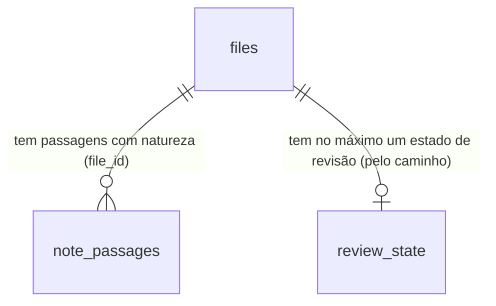

# Cérebro: natureza da informação — fato, opinião, plano, hipótese e relato separados, e revisão periódica

## Problem

O Segundo Cérebro guarda tudo com o mesmo peso. Uma nota que diz "vamos lançar o curso em março" e uma que diz "lançamos o
curso em março" chegam iguais à busca, ao recall e ao agente; nada no índice diz qual é realidade, qual é intenção e qual é
opinião de alguém. Levantamento no código em `chore/cerebro-v3-roteiro`:

- **O índice não sabe a natureza de nada.** O cabeçalho de uma nota só tem `title` e `tags` lidos
  (`core/src/memory/frontMatter.ts:1-9`); os outros campos são os `chave:: valor` do corpo, primeira ocorrência vence
  (`fields.ts:4-11`). Não existe a ideia de "esta passagem é um plano".
- **O recall entrega trechos sem rótulo.** `RecallContext` tem `path`, `section`, `excerpt`, `score`, `why` e `via`
  (`recall.ts:49-58`); um trecho de "Open loops" ou de "Reflections" (`skills/consolidate-memory/SKILL.md:59`) volta ao agente
  como volta um trecho de "Facts". O agente que responde "qual é o preço do plano anual?" pode citar uma proposta como se
  fosse o preço em vigor.
- **Só os fatos estruturados têm validade.** A tabela `facts` guarda sujeito, predicado, objeto e `valid_to`
  (`core/src/memory/facts.ts:74-106`), mas é alimentada só pela consolidação e pela rota `POST /api/memory/facts`; o texto
  das notas, onde mora quase tudo, não tem natureza nem prazo.
- **Nada cobra revisão.** Uma opinião de um ano atrás, um plano que ninguém executou e um status de projeto velho continuam
  "ativos" até alguém abrir o arquivo. Os sentinelas (`core/src/sentinels/types.ts:11-27`) já vigiam rotinas silenciosas e
  falhas repetidas sem custo de LLM, mas nenhum vigia conteúdo vencido.

Ninguém deu métrica de uso. A pesquisa de 29/10/2026 (`reports/Segundo cérebro para agentes.md`) aponta o mesmo risco por
outro lado: memória que mistura o que foi dito com o que é verdade é a que mais engana o agente (bi-temporalidade do
Graphiti; reflexões do agente rotuladas como proposta, R7).

Quando isto sair: cada nota e cada passagem pode dizer se é fato, opinião, plano, hipótese ou relato, e de quem (pessoal,
equipe, externo); a busca e o recall filtram e rotulam por isso, e um plano nunca chega ao agente como fato; e o sistema
lembra, uma vez por dia e sem custo de modelo, o que venceu a revisão — e aceita "ainda vale", "virou realidade", "mudei de
ideia", "adiar" e "não cobrar mais" num clique.

## Flow

Reutiliza o leitor de cabeçalho e o `fields` (`frontMatter.ts`, `fields.ts`, estendidos pela porta 6 de `cerebro-organizar`),
a rota de propriedades guardada por versão de `cerebro-vista-notas` (`PUT /api/memory/notes/properties`), o laço horário dos
sentinelas com chave de dedupe por dia (`sentinels/runner.ts`, `types.ts`), o gravador de notificações
(`notifications/recorder.ts`), a tabela `facts` e o bloco de regras do compilador (`sync/compiler.ts`); nada de agendador,
de escritor de nota nem de inbox novos.

1. Indexação → `MemoryIndexer` (exists) lê do cabeçalho `natureza`, `escopo` e `review_every` (door 1) junto com `type`,
   `status`, `updated` e `last_reviewed` (já da porta 6 de `cerebro-organizar`) para `fields`, e os blocos `> [!natureza]`
   do corpo para `note_passages` (door 2), com a linha de início e de fim.
2. Busca → `searchFiles` (exists) e `SemanticSearch.search` (exists) aceitam `natureza` e `escopo`; cada linha ganha a
   natureza da nota.
3. Recall → `recall` (exists) aceita `natureza` e `escopo` e dá a cada trecho a natureza da passagem que o contém, ou a da
   nota, ou a da seção dos arquivos gerados (`MEMORY.md`, diário: door 3), ou `null`.
4. Cadência → `reviewsDue` (new, door 4 e door 5) em `core/src/memory/reviews.ts` (new, no door - placement per conventions)
   cruza `fields` com a cadência de `settings.memory.reviews` e com `review_state` e devolve o que venceu.
5. Cobrança → `SentinelRunner.hourly` (exists) chama o sentinela `reviewDue` (door 5), que emite `sentinel.fired` uma vez por
   dia; o gravador de notificações (exists) cria a linha do inbox com link para "Revisões".
6. Decisão → `POST /api/memory/reviews` (new, door 4): numa nota de `memory/`, grava pelo `setProperties` de
   `cerebro-vista-notas` (com `baseVersion`); fora de `memory/`, grava só em `review_state` (door 6); "virou realidade" pode
   também chamar `assertFact` (exists) com `source_path`.
7. Agentes → o compilador (exists) e `buildRunPrompt` (exists) levam o bloco fixo "Natureza da informação".
8. Interface → a tela "Revisões" (new, no door - placement per conventions) nas duas interfaces, os selos e os filtros de
   natureza na busca e no preview das telas do cérebro (exist).

## Impact

| Front         | What changes                                                                                                                                                                                                                                                                                           |
| ------------- | ------------------------------------------------------------------------------------------------------------------------------------------------------------------------------------------------------------------------------------------------------------------------------------------------------ |
| domain        | new term: `natureza` - o que uma nota ou passagem é em relação à realidade: `fato`, `opiniao`, `plano`, `hipotese`, `relato`; ausente = não classificada, nunca presumida fato                                                                                                                         |
| domain        | new term: `escopo` - de quem é a informação: `pessoal`, `equipe`, `externo`; é rótulo, não permissão (o produto é de um dono só; permissão por pasta é de `cerebro-memoria-confiavel`)                                                                                                                 |
| domain        | new term: `revisão` - a cobrança periódica de uma nota cuja cadência venceu; decidida por "ainda vale", "virou realidade", "mudei de ideia", "adiar" ou "não cobrar mais"                                                                                                                              |
| domain        | existing term: `fields` de um arquivo ganham `natureza`, `escopo` e `review_every` - quem lê hoje: o grafo (`graph.ts:132`), o preview (`brain/PreviewPanel.tsx`), a consulta por campo (`fields.ts:95-117`)                                                                                           |
| domain        | existing term: `RecallContext` ganha `natureza` e `escopo` (aditivo) - quem lê hoje: a CLI `mordomo recall`, a ferramenta MCP de recall (`apps/api/src/mcp/mordomo.ts`), a skill `recall`, a consolidação                                                                                              |
| domain        | existing term: `status: archived` passa a ser o que "mudei de ideia" grava; o recall continua devolvendo a nota, com o selo de abandonada, e a busca a filtra só se pedirem                                                                                                                            |
| stored data   | migração 22 (ou o próximo número livre na integração): `note_passages` e `review_state`, `CREATE TABLE IF NOT EXISTS`, nada altera linha existente; as passagens das notas que não mudaram são preenchidas do texto que o FTS já guarda (como o `backfillNoteLinks` da migração 20), sem reler o disco |
| settings      | `settings.memory.reviews` (cadências, padrão abaixo) e `settings.sentinels.reviewDue` (`enabled`, padrão ligado)                                                                                                                                                                                       |
| contrato REST | `GET /api/memory/search` e `GET /api/memory/recall` aceitam `natureza` e `escopo`; duas rotas novas; o enum `SentinelId` ganha `reviewDue`                                                                                                                                                             |
| arquivos      | o `AGENTS.md`/`CLAUDE.md` compilado e o prompt das execuções com acesso à memória ganham um bloco de 6 linhas; as notas de `memory/` que a pessoa revisa ganham `last_reviewed` (e, conforme a decisão, `natureza`, `status`, `became_fact`, `abandoned`) no cabeçalho                                 |

## Relations

One-way constraints: uma passagem pertence a um arquivo e some com ele (door 2); o estado de revisão é chaveado pelo caminho,
não pelo id, e sobrevive a uma reindexação (door 6); `natureza` e `escopo` são vocabulários fechados (door 1).

## Surface

| Route                           | In                                                                                                                                | Out                                                                                                                              | Status                                   |
| ------------------------------- | --------------------------------------------------------------------------------------------------------------------------------- | -------------------------------------------------------------------------------------------------------------------------------- | ---------------------------------------- |
| `GET /api/memory/reviews`       | query `kind?` (`due`, `unclassified`), `context?`, `limit?`                                                                       | `items[]` (`path` · `name` · `natureza` · `type` · `escopo` · `lastReviewed` · `dueSince` · `editable` · `suggested?`) · `total` | `200`, `400`                             |
| `POST /api/memory/reviews`      | `path`, `action` (`keep`, `snooze`, `never`, `abandon`, `became_fact`, `classify`), `days?`, `natureza?`, `baseVersion?`, `fact?` | `path` · `state` · `version?` · `fact?`                                                                                          | `200`, `400`, `403`, `404`, `409`, `413` |
| `GET /api/memory/search` (muda) | query ganha `natureza?`, `escopo?` (listas separadas por vírgula)                                                                 | cada linha ganha `natureza` · `escopo`                                                                                           | `200`, `400`, `409`                      |
| `GET /api/memory/recall` (muda) | query ganha `natureza?`, `escopo?`                                                                                                | cada `answerContext[]` ganha `natureza` · `escopo`                                                                               | `200`, `400`                             |

## Landing

| One-way door                              | Literal shape                                                                                                                                                                                                                                                                                                                                                                                                                                                                                                                                                 | Alternative rejected                                                                                                                                                                                                                                                                     |
| ----------------------------------------- | ------------------------------------------------------------------------------------------------------------------------------------------------------------------------------------------------------------------------------------------------------------------------------------------------------------------------------------------------------------------------------------------------------------------------------------------------------------------------------------------------------------------------------------------------------------- | ---------------------------------------------------------------------------------------------------------------------------------------------------------------------------------------------------------------------------------------------------------------------------------------- |
| 1. Vocabulário no cabeçalho               | `natureza: fato \| opiniao \| plano \| hipotese \| relato`; `escopo: pessoal \| equipe \| externo`; `review_every: <n>d \| never` (`n` de 1 a 3650); valores sem acento e em minúsculas, comparados depois de `normalizeFieldKey`; um valor fora da lista é lido como ausente e a nota aparece em "sem classificação"; entram em `fields` com essas chaves, e o `chave:: valor` do corpo com a mesma chave vence (a regra da porta 6 de `cerebro-organizar`)                                                                                                  | uma tag por natureza (`#plano`): uma tag não exclui outra (uma nota `#plano #fato` não tem resposta), e as tags já são do dono para outras coisas; nomes em inglês (`nature: plan`): o resto do vocabulário que o dono lê está em português, e o valor aparece cru no YAML que ele edita |
| 2. Passagens                              | `note_passages(file_id INTEGER NOT NULL, natureza TEXT NOT NULL, start_line INTEGER NOT NULL, end_line INTEGER NOT NULL, PRIMARY KEY (file_id, start_line))`; uma passagem é um bloco de citação que começa com `> [!fato]`, `> [!opiniao]`, `> [!plano]`, `> [!hipotese]` ou `> [!relato]` (o formato de callout do Obsidian, maiúsculas aceitas, um título opcional depois) e vai até a última linha `>` seguida; fora de bloco de código                                                                                                                   | guardar as passagens em `fields` (JSON): sem consulta por linha e sem teto natural; `natureza:: plano` antes de cada parágrafo: o leitor de campos é por arquivo e a primeira ocorrência vence (`fields.ts:4-11`); um comentário HTML: invisível no Obsidian e na vista de notas         |
| 3. Natureza de seção nos arquivos gerados | `MEMORY.md`: `## Facts` e `## Decisions` → `fato`, `## Open loops` → `plano`, `## Reflections` → `opiniao`, `## Superseded` → `fato` com o selo "substituído"; diário: `## Decisions` → `fato`, `## Open loops` → `plano`, `## Today` e `## Runs` → `relato`; a tabela vive em `recall.ts` e a skill `consolidate-memory` passa a escrever com esses títulos                                                                                                                                                                                                  | pedir à consolidação que escreva `> [!fato]` em cada linha: polui o arquivo que o agente lê no topo do contexto e quebra o formato de uma linha por entrada                                                                                                                              |
| 4. Contrato de revisões                   | as duas rotas da `Surface`; `GET` com escopo `content`, `POST` com escopo `owner` (escrever conteúdo, AD-031); `action: "snooze"` exige `days` de 1 a 365; `became_fact` aceita `fact: { subject, predicate, object, validFrom? }` e grava a natureza `fato`, `became_fact: AAAA-MM-DD` e `was: <natureza anterior>`; `abandon` grava `status: archived` e `abandoned: AAAA-MM-DD`; `classify` exige `natureza`; erros `400 validation`, `403 note_not_editable`, `404 not_found`, `409 edit_conflict`, `413 note_too_large`                                  | uma rota por ação: seis rotas para uma decisão que a tela toma num clique e que o MCP também toma; reusar só `PUT /api/memory/notes/properties`: não cobre o estado de um arquivo fora de `memory/`, que não pode ser escrito                                                            |
| 5. Cadência e sentinela                   | `settings.memory.reviews = { cadence: { opiniao: "90d", plano: "30d", hipotese: "60d", relato: "never", fato: "never" }, byType: { status: "30d", conceito: "180d" }, maxPerDay: 20 }`; `review_every` da nota vence o `byType`, que vence o `cadence`; vence quando `hoje ≥ (last_reviewed ou mtime) + cadência` e não há `snooze_until` futuro; `SentinelId` ganha `"reviewDue"`, `settings.sentinels.reviewDue = { enabled: true }`; dispara no laço horário, uma vez por dia (chave `sentinel:reviewDue:<dia>:all`), só quando há ao menos 1 item vencido | uma rotina em `routines/` que roda um agente: gasta um modelo para contar datas que uma consulta conta; um aviso por nota: com 20 notas vencidas, 20 linhas no inbox por dia                                                                                                             |
| 6. Estado de revisão fora do arquivo      | `review_state(path TEXT PRIMARY KEY, last_reviewed INTEGER, snooze_until INTEGER, never INTEGER NOT NULL DEFAULT 0, updated_at INTEGER NOT NULL)`; vale para qualquer arquivo (o adiamento nunca vai para o cabeçalho, nem nas notas de `memory/`); para arquivo fora de `memory/` é o único lugar de "ainda vale" e "não cobrar mais"; um arquivo renomeado perde o estado (fica dito)                                                                                                                                                                       | chavear por `files.id`: o id muda quando o arquivo sai e volta ao índice, e a decisão do dono sumiria numa reindexação completa; gravar o adiamento no cabeçalho: cada "adiar" vira uma versão nova da nota e um conflito possível com o editor aberto                                   |

- Nothing else in this change is hard to reverse: o texto do bloco para os agentes, as heurísticas de sugestão, a ordem da
  lista de revisões e os selos mudam por refatoração.

## Criteria

### S1: o índice sabe a natureza (P1)

Cada nota e cada passagem tem natureza e escopo no índice, lidos do texto do dono.

**Acceptance Criteria**

1. WHEN a Markdown file's front matter holds `natureza: plano` and `escopo: equipe` THEN the index SHALL store `natureza` = `plano` and `escopo` = `equipe` in the file's `fields`.
2. IF the front matter holds a `natureza` or `escopo` value outside the closed lists (e.g. `natureza: talvez`) THEN the index SHALL store no `natureza` (or `escopo`) for the file and SHALL NOT fail the pass.
3. WHEN the front matter holds `review_every: 45d` or `review_every: never` THEN the index SHALL store it in `fields`, and IF it holds `review_every: 0d`, `5000d` or `semana` THEN it SHALL store none.
4. WHEN a file's body holds a block starting `> [!plano] Lançamento` and its following `>` lines THEN the index SHALL store one `note_passages` row with `natureza` = `plano` and the block's first and last line numbers.
5. IF a callout-like block sits inside a fenced code block, or its marker is not one of the five natures (e.g. `> [!note]`) THEN the index SHALL store no passage for it.
6. WHEN migration 22 runs on a database with indexed Markdown THEN it SHALL create `note_passages` and `review_state` with `IF NOT EXISTS`, change no existing row, and the next pass SHALL fill the passages of unchanged files from the stored text without opening them.
7. WHEN a file is removed from the index THEN its `note_passages` rows SHALL be deleted in the same transaction, and its `review_state` row SHALL stay.

**Independent test:** indexar uma nota com cabeçalho `natureza: opiniao` e um bloco `> [!plano]`; o índice tem os dois, e um
`> [!note]` ao lado não gera passagem.

### S2: busca e recall segregados (P1)

Quem pergunta pode pedir só fatos, ou ver cada trecho com o rótulo do que ele é.

**Acceptance Criteria**

8. WHEN `GET /api/memory/search?q=preço&natureza=fato` is called THEN the system SHALL return only files whose `natureza` is `fato`, and WHEN `natureza=fato,relato` THEN files of either nature.
9. WHEN `GET /api/memory/search` is called with `escopo=pessoal` THEN the system SHALL return only files whose `escopo` is `pessoal`, and IF `natureza` or `escopo` holds a value outside the lists THEN it SHALL answer `400 validation`.
10. The system SHALL return `natureza` and `escopo` (or `null` for each) on every search hit.
11. WHEN a recall excerpt lies within the lines of a `note_passages` row THEN its `natureza` SHALL be that passage's; ELSE the file's `natureza` from `fields`; ELSE the section's nature from the generated-file table (door 3); ELSE `null`.
12. WHEN `GET /api/memory/recall?q=…&natureza=fato` is called THEN no item of `answerContext` SHALL have a `natureza` other than `fato`, and an excerpt with `natureza` `null` SHALL NOT be returned.
13. WHEN `mordomo recall "<pergunta>"` prints an excerpt whose `natureza` is `plano`, `hipotese` or `opiniao` THEN the line SHALL start with `[Plano — ainda não é realidade]`, `[Hipótese]` or `[Opinião]`, and an excerpt with `natureza` `null` SHALL start with `[Não classificado]`.
14. WHEN a note has `status: archived` and `abandoned` set THEN its recall excerpts SHALL carry `natureza` as stored and the CLI line SHALL add `(abandonado em AAAA-MM-DD)`.
15. WHEN `mordomo sync --apply` compiles `AGENTS.md`/`CLAUDE.md`, and WHEN a run with memory access starts, THEN the text SHALL hold the block "Natureza da informação" stating that a `plano`, `hipotese` or `opiniao` excerpt SHALL NOT be stated as fact and that an answer SHALL name the nature of what it cites.
16. WHEN the `consolidate-memory` skill writes `MEMORY.md` THEN its guide SHALL keep the section titles of door 3, and its `Reflections` SHALL be read as `opiniao` by recall.

**Independent test:** duas notas sobre o mesmo preço, uma `natureza: plano` e outra `natureza: fato`; o recall com
`natureza=fato` devolve só a segunda, e sem filtro a CLI mostra a primeira com "[Plano — ainda não é realidade]".

### S3: o que venceu a revisão (P1)

**Acceptance Criteria**

17. WHEN a note has `natureza: opiniao`, no `review_every`, and `last_reviewed` 91 days ago THEN `GET /api/memory/reviews?kind=due` SHALL list it with `dueSince` one day ago; WHEN `last_reviewed` is 89 days ago THEN it SHALL NOT.
18. WHEN a note has no `last_reviewed` THEN its due date SHALL count from its `mtime`.
19. WHEN a note has `review_every: never` or `review_state.never = 1` THEN it SHALL NOT be listed as due, whatever its nature and age.
20. WHEN a note has `type: status` and `natureza: fato` THEN its cadence SHALL be `settings.memory.reviews.byType.status` (30 days by default), and `review_every` on the note SHALL win over both.
21. WHILE `review_state.snooze_until` is in the future the note SHALL NOT be listed as due, and WHEN that time passes THEN it SHALL be listed again.
22. WHEN a context is given (`context=<id>`, `cerebro-contextos`) THEN the list SHALL hold only files inside that context's paths.
23. IF a listed file is excluded by today's policy THEN it SHALL NOT be listed.
24. WHEN the hourly sentinel pass runs with at least one due item and no `reviewDue` notification today THEN the system SHALL emit one `sentinel.fired` with `sentinel: "reviewDue"` and the due count, and a second pass the same day SHALL emit none.
25. WHILE `settings.sentinels.reviewDue.enabled` is `false` the system SHALL emit no `reviewDue` event.
26. The notification of `reviewDue` SHALL link to the "Revisões" screen and SHALL say "N itens para revisar" / "N items to review" with N the due count capped at `maxPerDay` (shown as "20+").

**Independent test:** três notas (opinião velha, plano novo, fato velho); a lista devolve só a opinião, o sentinela cria
uma notificação e a segunda passada do dia não cria outra.

### S4: decidir num clique (P1)

**Acceptance Criteria**

27. WHEN `POST /api/memory/reviews` with `action: "keep"` names an editable note of `memory/` and its current `baseVersion` THEN the system SHALL set `last_reviewed` to today in its front matter through the guarded properties write, answer `200` with the new `version`, and the note SHALL leave the due list.
28. WHEN `action: "keep"` names a file outside `memory/` THEN the system SHALL set `review_state.last_reviewed` to now, SHALL NOT write the file, and the file SHALL leave the due list.
29. WHEN `action: "snooze"` with `days: 14` is called THEN the system SHALL set `review_state.snooze_until` to now + 14 days for any file, and SHALL NOT write the file; IF `days` is outside 1-365 THEN `400 validation`.
30. WHEN `action: "never"` is called THEN an editable note SHALL get `review_every: never` in its front matter and a file outside `memory/` SHALL get `review_state.never = 1`.
31. WHEN `action: "became_fact"` names an editable note with `natureza: plano` THEN the system SHALL set `natureza: fato`, `was: plano`, `became_fact` and `last_reviewed` to today, and WHERE `fact` is given it SHALL assert it with `source_path` = the note's path and `valid_from` = `fact.validFrom` or now.
32. WHEN `action: "abandon"` names an editable note THEN the system SHALL set `status: archived` and `abandoned` to today, SHALL keep `natureza`, and SHALL NOT delete or move the file.
33. IF `action` is `became_fact`, `abandon` or `classify` and the file is outside `memory/` (or is `ROUTER.md`, `areas/`, `journal/`) THEN the system SHALL answer `403 note_not_editable` and write nothing.
34. IF `baseVersion` differs from the file on disk THEN the system SHALL answer `409 edit_conflict` and write nothing, and `review_state` SHALL be unchanged.
35. WHILE the caller is a paired device or a run credential, `POST /api/memory/reviews` SHALL answer `403` (`owner_only` for a device), and `GET /api/memory/reviews` SHALL answer for a device that holds `content`.
36. WHEN any decision is saved THEN the next `GET /api/memory/reviews` SHALL reflect it, and an index pass SHALL be requested for that path only.

**Independent test:** na lista, "Ainda vale" numa nota de `memory/` grava `last_reviewed` e a tira da lista; "Adiar 14 dias"
num arquivo de uma pasta do usuário não muda os bytes do arquivo.

### S5: a tela "Revisões" (P1)

**Acceptance Criteria**

37. WHEN the person opens "Revisões" (the route `/brain/reviews`, reached from the "Revisões (N)" button of the Second Brain toolbar, the `reviewDue` notification and the palette command "Revisões" in both shells) THEN the screen SHALL list the due items, oldest `dueSince` first, each with name, path, a nature badge (icon + text), the age as text ("revisado há 4 meses") and the actions "Ainda vale", "Atualizar", "Virou realidade", "Mudei de ideia", "Adiar", "Não cobrar mais".
38. WHEN an item is not editable THEN the screen SHALL show only "Ainda vale", "Adiar" and "Não cobrar mais", with the reason "Fora de memory/: a decisão fica no MordomoOS, o arquivo não muda." beside a lock icon.
39. WHEN the person chooses "Atualizar" THEN the note SHALL open in the note editor (or the notes view of `cerebro-vista-notas`), and the item SHALL stay in the list until a decision is saved.
40. WHEN the person chooses "Virou realidade" THEN a dialog SHALL ask the date (today by default) and, optionally, the fact as three fields (o quê, qual atributo, valor), and "Confirmar" SHALL save; "Adiar" SHALL offer 7, 14, 30 and 90 days.
41. WHEN a decision is saved THEN the item SHALL leave the list with a 150 ms transition, an "Desfazer" toast SHALL stay for 8 seconds, and "Desfazer" SHALL restore the previous front matter (by version) or `review_state` row.
42. IF a save answers `409 edit_conflict` THEN the item SHALL show "A nota mudou desde que a lista foi carregada." with "Recarregar", and SHALL NOT be removed.
43. WHEN the list is empty THEN the screen SHALL show "Nada para revisar hoje." and the next due date ("Próxima revisão em 12 dias"), and WHILE it loads a spinner with "Carregando…", and IF it fails the error with "Tentar de novo".
44. The screen SHALL offer the filters "Natureza" and "Escopo" (chips) and respect the active context, and the badge colors SHALL come from tokens with the nature always written as text.
45. The screen SHALL be 12px minimum, colors only from tokens, every motion off under `prefers-reduced-motion`, keyboard-operable (each action reachable by Tab, `Enter` activates), and SHALL pass axe at WCAG A/AA in both themes and both shells.

**Independent test:** abrir "Revisões" com duas notas vencidas, decidir "Ainda vale" numa e "Desfazer"; a nota volta à lista e
o cabeçalho volta ao que era.

### S6: classificar o que não tem natureza (P2)

**Acceptance Criteria**

46. WHEN `GET /api/memory/reviews?kind=unclassified` is called THEN the system SHALL list the Markdown notes under `memory/notes` with no `natureza`, each with `suggested` as one nature or `null`.
47. WHEN a note's text holds future-intent markers in Portuguese or English ("vamos", "planejamos", "pretendemos", "a meta é", "we will", "plan to") more often than past markers THEN `suggested` SHALL be `plano`; WHEN it holds opinion markers ("acho que", "na minha opinião", "I think", "in my view") THEN `opiniao`; ELSE `null`.
48. The system SHALL NOT write a suggested nature to any file; only `action: "classify"` with an explicit `natureza` chosen by the person SHALL write it.
49. WHEN the person opens the tab "Sem classificação" of "Revisões" THEN each note SHALL show the suggestion as "Sugestão: Plano" with one-click "Confirmar" and a choice of the five natures, and "Não classificar" SHALL hide it for 90 days through `review_state.snooze_until`.

**Independent test:** uma nota com "vamos lançar em março" aparece como "Sugestão: Plano"; nada é gravado até "Confirmar".

## Out of scope

| Excluded                                                                                   | Why                                                                                                                                                  |
| ------------------------------------------------------------------------------------------ | ---------------------------------------------------------------------------------------------------------------------------------------------------- |
| Classificar a natureza por LLM                                                             | custa uma execução por nota e erra em silêncio; a skill `organize-brain` (`cerebro-organizar`) pode propor natureza na entrevista, a pessoa confirma |
| Resposta segregada na tela ("Perguntar ao cérebro" com fatos, planos e opiniões em blocos) | a interface ainda não chama o recall; entra em `cerebro-perguntar`, com os rótulos desta feature                                                     |
| Permissão por escopo (`equipe` só para alguns)                                             | o produto é de um dono só; permissão por pasta é de `cerebro-memoria-confiavel`                                                                      |
| Mover para arquivo o que foi abandonado                                                    | mover é de `cerebro-faxina-guiada` (arquivo com desfazer); aqui "mudei de ideia" só marca                                                            |
| Bi-temporalidade dos fatos (`recorded_at`, `retracted_at`)                                 | é de `cerebro-memoria-confiavel`; "virou realidade" usa `assertFact` como ele é hoje                                                                 |
| Revisão por passagem (um `> [!plano]` com prazo próprio)                                   | a cadência é por nota; uma passagem herda a da nota. Se pedir, entra em `cerebro-rituais`                                                            |
| Revisão semanal completa (GTD), painéis                                                    | é de `cerebro-rituais`; esta feature dá a fila e a cobrança diária que a revisão semanal vai consumir                                                |

## Assumptions

| Assumption                  | Chosen default                                                                                       | Rationale                                                                                                                                          | Confirmed? |
| --------------------------- | ---------------------------------------------------------------------------------------------------- | -------------------------------------------------------------------------------------------------------------------------------------------------- | ---------- |
| Nota sem natureza           | "não classificada", nunca presumida fato; a busca e o recall sem filtro a devolvem como hoje         | presumir fato é exatamente o erro que a feature evita; esconder o não classificado esconderia quase tudo no primeiro dia                           | n          |
| Cadências padrão            | opinião 90 dias, plano 30, hipótese 60, relato e fato nunca; `type: status` 30, `type: conceito` 180 | plano envelhece mais rápido que opinião; relato é registro do que aconteceu e não vence; fato tem validade pela tabela `facts`, não por calendário | n          |
| Sentinela ligado por padrão | `settings.sentinels.reviewDue.enabled = true`, uma notificação por dia no máximo                     | sem custo de modelo nem rede; uma linha por dia no inbox é o mínimo que faz a revisão acontecer; o dono desliga em Configurações                   | n          |
| Teto da fila                | `maxPerDay: 20` itens mostrados por vez, os mais velhos primeiro                                     | uma fila de 300 itens no primeiro dia não é revisada; 20 cabem em poucos minutos                                                                   | n          |
| Desfazer                    | 8 segundos, pela versão anterior (nota) ou pela linha anterior (`review_state`)                      | o padrão do aviso com ação já existe no shell; desfazer depois disso é editar a nota                                                               | n          |
| Heurística de sugestão      | marcadores fixos em PT e EN, contagem simples, sugestão só mostrada                                  | determinístico e explicável; o custo de errar é zero porque nada é gravado sem a pessoa                                                            | n          |

**Open questions:**

| #   | Kind           | Question                                                                                                                                                                                                                                                                                           | Until answered                                                                                            |
| --- | -------------- | -------------------------------------------------------------------------------------------------------------------------------------------------------------------------------------------------------------------------------------------------------------------------------------------------- | --------------------------------------------------------------------------------------------------------- |
| 1   | open           | O vocabulário (`fato`, `opiniao`, `plano`, `hipotese`, `relato`; `pessoal`, `equipe`, `externo`) serve, ou o dono quer outro nome ou uma natureza a mais (por exemplo `decisao` separada de `fato`)? Recomendo este: `decisao` é um fato sobre o que foi decidido, e o `type` já diz que é decisão | vale este vocabulário; mudar depois é uma migração de valores nas notas do dono (door 1)                  |
| 2   | blocks go-live | A cobrança diária vem ligada? Recomendo ligada (uma notificação por dia no máximo, sem custo). A alternativa é desligada até o dono ligar em Configurações                                                                                                                                         | AC 24-26 valem com o padrão ligado; trocar o padrão muda uma linha de `settings` e AC 25 continua valendo |

## Observable

| Surface                                                | Decision                                   | Landing                                                                                          |
| ------------------------------------------------------ | ------------------------------------------ | ------------------------------------------------------------------------------------------------ |
| screen Revisões                                        | empty state                                | AC 43                                                                                            |
| screen Revisões                                        | loading state                              | AC 43                                                                                            |
| screen Revisões                                        | error state                                | AC 42, AC 43                                                                                     |
| screen Revisões                                        | unauthorised                               | n/a - a interface do dono usa o token do dono; um dispositivo recebe `403` no `POST` (AC 35)     |
| screen Revisões                                        | density and ordering                       | AC 37, AC 44; teto de 20 (Assumptions)                                                           |
| screen Revisões                                        | destructive action confirms                | AC 41 (desfazer em vez de confirmar: nenhuma ação apaga; "Virou realidade" pede a data, AC 40)   |
| screen Revisões, aba Sem classificação                 | empty, loading, error, density             | AC 49; vazio, carregando e erro como AC 43                                                       |
| screen busca e preview do cérebro (selos e filtros)    | density and ordering                       | AC 10, AC 44                                                                                     |
| API `GET /api/memory/reviews`                          | error shape and codes                      | AC 22, AC 23; `400 validation` para `kind` desconhecido                                          |
| API `POST /api/memory/reviews`                         | error shape and codes                      | AC 29, AC 33, AC 34                                                                              |
| API `GET /api/memory/search`, `GET /api/memory/recall` | error shape and codes                      | AC 9, AC 12                                                                                      |
| all new and changed `/api/memory/*` routes             | who may call                               | AC 35                                                                                            |
| all new and changed `/api/memory/*` routes             | versioning, rate limits                    | n/a - `/api/v1` é o mesmo conjunto de rotas (api-v1) e nenhuma ganha limite próprio              |
| command `mordomo recall`                               | output, flags, exit codes                  | AC 13, AC 14; `--natureza` e `--escopo` repetem os filtros da rota (AC 12)                       |
| scheduled task sentinela `reviewDue`                   | output, failure halfway                    | AC 24-26; uma falha da consulta é engolida pelo laço dos sentinelas e registrada, como os outros |
| document bloco "Natureza da informação" (agentes)      | structure, tone, what the reader does next | AC 15; o texto literal vai no `design.md`                                                        |
| document notificação `reviewDue`                       | structure, what the reader does next       | AC 26                                                                                            |
| collection fila de revisões                            | grouping, ordering, duplicates, exception  | AC 17-23; um arquivo aparece uma vez; o arquivo fora de `memory/` é a exceção (AC 28, AC 38)     |

## Sources

- Pedido do dono em 29/10/2026 (segregar fatos, opiniões, planos e relatos pessoais e de equipe; cobrar revisão periódica com
  a opção de ignorar e manter).
- `.specs/features/cerebro-organizar/plan.md` porta 6 (front matter em `fields`) e `.specs/features/cerebro-vista-notas/plan.md`
  porta 2 (`PUT /api/memory/notes/properties` guardada por versão) — as duas peças que esta feature estende.
- `.specs/features/design-system/design.md`, `.specs/features/primitivas/design.md` e `design.md` desta feature — binding para a
  tela.
