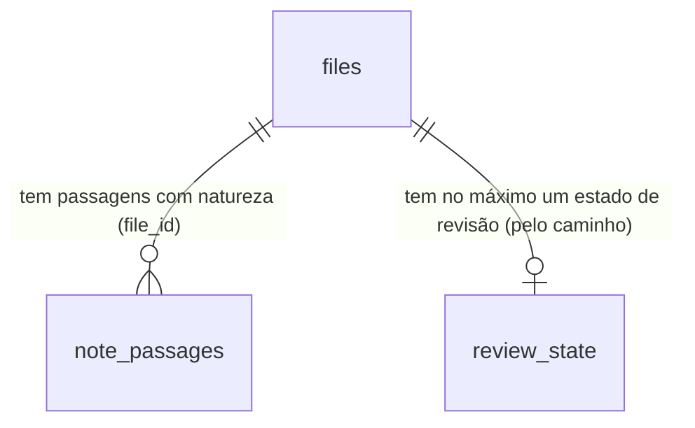

# Cérebro: natureza da informação — fato, opinião, plano, hipótese e relato separados, e revisão periódica

## Problem

O Segundo Cérebro guarda tudo com o mesmo peso. Uma nota que diz "vamos lançar o curso em março" e uma que diz "lançamos o
curso em março" chegam iguais à busca, ao recall e ao agente; nada no índice diz qual é realidade, qual é intenção e qual é
opinião de alguém. Levantamento no código em `chore/cerebro-v3-roteiro`:

- **O índice não sabe a natureza de nada.** O cabeçalho de uma nota só tem `title` e `tags` lidos
  (`core/src/memory/frontMatter.ts:1-9`); os outros campos são os `chave:: valor` do corpo, primeira ocorrência vence
  (`fields.ts:4-11`). Não existe a ideia de "esta passagem é um plano".
- **O recall entrega trechos sem rótulo.** `RecallContext` tem `path`, `section`, `excerpt`, `score`, `why` e `via`
  (`recall.ts:49-58`); um trecho de "Open loops" ou de "Reflections" (`skills/consolidate-memory/SKILL.md:59`) volta ao agente
  como volta um trecho de "Facts". O agente que responde "qual é o preço do plano anual?" pode citar uma proposta como se
  fosse o preço em vigor.
- **Só os fatos estruturados têm validade.** A tabela `facts` guarda sujeito, predicado, objeto e `valid_to`
  (`core/src/memory/facts.ts:74-106`), mas é alimentada só pela consolidação e pela rota `POST /api/memory/facts`; o texto
  das notas, onde mora quase tudo, não tem natureza nem prazo.
- **Nada cobra revisão.** Uma opinião de um ano atrás, um plano que ninguém executou e um status de projeto velho continuam
  "ativos" até alguém abrir o arquivo. Os sentinelas (`core/src/sentinels/types.ts:11-27`) já vigiam rotinas silenciosas e
  falhas repetidas sem custo de LLM, mas nenhum vigia conteúdo vencido.

Ninguém deu métrica de uso. A pesquisa de 29/10/2026 (`reports/Segundo cérebro para agentes.md`) aponta o mesmo risco por
outro lado: memória que mistura o que foi dito com o que é verdade é a que mais engana o agente (bi-temporalidade do
Graphiti; reflexões do agente rotuladas como proposta, R7).

Quando isto sair: cada nota e cada passagem pode dizer se é fato, opinião, plano, hipótese ou relato, e de quem (pessoal,
equipe, externo); a busca e o recall filtram e rotulam por isso, e um plano nunca chega ao agente como fato; e o sistema
lembra, uma vez por dia e sem custo de modelo, o que venceu a revisão — e aceita "ainda vale", "virou realidade", "mudei de
ideia", "adiar" e "não cobrar mais" num clique.

## Flow

Reutiliza o leitor de cabeçalho e o `fields` (`frontMatter.ts`, `fields.ts`, estendidos pela porta 6 de `cerebro-organizar`),
a rota de propriedades guardada por versão de `cerebro-vista-notas` (`PUT /api/memory/notes/properties`), o laço horário dos
sentinelas com chave de dedupe por dia (`sentinels/runner.ts`, `types.ts`), o gravador de notificações
(`notifications/recorder.ts`), a tabela `facts` e o bloco de regras do compilador (`sync/compiler.ts`); nada de agendador,
de escritor de nota nem de inbox novos.

1. Indexação → `MemoryIndexer` (exists) já guarda em `files.fields` o `natureza`, o `escopo` e o `review_every` do cabeçalho
   (porta 6 de `cerebro-organizar`, `FRONT_MATTER_FIELDS` de `frontMatter.ts`, que ganha `abandoned`, "Emendas" 13) junto com
   `type`, `status`, `updated` e `last_reviewed`, como texto; a lista fechada da door 1 vale quando a natureza é lida, não
   na gravação ("Emendas" 2); os blocos `> [!natureza]` do corpo vão para `note_passages` (door 2, migração 25, "Emendas"
   1), com a linha de início e de fim, e as notas que não mudaram ganham as passagens do texto de `files_fts`.
2. Busca → `searchFiles` (exists) e `SemanticSearch.search` (exists) aceitam `natureza` e `escopo`; cada linha ganha a
   natureza da nota.
3. Recall → `recall` (exists) aceita `natureza` e `escopo` e dá a cada trecho a natureza da passagem que o contém, ou a da
   nota, ou a da seção dos arquivos gerados (`MEMORY.md`, diário: door 3), ou `null`; a CLI `mordomo recall` (exists) põe o
   rótulo na linha de cada trecho ("Emendas" 12).
4. Cadência → `reviewsDue` (new, door 4 e door 5) em `core/src/memory/reviews.ts` (new, no door - placement per conventions)
   cruza `fields` com a cadência de `settings.memory.reviews` e com `review_state`, no escopo de um contexto pela
   `contextMembership` (exists, `cerebro-contextos`) mais `memory/notes/<id>/` ("Emendas" 5), e devolve o que venceu.
5. Cobrança → `SentinelRunner.hourly` (exists) chama o sentinela `reviewDue` (door 5, `core/src/sentinels/reviewDue.ts`, new,
   no door - placement per conventions), que conta pelo `reviewsDue` e emite `sentinel.fired` uma vez por dia; o gravador de notificações (exists) cria a linha do inbox com link para "Revisões"; Configurações › Notificações
   (`SentinelsCard`, exists) ganha a linha que o desliga ("Emendas" 16).
6. Decisão → `POST /api/memory/reviews` (new, door 4; `apps/api/src/routes/reviews.ts` e `core/src/memory/reviewDecisions.ts`,
   new, no door - placement per conventions): numa nota editável de `memory/` (`classifyNotePath`, exists), grava
   pelo `saveProperties` de `cerebro-vista-notas` (com `baseVersion`); em todo arquivo que não é editável, grava só em
   `review_state` (door 6, "Emendas" 4); "virou realidade" pode também chamar `assertFact` (exists) com `source_path`; pede ao
   `MemoryIndexer.requestIndexPaths` (exists) a passada daquele caminho, e responde quando ela acaba (no máximo 2 s); `action: "restore"` devolve uma linha de
   `review_state` ao que era ("Emendas" 7).
7. Agentes → o compilador (exists) e `buildRunPrompt` (exists) levam o bloco fixo "Natureza da informação" ("Emendas" 11).
8. Interface → a tela "Revisões" (new, no door - placement per conventions) nas duas interfaces, os selos e os filtros de
   natureza na busca e no preview das telas do cérebro (exist); "Desfazer" volta a nota por
   `PUT /api/memory/notes/properties` (exists) e o fato por `POST /api/memory/facts/:id/retract` (exists) ("Emendas" 7).

## Impact

| Front         | What changes                                                                                                                                                                                                                                                                                                                                                                                                                                                               |
| ------------- | -------------------------------------------------------------------------------------------------------------------------------------------------------------------------------------------------------------------------------------------------------------------------------------------------------------------------------------------------------------------------------------------------------------------------------------------------------------------------- |
| domain        | new term: `natureza` - o que uma nota ou passagem é em relação à realidade: `fato`, `opiniao`, `plano`, `hipotese`, `relato`; ausente = não classificada, nunca presumida fato                                                                                                                                                                                                                                                                                             |
| domain        | new term: `escopo` - de quem é a informação: `pessoal`, `equipe`, `externo`; é rótulo, não permissão (o produto é de um dono só; permissão por pasta é de `cerebro-memoria-confiavel`)                                                                                                                                                                                                                                                                                     |
| domain        | new term: `revisão` - a cobrança periódica de uma nota cuja cadência venceu; decidida por "ainda vale", "virou realidade", "mudei de ideia", "adiar" ou "não cobrar mais"                                                                                                                                                                                                                                                                                                  |
| domain        | existing term: `fields` de um arquivo ganham `natureza`, `escopo` e `review_every` - quem lê hoje: o grafo (`graph.ts:132`), o preview (`brain/PreviewPanel.tsx`), a consulta por campo (`fields.ts:95-117`)                                                                                                                                                                                                                                                               |
| domain        | existing term: `RecallContext` ganha `natureza` e `escopo` (aditivo) - quem lê hoje: a CLI `mordomo recall`, a ferramenta MCP de recall (`apps/api/src/mcp/mordomo.ts`), a skill `recall`, a consolidação                                                                                                                                                                                                                                                                  |
| domain        | existing term: `status: archived` passa a ser o que "mudei de ideia" grava; o recall continua devolvendo a nota, com o selo de abandonada, e a busca a filtra só se pedirem                                                                                                                                                                                                                                                                                                |
| stored data   | migração 25 (a 22 é `drop-file-links` da `cerebro-correcoes`, a 23 `run-context` da `cerebro-contextos`, a 24 `cleanup` da `cerebro-faxina-guiada`; "Emendas" 1): `note_passages` e `review_state`, `CREATE TABLE IF NOT EXISTS`, nada altera linha existente; as passagens das notas que não mudaram são preenchidas do texto que o FTS já guarda (como o `backfillNoteLinks` da migração 20), sem reler o disco; `files.fields` continua como a C3 o grava ("Emendas" 2) |
| settings      | `settings.memory.reviews` (cadências, padrão abaixo) e `settings.sentinels.reviewDue` (`enabled`, padrão ligado); `PUT /api/settings` troca `memory.reviews` inteiro (mescla `memory` um nível só) e `sentinels` inteiro ("Emendas" 16 e 17)                                                                                                                                                                                                                               |
| contrato REST | `GET /api/memory/search` e `GET /api/memory/recall` aceitam `natureza` e `escopo`; duas rotas novas, com os acréscimos de "Emendas" 4, 6 e 7; o enum `SentinelId` e o schema v1 de `sentinel.fired` ganham `reviewDue`, e `docs/events.md` é regenerado ("Emendas" 16)                                                                                                                                                                                                     |
| domain        | existing term: `became_fact` e `abandoned` passam a ser chaves de data das propriedades (porta 3 de `cerebro-vista-notas`) - quem lê hoje: a tabela de propriedades da vista de notas e `PUT /api/memory/notes/properties`, que passa a recusar nelas o que não é data ("Emendas" 3)                                                                                                                                                                                       |
| arquivos      | o `AGENTS.md`/`CLAUDE.md` compilado e o prompt das execuções com acesso à memória ganham um bloco de 6 linhas; as notas de `memory/` que a pessoa revisa ganham `last_reviewed` (e, conforme a decisão, `natureza`, `status`, `became_fact`, `abandoned`) no cabeçalho                                                                                                                                                                                                     |

## Relations

One-way constraints: uma passagem pertence a um arquivo e some com ele (door 2); o estado de revisão é chaveado pelo caminho,
não pelo id, e sobrevive a uma reindexação (door 6); `natureza` e `escopo` são vocabulários fechados (door 1).

## Surface

| Route                           | In                                                                                                                                | Out                                                                                                                              | Status                                   |
| ------------------------------- | --------------------------------------------------------------------------------------------------------------------------------- | -------------------------------------------------------------------------------------------------------------------------------- | ---------------------------------------- |
| `GET /api/memory/reviews`       | query `kind?` (`due`, `unclassified`), `context?`, `limit?`                                                                       | `items[]` (`path` · `name` · `natureza` · `type` · `escopo` · `lastReviewed` · `dueSince` · `editable` · `suggested?`) · `total` | `200`, `400`                             |
| `POST /api/memory/reviews`      | `path`, `action` (`keep`, `snooze`, `never`, `abandon`, `became_fact`, `classify`), `days?`, `natureza?`, `baseVersion?`, `fact?` | `path` · `state` · `version?` · `fact?`                                                                                          | `200`, `400`, `403`, `404`, `409`, `413` |
| `GET /api/memory/search` (muda) | query ganha `natureza?`, `escopo?` (listas separadas por vírgula)                                                                 | cada linha ganha `natureza` · `escopo`                                                                                           | `200`, `400`, `409`                      |
| `GET /api/memory/recall` (muda) | query ganha `natureza?`, `escopo?`                                                                                                | cada `answerContext[]` ganha `natureza` · `escopo`                                                                               | `200`, `400`                             |

## Landing

| One-way door                              | Literal shape                                                                                                                                                                                                                                                                                                                                                                                                                                                                                                                                                 | Alternative rejected                                                                                                                                                                                                                                                                     |
| ----------------------------------------- | ------------------------------------------------------------------------------------------------------------------------------------------------------------------------------------------------------------------------------------------------------------------------------------------------------------------------------------------------------------------------------------------------------------------------------------------------------------------------------------------------------------------------------------------------------------- | ---------------------------------------------------------------------------------------------------------------------------------------------------------------------------------------------------------------------------------------------------------------------------------------- |
| 1. Vocabulário no cabeçalho               | `natureza: fato \| opiniao \| plano \| hipotese \| relato`; `escopo: pessoal \| equipe \| externo`; `review_every: <n>d \| never` (`n` de 1 a 3650); valores sem acento e em minúsculas, comparados depois de `normalizeFieldKey`; um valor fora da lista é lido como ausente e a nota aparece em "sem classificação"; entram em `fields` com essas chaves, e o `chave:: valor` do corpo com a mesma chave vence (a regra da porta 6 de `cerebro-organizar`)                                                                                                  | uma tag por natureza (`#plano`): uma tag não exclui outra (uma nota `#plano #fato` não tem resposta), e as tags já são do dono para outras coisas; nomes em inglês (`nature: plan`): o resto do vocabulário que o dono lê está em português, e o valor aparece cru no YAML que ele edita |
| 2. Passagens                              | `note_passages(file_id INTEGER NOT NULL, natureza TEXT NOT NULL, start_line INTEGER NOT NULL, end_line INTEGER NOT NULL, PRIMARY KEY (file_id, start_line))`; uma passagem é um bloco de citação que começa com `> [!fato]`, `> [!opiniao]`, `> [!plano]`, `> [!hipotese]` ou `> [!relato]` (o formato de callout do Obsidian, maiúsculas aceitas, um título opcional depois) e vai até a última linha `>` seguida; fora de bloco de código                                                                                                                   | guardar as passagens em `fields` (JSON): sem consulta por linha e sem teto natural; `natureza:: plano` antes de cada parágrafo: o leitor de campos é por arquivo e a primeira ocorrência vence (`fields.ts:4-11`); um comentário HTML: invisível no Obsidian e na vista de notas         |
| 3. Natureza de seção nos arquivos gerados | `MEMORY.md`: `## Facts` e `## Decisions` → `fato`, `## Open loops` → `plano`, `## Reflections` → `opiniao`, `## Superseded` → `fato` com o selo "substituído"; diário: `## Decisions` → `fato`, `## Open loops` → `plano`, `## Today` e `## Runs` → `relato`; a tabela vive em `recall.ts` e a skill `consolidate-memory` passa a escrever com esses títulos                                                                                                                                                                                                  | pedir à consolidação que escreva `> [!fato]` em cada linha: polui o arquivo que o agente lê no topo do contexto e quebra o formato de uma linha por entrada                                                                                                                              |
| 4. Contrato de revisões                   | as duas rotas da `Surface`; `GET` com escopo `content`, `POST` com escopo `owner` (escrever conteúdo, AD-031); `action: "snooze"` exige `days` de 1 a 365; `became_fact` aceita `fact: { subject, predicate, object, validFrom? }` e grava a natureza `fato`, `became_fact: AAAA-MM-DD` e `was: <natureza anterior>`; `abandon` grava `status: archived` e `abandoned: AAAA-MM-DD`; `classify` exige `natureza`; erros `400 validation`, `403 note_not_editable`, `404 not_found`, `409 edit_conflict`, `413 note_too_large`                                  | uma rota por ação: seis rotas para uma decisão que a tela toma num clique e que o MCP também toma; reusar só `PUT /api/memory/notes/properties`: não cobre o estado de um arquivo fora de `memory/`, que não pode ser escrito                                                            |
| 5. Cadência e sentinela                   | `settings.memory.reviews = { cadence: { opiniao: "90d", plano: "30d", hipotese: "60d", relato: "never", fato: "never" }, byType: { status: "30d", conceito: "180d" }, maxPerDay: 20 }`; `review_every` da nota vence o `byType`, que vence o `cadence`; vence quando `hoje ≥ (last_reviewed ou mtime) + cadência` e não há `snooze_until` futuro; `SentinelId` ganha `"reviewDue"`, `settings.sentinels.reviewDue = { enabled: true }`; dispara no laço horário, uma vez por dia (chave `sentinel:reviewDue:<dia>:all`), só quando há ao menos 1 item vencido | uma rotina em `routines/` que roda um agente: gasta um modelo para contar datas que uma consulta conta; um aviso por nota: com 20 notas vencidas, 20 linhas no inbox por dia                                                                                                             |
| 6. Estado de revisão fora do arquivo      | `review_state(path TEXT PRIMARY KEY, last_reviewed INTEGER, snooze_until INTEGER, never INTEGER NOT NULL DEFAULT 0, updated_at INTEGER NOT NULL)`; vale para qualquer arquivo (o adiamento nunca vai para o cabeçalho, nem nas notas de `memory/`); para arquivo fora de `memory/` é o único lugar de "ainda vale" e "não cobrar mais"; um arquivo renomeado perde o estado (fica dito)                                                                                                                                                                       | chavear por `files.id`: o id muda quando o arquivo sai e volta ao índice, e a decisão do dono sumiria numa reindexação completa; gravar o adiamento no cabeçalho: cada "adiar" vira uma versão nova da nota e um conflito possível com o editor aberto                                   |

- Nothing else in this change is hard to reverse: o texto do bloco para os agentes, as heurísticas de sugestão, a ordem da
  lista de revisões e os selos mudam por refatoração.

## Criteria

### S1: o índice sabe a natureza (P1)

Cada nota e cada passagem tem natureza e escopo no índice, lidos do texto do dono.

**Acceptance Criteria**

1. WHEN a Markdown file's front matter holds `natureza: plano` and `escopo: equipe` THEN the index SHALL store `natureza` = `plano` and `escopo` = `equipe` in the file's `fields`.
2. IF the front matter holds a `natureza` or `escopo` value outside the closed lists (e.g. `natureza: talvez`) THEN the index SHALL store no `natureza` (or `escopo`) for the file and SHALL NOT fail the pass.
3. WHEN the front matter holds `review_every: 45d` or `review_every: never` THEN the index SHALL store it in `fields`, and IF it holds `review_every: 0d`, `5000d` or `semana` THEN it SHALL store none.
4. WHEN a file's body holds a block starting `> [!plano] Lançamento` and its following `>` lines THEN the index SHALL store one `note_passages` row with `natureza` = `plano` and the block's first and last line numbers.
5. IF a callout-like block sits inside a fenced code block, or its marker is not one of the five natures (e.g. `> [!note]`) THEN the index SHALL store no passage for it.
6. WHEN migration 22 runs on a database with indexed Markdown THEN it SHALL create `note_passages` and `review_state` with `IF NOT EXISTS`, change no existing row, and the next pass SHALL fill the passages of unchanged files from the stored text without opening them.
7. WHEN a file is removed from the index THEN its `note_passages` rows SHALL be deleted in the same transaction, and its `review_state` row SHALL stay.

**Independent test:** indexar uma nota com cabeçalho `natureza: opiniao` e um bloco `> [!plano]`; o índice tem os dois, e um
`> [!note]` ao lado não gera passagem.

### S2: busca e recall segregados (P1)

Quem pergunta pode pedir só fatos, ou ver cada trecho com o rótulo do que ele é.

**Acceptance Criteria**

8. WHEN `GET /api/memory/search?q=preço&natureza=fato` is called THEN the system SHALL return only files whose `natureza` is `fato`, and WHEN `natureza=fato,relato` THEN files of either nature.
9. WHEN `GET /api/memory/search` is called with `escopo=pessoal` THEN the system SHALL return only files whose `escopo` is `pessoal`, and IF `natureza` or `escopo` holds a value outside the lists THEN it SHALL answer `400 validation`.
10. The system SHALL return `natureza` and `escopo` (or `null` for each) on every search hit.
11. WHEN a recall excerpt lies within the lines of a `note_passages` row THEN its `natureza` SHALL be that passage's; ELSE the file's `natureza` from `fields`; ELSE the section's nature from the generated-file table (door 3); ELSE `null`.
12. WHEN `GET /api/memory/recall?q=…&natureza=fato` is called THEN no item of `answerContext` SHALL have a `natureza` other than `fato`, and an excerpt with `natureza` `null` SHALL NOT be returned.
13. WHEN `mordomo recall "<pergunta>"` prints an excerpt whose `natureza` is `plano`, `hipotese` or `opiniao` THEN the line SHALL start with `[Plano — ainda não é realidade]`, `[Hipótese]` or `[Opinião]`, and an excerpt with `natureza` `null` SHALL start with `[Não classificado]`.
14. WHEN a note has `status: archived` and `abandoned` set THEN its recall excerpts SHALL carry `natureza` as stored and the CLI line SHALL add `(abandonado em AAAA-MM-DD)`.
15. WHEN `mordomo sync --apply` compiles `AGENTS.md`/`CLAUDE.md`, and WHEN a run with memory access starts, THEN the text SHALL hold the block "Natureza da informação" stating that a `plano`, `hipotese` or `opiniao` excerpt SHALL NOT be stated as fact and that an answer SHALL name the nature of what it cites.
16. WHEN the `consolidate-memory` skill writes `MEMORY.md` THEN its guide SHALL keep the section titles of door 3, and its `Reflections` SHALL be read as `opiniao` by recall.

**Independent test:** duas notas sobre o mesmo preço, uma `natureza: plano` e outra `natureza: fato`; o recall com
`natureza=fato` devolve só a segunda, e sem filtro a CLI mostra a primeira com "[Plano — ainda não é realidade]".

### S3: o que venceu a revisão (P1)

**Acceptance Criteria**

17. WHEN a note has `natureza: opiniao`, no `review_every`, and `last_reviewed` 91 days ago THEN `GET /api/memory/reviews?kind=due` SHALL list it with `dueSince` one day ago; WHEN `last_reviewed` is 89 days ago THEN it SHALL NOT.
18. WHEN a note has no `last_reviewed` THEN its due date SHALL count from its `mtime`.
19. WHEN a note has `review_every: never` or `review_state.never = 1` THEN it SHALL NOT be listed as due, whatever its nature and age.
20. WHEN a note has `type: status` and `natureza: fato` THEN its cadence SHALL be `settings.memory.reviews.byType.status` (30 days by default), and `review_every` on the note SHALL win over both.
21. WHILE `review_state.snooze_until` is in the future the note SHALL NOT be listed as due, and WHEN that time passes THEN it SHALL be listed again.
22. WHEN a context is given (`context=<id>`, `cerebro-contextos`) THEN the list SHALL hold only files inside that context's paths.
23. IF a listed file is excluded by today's policy THEN it SHALL NOT be listed.
24. WHEN the hourly sentinel pass runs with at least one due item and no `reviewDue` notification today THEN the system SHALL emit one `sentinel.fired` with `sentinel: "reviewDue"` and the due count, and a second pass the same day SHALL emit none.
25. WHILE `settings.sentinels.reviewDue.enabled` is `false` the system SHALL emit no `reviewDue` event.
26. The notification of `reviewDue` SHALL link to the "Revisões" screen and SHALL say "N itens para revisar" / "N items to review" with N the due count capped at `maxPerDay` (shown as "20+").

**Independent test:** três notas (opinião velha, plano novo, fato velho); a lista devolve só a opinião, o sentinela cria
uma notificação e a segunda passada do dia não cria outra.

### S4: decidir num clique (P1)

**Acceptance Criteria**

27. WHEN `POST /api/memory/reviews` with `action: "keep"` names an editable note of `memory/` and its current `baseVersion` THEN the system SHALL set `last_reviewed` to today in its front matter through the guarded properties write, answer `200` with the new `version`, and the note SHALL leave the due list.
28. WHEN `action: "keep"` names a file outside `memory/` THEN the system SHALL set `review_state.last_reviewed` to now, SHALL NOT write the file, and the file SHALL leave the due list.
29. WHEN `action: "snooze"` with `days: 14` is called THEN the system SHALL set `review_state.snooze_until` to now + 14 days for any file, and SHALL NOT write the file; IF `days` is outside 1-365 THEN `400 validation`.
30. WHEN `action: "never"` is called THEN an editable note SHALL get `review_every: never` in its front matter and a file outside `memory/` SHALL get `review_state.never = 1`.
31. WHEN `action: "became_fact"` names an editable note with `natureza: plano` THEN the system SHALL set `natureza: fato`, `was: plano`, `became_fact` and `last_reviewed` to today, and WHERE `fact` is given it SHALL assert it with `source_path` = the note's path and `valid_from` = `fact.validFrom` or now.
32. WHEN `action: "abandon"` names an editable note THEN the system SHALL set `status: archived` and `abandoned` to today, SHALL keep `natureza`, and SHALL NOT delete or move the file.
33. IF `action` is `became_fact`, `abandon` or `classify` and the file is outside `memory/` (or is `ROUTER.md`, `areas/`, `journal/`) THEN the system SHALL answer `403 note_not_editable` and write nothing.
34. IF `baseVersion` differs from the file on disk THEN the system SHALL answer `409 edit_conflict` and write nothing, and `review_state` SHALL be unchanged.
35. WHILE the caller is a paired device or a run credential, `POST /api/memory/reviews` SHALL answer `403` (`owner_only` for a device), and `GET /api/memory/reviews` SHALL answer for a device that holds `content`.
36. WHEN any decision is saved THEN the next `GET /api/memory/reviews` SHALL reflect it, and an index pass SHALL be requested for that path only.

**Independent test:** na lista, "Ainda vale" numa nota de `memory/` grava `last_reviewed` e a tira da lista; "Adiar 14 dias"
num arquivo de uma pasta do usuário não muda os bytes do arquivo.

### S5: a tela "Revisões" (P1)

**Acceptance Criteria**

37. WHEN the person opens "Revisões" (the route `/brain/reviews`, reached from the "Revisões (N)" button of the Second Brain toolbar, the `reviewDue` notification and the palette command "Revisões" in both shells) THEN the screen SHALL list the due items, oldest `dueSince` first, each with name, path, a nature badge (icon + text), the age as text ("revisado há 4 meses") and the actions "Ainda vale", "Atualizar", "Virou realidade", "Mudei de ideia", "Adiar", "Não cobrar mais".
38. WHEN an item is not editable THEN the screen SHALL show only "Ainda vale", "Adiar" and "Não cobrar mais", with the reason "Fora de memory/: a decisão fica no MordomoOS, o arquivo não muda." beside a lock icon.
39. WHEN the person chooses "Atualizar" THEN the note SHALL open in the note editor (or the notes view of `cerebro-vista-notas`), and the item SHALL stay in the list until a decision is saved.
40. WHEN the person chooses "Virou realidade" THEN a dialog SHALL ask the date (today by default) and, optionally, the fact as three fields (o quê, qual atributo, valor), and "Confirmar" SHALL save; "Adiar" SHALL offer 7, 14, 30 and 90 days.
41. WHEN a decision is saved THEN the item SHALL leave the list with a 150 ms transition, an "Desfazer" toast SHALL stay for 8 seconds, and "Desfazer" SHALL restore the previous front matter (by version) or `review_state` row.
42. IF a save answers `409 edit_conflict` THEN the item SHALL show "A nota mudou desde que a lista foi carregada." with "Recarregar", and SHALL NOT be removed.
43. WHEN the list is empty THEN the screen SHALL show "Nada para revisar hoje." and the next due date ("Próxima revisão em 12 dias"), and WHILE it loads a spinner with "Carregando…", and IF it fails the error with "Tentar de novo".
44. The screen SHALL offer the filters "Natureza" and "Escopo" (chips) and respect the active context, and the badge colors SHALL come from tokens with the nature always written as text.
45. The screen SHALL be 12px minimum, colors only from tokens, every motion off under `prefers-reduced-motion`, keyboard-operable (each action reachable by Tab, `Enter` activates), and SHALL pass axe at WCAG A/AA in both themes and both shells.

**Independent test:** abrir "Revisões" com duas notas vencidas, decidir "Ainda vale" numa e "Desfazer"; a nota volta à lista e
o cabeçalho volta ao que era.

### S6: classificar o que não tem natureza (P2)

**Acceptance Criteria**

46. WHEN `GET /api/memory/reviews?kind=unclassified` is called THEN the system SHALL list the Markdown notes under `memory/notes` with no `natureza`, each with `suggested` as one nature or `null`.
47. WHEN a note's text holds future-intent markers in Portuguese or English ("vamos", "planejamos", "pretendemos", "a meta é", "we will", "plan to") more often than past markers THEN `suggested` SHALL be `plano`; WHEN it holds opinion markers ("acho que", "na minha opinião", "I think", "in my view") THEN `opiniao`; ELSE `null`.
48. The system SHALL NOT write a suggested nature to any file; only `action: "classify"` with an explicit `natureza` chosen by the person SHALL write it.
49. WHEN the person opens the tab "Sem classificação" of "Revisões" THEN each note SHALL show the suggestion as "Sugestão: Plano" with one-click "Confirmar" and a choice of the five natures, and "Não classificar" SHALL hide it for 90 days through `review_state.snooze_until`.

**Independent test:** uma nota com "vamos lançar em março" aparece como "Sugestão: Plano"; nada é gravado até "Confirmar".

## Out of scope

| Excluded                                                                                   | Why                                                                                                                                                  |
| ------------------------------------------------------------------------------------------ | ---------------------------------------------------------------------------------------------------------------------------------------------------- |
| Classificar a natureza por LLM                                                             | custa uma execução por nota e erra em silêncio; a skill `organize-brain` (`cerebro-organizar`) pode propor natureza na entrevista, a pessoa confirma |
| Resposta segregada na tela ("Perguntar ao cérebro" com fatos, planos e opiniões em blocos) | a interface ainda não chama o recall; entra em `cerebro-perguntar`, com os rótulos desta feature                                                     |
| Permissão por escopo (`equipe` só para alguns)                                             | o produto é de um dono só; permissão por pasta é de `cerebro-memoria-confiavel`                                                                      |
| Mover para arquivo o que foi abandonado                                                    | mover é de `cerebro-faxina-guiada` (arquivo com desfazer); aqui "mudei de ideia" só marca                                                            |
| Bi-temporalidade dos fatos (`recorded_at`, `retracted_at`)                                 | é de `cerebro-memoria-confiavel`; "virou realidade" usa `assertFact` como ele é hoje                                                                 |
| Revisão por passagem (um `> [!plano]` com prazo próprio)                                   | a cadência é por nota; uma passagem herda a da nota. Se pedir, entra em `cerebro-rituais`                                                            |
| Revisão semanal completa (GTD), painéis                                                    | é de `cerebro-rituais`; esta feature dá a fila e a cobrança diária que a revisão semanal vai consumir                                                |

## Assumptions

| Assumption                  | Chosen default                                                                                       | Rationale                                                                                                                                          | Confirmed? |
| --------------------------- | ---------------------------------------------------------------------------------------------------- | -------------------------------------------------------------------------------------------------------------------------------------------------- | ---------- |
| Nota sem natureza           | "não classificada", nunca presumida fato; a busca e o recall sem filtro a devolvem como hoje         | presumir fato é exatamente o erro que a feature evita; esconder o não classificado esconderia quase tudo no primeiro dia                           | n          |
| Cadências padrão            | opinião 90 dias, plano 30, hipótese 60, relato e fato nunca; `type: status` 30, `type: conceito` 180 | plano envelhece mais rápido que opinião; relato é registro do que aconteceu e não vence; fato tem validade pela tabela `facts`, não por calendário | n          |
| Sentinela ligado por padrão | `settings.sentinels.reviewDue.enabled = true`, uma notificação por dia no máximo                     | sem custo de modelo nem rede; uma linha por dia no inbox é o mínimo que faz a revisão acontecer; o dono desliga em Configurações                   | n          |
| Teto da fila                | `maxPerDay: 20` itens mostrados por vez, os mais velhos primeiro                                     | uma fila de 300 itens no primeiro dia não é revisada; 20 cabem em poucos minutos                                                                   | n          |
| Desfazer                    | 8 segundos, pela versão anterior (nota) ou pela linha anterior (`review_state`)                      | o padrão do aviso com ação já existe no shell; desfazer depois disso é editar a nota                                                               | n          |
| Heurística de sugestão      | marcadores fixos em PT e EN, contagem simples, sugestão só mostrada                                  | determinístico e explicável; o custo de errar é zero porque nada é gravado sem a pessoa                                                            | n          |

**Open questions:**

| #   | Kind           | Question                                                                                                                                                                                                                                                                                           | Until answered                                                                                            |
| --- | -------------- | -------------------------------------------------------------------------------------------------------------------------------------------------------------------------------------------------------------------------------------------------------------------------------------------------- | --------------------------------------------------------------------------------------------------------- |
| 1   | open           | O vocabulário (`fato`, `opiniao`, `plano`, `hipotese`, `relato`; `pessoal`, `equipe`, `externo`) serve, ou o dono quer outro nome ou uma natureza a mais (por exemplo `decisao` separada de `fato`)? Recomendo este: `decisao` é um fato sobre o que foi decidido, e o `type` já diz que é decisão | vale este vocabulário; mudar depois é uma migração de valores nas notas do dono (door 1)                  |
| 2   | blocks go-live | A cobrança diária vem ligada? Recomendo ligada (uma notificação por dia no máximo, sem custo). A alternativa é desligada até o dono ligar em Configurações                                                                                                                                         | AC 24-26 valem com o padrão ligado; trocar o padrão muda uma linha de `settings` e AC 25 continua valendo |

## Observable

| Surface                                                | Decision                                   | Landing                                                                                          |
| ------------------------------------------------------ | ------------------------------------------ | ------------------------------------------------------------------------------------------------ |
| screen Revisões                                        | empty state                                | AC 43                                                                                            |
| screen Revisões                                        | loading state                              | AC 43                                                                                            |
| screen Revisões                                        | error state                                | AC 42, AC 43                                                                                     |
| screen Revisões                                        | unauthorised                               | n/a - a interface do dono usa o token do dono; um dispositivo recebe `403` no `POST` (AC 35)     |
| screen Revisões                                        | density and ordering                       | AC 37, AC 44; teto de 20 (Assumptions)                                                           |
| screen Revisões                                        | destructive action confirms                | AC 41 (desfazer em vez de confirmar: nenhuma ação apaga; "Virou realidade" pede a data, AC 40)   |
| screen Revisões, aba Sem classificação                 | empty, loading, error, density             | AC 49; vazio, carregando e erro como AC 43                                                       |
| screen busca e preview do cérebro (selos e filtros)    | density and ordering                       | AC 10, AC 44                                                                                     |
| API `GET /api/memory/reviews`                          | error shape and codes                      | AC 22, AC 23; `400 validation` para `kind` desconhecido                                          |
| API `POST /api/memory/reviews`                         | error shape and codes                      | AC 29, AC 33, AC 34                                                                              |
| API `GET /api/memory/search`, `GET /api/memory/recall` | error shape and codes                      | AC 9, AC 12                                                                                      |
| all new and changed `/api/memory/*` routes             | who may call                               | AC 35                                                                                            |
| all new and changed `/api/memory/*` routes             | versioning, rate limits                    | n/a - `/api/v1` é o mesmo conjunto de rotas (api-v1) e nenhuma ganha limite próprio              |
| command `mordomo recall`                               | output, flags, exit codes                  | AC 13, AC 14; `--natureza` e `--escopo` repetem os filtros da rota (AC 12)                       |
| scheduled task sentinela `reviewDue`                   | output, failure halfway                    | AC 24-26; uma falha da consulta é engolida pelo laço dos sentinelas e registrada, como os outros |
| document bloco "Natureza da informação" (agentes)      | structure, tone, what the reader does next | AC 15; o texto literal vai no `design.md`                                                        |
| document notificação `reviewDue`                       | structure, what the reader does next       | AC 26                                                                                            |
| collection fila de revisões                            | grouping, ordering, duplicates, exception  | AC 17-23; um arquivo aparece uma vez; o arquivo fora de `memory/` é a exceção (AC 28, AC 38)     |

## Emendas depois da aprovação, registradas em vez de reescritas

O texto aprovado acima fica como foi aprovado, exceto `Flow` e `Impact`, que se mantêm verdadeiros. O plano e o `design.md`
foram aprovados antes de `cerebro-correcoes` (C1), `cerebro-contextos` (C2), `cerebro-organizar` (C3),
`cerebro-vista-notas` (C4) e `cerebro-faxina-guiada` (C5); o que as cinco construíram (AD-037 a AD-042, `git log` até
`c672981`) e o que a derivação dos checks achou ficam aqui, cada um com o check de `checks.md` que o resolve. A emenda 7
acrescenta uma ação à door 4 (`restore`) e a emenda 6 dois filtros e dois campos à `Surface` de `GET /api/memory/reviews`;
as outras não mudam o formato literal de uma door, e as que dizem um código ou uma recusa a mais só estreitam. Nada aqui
escreve uma natureza que a pessoa não escolheu (AC 48) nem um arquivo fora de `memory/` (door 6). As perguntas 1 e 2 seguem
sem resposta, e os padrões delas valem: este vocabulário, e a cobrança diária ligada, no máximo uma notificação por dia.

1. **Migração 25 (Impact, AC 6, doors 2 e 6).** A 22 é `drop-file-links` (C1), a 23 `run-context` (C2) e a 24 `cleanup`
   (C5). `note_passages` e `review_state` nascem na migração 25, com os formatos literais das doors 2 e 6; o AC 6 vale para
   ela. As passagens dos arquivos que não mudaram vêm do texto de `files_fts`, em fatias, com uma marca em `meta` escrita na
   última (o padrão de `backfillNoteLinks`), e uma passada cortada no meio as faz de novo (C7, C8).
2. **A lista fechada vale na leitura, não em `files.fields` (door 1, AC 1-3).** A C3 (door 6) grava em `fields` qualquer
   texto de até 64 caracteres em `natureza`, `escopo` e `review_every`, e o C33 da C3 afirma que um `escopo` de 64 letras
   `e` fica lá. A door 1 diz "lido como ausente": a lista fechada, a comparação depois de `normalizeFieldKey` e o limite de
   `review_every` (1 a 3650 dias, ou `never`) valem onde esta feature lê a natureza (as linhas da busca, os trechos do
   recall, a lista de revisões e os filtros), e `files.fields` fica como a C3 o grava. "SHALL store no `natureza`" dos AC 2
   e 3 se lê: a `natureza` (ou o `escopo`, ou a cadência) que a busca, o recall e as revisões respondem é `null`, e a nota
   aparece em "sem classificação". As linhas indexadas antes desta feature seguem a regra sem passada nova. O `chave:: valor`
   do corpo vence antes da conferência (a regra da C3): um `natureza:: talvez` no corpo sobre um `natureza: plano` no
   cabeçalho é ausente, e o cabeçalho não é consultado. A rota de propriedades da C4 continua escrevendo `review_every` só
   até `999d` (C19 da C4); um `1000d` a `3650d` escrito à mão é lido (C2, C3, C69).
3. **`became_fact` e `abandoned` são datas (door 4, AC 31, AC 32, porta 3 da C4).** O `setProperties` da C4 escreve entre
   aspas um texto que começa por dígito (`became_fact: "2026-10-30"`). Para o formato literal da door 4
   (`became_fact: AAAA-MM-DD`, `abandoned: AAAA-MM-DD`) as duas chaves entram nas chaves de data da porta 3 da C4: são escritas
   sem aspas, a tabela de propriedades as mostra como data, e `PUT /api/memory/notes/properties` passa a recusar nelas o que
   não é `AAAA-MM-DD` (`400 validation`), o que só estreita. `was` segue texto (`was: plano`). Todo outro byte fica (C50, C52,
   C69).
4. **O que é editável, e os códigos que a door 4 não lista (AC 28-30, AC 33).** Editável é o que `classifyNotePath` (C4)
   chama de editável: um `.md` de `memory/` que não é `ROUTER.md`, `areas/`, `journal/` nem `contexts/` (a C2 acrescentou
   `contexts/`, como na emenda 5 da C5). Todo arquivo que não é editável (fora de `memory/`, gerado, `.markdown`, não UTF-8)
   recebe "ainda vale", "adiar" e "não cobrar mais" em `review_state`, e `403 note_not_editable` em `became_fact`, `abandon` e
   `classify`. Além dos códigos da door 4, sem escrever nada: `403 forbidden_path` (um link no caminho ou um arquivo privado
   da home), `409 front_matter_unreadable` (C4); um `path` que não nomeia uma linha do índice que a política de hoje deixa é
   `404 not_found` e não ganha linha em `review_state`; `baseVersion` é exigida numa escrita em nota editável (`400
validation` sem ela) e não é lida nos outros arquivos (C47, C53, C55).
5. **O escopo de um contexto, e o `404` (AC 22, Surface).** Como na emenda 3 da C5: `context=<id>` é o que
   `contextMembership` deixa (realpath igual ou seguido do separador, só os caminhos `ok`) mais as linhas de
   `memory/notes/<id>/`; `context=all`, ou nenhum, é o acervo inteiro; um id que não existe é `404 context_not_found` (C2) em
   `GET /api/memory/reviews`, e continua sendo em `GET /api/memory/search` e `GET /api/memory/recall`, cujas linhas de status
   na Surface não o nomeavam (C13, C19, C32).
6. **O que a lista lê e devolve (Surface `GET /api/memory/reviews`, AC 17-23, AC 43, AC 44, AC 46).** Acréscimos à
   assinatura: a consulta ganha `natureza?` e `escopo?` (listas separadas por vírgula, só os valores das listas fechadas,
   `400 validation` para outro), para os filtros da tela (AC 44); cada item ganha `mtime` (o "alterado há" do `design.md`) e
   a resposta ganha `nextDue` (`AAAA-MM-DD` do próximo vencimento, ou `null`), para "Próxima revisão em N dias" (AC 43).
   `kind` é `due` quando falta e outro valor é `400 validation`; `limit` vai de 1 a 200, padrão `maxPerDay`, e fora disso é
   `400 validation`; `items` vem do `dueSince` mais velho para o mais novo, empate pelo caminho, e `total` conta tudo o que
   casa. `dueSince`, `lastReviewed` e `nextDue` são dias locais `AAAA-MM-DD`; a base é o mais recente entre o `last_reviewed`
   do cabeçalho (um dia de calendário válido) e o `review_state.last_reviewed`, e sem os dois o `mtime`; vence quando hoje ≥
   base + cadência. Candidatos: os arquivos Markdown que a política de hoje deixa; `memory/archive/` (o arquivo da C5) não
   entra, e uma nota com `status: archived` nunca vence (é o que "Mudei de ideia" grava, e o AC 41 tira o item da lista). Em
   `kind=unclassified`, o `mtime` mais velho primeiro, empate pelo caminho; as notas-índice `_index.md` e as notas-resumo
   `_resumo.md` entram, como no texto aprovado. `review_state` tem uma linha por caminho: "Não classificar" (adiar 90 dias,
   AC 49) também tira o arquivo de "Para revisar" até a data (C27-C37).
7. **Desfazer (AC 41, door 4, suposição "Desfazer").** O aviso do shell (`useToast` de `components/ui.tsx`) não tem ação: só
   texto e tom, 4,2 s. "Desfazer" é um aviso da própria tela (`role="status"`, 8 s). Do lado da nota, desfazer é
   `PUT /api/memory/notes/properties` com a `version` que o `POST` respondeu como `baseVersion`, devolvendo às chaves que a
   decisão escreveu o valor de antes e tirando as que ela acrescentou; um `fact` registrado é encerrado por
   `POST /api/memory/facts/:id/retract` (fica fechado, não apagado). Do lado de `review_state`, nenhuma ação da door 4 devolve
   uma linha: a door 4 ganha `action: "restore"` com `state`, que é o `previous` que a decisão respondeu
   (`{ lastReviewed, snoozeUntil, never }` ou `null`), e escreve só `review_state` (`null` apaga a linha), em qualquer
   arquivo, sem escrever arquivo; toda resposta do `POST` leva `previous`. Um desfazer em duas partes que falha na segunda
   deixa a primeira feita e mostra "Não foi possível desfazer tudo." com "Tentar de novo", que repete só o que falhou.
   Pergunta nova 5 (C56, C57, C77, C78).
8. **"Virou realidade": as ações de cada item e a data (AC 31, AC 37, AC 40, `design.md`).** O `design.md` (binding) põe as
   ações no detalhe do item escolhido (lista à esquerda, detalhe à direita) e desenha "Virou realidade" só para `plano` e
   `hipotese`: uma nota editável `plano` ou `hipotese` tem as seis ações do AC 37, uma editável de outra natureza (ou sem)
   tem cinco, e uma que não é editável tem as três do AC 38. A door 4 não tem data fora de `fact`, e o AC 31 grava hoje em
   `became_fact`: o "Desde" do diálogo vai como `fact.validFrom` (o dia escolhido à meia-noite local, em ms, como
   `POST /api/memory/facts` o recebe) quando "Registrar como fato" está aberta; fechada, a data não é enviada. Os três campos
   do fato vão até 200 caracteres na tela (`design.md`); a rota aceita os 2 000 da rota de fatos. Pergunta nova 6 (C50, C75,
   C80).
9. **"Atualizar" (AC 39, `cerebro-v2/design.md`).** A vista de notas da C4 existe, mas abri-la tira a pessoa da tela;
   "Atualizar" abre o editor de nota (`openNoteEditor({ mode: "edit", path })`) por cima de "Revisões", nas duas
   interfaces, e o item fica na tela. Depois de salvar no editor, o próximo `GET` calcula a nota como ela está: uma nota sem
   `last_reviewed` cujo salvamento mudou o `mtime` deixa de vencer (C79).
10. **Onde as entradas ficam (AC 37, `design.md` "Busca e preview", L-046).** O `design.md` não diz o lugar de cada entrada
    nos menus que a C4 e a C5 desenharam depois. Na moldura, "Revisões (N)" é o quarto `.btn.sm` de `.brain-topbar-actions`
    do grafo, depois de "Faxina" e antes dos `os-chip`, só com N > 0, N sendo o `total` de `GET /api/memory/reviews?kind=due`
    no contexto ativo; o modo Notas da C4 não tem fileira de ações e chega pela paleta e pela notificação. No Núcleo,
    "Revisões (N)" é a última linha de `bs-menu-acts` do menu da cena, depois de "Faxina", só com N > 0, e o comando
    "Revisões" da paleta abre o painel do cérebro em `/brain/reviews`. A notificação leva a `/brain/reviews`. No preview, os
    selos de natureza, de escopo e de abandono vêm nessa ordem no fim da fileira de selos que já existe, e "Revisar agora"
    (`.btn.sm`) logo depois da fileira, num arquivo Markdown, abre `/brain/reviews?path=<caminho>`, com o item escolhido
    quando ele está na lista e o primeiro quando não está (C70, C87).
11. **O bloco para os agentes: onde e para quem (AC 15, `design.md` "Texto do bloco").** No `AGENTS.md` e no `CLAUDE.md`
    compilados (as duas vistas) o bloco é a última seção, depois de `## Ground rules`. "Uma execução com acesso à memória" é
    a de uma skill de `settings.memorySkills` (a que recebe a pasta de memória e a API, `locationsBlock` de
    `skills/catalog.ts`); nela o bloco vem logo depois desse trecho. Uma skill fora da lista não o recebe. A ferramenta MCP
    `recall` não muda: pergunta nova 7 (C24, C25, C20).
12. **A linha da CLI (AC 13, AC 14, door 3, Observable).** Hoje cada trecho abre com `● <caminho> § <seção> (score <n>)`. Sem
    as cores, essa linha começa com o rótulo e um espaço (`[Plano — ainda não é realidade] ● …`); `fato` e `relato` não têm
    rótulo e a linha fica como antes. `(abandonado em AAAA-MM-DD)` e, para um trecho de `## Superseded` (door 3, o selo
    "substituído", que `RecallContext` não tem campo para dizer: a `section` `Superseded` o diz), `(substituído)` vão no fim
    da linha. `--json` leva `natureza` e `escopo`; `--natureza` e `--escopo` aceitam as listas da rota, e um valor fora delas
    sai com o código 2 (`EXIT_USAGE`), os valores aceitos no stderr e nada registrado em `recall.stats` (C21-C23).
13. **`abandoned` em `fields` (AC 14).** O recall e o preview só leem `fields`, que guarda as sete chaves da C3:
    `FRONT_MATTER_FIELDS` ganha `abandoned`, nas mesmas regras (texto de até 64 caracteres); o C33 da C3 continua valendo, já
    que o cabeçalho dele não tem a chave (C22, C69).
14. **Seções dos arquivos gerados e o trecho que contém uma passagem (door 3, AC 11).** Os títulos da door 3 são lidos como
    a skill `consolidate-memory` e o diário (`JOURNAL_SECTIONS`) os escrevem, em nível 2, só em `<home>/memory/MEMORY.md` e em
    `<home>/memory/journal/AAAA-MM-DD.md`. Um trecho do recall é uma seção inteira (`splitSections`), que pode ter um callout
    e outras linhas: pelo AC 11 só o trecho que está dentro das linhas de uma passagem ganha a natureza dela, e o que a contém
    sem estar dentro fica com a da nota (um `> [!plano]` numa seção de uma nota `natureza: fato` sai `fato`). Vale o texto
    aprovado, afirmado por um check próprio; pergunta nova 4 (C15-C17).
15. **Os filtros de natureza (`design.md` "Busca e preview", AC 9, AC 44).** O `design.md` desenha os seis selos como
    filtros, mas as rotas aceitam só as cinco naturezas (AC 9 recusa outro valor): as fileiras de filtro têm cinco botões, sem
    "Não classificado", e a de escopo três. A fileira da busca existe nas três telas que listam o que `useBrainSearch` acha (o
    grafo da moldura, a cena do cérebro do Núcleo e a busca da vista de notas) (C84, C86).
16. **O sentinela: o texto, o evento e Configurações (AC 24-26, suposição "Sentinela ligado por padrão").** O schema v1 de
    `sentinel.fired` (`eventSchemas.ts`) e `SENTINEL_IDS` ganham `reviewDue`, com fixture v1 e `docs/events.md` regenerado.
    O evento leva `title` "N items to review" (o servidor escreve em inglês, como os outros sentinelas),
    `messageParams.count` (o número) e `messageParams.display` ("20+" acima de `maxPerDay`, o número senão), `href`
    `/brain/reviews`, `severity` `info` e `dedupeKey` `sentinel:reviewDue:<dia local>:all`; a interface traduz
    `sentinel.reviewDue` para "N itens para revisar" (`hooks/notificationText.ts`). N conta o acervo inteiro, sem contexto.
    "O dono desliga em Configurações": Configurações › Notificações › Sentinelas ganha a linha "Revisões vencidas", depois de
    "Folder watch" e antes da triagem, e o botão manda `{ sentinels: { ...sentinels, reviewDue: { enabled } } }`, porque
    `PUT /api/settings` troca `sentinels` inteiro. Uma falha da consulta vai a `onError(err, "reviewDue")` e os outros
    sentinelas da passada rodam (C40-C44, C88).
17. **`settings.memory.reviews` (door 5, Impact).** `PUT /api/settings` mescla `memory` um nível só (C3 doors 12 e 13, emenda
    14 da C5): `{ memory: { reviews: { maxPerDay: 10 } } }` troca `memory.reviews` inteiro (`cadence` e `byType` voltam ao
    padrão) e mantém `notes`, `cleanup`, `journalBudgetTokens`, `agentStance` e `embeddings`. Cada cadência é `<n>d` de 1 a
    3650 ou `never`, `maxPerDay` vai de 1 a 200, e fora disso é `400 validation`; a lista lê os valores a cada pedido (C38,
    C39).
18. **`type: status` e `type: conceito` (door 5, AC 20).** As chaves de `byType` casam com `fields.type` depois de
    `normalizeFieldKey`. O vocabulário de `type` do guia da C3 (onze valores, check C3 da C3) não tem `status` nem `conceito`:
    com o padrão, só uma nota que a pessoa tipou à mão assim ganha essas cadências. Esta feature não muda o guia. Pergunta
    nova 9 (C30).
19. **O que a C5 deixou para esta feature (Out of scope da C5, emenda 8 da C5).** O plano da C5 diz que esta feature
    acrescenta ao inventário da faxina os cartões por natureza e escopo, ao lint dois `kind` novos ("plano antigo" e "nota
    sem natureza") e ao achado `stale` o `review_every`. Os critérios aprovados aqui não têm nenhum dos três, e esta emenda
    não os acrescenta: a mesma necessidade é atendida pela fila desta feature (um `plano` que passou de 30 dias é um item de
    "Para revisar", AC 17 e AC 20; uma nota sem natureza está em `kind=unclassified`, AC 46). Os oito `kind` da faxina, as
    chaves do inventário e a regra do `stale` (C19 da C5: `review_every` não conta) ficam como estão, afirmados por valor.
    Pergunta nova 3 (C68).
20. **A heurística da sugestão (AC 47).** O AC 47 não lista os marcadores de passado. São: "fizemos", "lançamos",
    "entregamos", "concluímos", "aconteceu", "we did", "we launched", "we shipped". Conta-se cada ocorrência de palavra
    inteira, sem caixa e sem acento, no texto que o índice guarda (`files_fts`, sem abrir o arquivo); a regra do `plano` vem
    primeiro (C61).
21. **Teto de peso (AC 45, `design-system/design.md`).** Como na C4 (emenda 14) e na C5 (emenda 13), `bundle:check` mede
    contra a entrada mais nova de `scripts/bundle-baseline.json` × 1,05, e a desta feature seria a mais nova. O teto é sobre a
    entrada anterior (`cerebro-faxina-guiada`, 546 409 B de JS gzip e 76 471 B de CSS gzip): no máximo 12 KB de JS gzip e
    2 KB de CSS gzip a mais, com a tela "Revisões" e o diálogo num pedaço próprio por `import()`. Pergunta nova 8 (C92).
22. **Quem chama (AC 35).** Nenhuma das duas rotas entra em `RUN_API_READ_ROUTES` ou `RUN_API_WRITE_ROUTES`: a credencial de
    uma execução recebe `403 forbidden` das duas. Um dispositivo com `content` recebe `200` do `GET`, um só com `monitor`
    `403 scope_required`, e todo dispositivo `403 owner_only` do `POST` (C66).
23. **O texto que a tabela "Texto" do `design.md` não tem.** O `design.md` cita "(ou o texto da ação)" e desenha textos fora
    da tabela; as chaves entram em `locales/brain.ts` (e a do sentinela em `locales/apps.ts`), `en` e `ptBR`:
    `reviews.done.snooze` "Adiado por {n} dias." / "Snoozed for {n} days."; `reviews.done.never` "Não vou cobrar mais." /
    "Won't remind you again."; `reviews.done.abandon` "Marcado como abandonado." / "Marked as abandoned.";
    `reviews.done.becameFact` "Marcado como realidade." / "Marked as real."; `reviews.done.classify` "Classificado como
    {natureza}." / "Classified as {natureza}."; `reviews.undoPartial` "Não foi possível desfazer tudo." / "Could not undo
    everything."; `reviews.noSuggestion` "Sem sugestão" / "No suggestion"; `reviews.reviewNow` "Revisar agora" / "Review now";
    `reviews.filters` "Filtros" / "Filters"; `reviews.filter.nature` "Natureza" / "Nature"; `reviews.filter.scope` "Escopo" /
    "Scope"; `reviews.button` "Revisões ({n})" / "Reviews ({n})"; `reviews.context` "Contexto: {name}" / "Context: {name}";
    `nature.abandoned` "Abandonado em {date}" / "Abandoned on {date}"; `apps.settings.sentinel.reviewDue` "Revisões vencidas"
    / "Reviews due" e `apps.settings.sentinel.reviewDueHint` "Uma vez por dia, as notas que venceram a revisão." / "Once a
    day, the notes due for review." (C93).

Perguntas novas ao dono, levantadas pela reconciliação; o padrão vale até a resposta:

| #   | Kind | Question                                                                                                                                                                                                                                                                                                                       | Until answered                                                                                        |
| --- | ---- | ------------------------------------------------------------------------------------------------------------------------------------------------------------------------------------------------------------------------------------------------------------------------------------------------------------------------------ | ----------------------------------------------------------------------------------------------------- |
| 3   | open | A C5 contava com esta feature para os cartões por natureza no inventário da faxina, os achados "plano antigo" e "nota sem natureza" e o `review_every` no `stale` (emenda 19). Acrescentar? Recomendo não: o mesmo item ficaria em duas filas com duas decisões guardadas em lugares diferentes; "Revisões" já é a fila deles. | não entram; a faxina fica com os oito `kind` e a regra de hoje                                        |
| 4   | open | Um trecho do recall que contém uma passagem `plano`, `hipotese` ou `opiniao` sem estar dentro dela fica com a natureza da nota (emenda 14). Rotular esse trecho com a natureza da passagem, a mais cautelosa? Recomendo sim: é o caso que mais engana o agente.                                                                | vale o AC 11 aprovado (a natureza da nota), afirmado por um check próprio                             |
| 5   | open | A door 4 ganha `action: "restore"` e o `POST` passa a responder `previous` (emenda 7), sem os quais o AC 41 não desfaz uma decisão guardada só em `review_state`. Aceitar? Recomendo sim: só devolve uma linha de `review_state` ao que a própria rota respondeu e nunca escreve arquivo.                                      | entra como escrito; recusada, "Desfazer" só aparece nas decisões que escreveram a nota                |
| 6   | open | O "Desde" do diálogo "Virou realidade" só vai como `fact.validFrom`, e `became_fact` é sempre hoje (emenda 8). Acrescentar à door 4 um `since?` que vá para `became_fact`? Recomendo não: a data do fato é a que importa para o recall e para a tabela `facts`.                                                                | "Desde" só conta com "Registrar como fato" aberta                                                     |
| 7   | open | A ferramenta MCP `recall` não rotula nem filtra por natureza, e o bloco para os agentes manda usar `natureza=fato` (emenda 11). Dar à ferramenta `natureza`/`escopo` e o rótulo da CLI? Recomendo sim, numa feature própria pequena: muda um contrato que clientes MCP leem.                                                   | a ferramenta fica como está; quem chama `GET /api/memory/recall` direto recebe os campos e o filtro   |
| 8   | open | O teto de peso desta feature: 12 KB de JS gzip e 2 KB de CSS gzip acima de `cerebro-faxina-guiada` (emenda 21)?                                                                                                                                                                                                                | 12 KB e 2 KB; se a construção passar, para e pergunta                                                 |
| 9   | open | O `byType` padrão usa `type: status` e `type: conceito`, que o guia da `organize-brain` não define (emenda 18). Acrescentar os dois ao vocabulário de `type` do guia? Recomendo sim, numa mudança da C3 com o check C3 dela atualizado.                                                                                        | o guia fica com os onze valores; só uma nota tipada à mão ganha as cadências de `status` e `conceito` |

## Sources

- Pedido do dono em 29/10/2026 (segregar fatos, opiniões, planos e relatos pessoais e de equipe; cobrar revisão periódica com
  a opção de ignorar e manter).
- `.specs/features/cerebro-organizar/plan.md` porta 6 (front matter em `fields`) e `.specs/features/cerebro-vista-notas/plan.md`
  porta 2 (`PUT /api/memory/notes/properties` guardada por versão) — as duas peças que esta feature estende.
- `.specs/features/design-system/design.md`, `.specs/features/primitivas/design.md` e `design.md` desta feature — binding para a
  tela.
- `.specs/STATE.md` AD-037 a AD-042 e os `plan.md`, `checks.md` e `verification.md` de `cerebro-correcoes`, `cerebro-contextos`,
  `cerebro-organizar`, `cerebro-vista-notas` e `cerebro-faxina-guiada` — o que as cinco construíram antes desta ("Emendas
  depois da aprovação").

24. **C52 sem "o mesmo inode" (AC 32, emenda do check na construção, lote B).** O AC 32 não fala de inode; o check dizia "o
    mesmo inode", mas a door 4 manda a decisão pela escrita guardada das propriedades (`saveProperties` →
    `writeWorkspaceFile`), que grava num arquivo temporário e renomeia sobre a nota, e o inode muda sempre. O C52 passa a
    dizer o mesmo caminho, sem nome criado nem removido sob a home (a listagem antes e depois). Pergunta cerebro-natureza 10.
