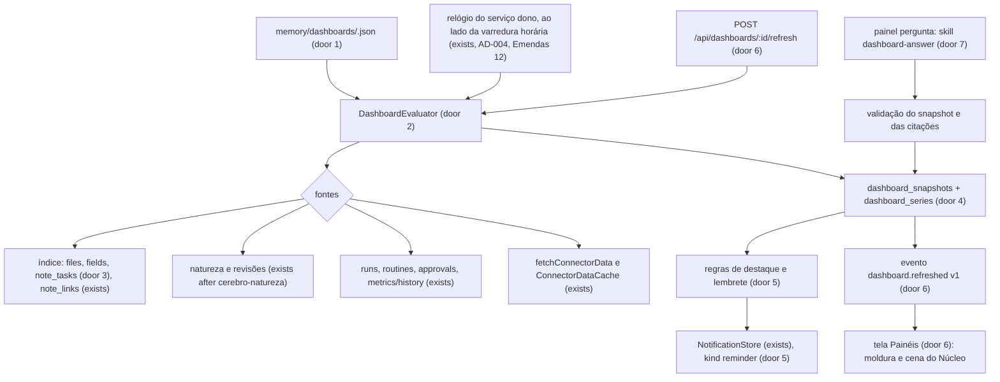
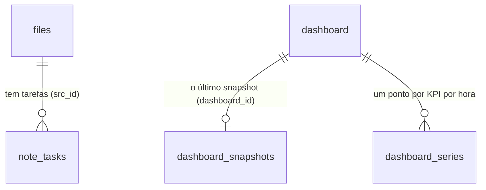

# Painéis — visão geral, área e pergunta, com destaques e lembretes, montados do cérebro e dos conectores

## Problem

O que o MordomoOS sabe sobre o trabalho da pessoa só se lê como texto, uma nota por vez. Levantamento no código em
`chore/cerebro-v3-roteiro`:

- **Não existe um lugar que junte o dia.** A tela Hoje (`apps/command-centre/src/moldura/Today.tsx:11-18`) mostra seis cartões
  fixos sobre o próprio sistema (aprovações, o que roda, rotinas, caixa de entrada, diário, custo); nenhum fala das tarefas, das
  decisões, dos projetos ou da agenda da pessoa. Uma tarefa com prazo escrita numa nota (`- [ ] … 📅 2026-10-30`) não é lida por
  ninguém: o índice guarda o texto, não a tarefa (`core/src/memory/indexer.ts`, sem extração de tarefas).
- **Os conectores já trazem itens e ninguém os mostra juntos.** Cada conector com `dataMapping` vira itens (`id`, `title`,
  `subtitle`, `ts`, `flagged`, `tag`, `href`) e um `summary` numérico (`contracts/src/connectors.ts:17-73`,
  `core/src/connectors/client.ts:24-44`, `GET /api/connectors/:id/data`), mas a única leitura fora da tela de conectores é o
  sentinela que guarda só ids embaralhados (`core/src/sentinels/connectorDelta.ts:10-19`).
- **Número sem histórico não diz se melhorou.** O histórico por hora (`core/src/metrics/history.ts:6-15`, 90 dias) cobre só o
  sistema (execuções, falhas, custo, tokens, caixa, aprovações); nada do que a pessoa acompanha (tarefas abertas, decisões da
  semana, projetos atrasados) tem série, delta ou tendência.
- **Nada avisa do que vence.** As notificações (`contracts/src/records.ts:30`, `approval`, `run`, `routine`, `index`, `system`)
  só nascem de eventos do sistema; um prazo de hoje ou uma tarefa atrasada não gera aviso.
- **Uma pergunta sobre o próprio acervo vira uma conversa longa.** "Por que o onboarding de clientes demora mais este
  trimestre?" pede um agente que leia, junte e responda com números; a resposta sai como texto num chat e não pode ser
  revista nem atualizada depois.

A pessoa que quer saber "o que pede atenção hoje, o que decidimos e o que está atrasado" abre notas, a tela de conectores e o
chat, e junta de cabeça. Nenhuma métrica de uso foi dada; o pedido é do dono, com três capturas de um produto de inspiração
(visão geral do negócio, uma área, uma pergunta respondida) que não se copia.

Quando isto sair: a pessoa abre "Painéis" e vê, sem esperar, a visão geral (prioridades com prazo, decisões da semana, o que os
agentes e os projetos estão fazendo, a agenda do dia com a nota de preparo), um painel por contexto (uma área do trabalho) e
painéis que respondem uma pergunta com citações; cada número tem tendência e delta; os destaques do dia sobem para o topo; o
que vence vira lembrete, no máximo três por dia; e qualquer painel sai como um HTML local.

## Flow

Reutiliza o leitor de conectores (`fetchConnectorData` e o `ConnectorDataCache` da rota `connectors.data`, que passa a ser um
só no serviço, "Emendas" 10), o histórico de métricas (`metrics/history.ts` e o `dailyPoints` da aba Tendências, "Emendas"
9), o índice (`files`, `fields`, `files_fts`, `note_links`, `note_passages`), as fontes das features anteriores (o escopo de
contexto que a faxina já resolve, `resolveCleanupScope` de `cerebro-faxina-guiada`; a fila `reviewsDue` de `cerebro-natureza`;
as propriedades de `cerebro-vista-notas`; "Emendas" 4 e 8), o primitivo de escrita
guardada (`writeWorkspaceFile` com `expectSha256`), o `NotificationStore`, o `EventBus` com `EVENT_VERSIONS`, a tabela `API` e o
sparkline feito à mão (`apps/command-centre/src/runs/sparkline.ts`); nenhuma biblioteca de gráficos entra.



1. Definição → `memory/dashboards/<id>.json` (door 1), escrita por `POST`/`PUT /api/dashboards` com o primitivo guardado (exists)
   e a versão `sha256:` (o padrão das notas, AD-031); lida e validada pelo contrato `DashboardSpec` (door 1).
2. Avaliação → `DashboardEvaluator` (door 2) em `core/src/dashboards/` lê cada widget, chama a fonte declarada pelo filtro de
   política (`storedRowFilter`, a mesma regra de `MemoryIndexer.rowFilter`) e, quando há, pelo escopo do contexto
   (`resolveCleanupScope`, "Emendas" 4), e monta o snapshot; uma fonte que falha marca só os seus widgets.
3. Tarefas → o `MemoryIndexer` (exists) passa a extrair tarefas Markdown com prazo para `note_tasks` (door 3, migração 26,
   "Emendas" 1 e 3) na mesma passada, e `FRONT_MATTER_FIELDS` ganha `due` ("Emendas" 2).
4. Guarda → `dashboard_snapshots` (o último por painel) e `dashboard_series` (um ponto por hora por KPI, 90 dias) (door 4).
5. Destaques e lembretes → regras fixas (door 5) sobre o snapshot; um lembrete entra no `NotificationStore` (exists) com o
   `kind` novo `reminder`, no máximo `maxPerDay` por dia.
6. Atualização → o relógio do serviço que é o dono (AD-004; em `apps/api/src/server.ts` (exists), onde já roda a varredura horária,
   "Emendas" 12) roda cada painel no seu `refresh`; a rota de atualizar roda na hora; o barramento anuncia
   `dashboard.refreshed` (door 6) e a tela troca o snapshot.
7. Pergunta → `POST /api/dashboards/:id/refresh` de um painel `question` inicia a skill `dashboard-answer` (door 7, uma skill
   de `settings.memorySkills`, "Emendas" 19) por `launchSkillRun` (exists) com recall; o resultado é validado (esquema e
   citações) antes de virar snapshot.
8. Tela → a página "Painéis" da moldura e uma cena do Núcleo (AD-005) leem `GET /api/dashboards/:id` (door 6) e desenham os widgets em SVG
   feito à mão; um item de nota abre `/brain?sel=<id>` ("Emendas" 18); "Exportar" grava um HTML local em `artifacts/dashboards/`.

## Impact

| Front       | What changes                                                                                                                                                                                                                                                                                                                                                                                                                                                                                                                                                                                                 |
| ----------- | ------------------------------------------------------------------------------------------------------------------------------------------------------------------------------------------------------------------------------------------------------------------------------------------------------------------------------------------------------------------------------------------------------------------------------------------------------------------------------------------------------------------------------------------------------------------------------------------------------------ |
| domain      | new term: `painel` — uma definição em `memory/dashboards/<id>.json` com `kind` (`overview`, `area`, `question`), widgets e fontes; o que a tela mostra é o seu `snapshot`, nunca uma leitura ao vivo                                                                                                                                                                                                                                                                                                                                                                                                         |
| domain      | new term: `widget` — um dos oito tipos fechados (`kpi`, `checklist`, `list`, `table`, `bars`, `agenda`, `highlights`, `note`) ligado a uma fonte declarada                                                                                                                                                                                                                                                                                                                                                                                                                                                   |
| domain      | new term: `tarefa` — uma linha Markdown `- [ ]`/`- [x]` de uma nota indexada, com prazo opcional `📅 AAAA-MM-DD` ou `[due:: AAAA-MM-DD]`; existe no índice, o arquivo continua a fonte                                                                                                                                                                                                                                                                                                                                                                                                                       |
| domain      | new term: `destaque` e `lembrete` — saídas de regras fixas sobre o snapshot (atrasado, vence hoje, decidido na semana, decisão aberta há mais de 7 dias, projeto atrasado, revisão vencida, item marcado do conector, novo desde a última visita)                                                                                                                                                                                                                                                                                                                                                            |
| domain      | existing term: `NotificationKind` era `approval`, `run`, `routine`, `index`, `system`; ganha `reminder` — quem ramifica hoje ("Emendas" 16): `contracts/src/records.ts:30-40` (`NotificationKind`, `NOTIFICATION_KINDS`), o enum de `contracts/src/api/wire.ts:180`, que é também o schema v1 de `notification.created`, a cópia da interface em `hooks/useNotifications.ts:37` e o `toNotification` do gravador (`core/src/notifications/recorder.ts:140`); a caixa de entrada (`InboxWidget.tsx:86`) ramifica só em `approval` e o envio por push (`channels/pushChannel.ts:38`) pelo tom, não pelo `kind` |
| domain      | existing term: projeto "no prazo/atrasado/vence hoje/em revisão" não existia; passa a ser derivado de `type: project` + `status` + `due` (o vocabulário de `cerebro-vista-notas`, door 3), sem valor novo                                                                                                                                                                                                                                                                                                                                                                                                    |
| stored data | migração 26 `dashboards` ("Emendas" 1): `note_tasks`, `dashboard_snapshots`, `dashboard_series`; a primeira passada depois dela preenche `note_tasks` do texto que o FTS já guarda, sem reler o disco (o padrão do `note_links` e do `note_passages`), e acrescenta só a chave `due` ao `fields` das linhas que já existem ("Emendas" 2); nada mais muda em linha existente                                                                                                                                                                                                                                  |
| stored data | o snapshot de um widget ligado a conector guarda os títulos e subtítulos dos itens mostrados (no máximo o limite do widget) no banco local, que o backup copia; hoje só o cache em memória da rota e ids embaralhados existem — `legal/PRIVACY.md` passa a dizer isso                                                                                                                                                                                                                                                                                                                                        |
| arquivos    | `memory/dashboards/` nasce com os três modelos na primeira abertura; o índice o lê como qualquer `.json` de `memory/`                                                                                                                                                                                                                                                                                                                                                                                                                                                                                        |
| tela        | a moldura ganha "Painéis" no grupo principal, logo depois de "Hoje"; o Núcleo ganha a cena "Painéis" (tecla `6`), a sexta cena principal do horizonte, depois de "Rotinas" ("Emendas" 25); a tela Hoje não muda além de um link "Ver a visão geral" no cabeçalho quando existe um painel `overview` (AD-005 mantém os seis cartões)                                                                                                                                                                                                                                                                          |
| domain      | existing term: "painel" já nomeia, em pt-BR, as lâminas do Núcleo (`desktop.dock.add` "Abrir um painel", comando `action:open-panel`) e o painel da nota (`notes.panel.label`), e `UiPreferences.dashboardLayout` é o arranjo das janelas da área de trabalho; os painéis desta feature são `dashboards` em código (rotas, `UiPreferences.dashboards`, cena `dashboards`) e os comandos novos têm ids próprios ("Emendas" 25 e 28)                                                                                                                                                                           |

## Relations



One-way constraints: o painel é o arquivo `memory/dashboards/<id>.json` e o `id` é o nome do arquivo, imutável (door 1); um painel
tem no máximo um snapshot guardado (door 4); uma série é chaveada por (`dashboard_id`, `widget_id`, hora) e some com o painel
(door 4); as tarefas somem com o arquivo (door 3).

## Surface

| Route                              | In                                                                               | Out                                                                                         | Status                            |
| ---------------------------------- | -------------------------------------------------------------------------------- | ------------------------------------------------------------------------------------------- | --------------------------------- |
| `GET /api/dashboards`              | —                                                                                | `dashboards[]`: `id` · `title` · `kind` · `contextId` · `refresh` · `generatedAt` · `stale` | `200`                             |
| `POST /api/dashboards`             | `template` (`overview`, `area`, `question`), `title?`, `contextId?`, `question?` | o painel: `id` · `definition` · `version`                                                   | `201`, `400`, `404`, `409`        |
| `GET /api/dashboards/:id`          | query `since?` (ms da última visita)                                             | `definition` · `version` · `snapshot` (ou `null`) · `highlights[]`                          | `200`, `404`                      |
| `PUT /api/dashboards/:id`          | `definition`, `baseVersion`                                                      | `definition` · `version`                                                                    | `200`, `400`, `404`, `409`        |
| `DELETE /api/dashboards/:id`       | —                                                                                | `archived` (caminho)                                                                        | `200`, `404`                      |
| `POST /api/dashboards/:id/refresh` | —                                                                                | `snapshot` (painéis determinísticos) ou `runId` (painel `question`)                         | `200`, `202`, `404`, `409`        |
| `POST /api/dashboards/:id/export`  | —                                                                                | `path` (o HTML em `artifacts/dashboards/`)                                                  | `200`, `404`, `409`               |
| `PUT /api/memory/tasks`            | `path`, `line`, `done`, `baseVersion`                                            | `path` · `version` · `task`                                                                 | `200`, `400`, `403`, `404`, `409` |

- Grown while building (batch A, additive): `GET /api/dashboards` and `POST /api/dashboards` also answer
  `403 forbidden_path`, as every route that lists or writes a folder through the safe primitives does (the refusal probe of
  `tests/api.refusals.test.ts` found them, and `FORBIDDEN_PATH_ROUTES` names them); `GET /api/dashboards/:id` answers
  `stale` beside the four keys of its row, as its `stale` rule asks.

## Landing

| One-way door                | Literal shape                                                                                                                                                                                                                                                                                                                                                                                                                                                                                                                                                                                                                | Alternative rejected                                                                                                                                                                                                                                                             |
| --------------------------- | ---------------------------------------------------------------------------------------------------------------------------------------------------------------------------------------------------------------------------------------------------------------------------------------------------------------------------------------------------------------------------------------------------------------------------------------------------------------------------------------------------------------------------------------------------------------------------------------------------------------------------- | -------------------------------------------------------------------------------------------------------------------------------------------------------------------------------------------------------------------------------------------------------------------------------- |
| 1. Definição de painel      | `memory/dashboards/<id>.json`, `id` = `^[a-z0-9][a-z0-9-]{0,63}$`, até 64 KB, `{ "v": 1, "title", "kind": "overview" \| "area" \| "question", "contextId"?: string, "question"?: string (até 500), "refresh": "15m" \| "1h" \| "6h" \| "daily@HH:MM" \| "manual", "widgets": [ { "id", "kind", "title", "source", "options"? } ] }` com até 12 widgets; `source` é um de onze tipos fechados (`notes`, `tasks`, `decisions`, `openLoops`, `projects`, `reviews`, `facts`, `runs`, `approvals`, `metrics`, `connector`) com o filtro de cada um; campo desconhecido = `400 validation`; versão `sha256:` dos bytes            | `settings.json`: o `PUT /api/settings` troca o documento inteiro e um painel editado à mão ficaria atrás de uma rota de configuração; tabela no banco: não vai com o Syncthing, não se lê nem se diffa, e o agente que ajuda a montar um painel não teria um arquivo para propor |
| 2. Avaliador determinístico | `DashboardEvaluator.evaluate(def, { now, since, context }) → Snapshot` sem modelo e sem rede além do conector já configurado; uma fonte por chamada, com teto de 5 s por fonte local e o `dataTimeoutMs` do conector; nenhum widget lê arquivo do disco (só o índice e as rotas de dados)                                                                                                                                                                                                                                                                                                                                    | montar o painel por um agente a cada atualização: custo de modelo a cada 15 minutos, resultado que muda sem o dado mudar e um texto que não se valida; ler os arquivos na hora: o painel ficaria tão lento quanto o acervo é grande                                              |
| 3. Tarefas no índice        | `note_tasks(src_id INTEGER NOT NULL, line INTEGER NOT NULL, done INTEGER NOT NULL, text TEXT NOT NULL, due TEXT, priority INTEGER NOT NULL DEFAULT 0, PRIMARY KEY (src_id, line))`, `idx_note_tasks_due ON note_tasks(done, due)`; uma tarefa é `^\s*[-*] \[( \|x\|X)\] (.+)$` fora de bloco de código; prazo `📅 AAAA-MM-DD` ou `[due:: AAAA-MM-DD]`; prioridade `⏫` = 2, `🔼` = 1; texto até 300 caracteres, sem os marcadores                                                                                                                                                                                            | ler as tarefas do texto do FTS a cada atualização: dezenas de MB por painel a cada 15 minutos; uma sintaxe própria (`TODO(2026-10-30)`): quem usa Obsidian Tasks ou Dataview já escreve as duas formas aceitas                                                                   |
| 4. Snapshot e série         | `dashboard_snapshots(dashboard_id TEXT PRIMARY KEY, generated_at INTEGER NOT NULL, json TEXT NOT NULL)` (o último, substituído); `dashboard_series(dashboard_id TEXT NOT NULL, widget_id TEXT NOT NULL, at INTEGER NOT NULL, value REAL NOT NULL, PRIMARY KEY (dashboard_id, widget_id, at))`, `at` na hora cheia, 90 dias como `metrics/history.ts`; o snapshot é `{ "v": 1, "dashboardId", "generatedAt", "sources": [{ "id", "kind", "status": "ok" \| "error" \| "not_configured" \| "unavailable", "syncedAt", "message"? }], "widgets": [{ "id", "kind", "status": "ok" \| "empty" \| "error", "data"?, "error"? }] }` | guardar todos os snapshots: o banco cresce a cada 15 minutos por painel e a série já guarda o que a tendência precisa; um arquivo por snapshot em `memory/`: o índice leria números e títulos de e-mail como notas                                                               |
| 5. Destaques e lembretes    | regras fixas `overdue`, `due_today`, `decided_this_week`, `open_decision_7d`, `project_behind`, `review_due`, `connector_flagged`, `new_since_visit`; destaques no topo, até 8, nesta ordem; lembrete = `overdue` e `due_today` de tarefas e `project_behind`, com `NotificationKind` `reminder`, `dedupeKey` `reminder:<regra>:<item>:<dia local>`, no máximo `settings.dashboards.reminders.maxPerDay` (padrão 3, 0 desliga) por dia, entregues a partir de `settings.dashboards.reminders.at` (padrão `08:30`)                                                                                                            | regras escritas pela pessoa (uma linguagem de consulta): é um produto à parte e o erro de uma regra vira um aviso falso todos os dias; reusar `kind: system`: o lembrete não se filtra nem se silencia sem silenciar os avisos do sistema                                        |
| 6. Contrato REST e evento   | as oito rotas da `Surface`; leitura com escopo `content`, escrita (`POST`, `PUT`, `DELETE`, `refresh`, `export`, `tasks`) com escopo `owner` (AD-015, AD-031); evento `dashboard.refreshed` `{ id, generatedAt, status }` `v` 1; erros `400 validation`, `404 dashboard_not_found`, `404 context_not_found`, `409 dashboard_exists`, `409 edit_conflict`, `409 refresh_in_progress`, `403 note_not_editable`                                                                                                                                                                                                                 | rotas de painel sob `/api/memory/*`: o painel lê também execuções, aprovações e conectores, não é uma propriedade do índice; atualizar por `GET`: um `GET` que chama conector e agente quebra o cache e a regra de leitura sem efeito                                            |
| 7. Painel pergunta          | skill `skills/dashboard-answer/SKILL.md` (`mode: read`, `memoryAccess`, perfil `read_only`), que recebe `question`, `contextId` e o esquema de widgets e devolve `artifacts/<run>/dashboard.json` no formato do snapshot com `citations[]` (`path`, `section`) por widget; o host só aceita se o esquema valida, se toda citação é um arquivo indexado que a política permite e se nenhum item de natureza `plano`, `hipotese` ou `opiniao` sai sem o rótulo; recusado = o snapshot anterior fica e a fonte vira `error` com o motivo                                                                                        | o agente escrever direto no banco ou em `memory/dashboards/`: a credencial da execução não escreve conteúdo (AD-012, AD-031); texto livre como resposta: não se desenha como painel nem se confere citação                                                                       |

- Nothing else in this change is hard to reverse: a disposição dos widgets na tela, as cores dos gráficos (tokens), o texto, o
  HTML exportado e a ordem de avaliação das fontes mudam por refatoração.

## Criteria

### S1: definição, avaliação e snapshot (P1)

Um painel é um arquivo; atualizá-lo produz um snapshot que a tela abre sem esperar.

**Acceptance Criteria**

1. WHEN the owner calls `POST /api/dashboards` with `template: "overview"` and no dashboard exists THEN the system SHALL write `memory/dashboards/visao-geral.json` with `kind: "overview"`, `refresh: "15m"` and the overview widgets of `design.md`, answer `201` with `id`, `definition` and `version` (`sha256:` plus 64 hex digits).
2. WHEN `template` is `area` THEN `contextId` SHALL be required and SHALL name an existing context of `cerebro-contextos`, IF it does not THEN the system SHALL answer `404 context_not_found` and write nothing.
3. WHEN `template` is `question` THEN `question` SHALL be required, 1 to 500 characters after trimming, and the dashboard SHALL be created with `refresh: "manual"`.
4. IF a dashboard with the derived `id` exists THEN `POST` SHALL create `<id>-2` up to `<id>-99`, and IF all exist THEN it SHALL answer `409 dashboard_exists`.
5. IF a definition has an unknown key, more than 12 widgets, a widget `kind` or `source` outside the closed sets, a `refresh` outside `15m`, `1h`, `6h`, `daily@HH:MM`, `manual`, or more than 64 KB THEN `PUT` SHALL answer `400 validation` naming the field and SHALL leave the file unchanged.
6. WHEN `PUT /api/dashboards/:id` carries a `baseVersion` that is not the file's version THEN the system SHALL answer `409 edit_conflict` and leave the file unchanged.
7. WHEN `POST /api/dashboards/:id/refresh` is called on a non-question dashboard THEN the system SHALL evaluate every widget, store the snapshot, answer `200` with it and announce `dashboard.refreshed` `v: 1`.
8. IF one source fails (a connector times out, a context path is gone, `cerebro-natureza` reviews unavailable) THEN only the widgets bound to it SHALL have `status: "error"` with the message, every other widget SHALL keep its data, and the source SHALL appear in `sources[]` with `status: "error"`.
9. WHILE a refresh of a dashboard runs a second `refresh` of the same dashboard SHALL answer `409 refresh_in_progress`.
10. WHEN the owner process runs (AD-004) THEN each dashboard SHALL be refreshed at its `refresh` interval (`daily@HH:MM` once a day at that local time, `manual` never), and a dashboard whose snapshot is older than its interval SHALL be refreshed when `GET /api/dashboards/:id` is called, after answering with the stored one.
11. WHEN `GET /api/dashboards/:id` is called THEN it SHALL answer the stored snapshot without evaluating any source, with `stale: true` when `now - generatedAt` exceeds the refresh interval (twice the interval for `daily`), and `snapshot: null` when none exists.
12. WHERE a dashboard has `contextId` the evaluation SHALL pass that context to every memory source, so no row outside the context's paths appears, and IF the context was deleted THEN every memory widget SHALL be `error` with "O contexto deste painel não existe mais."
13. The evaluation SHALL apply today's policy filter (`rowFilter`) to every row it reads from the index, and SHALL read no file from disk.
14. WHEN `DELETE /api/dashboards/:id` is called THEN the system SHALL move the file to `memory/archive/dashboards/<id>-<AAAA-MM-DD>.json`, delete its snapshot and series rows, and answer `200` with the archived path.

**Independent test:** criar a visão geral num home de teste com duas notas com tarefas e um conector falso, atualizar, e ler o
snapshot: os widgets das notas têm dados, o do conector também; derrubar o conector e atualizar de novo: só o widget dele vira
erro.

### S2: fontes do cérebro e do sistema (P1)

**Acceptance Criteria**

15. WHEN a note holds `- [ ] Mandar a proposta 📅 2026-10-30 ⏫` outside a code block THEN the index SHALL store one `note_tasks` row with `done: 0`, `due: "2026-10-30"`, `priority: 2` and the text "Mandar a proposta", and `[due:: 2026-10-30]` SHALL give the same `due`.
16. WHEN the migration that creates `note_tasks` runs on an indexed database THEN the first pass after it SHALL fill the tasks from the stored text without opening any file, and running it twice SHALL leave the same rows.
17. WHEN a `tasks` source asks for `window: "today"` THEN it SHALL return the open tasks due today and the open tasks overdue, overdue first, then by priority (higher first), then by due date, each with `path`, `line`, `due`, `overdue` and the note title.
18. WHEN a `decisions` source asks for `window: "week"` THEN it SHALL return the bullets under `## Decisions` of the journal days of the current week and of `MEMORY.md`, and the notes with `type: decision`, each with `state` `decided` when its natureza is `fato` or absent and `open` when it is `plano` or `hipotese`.
19. WHEN a `projects` source runs THEN it SHALL return the notes with `type: project` and `status` other than `archived`, each with `health`: `done` for `status: done`, `paused` for `status: paused`, `behind` when `due` is before today, `due_today` when `due` is today, `in_review` for `status: draft`, else `on_track`.
20. WHEN a `notes` source declares filters on `type`, `status`, `tags`, `natureza`, `escopo`, a folder or the dashboard's context THEN it SHALL return only matching notes, up to the widget's `limit` (default 8, at most 50), ordered by `updated` then `mtime` descending.
21. WHEN a `runs` source runs THEN it SHALL return the active runs and the last finished ones of the window with skill, state and duration, and an `approvals` source SHALL return the pending approvals with their age.
22. WHEN a `metrics` source names a series of `metrics/history.ts` (`runs24h`, `failed24h`, `costToday`, `tokensToday`, `inboxUnread`, `approvalsPending`) THEN it SHALL return the latest value and the daily points of the last 14 days.
23. WHEN a `connector` source names a connector with a read mapping THEN it SHALL return its `list` items (or `flagged`, or a `summary` key) through `fetchConnectorData` with the connector's timeout, and IF the connector has no mapping THEN the source SHALL be `not_configured` with the connector's setup lines.
24. WHERE `cerebro-natureza` is present the `reviews` source SHALL return the items due for review, and every item a source returns from a note SHALL carry the note's `natureza` when it has one.
25. IF a source is absent from this build (a feature not yet delivered) THEN its widgets SHALL be `error` with `status: "unavailable"` and the text "Esta fonte ainda não existe nesta versão." instead of failing the dashboard.

**Independent test:** um acervo de teste com notas de projeto, decisões no diário, tarefas com e sem prazo e uma nota de natureza
`plano`; cada fonte devolve o que os critérios dizem, e a decisão `plano` sai como `open`.

### S3: KPIs com tendência e delta (P1)

**Acceptance Criteria**

26. WHEN a `kpi` widget is evaluated THEN its data SHALL hold `value`, optional `of` (the denominator, as in "3 de 5"), `delta` against the declared period (`day` or `week`) with `direction` and whether up is good, and `series` with at most 30 points from `dashboard_series`.
27. WHEN a refresh evaluates a `kpi` THEN the system SHALL store one point per KPI per local hour in `dashboard_series`, replacing the point of the same hour, and SHALL delete points older than 90 days.
28. IF a KPI has fewer than 2 points THEN its data SHALL have no `delta` and the screen SHALL show "Sem histórico ainda" in place of the trend.
29. WHEN a `kpi` declares `chip` rules (for example "2 restantes" when `of - value > 0`) THEN its data SHALL carry the chip text and tone (`ok`, `warn`, `danger`, `info`).

**Independent test:** atualizar um painel em três horas simuladas com valores 3, 4 e 2; a série tem três pontos e o delta do dia é −1.

### S4: a tela Painéis (P1)

**Acceptance Criteria**

30. WHEN the person opens "Painéis" for the first time and no dashboard exists THEN the screen SHALL create the overview dashboard, refresh it, and show its widgets, and SHALL offer "Painel de um contexto" and "Painel de uma pergunta" as the next steps.
31. WHEN a dashboard opens THEN the screen SHALL show the stored snapshot at once, with the header "Bom dia" / "Boa tarde" / "Boa noite" by local hour for `overview`, the dashboard title for the others, the date, "Atualizado às HH:MM" and the list of sources with a state icon each.
32. WHILE a refresh runs the header SHALL show "Atualizando…" with a spinner, and the widgets SHALL keep the previous data until `dashboard.refreshed` arrives.
33. IF the snapshot is `stale` THEN the header SHALL show "Desatualizado — atualizado às HH:MM" with a clock icon and the "Atualizar" button.
34. IF a widget has `status: "error"` THEN that widget alone SHALL show the message with an alert icon and "Tentar de novo", and IF it has `status: "empty"` THEN it SHALL show the empty text of `design.md` for its kind.
35. WHEN a source is `not_configured` THEN its widgets SHALL show "Conecte <conector> para ver isto." with a link to the connector's setup in Connectors.
36. The screen SHALL render the widget kinds `kpi`, `checklist`, `list`, `table`, `bars`, `agenda`, `highlights` and `note` as `design.md` composes them, with charts in hand-made SVG and no new runtime dependency.
37. WHEN a list or checklist item comes from a note THEN choosing it SHALL open the note (the notes view of `cerebro-vista-notas`, or the preview of the Second Brain), and an item from a connector with `href` SHALL open it outside the app.
38. WHEN an item carries `natureza` `plano`, `hipotese` or `opiniao` THEN the screen SHALL show its label ("Plano", "Hipótese", "Opinião") as text beside an icon, and SHALL never show the "Decidido" chip on it.
39. The screen SHALL give every chart widget "Ver como tabela", which shows the same values as a table, and every value a tooltip shows SHALL also be in that table.
40. The screen SHALL exist as the moldura page "Painéis" (after "Hoje" in the main group) and as the Núcleo scene "Painéis" (key `6`), with the same data, the same dashboard selector and the commands "Abrir painéis" and "Atualizar painel" in the palette.
41. The screen SHALL keep text at 12px minimum, colors only from tokens (the chart tokens of `design.md`), states never by color alone, motion only under `prefers-reduced-motion: no-preference`, and SHALL pass axe at WCAG A/AA in both themes and both shells.
42. WHEN a device without `content` opens "Painéis" THEN the screen SHALL show "Este dispositivo não tem permissão para ver painéis." and no data.
43. WHEN an `overview` dashboard exists THEN the Today screen SHALL show a "Ver a visão geral" link in its header, and SHALL keep its six cards unchanged.

**Independent test:** abrir a página nos dois shells com um snapshot de teste que tem um widget de cada tipo, um em erro e um
vazio; tudo aparece como `design.md` diz, e o axe passa.

### S5: destaques, lembretes e tarefas (P2)

**Acceptance Criteria**

44. WHEN `GET /api/dashboards/:id?since=<ms>` is called THEN `highlights` SHALL hold at most 8 items computed by the rules of door 5, in that order, each with `rule`, `title`, tone and the target it opens, and `new_since_visit` SHALL list only items whose time is after `since`.
45. WHEN the screen leaves a dashboard THEN it SHALL store the time of the visit in `UiPreferences.dashboards.lastViewed[<id>]` and send it as `since` on the next open.
46. WHEN, after `settings.dashboards.reminders.at` local time, a refresh finds an overdue or due-today task or a project `behind` THEN the system SHALL create a `reminder` notification for it, once per item per local day, and SHALL create no more than `maxPerDay` (default 3) reminders per day.
47. WHERE `maxPerDay` is `0` the system SHALL create no reminder.
48. WHEN the person checks a task of a note under `memory/` in a `checklist` widget THEN the screen SHALL call `PUT /api/memory/tasks` with the note's version, the system SHALL change only `[ ]` to `[x]` on that line, and the item SHALL show as done.
49. IF the task's note is outside `memory/` THEN the checkbox SHALL be read-only with the reason "Fora de memory/: abra a nota para marcar." and `PUT /api/memory/tasks` SHALL answer `403 note_not_editable`.
50. IF the line no longer holds the task (the note changed) THEN `PUT /api/memory/tasks` SHALL answer `409 edit_conflict` and change nothing.

**Independent test:** uma tarefa atrasada e duas de hoje com `maxPerDay: 2`; a atualização cria dois lembretes e a seguinte, no
mesmo dia, nenhum; marcar uma tarefa de `memory/` troca só os três caracteres da linha.

### S6: painel pergunta e exportação (P2)

**Acceptance Criteria**

51. WHEN `refresh` is called on a `question` dashboard THEN the system SHALL start the skill `dashboard-answer` with the question and the context, answer `202` with `runId`, and keep the previous snapshot until the run's result is accepted.
52. WHEN the run writes `dashboard.json` THEN the system SHALL accept it only if it validates against the snapshot schema, every widget has at least one citation, every citation is an indexed file the policy allows (and inside the context when there is one), and no item of natureza `plano`, `hipotese` or `opiniao` lacks its label.
53. IF the result is refused or the run fails THEN the snapshot SHALL stay, the source `question` SHALL be `error` with the reason, and the screen SHALL show it with "Tentar de novo".
54. WHEN a question dashboard shows an accepted snapshot THEN every widget SHALL list its citations as `nome § seção`, each opening the note at that section.
55. WHEN the owner calls `POST /api/dashboards/:id/export` THEN the system SHALL write a single HTML file under `artifacts/dashboards/<id>-<AAAA-MM-DDTHHMM>.html` with the snapshot drawn in inline SVG and CSS, every chart also as a table, no script, every text escaped, and SHALL answer its path, and IF there is no snapshot THEN `409` with `no_snapshot`.

**Independent test:** uma execução falsa que devolve um `dashboard.json` com uma citação de um arquivo excluído é recusada; com
citações válidas, o snapshot aparece com as citações; exportar gera um HTML sem `<script>`.

### Cross-cutting (P1)

**Acceptance Criteria**

56. The system SHALL declare every new route in the `API` table with schemas, scope and errors, regenerate the OpenAPI document and `docs/events.md`, list the routes in `EXPECTED_ROUTE_SCOPES` and `docs/security.md`, and give each route a scenario in the refusal probe.
57. The system SHALL add no raw `fs` read or write outside `tests/security-reads.test.ts`'s list, and no module-level mutable state outside the list of `tests/sdk.instances.test.ts`.
58. The system SHALL ship `legal/PRIVACY.md` saying that a dashboard snapshot keeps, in the local database and its backups, the titles and subtitles of the connector items it shows, replaced at each refresh and deleted with the dashboard.

## Out of scope

| Excluded                                                         | Why                                                                                                                                                                                                           |
| ---------------------------------------------------------------- | ------------------------------------------------------------------------------------------------------------------------------------------------------------------------------------------------------------- |
| Montar um widget novo pela tela (escolher fonte, filtro e forma) | é um editor visual próprio; nesta feature a tela esconde, mostra e reordena widgets dos modelos e o JSON se edita no editor do sistema; entra numa feature `cerebro-paineis-editor`, a acrescentar ao roteiro |
| Painel de equipe, pessoas, responsáveis e convites               | o produto é de um dono só (AD-015 trata dispositivos); pessoas aparecem só como valor de nota ou de conector                                                                                                  |
| Publicar na nuvem ou compartilhar por link                       | o produto é local; exportar gera um HTML que a pessoa envia se quiser                                                                                                                                         |
| Gráfico de várias séries, pizza, mapa de calor e eixo duplo      | os oito tipos cobrem os três modelos com uma série por gráfico; várias séries pedem a paleta categórica validada e a legenda (regra do `dataviz`)                                                             |
| Gravar no conector (marcar e-mail, mover negócio)                | os conectores são só leitura nos painéis (`isWriteLikeTool`)                                                                                                                                                  |
| Preparo de reunião escrito por agente                            | a nota de preparo vem do `subtitle` do conector ou de uma nota ligada ao evento; um resumo por agente entra em `cerebro-perguntar` (C10)                                                                      |
| Regras de destaque escritas pela pessoa                          | ver door 5                                                                                                                                                                                                    |

## Assumptions

| Assumption                               | Chosen default                                                                                  | Rationale                                                                                                                                               | Confirmed? |
| ---------------------------------------- | ----------------------------------------------------------------------------------------------- | ------------------------------------------------------------------------------------------------------------------------------------------------------- | ---------- |
| Lugar no roteiro                         | C6b, depois de `cerebro-natureza` e antes de `cerebro-memoria-confiavel`                        | os painéis leem contexto, natureza, revisões e propriedades das features C2 a C6; a ordem dá todas as fontes já prontas                                 | n          |
| Painéis criados na primeira abertura     | só a visão geral; os de contexto e de pergunta são oferecidos                                   | um painel por contexto criado sem pedir enche a lista; a pergunta precisa do texto da pessoa                                                            | n          |
| Atualização da visão geral               | a cada 15 minutos, só no processo dono e só enquanto o serviço roda                             | os conectores já têm cache e teto de tempo; mais frequente chamaria os servidores MCP sem ganho para quem lê                                            | n          |
| Cor dos gráficos                         | um token próprio por tema (`--chart-mark`), fixo, e não a cor de destaque escolhida pela pessoa | a cor de destaque é escolhida livremente e pode cair fora da faixa que o validador do `dataviz` aceita; os valores do `design.md` passaram no validador | n          |
| Quem vê "o que os agentes estão fazendo" | a fonte `runs` e a fonte `projects`; nenhum avatar                                              | sem membros, o "quem" do produto são as execuções e os projetos do dono                                                                                 | n          |

**Open questions:**

| #   | Kind           | Question                                                                                                                                                                                                                                                                                                                                          | Until answered                                                                                                   |
| --- | -------------- | ------------------------------------------------------------------------------------------------------------------------------------------------------------------------------------------------------------------------------------------------------------------------------------------------------------------------------------------------- | ---------------------------------------------------------------------------------------------------------------- |
| 1   | blocks go-live | O snapshot guarda os títulos e subtítulos dos itens de conector que mostra (assuntos de e-mail, eventos da agenda) no banco local, que o backup copia (AC 58). Recomendo assim, com o texto em `legal/PRIVACY.md`. A alternativa é não guardar itens de conector: o widget fica "Carregando…" depois de cada reinício até a primeira atualização. | a feature se constrói com a recomendação; o texto de privacidade é minuta e não se publica sem a revisão do dono |
| 2   | open           | Lembretes ligados por padrão, no máximo 3 por dia a partir das 08:30? A `cerebro-natureza` já cobra revisões uma vez por dia. Recomendo ligados, com os dois avisos contando no mesmo teto diário só se o dono pedir.                                                                                                                             | vale o padrão: ligados, 3 por dia, 08:30                                                                         |
| 3   | open           | A visão geral substitui a tela Hoje? Recomendo que não: Hoje fala do sistema (aprovações, execuções, custo) e o painel fala do trabalho; Hoje ganha só o link (AC 43). Substituir mudaria a tela que AD-005 fixa.                                                                                                                                 | vale o link                                                                                                      |

## Observable

| Surface                                         | Decision                               | Landing                                                                                                        |
| ----------------------------------------------- | -------------------------------------- | -------------------------------------------------------------------------------------------------------------- |
| screen Painéis                                  | empty state                            | AC 30, AC 34, AC 35                                                                                            |
| screen Painéis                                  | loading state                          | AC 31, AC 32                                                                                                   |
| screen Painéis                                  | error state                            | AC 34, AC 53                                                                                                   |
| screen Painéis                                  | stale state                            | AC 33                                                                                                          |
| screen Painéis                                  | unauthorised                           | AC 42                                                                                                          |
| screen Painéis                                  | density and ordering                   | AC 17, AC 20, AC 44; disposição em `design.md`                                                                 |
| screen Painéis                                  | destructive action confirms            | n/a - apagar um painel o arquiva (AC 14) e marcar uma tarefa se desmarca no mesmo lugar                        |
| screen Hoje                                     | density and ordering                   | AC 43                                                                                                          |
| API `/api/dashboards*`, `PUT /api/memory/tasks` | error shape and codes                  | AC 2, 4, 5, 6, 9, 49, 50, 55; door 6                                                                           |
| API `/api/dashboards*`, `PUT /api/memory/tasks` | who may call                           | door 6, AC 42                                                                                                  |
| API `/api/dashboards*`, `PUT /api/memory/tasks` | versioning, rate limits                | n/a - `/api/v1` é o mesmo conjunto de rotas; `refresh` tem a trava de AC 9 e nenhuma rota ganha limite próprio |
| event `dashboard.refreshed`                     | versioning                             | AC 7, door 6                                                                                                   |
| notification `reminder`                         | output, frequency                      | AC 46, AC 47                                                                                                   |
| document HTML exportado                         | structure, what the reader does next   | AC 55                                                                                                          |
| collection widgets de um painel                 | grouping, naming, ordering, duplicates | door 1 (até 12, `id` único), AC 36                                                                             |
| collection destaques                            | ordering, duplicates, the exception    | AC 44, door 5                                                                                                  |
| command "Abrir painéis", "Atualizar painel"     | output, flags, exit codes              | AC 40                                                                                                          |

## Emendas depois da aprovação, registradas em vez de reescritas

O texto aprovado acima fica como foi aprovado, exceto `Flow` e `Impact`, que se mantêm verdadeiros (as linhas que mudaram
citam a emenda). O plano e o `design.md` foram aprovados antes de `cerebro-correcoes` (C1), `cerebro-contextos` (C2),
`cerebro-organizar` (C3), `cerebro-vista-notas` (C4), `cerebro-faxina-guiada` (C5) e `cerebro-natureza` (C6); o que as seis
construíram (AD-037 a AD-043, `git log` até `4537fb2`) e o que a derivação dos checks achou ficam aqui, cada um com o check de
`checks.md` que o resolve. Onde as fontes podem reusar o que a C5 e a C6 já calculam, reusam: o escopo de um contexto é o da
faxina (emenda 4) e a fila de revisões é a da C6 (emenda 8). Nenhuma emenda acrescenta modelo, rede ou leitura de disco à
avaliação (door 2), escrita em conector, regra escrita pela pessoa nem editor visual de widget (`Out of scope`). A emenda 5
completa o formato literal da door 1 (as chaves de `source` e de `options`, que o texto aprovado deixou como "o filtro de
cada um"), a emenda 11 acrescenta `problems[]` à resposta de `GET /api/dashboards`, e as emendas 12, 17, 19 e 20 acrescentam
recusas, o que só estreita. A pergunta 1 segue sem resposta e o padrão vale: o snapshot guarda os títulos e subtítulos dos
itens de conector, e `legal/PRIVACY.md` o diz (AC 58). As perguntas 2 e 3 seguem nos padrões (lembretes ligados, 3 por dia a
partir das 08:30, sem teto comum com a cobrança diária de revisões da C6; Hoje ganha só o link).

1. **Migração 26 (Impact, doors 3 e 4, AC 16).** A 22 é `drop-file-links` (C1), a 23 `run-context` (C2), a 24 `cleanup` (C5) e
   a 25 `natureza` (C6). `note_tasks`, `dashboard_snapshots` e `dashboard_series` nascem na migração 26 `dashboards`, com os
   formatos literais das doors 3 e 4. As tarefas dos arquivos que não mudaram vêm do texto de `files_fts`, em fatias, com a
   marca `index.note_tasks` em `meta` escrita na última (o padrão de `backfillNoteLinks` e `backfillNotePassages`); uma passada
   cortada no meio as faz de novo. Como as passagens da C6, as tarefas são lidas dos primeiros 200 000 caracteres do texto,
   o que o índice guarda, na passada normal e na de preenchimento (C19, C23).
2. **`due` em `fields` (AC 19, door 2, Impact).** `FRONT_MATTER_FIELDS` (C3, porta 6) guarda oito chaves e não guarda `due`, que
   a C4 tipa como data (door 3 da C4); a door 2 proíbe ler o arquivo na avaliação. `FRONT_MATTER_FIELDS` ganha `due`, depois
   de `abandoned`, nas mesmas regras (texto de até 64 caracteres; o `due::` do corpo vence). As linhas indexadas antes ganham
   `due` na passada de preenchimento da emenda 1, lido do texto guardado (`parseFrontMatter` e `parseInlineFields`), e nenhuma
   outra chave delas muda. Um `due` que não é um dia de calendário `AAAA-MM-DD` é lido como ausente pela fonte `projects`
   (C23, C24, C28).
3. **O que é uma tarefa (door 3, AC 15).** "Fora de bloco de código" é fora de cercas ` ``` ` e `~~~` e fora do front matter,
   como os links (AD-031 b) e as passagens da C6 leem; recuo antes do marcador é permitido (uma subtarefa é tarefa). Só
   arquivos `.md` e `.markdown`. `line` conta de 1, como `note_links.line`. Um `📅` ou `[due:: …]` cujo valor não é um dia de
   calendário dá `due: null`, e o marcador fica no texto como foi escrito. O texto perde `📅 AAAA-MM-DD`, `[due:: AAAA-MM-DD]`,
   `⏫` e `🔼` e os espaços das pontas, e é cortado em 300 caracteres (C20, C21, C22).
4. **A política e o escopo de um contexto (AC 12, AC 13, Flow).** O filtro de hoje é `storedRowFilter(settings.excludes,
{ homeDir })`, a regra de `MemoryIndexer.rowFilter` para quem não tem o indexador (como `reviewsDue` e `cleanupRows` o
   usam). O escopo de um painel `area` é o da faxina, reusado: `resolveCleanupScope(env, { context })` da C5 (os caminhos `ok`
   do contexto mais `memory/notes/<id>/`, por realpath igual ou seguido do separador, emenda 3 da C5 e emenda 5 da C6). As
   fontes de memória são `notes`, `tasks`, `decisions`, `openLoops`, `projects`, `reviews` e `facts`; `runs`, `approvals`,
   `metrics` e `connector` não leem o contexto. Um contexto apagado (`CleanupContextNotFoundError`) põe cada widget de fonte de
   memória em `error` com "O contexto deste painel não existe mais." e as outras fontes seguem (C13, C14).
5. **O formato de `source` e de `options` (door 1).** O texto aprovado diz "com o filtro de cada um" sem dizer as chaves, e
   "campo desconhecido = `400 validation`" exige uma lista fechada. `source` é `{ "kind", ...filtro }`, com estas chaves e
   nenhuma outra: `notes` — `type?`, `status?`, `tags?` (listas de texto), `natureza?`, `escopo?` (listas das listas fechadas
   da C6), `folder?` (caminho absoluto), `changed?: "week"`, `groupBy?: "status" | "type"`; `tasks` — `window: "today" |
"week"`; `decisions` — `window: "week"`, `state?: "open" | "decided"`; `openLoops` — `window: "week"`; `projects` —
   `health?` (lista de `done`, `paused`, `behind`, `due_today`, `in_review`, `on_track`); `reviews` e `facts` e `approvals` —
   nenhuma; `runs` — `window?: "24h"`; `metrics` — `series` (um dos seis da emenda 9); `connector` — `id`, `read: "list" |
"flagged" | "summary"`, `key?` (só com `summary`). `options` é `{ size?: "s" | "m" | "l" | "xl", hidden?: boolean, limit?:
1..50, measure?, period?: "day" | "week", upIsGood?: boolean, chip?: "remaining" | "open" | "behind", ordered?: boolean,
funnel?: boolean }`; `measure` (só em `kpi`) é `count` (o `total` da fonte, qualquer fonte), `done_of_due` (`tasks`:
   `value` as feitas com prazo hoje, `of` todas com prazo hoje), `open` (`tasks`: as abertas da janela),
   `on_track_of_active` (`projects`: `value` as `on_track`, `of` as que não são `done` nem `paused`) ou `latest` (`metrics`).
   `title` vai de 1 a 120 caracteres. Pergunta nova 4 (C5, C29, C37).
6. **Os três modelos, os ids e os títulos (`design.md` "Os três modelos", AC 1-4).** (a) Um widget tem uma `source` (door 1), e
   o `list` "Em andamento" do `design.md` junta `projects` e `runs`: a visão geral tem dois `list`, "Em andamento" (`projects`,
   `health` sem `done` e `paused`, m) e "Agentes agora" (`runs`, m), nessa ordem, antes da agenda; são dez widgets: os cinco
   `kpi`, `checklist` "Prioridades de hoje", `list` "Decisões da semana", "Em andamento", "Agentes agora" e `agenda` "Agenda de
   hoje". (b) A agenda lê o conector semeado `calendar-google` (`connectors/calendar-google.json`); não existe conector de id
   `calendar`. (c) Um contexto (AD-040 a) tem `id`, `name` e `paths` e nenhum conector ligado: o modelo de contexto não tem
   widget de conector; são oito widgets (quatro `kpi`, `checklist`, `bars`, dois `list`). (d) O `id` derivado é `visao-geral`
   para `overview`, `contexto-<contextId>` para `area` (até 49 caracteres) e `pergunta` para `question`, cada um seguido de
   `-2` a `-99` pelo AC 4; o título é "Visão geral", o `name` do contexto e a pergunta sem os espaços das pontas (cortada em
   120 caracteres). (e) `contextId` num `overview` ou num `question` é `400 validation`. Pergunta nova 6 (C1-C4).
7. **`decisions` e `openLoops` lidas do índice (AC 18, door 2).** `readJournal` lê o disco; a door 2 não deixa. As duas fontes
   leem o texto que o índice guarda (`files_fts`) dos arquivos que `generatedFileKind` (C6) chama de gerados: os
   `memory/journal/AAAA-MM-DD.md` da semana local corrente (segunda a domingo) e `memory/MEMORY.md`, só as seções de nível 2
   `## Decisions` e `## Open loops` (os títulos de `JOURNAL_SECTIONS` e do `consolidate-memory`); um `### Decisions`, ou a mesma
   seção numa nota que não é gerada, não conta. De `MEMORY.md` entram as linhas cuja origem `(journal AAAA-MM-DD)` é um dia da
   semana corrente, e uma linha de `MEMORY.md` e um item do diário do mesmo dia com o mesmo texto (sem o `HH:MM ` do diário e
   sem a origem) contam uma vez. O `state` de uma decisão segue a natureza (door 3 da C6 dá `fato` às duas seções; uma
   passagem `> [!…]` em volta do item vence): `fato`, `relato` ou nenhuma → `decided`; `plano`, `hipotese` ou `opiniao` →
   `open`. O AC 18 não diz `opiniao` nem `relato`; `opiniao` é `open` porque o AC 38 proíbe "Decidido" nela. Pergunta nova 5
   (C26, C27).
8. **As fontes sem critério, e o reuso da fila da C6 (AC 21, AC 24, door 1).** `facts` são os fatos abertos de `queryFacts`
   (`validTo` nulo), do mais novo para o mais velho, com `subject`, `predicate`, `object`, `validFrom` e `sourcePath`; num
   painel de contexto, só os de `sourcePath` dentro do escopo. `openLoops` segue a emenda 7, cada item com natureza `plano`.
   `reviews` é `reviewsDue(db, env, { kind: "due", context, limit, now })` da C6, sem uma segunda fila: os itens e o `total`
   são os dela, o KPI "Revisões vencidas" é esse `total` e o destaque `review_due` lê os mesmos itens. Nenhum lembrete nasce
   de revisão (a door 5 não a lista; a cobrança diária `reviewDue` da C6 já avisa). `runs` são as execuções ativas e as que
   terminaram nas últimas 24 horas, das ativas para as terminadas, da mais nova para a mais velha; `approvals` são as
   pendentes, da mais velha para a mais nova (C30, C34, C35).
9. **Os nomes das séries de `metrics` (AC 22).** A amostra horária (`MetricsSample`) chama `costTodayUsd` o que o AC 22 chama
   `costToday`; os seis nomes aceitos são `runs24h`, `failed24h`, `costTodayUsd`, `tokensToday`, `inboxUnread` e
   `approvalsPending`. O valor é o da amostra mais nova de `MetricsHistory.series(14)`, e os pontos diários são os de
   `dailyPoints` (o que a aba Tendências desenha: o maior valor do dia para custo e tokens, a última amostra do dia para os
   outros). Sem amostra, o widget é `empty` (C31).
10. **O cache dos conectores (Flow, AC 23).** O `ConnectorDataCache` é hoje uma variável de `registerConnectorRoutes`, que o
    avaliador não alcança. Passa a haver um só por serviço, criado com o contexto da API e usado pela rota e pelo avaliador,
    com o mesmo TTL (`settings.connectors.dataCacheTtlMs`); o relógio lê pelo cache e "Atualizar" (`POST
/api/dashboards/:id/refresh`) passa por cima dele, como `?refresh=1`. Um conector que o registro não tem é
    `not_configured`; o texto do widget usa o `name` do conector (o `id` quando ele não existe) e o link é
    `/connectors#<id>`, o do sentinela `connectorDelta` (C32, C33).
11. **`unavailable` e um arquivo que não se lê (AC 25, door 1).** As onze fontes existem nesta versão (C1 a C6 entregues). O
    avaliador recebe as fontes como um mapa por `kind`, e um `kind` sem entrada é o "ausente desta versão" do AC 25: os
    widgets dele ficam `error` com a fonte `unavailable` e o texto do AC, os outros são avaliados. Um arquivo de
    `memory/dashboards/` que a door 1 recusa ao ser lido (editado à mão) não é um painel: `GET /api/dashboards/:id` responde
    `404 dashboard_not_found`, o relógio não o roda, e `GET /api/dashboards` ganha `problems[]` (`id`, `message`), como
    `ConnectorRegistry.lastProblems`. Pergunta nova 7 (C16, C17).
12. **O relógio e o painel pergunta (AC 3, AC 10, AD-004, Flow).** O motor não tem relógio para isto: a varredura horária mora
    no serviço (`apps/api/src/server.ts`, depois de `ctx.start()`), e o relógio dos painéis fica ao lado dela, um tique por
    minuto, desligado (`unref`) na saída; uma CLI que monta o motor sem `start()` não o tem. `daily@HH:MM` roda uma vez por dia
    local, no primeiro tique a partir dessa hora. Um painel `question` só roda por `POST /api/dashboards/:id/refresh`: nem o
    relógio nem um `GET` desatualizado o iniciam, qualquer que seja o `refresh` do arquivo, e a door 1 recusa um `question`
    com `refresh` diferente de `manual` (`400 validation`): uma skill paga a cada 15 minutos por um arquivo escrito à mão é o
    que isto fecha (C5, C10, C11).
13. **A lista, o `stale` e o `GET` (AC 10, AC 11, Surface).** `GET /api/dashboards` vem por tipo (`overview`, `area`,
    `question`), depois pelo título e pelo `id`. `stale` é `false` em `manual` e sem snapshot. O `GET` de um painel
    desatualizado responde o guardado e só então começa a atualização, que segue a trava do AC 9; uma já em curso não é
    repetida (C11, C12, C16).
14. **KPI: a base do delta, a hora local e o selo (AC 26-29).** O delta compara o ponto mais novo com o mais velho que não
    passa do período (`day`, 24 horas; `week`, 7 dias): três pontos 3, 4 e 2 em três horas dão −1, o teste independente do S3.
    `direction` é `up`, `down` ou `flat`; `good` é `direction` contra `upIsGood` (padrão `true`; "Revisões vencidas" usa
    `false`); `deltaPct` é `null` quando a base é 0. `series` são os até 30 pontos mais novos, do mais velho para o mais novo.
    O ponto é chaveado pela hora cheia local (`at` = o início da hora local, que difere da hora UTC num fuso de meia hora). O
    selo é `{ rule, n, tone }` (`remaining`: `of - value` > 0, `warn`; `open`: decisões abertas > 0, `warn`; `behind`:
    projetos `behind` > 0, `danger`), e a tela escreve o texto ("2 restantes", "2 abertas", "3 atrasados"): o servidor não tem
    língua (C37-C41, C70).
15. **Destaques: duplicatas, tempo, tom e alvo (AC 44, door 5).** Um item que casa com várias regras aparece uma vez, na
    primeira regra da ordem da door 5. O tempo de um item é o `ts` do item de conector ou o `mtime` da nota; um item sem tempo
    nunca é `new_since_visit`, e sem `since` a regra não dá item. Tons: `overdue` e `project_behind` `danger`, `due_today` e
    `open_decision_7d` `warn`, `decided_this_week` `ok`, `review_due`, `connector_flagged` e `new_since_visit` `info`. `open_decision_7d`
    é uma decisão `open` cujo dia (o do diário, ou o `updated` da nota, ou o `mtime`) tem mais de 7 dias locais. O alvo é
    `/brain?sel=<id>` (nota), o `href` do item (conector) ou `/brain/reviews?path=<caminho>` (revisão) (C42, C43).
16. **O lembrete na caixa de entrada (AC 46, AC 47, door 5, Impact).** Quem muda com o `kind` novo está na linha do Impact
    (corrigida): `notification.created` segue `v: 1`, com `reminder` no enum (como a C6 pôs `reviewDue` em `sentinel.fired`
    v1), fixture v1 e `docs/events.md` regenerado. O lembrete é escrito por `NotificationStore.add` com `kind: "reminder"`,
    `tone` `warn` (`overdue`, `project_behind`) ou `info` (`due_today`), `title` em inglês como os sentinelas ("Overdue:
    <texto>", "Due today: <texto>", "Project behind: <título>"), `messageKey` `reminder.<regra>` com `messageParams.text`, que a
    interface traduz, `href` `/brain?sel=<id>` e `dedupeKey` `reminder:<regra>:<item>:<dia local>` (o item é
    `task:<caminho>:<linha>` ou `project:<caminho>`). O teto conta as linhas de `kind: "reminder"` com o dia local na chave.
    `settings.dashboards.reminders` é `{ maxPerDay: 0..20, at: "HH:MM" }` (padrões 3 e `08:30`), e fora disso é `400
validation`; `PUT /api/settings` troca `dashboards` inteiro, como `sentinels` (emenda 16 da C6): `{ dashboards: { reminders:
{ maxPerDay: 0 } } }` volta `at` a `08:30` (L-042) (C44-C46, C91).
17. **`PUT /api/memory/tasks` (Surface, AC 48-50).** O que se marca é o que `classifyNotePath` (C4) chama de editável: um `.md`
    de `memory/` fora de `ROUTER.md`, `areas/`, `journal/` e `contexts/`. A escrita é a guardada (`writeWorkspaceFile` com
    `expectSha256`) e `done: false` troca `[x]` ou `[X]` por `[ ]`. Além dos códigos da Surface, sem escrever nada, os das rotas
    de nota: `403 forbidden_path`, `404 note_missing`, `404 not_a_file` e `413 note_too_large`; `409 edit_conflict` vale também
    para uma linha que não é tarefa ou que não existe. Depois de escrever, a rota pede ao índice o caminho (`requestIndexPaths`,
    C6). O snapshot não tem a versão da nota (a door 2 não lê o arquivo): a caixa lê `GET /api/memory/note` no clique e manda
    a `version` dela. Na tela, uma tarefa de um arquivo gerado sob `memory/` fica só de leitura com "Gerada pelo MordomoOS"
    (`notes.lock.generated` da C4), e uma fora de `memory/` com o texto do AC 49 (C47-C51, C71, C72).
18. **Abrir a nota e as citações (AC 37, AC 54).** A vista de notas da C4 não tem endereço por caminho; o preview tem
    (`/brain?sel=<id>`, que `useBrainState` lê nas duas interfaces). Um item de nota leva o `id` do índice (`fileId`) e abre
    `/brain?sel=<fileId>`; uma citação `nome § seção` abre o mesmo preview, e o preview não tem âncora de seção: a seção fica
    no texto da citação. Pergunta nova 8 (C80, C88).
19. **A skill `dashboard-answer` (door 7).** `mode` de um `SKILL.md` é `read_only` ou `write` (não há `read`), e `memoryAccess`
    não é campo do `SKILL.md`: é calculado de `settings.memorySkills`, que só o dono muda (AD-012). A skill é
    `mode: read_only`, entra no padrão de `settings.memorySkills` depois de `organize-brain` (como a C3 fez, AC 9 dela; uma casa
    com outra lista guardada a mantém) e roda por `launchSkillRun` com `inputs` `question` e `contextId`. Sem a skill, com ela
    desligada ou fora de `memorySkills`, `refresh` responde `409 skill_unavailable` e nada começa; o teto diário da skill é o
    `409 budget_exhausted` de `launchSkillRun`. O host lê `artifacts/<run>/dashboard.json` (até 256 KB, pelo leitor seguro)
    quando `run.finished` chega com `succeeded`; o resultado tem até 6 widgets (`design.md`); um item com `path` passa pelas
    mesmas regras de uma citação, e a fonte do snapshot é `{ id: "question", kind: "question" }`. Pergunta nova 9 (C52-C56).
20. **Exportar (AC 55).** O nome usa a data e a hora locais; um segundo arquivo no mesmo minuto ganha `-2`. Nenhum elemento
    carrega recurso de fora (`src`, `url(`, `@import`, `<link>`); um item de conector pode ser um `<a>` para o seu `href`. A
    rota é `owner` (door 6) (C57).
21. **Arquivar duas vezes no mesmo dia (AC 14).** Um painel arquivado, recriado e arquivado de novo no mesmo dia local vai a
    `memory/archive/dashboards/<id>-<AAAA-MM-DD>-2.json`. A pasta não é um arquivo da faxina (`memory/archive/AAAA-MM-DD-<id>/`
    da C5) e nada da C5 a lê como um (C15).
22. **O rótulo de natureza (AC 38, `cerebro-natureza/design.md`).** O rótulo é o `NatureBadge` da C6 (`brain/natureza.tsx`), com
    o ícone e o texto dela ("Plano — ainda não é realidade", "Hipótese", "Opinião"), e não um segundo texto ("Plano") para a
    mesma natureza (C73).
23. **As cores dos gráficos (`design.md` "Cores dos gráficos").** `dataviz/scripts/validate_palette.js` não está no
    repositório; o check fixa os quatro tokens por valor em `theme.css` e mede, com o `contrastRatio` de `color.ts`, o
    contraste de `--chart-mark` sobre o `--bg-raise` dos dez pares de tema e preset (medido: de 5,04 a 5,31; o piso é 3:1).
    `--chart-mark` não muda com o preset (C93).
24. **Teto de peso (AC 36, AC 41, `design-system/design.md`).** Como na C4, na C5 e na C6, `bundle:check` mede contra a entrada
    mais nova de `scripts/bundle-baseline.json` × 1,05, e a desta feature seria a mais nova. O teto é sobre a entrada anterior
    (`cerebro-natureza`, 556 121 B de JS gzip e 77 763 B de CSS gzip): no máximo 24 KB de JS gzip e 4 KB de CSS gzip a mais
    (o teto da C4, AD-041 e), com a página e a cena cada uma num pedaço próprio por `import()`. Pergunta nova 10 (C96).
25. **Onde as entradas ficam (AC 40, AC 43, `design.md`).** "Painéis" é o segundo item do grupo principal da barra lateral,
    depois de "Hoje", com a rota `/dashboards` (o primeiro `overview`) e `/dashboards/<id>`. No Núcleo, a cena `dashboards` é a
    sexta principal, depois de `routines`: a tecla `6` vem de `MAIN_SCENES` (os números são a posição), e a lista passa de cinco
    para seis cenas. Os comandos são `action:dashboards` ("Abrir painéis", toda a parte) e `action:dashboard-refresh`
    ("Atualizar painel", só com um painel na tela), distintos de `action:open-panel` ("Abrir um painel", as lâminas do Núcleo).
    O link de Hoje vai a `/dashboards/<id do overview>`. "Editar no editor do sistema" é `POST /api/memory/open` com o caminho
    do arquivo. As primitivas são `DropdownMenu`, `Modal` e `Switch` de `ui/` e o `Badge` de `components/primitives.tsx`.
    Criar um painel o atualiza logo depois (C81, C82, C85, C87).
26. **O texto que a tabela "Texto" do `design.md` não tem.** O `design.md` desenha textos fora da tabela ("etc." nos vazios de
    `list`); as chaves entram em `locales/dashboards.ts`, `en` e `ptBR`: `dash.empty.notes` "Nenhuma nota." / "No notes.";
    `dash.empty.tasks` "Nada com prazo para hoje." / "Nothing due today."; `dash.empty.decisions` "Nenhuma decisão nesta
    semana." / "No decisions this week."; `dash.empty.openLoops` "Nenhuma pendência aberta." / "No open loops.";
    `dash.empty.projects` "Nenhum projeto ativo." / "No active projects."; `dash.empty.reviews` "Nada para revisar." / "Nothing
    to review."; `dash.empty.facts` "Nenhum fato registrado." / "No facts recorded."; `dash.empty.runs` "Nenhuma execução
    recente." / "No recent runs."; `dash.empty.approvals` "Nenhuma aprovação pendente." / "No pending approvals.";
    `dash.empty.connector` "Nada de {connector} hoje." / "Nothing from {connector} today."; `dash.empty.table` "Nada para
    mostrar." / "Nothing to show."; `dash.empty.bars` "Sem dados para comparar." / "No data to compare.";
    `dash.empty.agenda` "Agenda livre hoje." / "Free day."; `dash.empty.note` "Esta nota está vazia." / "This note is empty.";
    `dash.task.howto` "Como marcar um prazo" / "How to set a due date"; `dash.task.conflict` "A nota mudou; atualize o
    painel." / "The note changed; refresh the dashboard."; `dash.chip.remaining` "{n} restantes" / "{n} left";
    `dash.chip.open` "{n} abertas" / "{n} open"; `dash.chip.behind` "{n} atrasados" / "{n} behind"; `dash.more` "Mais" /
    "More"; `dash.editFile` "Editar no editor do sistema" / "Open in the system editor"; `dash.customize.conflict` "Este painel
    mudou em outro lugar." / "This dashboard changed elsewhere."; `dash.reload` "Recarregar" / "Reload";
    `dash.new.overview` "Visão geral" / "Overview"; `dash.new.needContext` "Crie um contexto primeiro" / "Create a context
    first"; `dash.create` "Criar" / "Create"; `dash.cancel` "Cancelar" / "Cancel"; `dash.seeAll` "Ver todas ({n})" / "See all
    ({n})"; `dash.openNote` "Abrir nota" / "Open note"; `dash.agents` "Agentes agora" / "Agents now"; `dash.exported`
    "Exportado do MordomoOS em {date}" / "Exported from MordomoOS on {date}"; `dash.cmd.open` "Abrir painéis" / "Open
    dashboards"; `dash.cmd.refresh` "Atualizar painel" / "Refresh dashboard"; `reminder.overdue` "Atrasada: {text}" /
    "Overdue: {text}"; `reminder.due_today` "Vence hoje: {text}" / "Due today: {text}"; `reminder.project_behind` "Projeto
    atrasado: {text}" / "Project behind: {text}" (C97).
27. **Quem chama (door 6).** Nenhuma das oito rotas entra em `RUN_API_READ_ROUTES` ou `RUN_API_WRITE_ROUTES`: a credencial de
    uma execução recebe `403 forbidden` de todas. Um dispositivo com `content` recebe `200` dos dois `GET`, um só com `monitor`
    `403 scope_required`, e todo dispositivo `403 owner_only` das seis escritas (C59).
28. **`UiPreferences.dashboards` (AC 45).** `{ lastViewed: { <id>: <ms> } }`, até 200 entradas; um valor que esta versão não
    lê vira `{}` (`.catch`, como toda chave de apresentação), e a tela manda o objeto inteiro (C84).

Perguntas novas ao dono, levantadas pela reconciliação; o padrão vale até a resposta:

| #   | Kind | Question                                                                                                                                                                                                                                                           | Until answered                                                               |
| --- | ---- | ------------------------------------------------------------------------------------------------------------------------------------------------------------------------------------------------------------------------------------------------------------------ | ---------------------------------------------------------------------------- |
| 4   | open | As chaves fechadas de `source` e de `options` na door 1 (emenda 5) completam o formato que um arquivo escrito à mão segue para sempre. Aceitar como escritas? Recomendo sim: são as que os três modelos do `design.md` usam e nenhuma a mais.                      | valem como escritas; uma chave a mais depois é uma emenda                    |
| 5   | open | O `state` de uma decisão de natureza `relato` é `decided` e o de `opiniao` é `open` (emenda 7); o AC 18 não os nomeia. Aceitar? Recomendo sim: `opiniao` não pode levar "Decidido" (AC 38) e um relato registra o que foi dito como foi.                           | `relato` decidida, `opiniao` aberta                                          |
| 6   | open | "Em andamento" junta projetos e execuções no `design.md`, mas um widget tem uma fonte (door 1): a visão geral ganha "Agentes agora" (`runs`) ao lado de "Em andamento" (`projects`) (emenda 6). Aceitar? A alternativa é uma fonte composta, que a door 1 não tem. | dois widgets                                                                 |
| 7   | open | Um arquivo de `memory/dashboards/` que não se lê não é painel e aparece em `problems[]` de `GET /api/dashboards` (emenda 11). Mostrar esse aviso na tela? Recomendo sim, numa linha abaixo do seletor, numa mudança pequena depois desta feature.                  | a rota responde `problems[]`; a tela não o mostra                            |
| 8   | open | Uma citação abre o preview do arquivo, sem rolar até a seção (emenda 18): o preview não tem âncora. Dar ao preview (ou à vista de notas) um endereço com seção? Recomendo sim, numa feature própria do cérebro: muda a C4 ou o preview.                            | o preview do arquivo, a seção só no texto da citação                         |
| 9   | open | `dashboard-answer` entra no padrão de `settings.memorySkills` e, fora dele, `refresh` responde `409 skill_unavailable` (emenda 19). Aceitar? Recomendo sim: sem a memória a skill não cita, e todo resultado seria recusado depois de custar uma execução.         | entra no padrão; uma casa com outra lista guardada a mantém e recebe o `409` |
| 10  | open | O teto de peso desta feature: 24 KB de JS gzip e 4 KB de CSS gzip acima de `cerebro-natureza` (emenda 24)?                                                                                                                                                         | 24 KB e 4 KB; se a construção passar, para e pergunta                        |

## Sources

- O pedido do dono (painéis inteligentes e atualizados, destaques, lembretes, experiências visuais) e as três capturas de
  inspiração: visão geral, uma área, uma pergunta respondida — inspiração, não referência a copiar.
- `.specs/features/cerebro-contextos/plan.md`, `cerebro-natureza/plan.md` e `cerebro-vista-notas/plan.md` (door 3, vocabulário de
  `status`, `due` e `type`) — as fontes que os painéis leem.
- `.specs/features/design-system/design.md` e o método do skill `dataviz` — binding para a tela; `design.md` desta feature lista as
  fontes.
- `.specs/STATE.md` AD-037 a AD-043 e os `plan.md`, `checks.md` e `verification.md` de `cerebro-correcoes`, `cerebro-contextos`,
  `cerebro-organizar`, `cerebro-vista-notas`, `cerebro-faxina-guiada` e `cerebro-natureza` — o que as seis construíram antes desta
  ("Emendas depois da aprovação").
