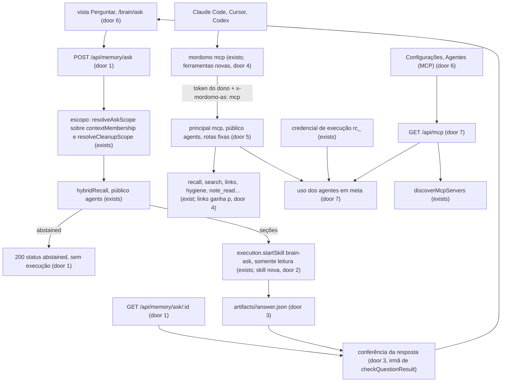
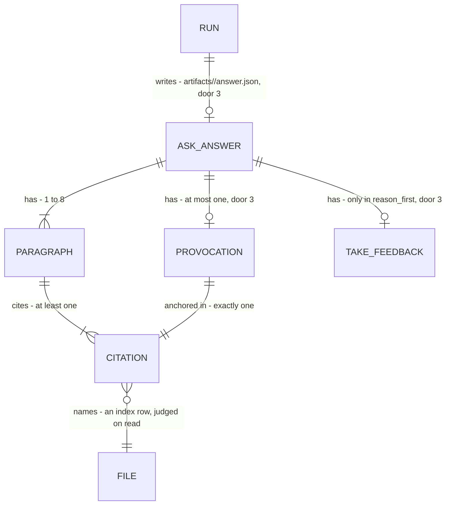

# Cérebro: perguntar — resposta com citações, "raciocine primeiro", provocação ancorada, e o cérebro pelo MCP sob as regras dos agentes

## Problem

Quem tem o Segundo Cérebro não consegue fazer uma pergunta a ele e receber uma resposta que diga de onde veio. E os agentes
que se ligam ao MordomoOS pelo MCP leem a memória como se fossem o dono. Levantamento no código em
`claude/clever-gates-o2zm4x` (HEAD `bbcd757`, depois do merge do PR #12):

- **Não existe "perguntar" nas telas do cérebro.** As vistas são `graph`, `notes`, `reviews` e `weekly`
  (`apps/command-centre/src/brain/BrainViewSwitch.tsx:17`). O recall com abstenção da C9 existe
  (`GET /api/memory/recall`, `apps/api/src/routes/memory.ts:522-550`), mas só agentes o chamam; a interface nunca o usa
  (relatório da pesquisa, "Exibir para diagnosticar e perguntar"). O único caminho de uma pergunta em linguagem natural é o
  painel de pergunta da C6b, que responde em widgets e não em texto (`skills/dashboard-answer/SKILL.md`).
- **Nada protege o pensamento do dono de virar "aceitar a resposta".** A pesquisa citada pelo roteiro (A1) mostra que mais
  confiança na IA veio com menos pensamento crítico (Microsoft Research com a CMU, 319 pessoas, 936 casos), que pedir a visão
  da pessoa antes de responder deu reflexão mais profunda (ExtendAI), e que provocações curtas ajudam só quando são
  específicas e ancoradas numa fonte, porque as genéricas viram "fadiga de alerta" (arXiv 2501.17247). Nenhuma tela do
  produto pede a visão do dono antes nem aponta a nota que discorda.
- **O MCP lê com o token do dono.** `mordomo mcp` chama a API com `ctx.token()` (`apps/api/src/cli.ts:1524-1527`); a
  requisição vira o principal do dono, sem público (`apps/api/src/access.ts:56-57` só dá `agents` a `run` e `devices` a
  `device`). Uma pasta que o dono marcou "esconder dos agentes" na C7 é lida inteira por uma sessão do Claude Code, do Cursor
  ou do Codex que tenha as ferramentas. O limite está escrito em `docs/security.md:100` e `:467` e no gap 4.2 de
  `.specs/cerebro-v3-status.md`.
- **O MCP não tem busca, links nem higiene.** As ferramentas são `recall`, `skills_list`, `skills_run`, `journal_append`,
  `facts_assert`, `facts_query`, `note_create`, `note_read`, `note_save` e `inbox_unread`
  (`apps/api/src/mcp/mordomo.ts:59-257`). Um agente não acha um arquivo por palavras, não vê quem aponta para uma nota nem
  pergunta o que está quebrado.
- **Não há onde ver nem ligar a conexão.** Nenhuma tela diz se o Claude Code, o Cursor ou o Codex têm o `mordomo` configurado,
  nem mostra o comando para ligar; o auditor de conectores já lê esses três arquivos de configuração
  (`core/src/connectors/auditor.ts:42-63`, `adapters/*/src/manifest.ts`), mas só para recomendar conectores. E ninguém sabe o
  que os agentes mais leem: `GET /api/memory/recall/stats` conta todo recall, de qualquer um, sem dizer quem leu.

A fonte não traz número de uso, de suporte ou prazo; a prioridade é a do roteiro (C10, fase P3).

Quando isto sair: o dono abre "Perguntar" no cérebro, escolhe sobre o quê (o contexto ativo, todo o cérebro, uma pasta ou
algumas notas), escreve a pergunta e, se quiser, a própria visão antes; recebe parágrafos que citam `caminho § seção`
clicáveis, um retorno sobre a visão dele (onde as notas concordam, onde discordam, o que falta) e no máximo uma provocação que
aponta para uma nota de verdade. Um agente ligado pelo MCP busca, vê links e higiene, e lê só o que o dono deixou os agentes
lerem; nas Configurações o dono vê quais ferramentas estão ligadas, copia o comando para ligar cada uma e vê o que os agentes
mais leem.

## Flow

Reusa em vez de duplicar: o recall híbrido com abstenção da C9 (`hybridRecall`), o arranque de skill somente leitura e a
conferência de um arquivo de resposta do painel de pergunta da C6b (`execution.startSkill`, `checkQuestionResult`), as regras de
pasta e de público da C7 (`accessView` com `audience: "agents"`), a resolução de escopo dos contextos da C2
(`contextFilter`, `resolveCleanupScope`), a leitura das configurações dos três CLIs do auditor (`discoverMcpServers`) e as
rotas de busca, links e higiene que já existem.

1. a vista Perguntar (`/brain/ask`, door 6) manda a pergunta, o modo, a visão do dono (só no modo "raciocine primeiro") e o
   escopo para `POST /api/memory/ask` (door 1)
2. a rota resolve o escopo com `resolveAskScope` (contexto pela regra da C2, `contextMembership`; pasta por
   `resolveCleanupScope`, a mesma regra de realpath igual ou seguido do separador; notas por linha do índice) e roda `hybridRecall` (exists) com o público `agents`, os filtros de política e o escopo; uma abstenção
   responde `200 status: "abstained"` com o motivo e o que foi consultado, **sem iniciar execução**
3. com seções, a rota inicia a skill `brain-ask` (door 2) por `execution.startSkill` (exists), somente leitura, com a pergunta,
   o modo, a visão, o escopo e as seções do recall como entradas; responde `202` com o id da execução
4. a skill escreve `artifacts/<run>/answer.json` (door 3); quando a execução termina, `GET /api/memory/ask/:id` lê o arquivo e
   o confere (door 3, a mesma forma de conferência de `checkQuestionResult`, exists): toda citação é uma linha do índice que a
   política de hoje mostra, fora das pastas escondidas dos agentes, dentro do escopo, e com uma seção que o arquivo tem;
   aceita, devolve a resposta com o id de cada arquivo citado; recusada, devolve o motivo
5. `GET /api/memory/ask` (door 1) lista as perguntas recentes a partir das execuções de `brain-ask` (a tabela `runs`, exists)
6. `mordomo mcp` (exists) passa a mandar `x-mordomo-as: mcp` e `x-mordomo-client` com o token do dono (door 5); o servidor dá
   à requisição o principal `mcp`, com o público `agents`, e só deixa chamar as rotas das ferramentas; as ferramentas novas
   `search`, `links` e `hygiene` (door 4) chamam `GET /api/memory/search`, `GET /api/memory/links` (ganha `p`, door 4) e
   `GET /api/memory/hygiene` (exist)
7. cada leitura de um agente (principal `mcp` ou credencial de execução, exists) por recall, busca, links ou `note_read` soma
   chamadas por ferramenta, por cliente e por caminho num registro em `meta` (door 7)
8. a aba Agentes (MCP) das Configurações (door 6), um pedaço próprio carregado na primeira vez, lê `GET /api/mcp` (door 7): o
   estado de cada CLI pelo `discoverMcpServers` (exists), o comando de cada um, as ferramentas e o uso; e `GET /api/system/info`
   (exists, a mesma entrada de cache da aba Identidade) para mostrar o caminho de um arquivo lido relativo a `memory/`

## Impact

| Front             | What changes                                                                                                                                                                                                                                                                                                                                                                                                                                                                                                                                     |
| ----------------- | ------------------------------------------------------------------------------------------------------------------------------------------------------------------------------------------------------------------------------------------------------------------------------------------------------------------------------------------------------------------------------------------------------------------------------------------------------------------------------------------------------------------------------------------------ |
| domain            | novo termo: **pergunta** (`ask`) - uma pergunta do dono ao cérebro, com modo, escopo e, no modo "raciocine primeiro", a visão dele; é uma execução da skill `brain-ask` e vive em `core/src/memory/ask.ts` (placement)                                                                                                                                                                                                                                                                                                                           |
| domain            | novo termo: **provocação** (`provocation`) - no máximo uma por resposta, até 2 frases, sempre presa a uma seção de uma nota do escopo que contradiz, complica ou completa a resposta; vive no contrato da resposta                                                                                                                                                                                                                                                                                                                               |
| domain            | novo termo: **escopo da pergunta** (`AskScope`) - `all`, `context`, `folder` ou `notes`; o `context` é o da C2, os outros dois são novos e só existem na pergunta                                                                                                                                                                                                                                                                                                                                                                                |
| domain            | novo termo: principal **`mcp`** - uma requisição do `mordomo mcp`, com o público `agents`. Quem ramifica em `principal.kind` hoje: `audienceOf` e `principalName` (`access.ts`, `server.ts`), o `onRequest` de autenticação (`server.ts:520-585`), `runReach`, `deviceRedactor` e as rotas de memória que testam `req.principal?.kind === "run"` (`memory.ts`, a escrita do diário e das propostas); todos entram na construção                                                                                                                  |
| domain            | termo existente: as ferramentas do MCP liam como o dono; passam a ler como agente. **Muda o uso de quem já tem o `mordomo` ligado:** uma pasta "esconder dos agentes" some do `recall`, do `note_read` e do `facts_query` do MCP; `skills_run` e `inbox_unread` continuam (são do dono pela natureza, door 5)                                                                                                                                                                                                                                    |
| domain            | termo existente: `GET /api/memory/links` recebia só `id`; passa a aceitar `p` (caminho) no lugar. Quem chama hoje: `LinksSection.tsx` e a vista de notas, que continuam com `id`                                                                                                                                                                                                                                                                                                                                                                 |
| stored data       | nada a migrar: a pergunta é uma execução (tabela `runs`, exists) e a resposta é o artefato da execução; o uso dos agentes é uma chave nova de `meta` (`agents.usage`), criada na primeira leitura; nenhuma migração (34 continua a última)                                                                                                                                                                                                                                                                                                       |
| configurações     | `memorySkills` ganha `brain-ask` no padrão; **uma casa que já grava a lista a mantém**, e a vista diz como ligar (C6b fez o mesmo com `dashboard-answer`); `UiPreferences.brain.ask` guarda, por máquina, o último modo e o último escopo                                                                                                                                                                                                                                                                                                        |
| custo             | cada pergunta que não se abstém gasta uma execução do provedor padrão das configurações; a abstenção antes da execução não gasta nada                                                                                                                                                                                                                                                                                                                                                                                                            |
| contratos e pinos | 4 rotas novas (173 → 177); 1 rota com assinatura nova (`memory.links`); a resposta de `memory.hygiene` ganha `brokenLinks` (door 8, lote B); o `400 validation` comum passa a valer em toda rota guardada (um `x-mordomo-as` que não é `mcp`, door 5); códigos de erro novos por recusa nomeada; 3 ferramentas MCP novas (10 → 13); 1 skill embutida nova; o padrão de `memorySkills` muda; exportações novas de `@mordomo/contracts`; `docs/security.md` (o MCP deixa de ler como o dono), `docs/memory-guide.md` e `docs/user-manual.md` mudam |
| peso              | teto novo acima de `cerebro-busca-significado` (AD-047 h), proposto em Assumptions; a vista Perguntar e a aba Agentes (MCP) são pedaços próprios, carregados na primeira vez                                                                                                                                                                                                                                                                                                                                                                     |

## Relations

One-way constraints: uma pergunta é exatamente uma execução da skill `brain-ask` e não tem linha própria (door 1); a resposta
é julgada na leitura pela política e pelas pastas de hoje, nunca guardada já julgada (door 3); toda citação nomeia uma linha
do índice e uma seção que o arquivo tem (door 3); a provocação tem exatamente uma citação (door 3). No columns and no types
here.

## Surface

Só as rotas que esta feature acrescenta ou cuja assinatura muda.

| Route                                    | In                                                                                                       | Out                                                                                                                                                                                                                                   | Status                                   |
| ---------------------------------------- | -------------------------------------------------------------------------------------------------------- | ------------------------------------------------------------------------------------------------------------------------------------------------------------------------------------------------------------------------------------- | ---------------------------------------- |
| `POST /api/memory/ask`                   | `question` · `mode` (`direct`, `reason_first`) · `take?` · `scope` (`kind` · `id?` · `path?` · `paths?`) | `status` (`running`, `abstained`) · `id?` · `abstainReason?` · `consulted`                                                                                                                                                            | `200`, `202`, `400`, `403`, `404`, `409` |
| `GET /api/memory/ask`                    | `limit?`                                                                                                 | `items[]` (`id` · `question` · `mode` · `scope` · `status` · `startedAt` · `finishedAt?`)                                                                                                                                             | `200`, `403`                             |
| `GET /api/memory/ask/:id`                | -                                                                                                        | `id` · `question` · `mode` · `take?` · `scope` · `status` (`running`, `answered`, `refused`, `failed`) · `answer?` (`paragraphs[]` · `takeFeedback?` · `provocation?`) · `reason?` · `run` (`provider` · `startedAt` · `finishedAt?`) | `200`, `403`, `404`                      |
| `GET /api/mcp`                           | -                                                                                                        | `clients[]` (`id` · `name` · `connected` · `source?` · `command`) · `tools[]` (`name` · `kind`) · `usage` (`since` · `calls` · `byTool[]` · `byClient[]` · `paths[]`)                                                                 | `200`, `403`                             |
| `GET /api/memory/links` (muda)           | query aceita `p` no lugar de `id`                                                                        | -                                                                                                                                                                                                                                     | `200`, `400`, `404`                      |
| `GET /api/memory/hygiene` (muda, lote B) | -                                                                                                        | ganha `brokenLinks` (`count` · `items[]`: `path` · `name` · `target` · `line`), os links de notas que não levam a nada, só do que o chamador lê                                                                                       | `200`                                    |
| `GET /api/mcp` (acréscimo, lote B)       | -                                                                                                        | cada item de `clients[]` ligado ganha `server` (`name` · `command`), o servidor achado, com o comando sem a parte com cara de credencial                                                                                              | `200`, `403`                             |
| `GET /api/mcp` (acréscimo, lote E)       | -                                                                                                        | cada item de `clients[]` cujo `command` é um bloco para colar num arquivo (Cursor, Codex) ganha `pasteInto`, esse arquivo como `~/<arquivo>`                                                                                          | `200`, `403`                             |

## Landing

| One-way door                                        | Literal shape                                                                                                                                                                                                                                                                                                                                                                                                                                                                                                                                                                                                                                                                                                                                                                                                                                                                                                                                                                        | Alternative rejected                                                                                                                                                                                                                                                                                                              |
| --------------------------------------------------- | ------------------------------------------------------------------------------------------------------------------------------------------------------------------------------------------------------------------------------------------------------------------------------------------------------------------------------------------------------------------------------------------------------------------------------------------------------------------------------------------------------------------------------------------------------------------------------------------------------------------------------------------------------------------------------------------------------------------------------------------------------------------------------------------------------------------------------------------------------------------------------------------------------------------------------------------------------------------------------------ | --------------------------------------------------------------------------------------------------------------------------------------------------------------------------------------------------------------------------------------------------------------------------------------------------------------------------------- |
| 1. A pergunta é uma execução                        | as três rotas `/api/memory/ask*` da `Surface`, todas com escopo `owner`; o `id` de uma pergunta é o `runId` da execução da skill `brain-ask`, e a lista é `SELECT` das execuções dessa skill, da mais nova para a mais velha, `limit` 1 a 100 (padrão 30); `question` 3 a 500 caracteres depois de `trim`; `take` obrigatório em `reason_first` com 20 a 4000 caracteres e recusado (`400 validation`) em `direct`; `409 ask_in_progress` quando há uma execução de `brain-ask` em `queued`, `running` ou `waiting_approval` na tabela `runs`; `409 skill_unavailable` quando a skill não existe, está desligada ou não está em `memorySkills`; uma abstenção não cria execução e não entra na lista                                                                                                                                                                                                                                                                                 | uma tabela `brain_asks`: duplica o estado da execução (início, fim, falha, cancelamento) que `runs` já guarda e cria uma migração para o que uma linha de `runs` e um artefato já dizem                                                                                                                                           |
| 2. A skill `brain-ask` e suas entradas              | `skills/brain-ask/SKILL.md`, `mode: read_only`, `providers: [claude, cursor, codex]`, entradas `question`, `mode`, `take` (vazio em `direct`), `scope` (uma linha: `all`, `context:<id>`, `folder:<caminho absoluto>` ou `notes:<caminho>;<caminho>…`) e `sources` (as seções do recall como `## <caminho> § <seção>` seguidas do trecho, dentro do `tokenBudget` do recall); `memorySkills` padrão passa a ser `["recall", "consolidate-memory", "organize-brain", "dashboard-answer", "brain-ask"]`                                                                                                                                                                                                                                                                                                                                                                                                                                                                                | o serviço chamar o modelo direto: o MordomoOS não fala com nenhuma API de LLM, só orquestra os CLIs (o provedor, a cobrança e a permissão são deles), e uma chamada direta seria um segundo caminho de provedor para manter                                                                                                       |
| 3. O arquivo da resposta e a conferência            | `artifacts/<run>/answer.json`, no máximo 64 KB: `{ "v": 1, "paragraphs": [{ "text": ≤ 1200 caracteres, "citations": [{ "path", "section" }] (1 a 6) }] (1 a 8), "takeFeedback"?: { "agrees": [item], "disagrees": [item], "missing": [item] } com item = { "text": ≤ 400, "citations": [1 a 3] }, ao menos um item no total, só em `reason_first`, "provocation"?: { "kind": "contradiz" \| "complica" \| "falta", "text": ≤ 300 caracteres e no máximo 2 frases, "citation": { "path", "section" } } }`; a conferência recusa a resposta inteira, com o motivo, por: tamanho, JSON inválido, esquema, `takeFeedback` em `direct` ou ausente em `reason_first`, caminho fora do índice, excluído pela política de hoje, numa pasta escondida dos agentes, fora do escopo, ou `section` que não é um título de seção do arquivo segundo `splitSections`; a natureza (`plano`, `hipotese`, `opiniao`) de cada citação é posta pelo servidor a partir do índice, nunca lida da resposta | guardar a resposta já conferida: uma pasta escondida depois continuaria citada numa resposta antiga; aceitar a resposta e só tirar as citações ruins: uma resposta com uma citação inventada é uma resposta em que não se pode confiar, e cortá-la em silêncio esconde o defeito                                                  |
| 4. As ferramentas MCP novas                         | `search` (`query` obrigatório, `mode?` `auto`/`text`/`semantic`, `context?`, `limit?` 1 a 20, padrão 10) → uma linha por arquivo `<caminho> (<seção>?) — <trecho>`; `links` (`path` obrigatório) → `Backlinks:` e `Links:` com os quebrados marcados `(quebrado)`; `hygiene` (`perKind?` 1 a 20, padrão 10) → as listas de órfãos, links quebrados, ponteiros de roteador quebrados e arquivos parados; `GET /api/memory/links` aceita `p` (caminho absoluto ou relativo a `memory/`) e exatamente um de `id` e `p` (`400 validation` com os dois ou nenhum)                                                                                                                                                                                                                                                                                                                                                                                                                         | expor `graph` pelo MCP: devolve até milhares de nós e arestas, que não cabem no contexto de um agente e que `links` e `search` respondem por partes                                                                                                                                                                               |
| 5. O principal `mcp`                                | o `mordomo mcp` manda `x-mordomo-as: mcp` e `x-mordomo-client: <nome>` (o `clientInfo.name` do `initialize`, `[a-z0-9._-]{1,40}` ou `desconhecido`) com o token do dono; o servidor só aceita `x-mordomo-as` junto do token do dono, e então o principal é `{ kind: "mcp", client }` com público `agents`; `MCP_ROUTES` é a lista fixa das rotas que as 13 ferramentas chamam, e qualquer outra rota é `403 forbidden`; um `x-mordomo-as` com outro valor é `400 validation`; **não é contenção**: quem tem o token do dono pode não mandar o cabeçalho, e `docs/security.md` diz isso                                                                                                                                                                                                                                                                                                                                                                                               | uma credencial própria do MCP (`mcp_…`) emitida pela tela: o processo do `mordomo mcp` roda como o usuário e lê o token do dono no disco de qualquer jeito, então um segundo segredo custaria rotação, revogação e armazenamento sem fechar nada; manter o token do dono sem público: é o furo da C7 que o dono pediu para fechar |
| 6. Rota e lugar das telas                           | a vista Perguntar é o modo `ask` de `BrainMode`, na rota `/brain/ask` nos dois shells, com as entradas da Revisão semanal (botão da barra do cérebro, linha do menu da cena, comando `global` da paleta) e a tecla `a` do escopo `view:brain`; a aba nova `Agentes (MCP)` das Configurações tem o `TabId` `agents-mcp`, no grupo `think`, depois de `memory`; `UiPreferences.brain.ask = { mode: "direct" \| "reason_first", scope: AskScope \| null }`                                                                                                                                                                                                                                                                                                                                                                                                                                                                                                                              | uma caixa de pergunta solta no grafo: não tem onde mostrar a resposta longa, o histórico nem a visão do dono, e o grafo já tem a busca                                                                                                                                                                                            |
| 7. O registro de uso dos agentes                    | a chave `agents.usage` de `meta`: `{ "v": 1, "since": <ms>, "calls": <n>, "byTool": { <ferramenta>: { "calls", "lastAt" } }, "byClient": { <cliente>: { "calls", "lastAt" } }, "paths": { <caminho absoluto>: { "reads", "lastAt" } } }` com no máximo 500 caminhos (sai o de menos leituras e, no empate, o mais antigo, como `recordRecall`) e 50 clientes; a ferramenta de uma execução é o nome da rota (`recall`, `search`, `links`, `note_read`) e o cliente é `run:<provedor>`; `GET /api/mcp` devolve os 20 caminhos mais lidos que a política de hoje mostra                                                                                                                                                                                                                                                                                                                                                                                                                | contar dentro de `memory.recall.stats`: aquele registro é de todo recall, inclusive o da interface, e mudar o que ele conta muda um número que a tela de Configurações da C9 já mostra                                                                                                                                            |
| 8. Os links quebrados na higiene (lote B)           | `GET /api/memory/hygiene` responde também `brokenLinks: { count, items: [{ path, name, target, line }] }`: cada link de `note_links` de um arquivo que o chamador lê que não leva a nenhum arquivo que ele lê, até `perKind` itens, do caminho e da linha; um link Markdown cujo alvo é um caminho que o chamador não pode saber (a política de hoje, uma pasta escondida dele) não entra; a ferramenta `hygiene` (door 4) lê dali a lista "links quebrados", e os "ponteiros de roteador quebrados" de `dangling-link`; na mesma rota, os arquivos parados passam a ser julgados pelo mesmo filtro de linhas que os órfãos (antes uma pasta escondida aparecia em `stale`)                                                                                                                                                                                                                                                                                                          | um tipo novo `broken-link` em `counts` e `items`: muda a lista fechada de tipos que dois testes e a tela de higiene fixam, para um dado que só o MCP lê; uma rota nova só para os links quebrados: fora de `MCP_ROUTES` como a door 5 a fixou (11 rotas)                                                                          |
| 9. O servidor achado em `GET /api/mcp` (lote B)     | um cliente `connected: true` traz `server: { name, command }`, o nome do servidor e o comando como `discoverMcpServers` o devolve (uma parte com cara de credencial, `TOKEN=abc`, lida `TOKEN=[hidden]`, C60); um cliente não ligado não traz `server`                                                                                                                                                                                                                                                                                                                                                                                                                                                                                                                                                                                                                                                                                                                               | não devolver o comando achado: o C60 pede que a parte com cara de credencial seja lida `TOKEN=[hidden]`, o que só se vê num comando devolvido, e a tela não teria como dizer qual servidor achou                                                                                                                                  |
| 10. O arquivo onde colar em `GET /api/mcp` (lote E) | um cliente cujo `command` é um bloco de arquivo de configuração (Cursor e Codex) traz `pasteInto: "~/<arquivo>"`, o primeiro dos `homeConfigFiles` do manifesto dele (`~/.cursor/mcp.json`, `~/.codex/config.toml`); o Claude Code, cujo `command` é um comando, não traz `pasteInto`; a aba lê dali a linha "Cole em <arquivo>."                                                                                                                                                                                                                                                                                                                                                                                                                                                                                                                                                                                                                                                    | a aba guardar um mapa `{ cursor: "~/.cursor/mcp.json", codex: "~/.codex/config.toml" }`: a interface não tem mapa pelos ids dos provedores embutidos (`providers.pluggable` C28), o arquivo de cada CLI é do manifesto dele, e um provedor novo pediria mexer na tela                                                             |

- Nothing else in this change is hard to reverse: os textos e a ordem da tela, quantas perguntas a lista mostra, o tamanho do
  trecho da busca pelo MCP, as frases do `SKILL.md` e a ordem das ferramentas mudam por refatoração

## Criteria

### S1: perguntar e receber parágrafos com citações (P1)

O dono pergunta pela API e recebe uma resposta em que cada parágrafo diz de que seção de que arquivo veio, ou um "não
encontrei" que não gasta nada.

**Acceptance Criteria**

1. WHEN o dono manda `POST /api/memory/ask` com `question`, `mode: "direct"` e um escopo cujo recall devolve seções THEN o sistema SHALL iniciar uma execução da skill `brain-ask`, somente leitura, e responder `202` com `status: "running"` e o `id` igual ao `runId` dessa execução
2. WHEN o recall do escopo se abstém THEN o sistema SHALL responder `200` com `status: "abstained"`, o `abstainReason` do recall (`no_match` ou `weak`) e `consulted` com o número de arquivos do escopo, e SHALL NOT criar execução
3. IF `question` tem menos de 3 ou mais de 500 caracteres depois de `trim` THEN o sistema SHALL responder `400 validation`
4. IF já existe uma execução de `brain-ask` em `queued`, `running` ou `waiting_approval` THEN o sistema SHALL responder `409 ask_in_progress`, inclusive depois de o serviço reiniciar com essa execução ainda aberta
5. IF a skill `brain-ask` não existe, está desligada ou não está em `memorySkills` THEN o sistema SHALL responder `409 skill_unavailable`
6. IF quem chama não é o dono THEN o sistema SHALL responder `403 owner_only` às três rotas `/api/memory/ask*`
7. WHEN a execução termina em `done` e `answer.json` passa na conferência THEN `GET /api/memory/ask/:id` SHALL devolver `status: "answered"` e `answer.paragraphs` com cada citação levando `path`, `section`, `name`, `fileId` e, quando a nota é `plano`, `hipotese` ou `opiniao`, a `natureza` lida do índice
8. IF `answer.json` cita um caminho que o índice não tem THEN `GET /api/memory/ask/:id` SHALL devolver `status: "refused"`, nenhum parágrafo e `reason` com o caminho
9. IF `answer.json` cita uma `section` que não é título de seção do arquivo segundo `splitSections` THEN o sistema SHALL devolver `status: "refused"` com `reason` que nomeia o arquivo e a seção
10. IF `answer.json` cita um arquivo que a política de hoje exclui ou que está numa pasta escondida dos agentes THEN o sistema SHALL devolver `status: "refused"`, inclusive quando a pasta foi escondida depois de a resposta ser escrita
11. IF `answer.json` passa de 64 KB, não é JSON ou não obedece ao esquema da door 3 (mais de 8 parágrafos, parágrafo sem citação, mais de 6 citações num parágrafo, texto de parágrafo acima de 1200 caracteres) THEN o sistema SHALL devolver `status: "refused"` com `reason` que diz qual regra falhou
12. WHEN a execução termina em `failed` ou `cancelled`, ou termina em `done` sem `answer.json` THEN o sistema SHALL devolver `status: "failed"` com `reason` que diz o fim da execução ou "A execução não escreveu answer.json."
13. WHILE a execução está aberta `GET /api/memory/ask/:id` SHALL devolver `status: "running"` e nenhum `answer`
14. IF o `id` não é de uma execução de `brain-ask` THEN `GET /api/memory/ask/:id` SHALL responder `404 not_found`
15. WHEN o dono pede `GET /api/memory/ask` THEN o sistema SHALL devolver as execuções de `brain-ask` da mais nova para a mais velha, no máximo `limit` (1 a 100, padrão 30), cada uma com `question`, `mode`, `scope` e `status`
16. The system SHALL dar à skill `brain-ask`, como entrada `sources`, só as seções que o recall do escopo devolveu com o público `agents` e a política de hoje

**Independent test:** com um índice de três notas, `POST /api/memory/ask` com um adaptador de teste que escreve um
`answer.json` válido devolve `202`; `GET /api/memory/ask/:id` devolve os parágrafos com `fileId`; um segundo `answer.json` com
uma seção inventada devolve `refused`; uma pergunta sem palavra do índice devolve `abstained` e a lista de execuções não cresce.

### S2: escolher sobre o quê perguntar (P1)

O dono restringe a pergunta a um contexto, a uma pasta ou a algumas notas, e a resposta nunca cita fora disso.

**Acceptance Criteria**

17. WHEN o escopo é `{ kind: "context", id }` THEN o sistema SHALL recuperar e conferir citações pela regra de pertença do contexto da C2 (realpath igual ou seguido do separador) e SHALL iniciar a execução com esse `contextId`
18. IF o escopo é `{ kind: "context" }` com um `id` que não existe THEN o sistema SHALL responder `404 context_not_found`
19. WHEN o escopo é `{ kind: "folder", path }` THEN o sistema SHALL aceitar só citações de arquivos cujo realpath é o da pasta seguido do separador, de modo que `projetos` não aceita `projetos-antigo/x.md`
20. IF a pasta do escopo `folder` não está dentro de `memory/` nem de uma pasta indexada, ou está numa pasta escondida dos agentes THEN o sistema SHALL responder `400 folder_outside_index`
21. WHEN o escopo é `{ kind: "notes", paths }` com 1 a 20 caminhos THEN o sistema SHALL aceitar só citações desses arquivos
22. IF um caminho do escopo `notes` não é uma linha do índice que a política de hoje mostra fora das pastas escondidas dos agentes THEN o sistema SHALL responder `400 unknown_note` com o caminho, e IF `paths` tem 0 ou mais de 20 itens THEN `400 validation`
23. WHEN o escopo é `{ kind: "all" }` THEN o sistema SHALL recuperar de todo o índice que o público `agents` lê, sem contexto
24. IF `answer.json` cita um arquivo fora do escopo da pergunta THEN o sistema SHALL devolver `status: "refused"` com `reason` que nomeia o arquivo

**Independent test:** com duas pastas `projetos/` e `projetos-antigo/`, uma pergunta de escopo `folder` em `projetos` cujo
`answer.json` cita `projetos-antigo/a.md` volta `refused`; com escopo `notes` de um só caminho, citar outro volta `refused`.

### S3: raciocine primeiro (P1)

No modo "raciocine primeiro" o dono escreve a própria visão antes, e a resposta começa pelo retorno sobre ela.

**Acceptance Criteria**

25. IF `mode` é `reason_first` e `take` falta ou tem menos de 20 ou mais de 4000 caracteres depois de `trim` THEN o sistema SHALL responder `400 validation`
26. IF `mode` é `direct` e `take` vem preenchido THEN o sistema SHALL responder `400 validation`
27. WHEN a pergunta é `reason_first` THEN o sistema SHALL passar `take` à skill como entrada e SHALL devolver `take` em `GET /api/memory/ask/:id`
28. IF uma resposta `reason_first` não traz `takeFeedback`, ou o traz sem nenhum item em `agrees`, `disagrees` e `missing` THEN o sistema SHALL devolver `status: "refused"`
29. IF uma resposta `direct` traz `takeFeedback` THEN o sistema SHALL devolver `status: "refused"`
30. The system SHALL exigir de 1 a 3 citações em cada item de `takeFeedback`, conferidas pelas mesmas regras das citações dos parágrafos (AC 8 a 10 e 24)

**Independent test:** uma pergunta `reason_first` com uma visão de 30 caracteres e um `answer.json` com `disagrees` citando uma
nota volta `answered` com o retorno; o mesmo arquivo numa pergunta `direct` volta `refused`.

### S4: uma provocação presa a uma nota (P1)

Cada resposta pode trazer uma provocação curta que aponta uma nota de verdade; nunca uma genérica.

**Acceptance Criteria**

31. The system SHALL aceitar no máximo uma `provocation` por resposta, com `kind` `contradiz`, `complica` ou `falta`, `text` de até 300 caracteres e no máximo 2 frases, e exatamente uma `citation`
32. IF a citação da provocação não passa nas regras das citações (AC 8 a 10 e 24) THEN o sistema SHALL devolver `status: "refused"`
33. IF o `text` da provocação tem mais de 2 frases (contadas por `.`, `!` ou `?` seguidos de espaço ou do fim) THEN o sistema SHALL devolver `status: "refused"`
34. WHEN a resposta não traz provocação THEN o sistema SHALL devolver `answer.provocation` ausente e a resposta SHALL ser `answered`

**Independent test:** um `answer.json` com uma provocação de três frases volta `refused`; com uma provocação de uma frase que
cita uma seção real do escopo volta `answered` com a provocação e o `fileId` da nota.

### S5: a vista Perguntar (P1)

A pergunta, a visão, o escopo, a espera e a resposta numa vista do cérebro, nos dois shells, como `design.md` desenha.

**Acceptance Criteria**

35. WHEN o dono aperta o botão "Perguntar" da barra de ferramentas do cérebro (moldura), escolhe a linha "Perguntar ao cérebro" do menu da cena do cérebro (Núcleo), usa o comando "Perguntar ao cérebro" da paleta ou aperta `a` no escopo `view:brain` THEN o sistema SHALL abrir `/brain/ask`
36. WHEN a vista abre pela primeira vez numa máquina THEN o sistema SHALL mostrar o modo `direct` e o escopo do contexto ativo, ou "Todo o cérebro" sem contexto ativo
37. WHEN o dono troca o modo ou o escopo THEN o sistema SHALL gravar `UiPreferences.brain.ask` e SHALL abrir a vista com eles da próxima vez nessa máquina
38. WHILE o modo é "Raciocine primeiro" o sistema SHALL mostrar o campo "Sua visão" antes do campo da pergunta e SHALL manter "Perguntar" desabilitado enquanto a visão tem menos de 20 caracteres, com a contagem visível
39. WHILE a pergunta está `running` o sistema SHALL mostrar o estado de espera do `design.md` com o botão "Cancelar", que cancela a execução pela rota de cancelamento de execuções que já existe
40. WHEN a resposta chega `answered` THEN o sistema SHALL mostrar cada parágrafo com as citações como `nome § seção` clicáveis, e um clique SHALL abrir o arquivo como a citação de um painel de pergunta abre (`/brain?sel=<fileId>`)
41. WHEN uma citação é de uma nota `plano`, `hipotese` ou `opiniao` THEN o sistema SHALL mostrar o rótulo da natureza junto da citação
42. WHEN a resposta `reason_first` chega `answered` THEN o sistema SHALL mostrar primeiro "Sua visão" e o retorno em "Onde as notas concordam", "Onde discordam" e "O que falta" (só as listas com item), e a resposta do cérebro recolhida atrás de "Ver a resposta do cérebro"
43. WHEN a resposta tem provocação THEN o sistema SHALL mostrá-la depois dos parágrafos, sem estilo de alerta, com a citação e os botões "Abrir a nota" e "Perguntar sobre isto", e "Perguntar sobre isto" SHALL preencher a pergunta com o texto da provocação e o escopo `notes` com a nota citada
44. WHEN o POST volta `abstained` THEN o sistema SHALL mostrar "Não encontrei nada nas suas notas sobre isso." com o escopo e o número de arquivos consultados, e um botão "Perguntar em todo o cérebro" quando o escopo não era `all`
45. WHEN a resposta volta `refused` ou `failed` THEN o sistema SHALL mostrar a linha de erro do `design.md` com o `reason` e o botão "Tentar de novo", que manda a mesma pergunta
46. WHEN o POST volta `409 skill_unavailable` THEN o sistema SHALL mostrar o estado "Perguntar está desligado" com o botão "Ligar", que acrescenta `brain-ask` a `memorySkills` por `PUT /api/settings` sem tirar nenhum item da lista
47. WHEN o POST volta `409 ask_in_progress` THEN o sistema SHALL abrir a pergunta em andamento em vez de mostrar erro
48. WHEN a vista abre THEN o sistema SHALL listar em "Perguntas recentes" as até 30 de `GET /api/memory/ask`, e um clique SHALL abrir a pergunta com a resposta como `GET /api/memory/ask/:id` a julga hoje
49. WHEN "Perguntas recentes" está vazia THEN o sistema SHALL mostrar o estado vazio do `design.md`, com três exemplos de pergunta que preenchem o campo
50. WHEN o escopo é `notes` THEN o sistema SHALL mostrar as notas escolhidas como fichas removíveis, e a vista de notas SHALL oferecer "Perguntar sobre esta nota", que abre `/brain/ask` com o escopo `notes` dela
51. WHILE o escopo contém uma pasta escondida dos agentes o sistema SHALL mostrar a linha "Pastas escondidas dos agentes não entram nas respostas."
52. WHEN a resposta chega `answered` THEN o sistema SHALL mostrar o cartão "Como esta resposta foi feita" com o provedor, o início, a duração e o link para a execução
53. The system SHALL ter todos os textos da vista nas duas línguas (`pt-BR` e `en`, as mesmas chaves) e passar no axe WCAG A/AA nos dois shells e nos temas claro e escuro
54. The system SHALL carregar a vista Perguntar num pedaço próprio, buscado na primeira vez que `/brain/ask` abre

**Independent test:** no Command Centre de teste, abrir `/brain/ask`, perguntar no modo direto com um adaptador de teste, ver
o estado de espera, a resposta com duas citações clicáveis e a provocação; repetir em "Raciocine primeiro" e ver o retorno
primeiro; um índice vazio mostra o estado de abstenção.

### S6: o cérebro pelo MCP, sob as regras dos agentes (P1)

Um agente ligado pelo MCP busca, vê links e higiene, e lê só o que o dono deixou os agentes lerem.

**Acceptance Criteria**

55. WHEN `mordomo mcp` chama a API THEN o sistema SHALL mandar `x-mordomo-as: mcp` e `x-mordomo-client` com o nome do `clientInfo` do `initialize`, ou `desconhecido` quando o nome falta ou não casa `[a-z0-9._-]{1,40}`
56. WHEN uma requisição traz o token do dono e `x-mordomo-as: mcp` THEN o sistema SHALL tratá-la com o principal `mcp` e o público `agents`, de modo que o `recall`, o `note_read`, o `facts_query`, a `search`, os `links` e a `hygiene` do MCP não devolvem nada de uma pasta "esconder dos agentes"
57. IF uma requisição com o principal `mcp` chama uma rota fora de `MCP_ROUTES` THEN o sistema SHALL responder `403 forbidden`
58. IF `x-mordomo-as` vem com outro valor que `mcp` THEN o sistema SHALL responder `400 validation`, e IF vem com uma credencial que não é o token do dono THEN o sistema SHALL ignorar o cabeçalho e julgar a credencial como hoje
59. WHEN um agente chama a ferramenta `search` com `query` THEN o sistema SHALL devolver até `limit` (1 a 20, padrão 10) arquivos de `GET /api/memory/search`, uma linha cada, com o caminho, a seção quando há e o trecho
60. WHEN um agente chama a ferramenta `links` com `path` THEN o sistema SHALL devolver os backlinks e os links do arquivo, com os quebrados marcados `(quebrado)`, e IF o caminho não é um arquivo que o agente lê THEN o texto de erro de "arquivo não encontrado", igual para um arquivo que não existe e um escondido
61. WHEN `GET /api/memory/links` recebe `p` THEN o sistema SHALL resolver o arquivo pelo caminho, absoluto ou relativo a `memory/`, e IF recebe `id` e `p` juntos ou nenhum dos dois THEN `400 validation`
62. WHEN um agente chama a ferramenta `hygiene` THEN o sistema SHALL devolver no máximo `perKind` (1 a 20, padrão 10) itens de cada lista de órfãos, links quebrados, ponteiros de roteador quebrados e arquivos parados, só do que o público `agents` lê
63. The system SHALL manter as escritas do MCP como propostas na caixa de revisão (AD-045 c): `facts_assert`, `note_create` e `note_save` com o principal `mcp` continuam criando propostas com `author: "mcp"`
64. The system SHALL dizer em `docs/security.md` que o principal `mcp` aplica as regras de pasta às ferramentas e não é contenção, porque quem tem o token do dono pode chamar a API sem o cabeçalho

**Independent test:** com uma pasta marcada "esconder dos agentes" e uma nota nela com a palavra `zebra`, as ferramentas
`recall`, `search` e `note_read` do servidor MCP de teste não devolvem a nota, e a mesma busca com o token do dono, sem o
cabeçalho, devolve.

### S7: Agentes (MCP) nas Configurações, com o que os agentes mais leem (P2)

O dono vê se cada CLI tem o MordomoOS ligado, copia o comando para ligar e vê o que os agentes mais leem.

**Acceptance Criteria**

65. WHEN o dono pede `GET /api/mcp` THEN o sistema SHALL devolver um item por CLI (`claude`, `cursor`, `codex`), com `connected: true` quando `discoverMcpServers` acha, nos arquivos do manifesto desse CLI, um servidor chamado `mordomo` ou cujo comando tem o nome de arquivo `mordomo`, `mordomo.cmd` ou `mordomo.exe`, e `source` com o arquivo
66. The system SHALL devolver em `GET /api/mcp` o `command` literal de cada CLI: `claude mcp add mordomo -- mordomo mcp`, o bloco JSON `mcpServers.mordomo` do Cursor e o bloco TOML `[mcp_servers.mordomo]` do Codex
67. The system SHALL devolver em `GET /api/mcp` as 13 ferramentas, cada uma com `kind` `read`, `propose` ou `owner` (`skills_run` e `inbox_unread` são `owner`)
68. WHEN um agente lê por `recall`, `search`, `links` ou `note_read`, pelo principal `mcp` ou pela credencial de uma execução THEN o sistema SHALL somar uma chamada à ferramenta, ao cliente (`run:<provedor>` numa execução) e a cada caminho devolvido em `agents.usage`
69. IF `agents.usage` passaria de 500 caminhos THEN o sistema SHALL tirar o de menos leituras e, no empate, o de `lastAt` mais antigo
70. WHEN o dono pede `GET /api/mcp` THEN o sistema SHALL devolver em `usage.paths` os até 20 caminhos mais lidos que a política de hoje mostra, em ordem de leituras
71. IF `agents.usage` está ausente ou ilegível THEN `GET /api/mcp` SHALL devolver `usage` com `calls: 0` e listas vazias, e a próxima leitura de um agente SHALL recomeçar o registro
72. IF quem chama `GET /api/mcp` não é o dono THEN o sistema SHALL responder `403 owner_only`
73. WHEN o dono abre Configurações › Agentes (MCP) THEN o sistema SHALL mostrar um cartão por CLI com "Ligado" ou "Não ligado", o arquivo onde foi achado e o comando com o botão "Copiar", como `design.md` desenha
74. WHEN o dono abre Configurações › Agentes (MCP) THEN o sistema SHALL mostrar a lista das ferramentas com o que cada uma faz e a marca "lê", "propõe" ou "do dono", e a linha "As ferramentas leem como um agente: pastas escondidas dos agentes ficam de fora."
75. WHEN `usage.calls` é 0 THEN o sistema SHALL mostrar o estado vazio "Nenhum agente leu o cérebro ainda." e, com chamadas, as chamadas por ferramenta, por cliente com a última vez, e os 20 caminhos mais lidos, cada um abrindo o arquivo
76. IF `GET /api/mcp` falha THEN o sistema SHALL mostrar a linha de erro de Configurações com "Tentar de novo"
77. The system SHALL ter os textos da aba nas duas línguas e passar no axe WCAG A/AA, nos temas claro e escuro

**Independent test:** com um `~/.claude.json` de teste que tem `mcpServers.mordomo`, a seção mostra Claude Code "Ligado" e os
outros dois "Não ligado"; depois de duas chamadas `search` pelo servidor MCP de teste, o uso mostra `search` com 2 e o caminho
lido.

## Out of scope

| Excluded                                                      | Why                                                                                                                                                      |
| ------------------------------------------------------------- | -------------------------------------------------------------------------------------------------------------------------------------------------------- |
| Salvar uma resposta como nota                                 | a pesquisa do roteiro pede que a IA proponha, ligue e questione, não que escreva notas por padrão; um "salvar" entra depois, pela caixa de revisão da C7 |
| Conversa de várias voltas                                     | cada pergunta é uma execução; "Perguntar sobre isto" e "Tentar de novo" cobrem a volta seguinte sem uma sessão de chat                                   |
| Escrever a configuração do Claude Code, do Cursor ou do Codex | é arquivo de outro programa; a tela mostra o comando e diz se achou, e o dono liga                                                                       |
| Uma credencial própria do MCP, com rotação e revogação        | não fecha nada enquanto o token do dono está no disco do mesmo usuário (door 5)                                                                          |
| Ferramenta MCP do grafo inteiro                               | não cabe no contexto de um agente (door 4)                                                                                                               |
| Zerar o uso dos agentes                                       | o registro é limitado por tamanho; um "zerar" é uma ação destrutiva que ninguém pediu                                                                    |
| Entidades, resumos por área e PageRank                        | são a C11                                                                                                                                                |
| Escolher o provedor ou o modelo por pergunta                  | a pergunta usa o provedor padrão das configurações, como o painel de pergunta                                                                            |

## Assumptions

| Assumption                         | Chosen default                                                                                                                                                             | Rationale                                                                                                                     | Confirmed? |
| ---------------------------------- | -------------------------------------------------------------------------------------------------------------------------------------------------------------------------- | ----------------------------------------------------------------------------------------------------------------------------- | ---------- |
| Modo padrão                        | `direct`, com o último modo lembrado por máquina                                                                                                                           | o "raciocine primeiro" pede escrever antes; como padrão, viraria atrito em toda pergunta rápida                               | n          |
| Casas que já gravam `memorySkills` | mantêm a lista; a vista mostra "Perguntar está desligado" com "Ligar"                                                                                                      | é o que a C6b fez com `dashboard-answer`; nunca mudar sozinho a lista do que lê a memória                                     | n          |
| Uma pergunta por vez               | `409 ask_in_progress`, e a vista abre a que está em andamento                                                                                                              | cada pergunta gasta uma execução paga do provedor; duas ao mesmo tempo por um clique duplo custam o dobro                     | n          |
| Abstenção sem registro             | uma pergunta que o recall abstém não entra em "Perguntas recentes"                                                                                                         | não houve execução; guardar exigiria a tabela que a door 1 rejeita                                                            | n          |
| Teto de peso                       | 16 KB de JS gzip e 2 KB de CSS gzip acima de `cerebro-busca-significado` (vista Perguntar, entradas nos dois shells, aba Agentes (MCP), a história da galeria e os textos) | a C8 mediu 13,1 KB para uma vista de cinco passos e a C9 7,3 KB para um bloco de Configurações; esta tem uma vista e um bloco | n          |
| Sessão de telas com o dono         | junto da sessão pendente da C8 e da C9 (AD-048 c), depois da construção e antes do verificador                                                                             | a sessão de andar as telas nunca rodou; juntar as três custa uma sessão só                                                    | n          |

**Open questions:** none - all resolved or logged above. As duas perguntas do plano foram respondidas pelo dono em 22/11/2026 pelas recomendações (AD-052): o MCP lê como agente nesta feature (door 5) e a provocação é zero ou uma, nunca genérica (AC 31, AC 34).

## Observable

| Surface                                      | Decision                                   | Landing                                                                                                                      |
| -------------------------------------------- | ------------------------------------------ | ---------------------------------------------------------------------------------------------------------------------------- |
| screen Perguntar                             | empty state                                | AC 49                                                                                                                        |
| screen Perguntar                             | loading state                              | AC 39                                                                                                                        |
| screen Perguntar                             | error state                                | AC 45, AC 46                                                                                                                 |
| screen Perguntar                             | unauthorised state                         | n/a - a vista só existe no Command Centre do dono; um dispositivo pareado recebe `403 owner_only` (AC 6) e não tem a vista   |
| screen Perguntar                             | no answer (abstention)                     | AC 44                                                                                                                        |
| screen Perguntar                             | density and ordering                       | AC 42, AC 43, AC 48                                                                                                          |
| screen Perguntar                             | destructive action confirms                | n/a - nada se apaga; "Cancelar" só para uma execução que ainda não respondeu, como o cancelamento de execuções que já existe |
| screen Agentes (MCP)                         | empty state                                | AC 75                                                                                                                        |
| screen Agentes (MCP)                         | loading state                              | existing - o esqueleto das seções de Configurações                                                                           |
| screen Agentes (MCP)                         | error state                                | AC 76                                                                                                                        |
| screen Agentes (MCP)                         | unauthorised state                         | n/a - Configurações é do dono; `GET /api/mcp` responde `403 owner_only` a outro (AC 72)                                      |
| screen Agentes (MCP)                         | density and ordering                       | AC 73 a 75                                                                                                                   |
| screen Agentes (MCP)                         | destructive action confirms                | n/a - a seção não apaga nem escreve nada fora de copiar um comando                                                           |
| API `POST /api/memory/ask`                   | error shape and codes                      | AC 3 a 6, 18, 20, 22, 25, 26; o envelope de erro único de `api-v1`                                                           |
| API `GET /api/memory/ask/:id`                | error shape and codes                      | AC 6, 14; uma resposta recusada é `200` com `status: "refused"` e `reason` (AC 8 a 12)                                       |
| API `GET /api/mcp`                           | error shape and codes                      | AC 72                                                                                                                        |
| API `GET /api/memory/links`                  | error shape and codes                      | AC 61                                                                                                                        |
| all new `/api/memory/ask*` e `/api/mcp`      | who may call it                            | AC 6, AC 72 (escopo `owner`)                                                                                                 |
| all new `/api/memory/ask*` e `/api/mcp`      | versioning                                 | existing - as rotas também respondem em `/api/v1`, como todas da tabela `API`                                                |
| all new `/api/memory/ask*` e `/api/mcp`      | rate limit                                 | existing - o rate limit de `api-v1`; o custo de uma pergunta é limitado por uma por vez (AC 4)                               |
| ferramentas MCP `search`, `links`, `hygiene` | output format                              | AC 59, 60, 62                                                                                                                |
| ferramentas MCP `search`, `links`, `hygiene` | what it prints when it fails               | AC 60; o `isError` com a mensagem que o servidor MCP já devolve (`stdio.ts:73-76`)                                           |
| ferramentas MCP `search`, `links`, `hygiene` | flags and defaults                         | AC 59, 60, 62                                                                                                                |
| copy `SKILL.md` de `brain-ask`               | structure, tone, what the reader does next | door 2; a skill é lida por um agente: o formato de `answer.json`, as regras de citação e a de não inventar provocação        |
| copy da vista e da aba                       | structure, tone                            | `design.md`, seção "Texto"                                                                                                   |

## Sources

- `.specs/roadmap.md`, linha C10 - o escopo: perguntar com citações, "raciocine primeiro", provocações, busca, links e higiene
  pelo MCP, página de conexão MCP e uso
- `reports/Segundo cérebro para agentes.md`, A1, e `research_notes/Segundo cérebro para agentes/exibicao_pensamento.md` - a
  evidência sobre ExtendAI e provocações ancoradas
- `.specs/cerebro-v3-status.md`, gap 4.2 item 2 - o MCP lê com o token do dono
- `design.md` desta pasta - as duas telas (binding para `ui`)
