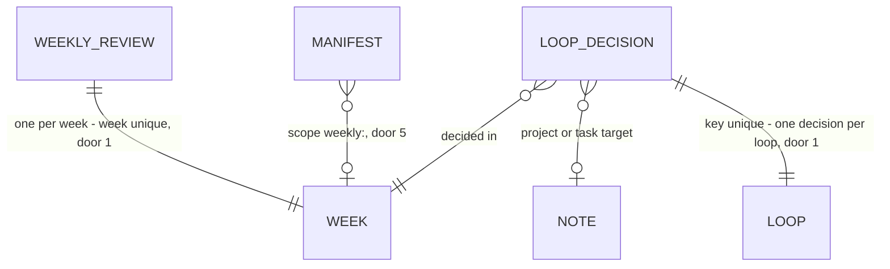

# Cérebro: rituais — revisão semanal, projetos com fim, arquivo da semana e menções sem link

## Problem

O Segundo Cérebro acumula compromissos e não tem um momento em que alguém os encara. Levantamento no código em
`claude/beautiful-volta-6xmhok` (o mesmo de `chore/cerebro-v3-roteiro`, PR #11):

- **Laço aberto não tem dono nem idade.** Um "Open loop" é uma linha de texto no `## Open loops` do diário do dia
  (`core/src/memory/journal.ts:18`) ou do `MEMORY.md` (`core/src/memory/proposals.ts:60`). Nada guarda se ele foi resolvido:
  a consolidação só acrescenta `→ closed <dia>` no `MEMORY.md` e a linha fica (`proposals.ts:647`); no diário, que é gerado e
  não editável (`403 note_not_editable`), a linha fica para sempre. O único leitor é o widget "Laços abertos" dos painéis, e só
  da semana corrente (`core/src/dashboards/sources.ts:399-416`): um laço de três semanas atrás some da vista sem ter sido
  fechado.
- **Projeto não tem próxima ação nem prazo de revisão.** Projeto é uma nota `type: project` com `status` e `due`
  (`frontMatter.ts:128`, `sources.ts:432-466`). Ninguém pergunta "qual é o próximo passo?"; a saúde (`projectHealth`) só olha
  o prazo de entrega. A cadência de revisão da C6 (`reviews.ts:109-120`) vale para natureza e para `type: status` e
  `conceito`, não para projeto.
- **Projeto terminado nunca sai do caminho.** `status: done` fica onde está, no meio dos ativos; mover para
  `memory/archive/` com desfazer só existe dentro da faxina (`cleanupApply.ts:241-345`), presa a uma varredura de achados.
- **Não há ritual semanal.** As rotinas são consolidação noturna, resumo diário e heartbeat, as três desligadas
  (`routines/*.json`); a cobrança diária da C6 (`reviewDue`) lembra notas, não a semana. A caixa de entrada
  `memory/inbox/` existe por convenção da C3 (`skills/organize-brain/resources/guia.md:9`) e ninguém a esvazia.
- **Menção sem link fica invisível.** Uma nota que cita "Curso de Março" pelo nome, sem `[[...]]`, não aparece em
  Backlinks (`GET /api/memory/links`), nem no grafo, nem no recall por link. A vista de notas (C4) e a faxina (C5) deixaram
  isso para esta feature (`cerebro-vista-notas/plan.md:235`, `cerebro-faxina-guiada/plan.md:235`).

Quem paga é o dono: o que ele prometeu a si mesmo some do campo de visão sem ter sido decidido, e o agente que lê o `MEMORY.md`
trata como aberto o que já acabou. A pesquisa de 29/10/2026 (`reports/Segundo cérebro para agentes.md`, M5) chama a revisão
semanal de "fator crítico de sucesso" do GTD e registra que o MordomoOS não tem nenhuma; ninguém deu número de uso, e a
pesquisa diz que não achou limiares publicados (`research_notes/.../metodos_pkm_agentes.md:364-366`).

Quando isto sair: uma vez por semana o MordomoOS lembra, e uma tela de cinco etapas leva o dono por todo laço aberto
(fechar, manter, algum dia, virar projeto ou tarefa), por todo projeto ativo (revisado, próxima ação, concluído, pausar), pelo
que está em "algum dia" e pelo que terminou (arquivar com desfazer). No painel de uma nota aparecem as menções sem link, com
"Linkar" num clique.

## Flow

Reusa em vez de recriar: a base do dia de revisão e a decisão `keep` da C6 (`lastReviewedDay`, `POST /api/memory/reviews`),
o movimento para `memory/archive/` com manifesto e desfazer da C5, a leitura das seções geradas, a semana local e a
`projectHealth` dos painéis (C6b), o índice de tarefas `note_tasks` e o painel da nota da C4, a pertença a contexto da C2, o
laço horário dos sentinelas e o histórico da C7.

```mermaid
flowchart TD
    UI["página /brain/weekly (door 2)"] --> GET["GET /api/memory/weekly-review (door 2)"]
    GET --> RD["generatedSections / sectionItems (exists, dashboards)"]
    GET --> LR["lastReviewedDay (exists, reviews.ts)"]
    GET --> TK["note_tasks (exists)"]
    GET --> LD["loop_decisions (door 1)"]
    UI --> LP["POST /api/memory/weekly-review/loops (door 2)"]
    LP --> LD
    LP --> CN["createNote (exists, notes.ts)"]
    LP --> AT["appendTask (door 3)"]
    UI --> RV["POST /api/memory/reviews (exists)"]
    UI --> PR["PUT /api/memory/notes/properties (exists)"]
    UI --> TA["POST /api/memory/tasks (door 3)"]
    TA --> AT
    UI --> AR["POST /api/memory/weekly-review/archive (door 5)"]
    AR --> MV["mover de applyCleanup (exists, cleanupApply.ts)"]
    UI --> UN["POST /api/memory/cleanup/undo (exists)"]
    UI --> FN["POST /api/memory/weekly-review/finish (door 2)"]
    FN --> WR["weekly_reviews (door 1)"]
    FN --> JA["appendJournal (exists, journal.ts)"]
    SN["laço horário runner.ts (exists)"] --> WS["sentinela weeklyReview (door 4)"]
    WS --> NT["recorder, kind system (exists)"]
    NP["NotePanel da vista de notas (exists)"] --> MG["GET /api/memory/mentions (door 6)"]
    MG --> FT["files_fts e cópias por público (exists)"]
    MG --> NL["note_links (exists)"]
    NP --> ML["POST /api/memory/mentions/link (door 7)"]
    ML --> SV["saveNote com histórico (exists, notes.ts)"]
    LD --> OL["openLoopsSource dos painéis (exists)"]
```

1. a página `/brain/weekly` (door 2) pede `GET /api/memory/weekly-review`; o núcleo da revisão semanal (novo, sem door -
   lugar pelas convenções de `core/src/memory/`) lê os laços pelas mesmas `generatedSections`/`sectionItems` dos painéis
   (exists), os projetos pelas linhas de `files` e o cabeçalho indexado, a próxima ação por `note_tasks` (exists), o prazo
   de revisão por `lastReviewedDay` (exists), o contexto por `contextMembership` (exists) e as decisões em `loop_decisions`
   (door 1)
2. uma decisão de laço vai a `POST /api/memory/weekly-review/loops`, grava em `loop_decisions` (door 1); "virar projeto"
   cria a nota por `createNote` (exists) e "virar tarefa" acrescenta a linha por `appendTask` (door 3)
3. uma decisão de projeto usa rotas que já existem: `POST /api/memory/reviews` `keep` (C6) e
   `PUT /api/memory/notes/properties`; só "adicionar próxima ação" é rota nova, `POST /api/memory/tasks` (door 3)
4. "Arquivar" vai a `POST /api/memory/weekly-review/archive` (door 5), que usa o mover que hoje está dentro de `applyCleanup`
   (exists, extraído sem mudar comportamento) e escreve o manifesto da C5 com o escopo da semana (door 5); "Desfazer" é o
   `POST /api/memory/cleanup/undo` de sempre
5. "Concluir revisão" vai a `POST /api/memory/weekly-review/finish`: grava `weekly_reviews` (door 1) e acrescenta uma linha
   ao `## Today` do diário por `appendJournal` (exists)
6. o laço horário dos sentinelas (`core/src/sentinels/runner.ts`, exists) roda o sentinela `weeklyReview` (door 4), que vira
   notificação `system` pelo recorder (exists)
7. o painel da nota (`NotePanel.tsx`, exists) pede `GET /api/memory/mentions` (door 6), que procura os termos da nota em
   `files_fts` e nas cópias por público da C7 (exists) e descarta quem já liga por `note_links` (exists); "Linkar" vai a
   `POST /api/memory/mentions/link` (door 7), que grava por `saveNote` com versão no histórico (exists)
8. out: o `openLoopsSource` dos painéis (exists) passa a ler `loop_decisions` e deixa de contar o laço decidido

## Impact

| Front             | What changes                                                                                                                                                                                                                                                                                                                                                                                       |
| ----------------- | -------------------------------------------------------------------------------------------------------------------------------------------------------------------------------------------------------------------------------------------------------------------------------------------------------------------------------------------------------------------------------------------------- |
| domain            | novo termo: **laço** (`loop`) - um item de `## Open loops` do diário ou do `MEMORY.md`, identificado pelo texto normalizado, não pelo arquivo nem pela linha; vive no núcleo da revisão semanal                                                                                                                                                                                                    |
| domain            | novo termo: **revisão semanal** (`weekly review`) - o ritual de uma semana local que começa na segunda (a semana dos painéis, `weekDays`), identificada pela data da segunda, `AAAA-MM-DD`                                                                                                                                                                                                         |
| domain            | novo termo: **próxima ação** - a primeira tarefa `- [ ]` aberta da nota do projeto, em ordem de linha; não é campo do cabeçalho (door 3)                                                                                                                                                                                                                                                           |
| domain            | termo existente: `last_reviewed` era a base da cadência das naturezas (C6); agora também é a base do **prazo de revisão de projeto** (`reviewBy`). Quem ramifica nele hoje: `reviews.ts` (fila), `cleanupScan.ts` (achado `stale`), `cleanupApply.ts` (texto da proposta), `PropertiesTable.tsx`, `ReviewsScreen.tsx`, `CleanupFindings.tsx`; nenhum muda                                          |
| domain            | termo existente: `status: paused` passa a ser lido como "algum dia" para projeto; `status: done` passa a pôr o projeto na etapa "Arquivar". Quem ramifica em `status` hoje: `projectHealth` e `projectsSource` (painéis), `reviewsDue` (C6 tira `archived`); nenhum muda                                                                                                                           |
| domain            | termo existente: `aliases` era só uma propriedade de lista no editor (`frontMatter.ts:132`); passa a ser indexado e a dar termos às menções. Não muda a resolução de `[[...]]`                                                                                                                                                                                                                     |
| painéis           | o widget "Laços abertos" (`openLoopsSource`) deixa de contar um laço com decisão `closed`, `project`, `task` ou `someday` (AC 5). O número do painel de quem já decidiu cai; nada mais muda na fonte (continua só a semana corrente)                                                                                                                                                               |
| faxina            | o mover de `applyCleanup` vira uma função que a faxina e o arquivo da semana chamam; a faxina continua igual (as provas da C5 seguem verdes)                                                                                                                                                                                                                                                       |
| stored data       | migração 33 `rituais` cria `loop_decisions` e `weekly_reviews`, vazias; nada a migrar. `aliases` entra no índice na próxima passada (as notas já indexadas ganham o campo quando forem reindexadas; o mesmo padrão de `backfillNoteLinks` cobre uma reindexação completa)                                                                                                                          |
| contratos e pinos | 7 rotas novas (164 → 171) e os pinos que andam com elas (cenários de recusa, rotas não públicas 162 → 169, códigos de erro, `docs/events.md`); migrações 32 → 33; `SENTINEL_IDS` ganha `weeklyReview` (linhas de sentinela no desktop 8 → 9); a lista dos booleanos ligados por padrão ganha `sentinels.weeklyReview.enabled`; `settings.memory` ganha `weeklyReview` (as chaves do topo ficam 30) |
| peso              | teto novo acima de `cerebro-memoria-confiavel` (AD-047 h), proposto em Assumptions                                                                                                                                                                                                                                                                                                                 |

## Relations

One-way constraints: um laço tem no máximo uma decisão, chaveada pelo texto normalizado (door 1); uma semana tem no máximo um
registro de revisão (door 1); um manifesto de arquivo da semana leva o escopo `weekly:<segunda>` (door 5). Uma nota nunca é
apagada por nenhuma decisão. No columns and no types here.

## Surface

Só as rotas que esta feature acrescenta; `POST /api/memory/reviews`, `PUT /api/memory/notes/properties` e
`POST /api/memory/cleanup/undo` são usadas como estão.

| Route                                    | In                                                                                                                           | Out                                                                                                                                                                                                                                                                                                                                                                                                     | Status                                   |
| ---------------------------------------- | ---------------------------------------------------------------------------------------------------------------------------- | ------------------------------------------------------------------------------------------------------------------------------------------------------------------------------------------------------------------------------------------------------------------------------------------------------------------------------------------------------------------------------------------------------- | ---------------------------------------- |
| `GET /api/memory/weekly-review`          | query `context?`                                                                                                             | `week` · `finishedAt` · `loops` (`items[]` `key` · `text` · `day` · `ageDays` · `sources[]`; `total`) · `projects` (`items[]` `path` · `title` · `status` · `due` · `health` · `nextAction` · `lastReviewed` · `reviewBy` · `reviewDue` · `editable`; `total`) · `someday` (`loops[]` · `projects[]`) · `archive` (`items[]` · `total`) · `inbox` (`items[]` · `total`) · `reviewsDue` · `nextReminder` | `200`, `400`, `403`                      |
| `POST /api/memory/weekly-review/loops`   | `key`, `action` (`close`, `keep`, `someday`, `project`, `task`, `restore`), `name?`, `project?`, `baseVersion?`, `previous?` | `key` · `state` · `previous` · `created?` (`path` · `version`)                                                                                                                                                                                                                                                                                                                                          | `200`, `400`, `403`, `404`, `409`        |
| `POST /api/memory/weekly-review/archive` | `week`, `paths[]` (1 a 100)                                                                                                  | `manifest` · `moved[]` · `skipped[]` · `proposals`                                                                                                                                                                                                                                                                                                                                                      | `200`, `400`, `403`, `409`               |
| `POST /api/memory/weekly-review/finish`  | `week`                                                                                                                       | `week` · `finishedAt` · `counts` (`loops` · `projects` · `archived`) · `journal` (`path` · `line`)                                                                                                                                                                                                                                                                                                      | `200`, `400`, `403`, `409`               |
| `POST /api/memory/tasks`                 | `path`, `text`, `baseVersion`                                                                                                | `path` · `version` · `task` (`line` · `done` · `text`)                                                                                                                                                                                                                                                                                                                                                  | `200`, `400`, `403`, `404`, `409`, `413` |
| `GET /api/memory/mentions`               | query `id`, `context?`, `limit?`                                                                                             | `file` · `terms[]` · `items[]` (`file` · `line` · `excerpt` · `term` · `editable`) · `total`                                                                                                                                                                                                                                                                                                            | `200`, `400`, `404`                      |
| `POST /api/memory/mentions/link`         | `source`, `line`, `term`, `target`, `baseVersion`                                                                            | `path` · `version` · `link`                                                                                                                                                                                                                                                                                                                                                                             | `200`, `400`, `403`, `404`, `409`, `413` |

## Landing

| One-way door                              | Literal shape                                                                                                                                                                                                                                                                                                                                                                                                                                                                                                                                                                                                                                                | Alternative rejected                                                                                                                                                                                                                                                                                                                                                                                             |
| ----------------------------------------- | ------------------------------------------------------------------------------------------------------------------------------------------------------------------------------------------------------------------------------------------------------------------------------------------------------------------------------------------------------------------------------------------------------------------------------------------------------------------------------------------------------------------------------------------------------------------------------------------------------------------------------------------------------------ | ---------------------------------------------------------------------------------------------------------------------------------------------------------------------------------------------------------------------------------------------------------------------------------------------------------------------------------------------------------------------------------------------------------------- |
| 1. Estado dos laços e da semana           | migração 33 `rituais`: `loop_decisions(key TEXT PRIMARY KEY, text TEXT NOT NULL, action TEXT NOT NULL CHECK (action IN ('closed','keep','someday','project','task')), week TEXT NOT NULL, target TEXT, decided_at INTEGER NOT NULL)` e `weekly_reviews(week TEXT PRIMARY KEY, archived INTEGER NOT NULL DEFAULT 0, finished_at INTEGER, counts TEXT)`; `key` = SHA-256 hex do texto depois de `trim`, espaços colapsados e `foldName` (minúsculas, sem acento); `week` = a data local da segunda, `AAAA-MM-DD`; `keep` vale só para a `week` em que foi gravado                                                                                              | chavear por arquivo e linha: o mesmo laço repetido em cinco dias seria cinco laços, e a consolidação reescreve o `MEMORY.md` e muda as linhas; escrever a decisão no arquivo (`→ closed`): o diário é gerado e não editável, e o `MEMORY.md` passa pela guarda da C7; semana ISO (`2026-W45`): os painéis já contam a semana da segunda local, e dois relógios de semana dariam números diferentes na mesma tela |
| 2. Contrato da revisão semanal            | as quatro rotas `/api/memory/weekly-review*` da `Surface`, todas com escopo `owner` (o `GET` também: é o ritual do dono); erros `400 validation`, `403 owner_only` (dispositivo), `404 loop_not_found`, `403 note_not_editable`, `409 edit_conflict`, `409 week_mismatch`; `restore` aceita o `previous` que a decisão devolveu, como na C6                                                                                                                                                                                                                                                                                                                  | uma rota por ação de laço: seis rotas para uma decisão de um clique; o `GET` com escopo `content`: daria a um dispositivo a lista de compromissos do dono, que nenhuma tela de dispositivo usa, e cada leitura por público custou uma rodada de verificação na C7                                                                                                                                                |
| 3. Próxima ação é tarefa                  | a próxima ação de um projeto é a primeira linha `- [ ]` aberta da nota (`note_tasks`, ordem de linha); `appendTask` acrescenta `- [ ] <texto>` como última linha da nota, com uma linha em branco antes quando a última linha não é tarefa nem vazia; texto de 1 a 300 caracteres, sem quebra de linha (o `TASK_TEXT_MAX` de `tasks.ts`); a rota `POST /api/memory/tasks` grava versão com origem `task`                                                                                                                                                                                                                                                     | um campo `next_action:` no cabeçalho: uma segunda fonte ao lado das tarefas, que o painel de tarefas, o `📅` de prazo e o "feito" da C6b não veriam; acrescentar sob um título `## Próximas ações` criado se faltar: põe um título em português em nota de quem escreve em inglês, e o lugar de uma tarefa é do dono                                                                                             |
| 4. Prazo de revisão de projeto e lembrete | `settings.memory.weeklyReview = { projectEvery: "7d", loopsWindowDays: 90, maxItems: 50 }` (`projectEvery` no formato de `review_every`; `loopsWindowDays` 7 a 3650; `maxItems` 1 a 200); `reviewBy` = `lastReviewedDay` + (`review_every` da nota, senão `projectEvery`); `SentinelId` ganha `"weeklyReview"`, `settings.sentinels.weeklyReview = { enabled: true, weekday: 5, hour: 16 }` (`weekday` 0 domingo a 6 sábado, `hour` 0 a 23, hora local); dispara na primeira passada horária em ou depois de (`weekday`, `hour`) da semana local, até domingo, se a semana não tem `weekly_reviews.finished_at`; chave `sentinel:weeklyReview:<segunda>:all` | `byType.project: "7d"` na cadência da C6: poria todo projeto também na fila diária, e o `PUT /api/settings` troca `memory.reviews` inteiro (emenda 17 da C6), então quem já salvou a cadência nunca ganharia a chave; uma rotina em `routines/` com agente: gasta um modelo para contar datas (a mesma recusa da door 5 da C6)                                                                                   |
| 5. Arquivo da semana                      | o mesmo destino e manifesto da faxina: `memory/archive/<AAAA-MM-DD>-<8 hex>/<caminho sob memory/>` e `manifest.json` `{ v: 1, createdAt, scope: "weekly:<segunda>", entries[] }`; o que está fora de `memory/` vai para `artifacts/cleanup/<AAAA-MM-DD>-<8 hex>.md` (AD-047 a); só aceita caminhos que o `GET` da semana lista em `archive` ou `inbox`; o desfazer é o da C5                                                                                                                                                                                                                                                                                 | uma pasta própria (`memory/archive/projetos/`): um segundo formato de manifesto e um segundo desfazer para a mesma operação; só marcar `status: archived` sem mover: o projeto continua na árvore, no grafo e nas pastas do contexto, que é o problema                                                                                                                                                           |
| 6. Contrato das menções                   | `GET /api/memory/mentions` com o escopo de `GET /api/memory/links` (`content`) e o filtro por público da C7; termos = `title`, o nome do arquivo sem extensão com `-` e `_` lidos como espaço, e cada item de `aliases`, cada um só com 4 caracteres ou mais; casa palavra inteira depois de `foldName`; `limit` 1 a 50, padrão 20; erros `400 validation`, `404 not_found`                                                                                                                                                                                                                                                                                  | casar trecho dentro de palavra: "Mar" casaria "Marte" e "amar"; termos de 1 a 3 caracteres: "IA", "RH" e "Ana" encheriam o painel; usar a busca `GET /api/memory/search`: é AND por palavras e responde arquivos, não linhas                                                                                                                                                                                     |
| 7. Reescrita de "Linkar"                  | a primeira ocorrência do termo na linha, fora de código e de link, vira `[[<nome do arquivo alvo sem extensão>]]` quando o termo é igual ao nome depois de `foldName`, senão `[[<nome do arquivo alvo>\|<termo como escrito>]]`; nenhum outro byte do arquivo muda; escopo `owner`; erros `403 note_not_editable`, `404 note_missing`, `409 edit_conflict`, `409 mention_gone`, `413 note_too_large`                                                                                                                                                                                                                                                         | todas as ocorrências da nota: o dono escolheu uma linha, não um arquivo; reescrever no cliente com `PUT /api/memory/notes`: a regra de onde casa ficaria na tela, sem prova no servidor e sem reuso pelo MCP depois; `[[título]]` em vez do nome do arquivo: o resolvedor (`resolveWikilink`) resolve pelo nome do arquivo                                                                                       |

- Nothing else in this change is hard to reverse: o texto da linha do diário, a ordem das listas, os textos da tela, os
  limites de exibição e o recorte do trecho das menções mudam por refatoração.

## Criteria

### S1: todo laço aberto tem uma decisão (P1)

O dono vê cada laço aberto dos últimos 90 dias, com a idade, e decide cada um sem que nada no diário seja reescrito.

**Acceptance Criteria**

1. WHEN `GET /api/memory/weekly-review` is called THEN the system SHALL list under `loops` each bullet of the level-2 `## Open loops` section of every journal day from today back to `loopsWindowDays − 1` local days before (90 days by default, today included) and of `MEMORY.md`, each with `key`, `text`, `day`, `ageDays` and `sources[]` (`path`, `line`), oldest `day` first, at most `maxItems` (50) items, with `total` counting every one.
2. WHEN a journal day lies exactly `loopsWindowDays − 1` local days before today THEN its loops SHALL be listed, and WHEN it lies `loopsWindowDays` days before THEN they SHALL NOT.
3. WHEN the same text, after trimming, collapsing whitespace and `foldName`, appears on several days or in both the journal and `MEMORY.md` THEN the system SHALL list it once, with the oldest `day` and every place in `sources`.
4. IF a `MEMORY.md` loop line ends with `→ closed AAAA-MM-DD` THEN the system SHALL NOT list it.
5. WHEN `POST /api/memory/weekly-review/loops` with `action: "close"` names a listed `key` THEN the system SHALL store the decision `closed` for the current week, SHALL NOT write any file, and the loop SHALL be absent from the next `loops` and from the dashboards' `openLoops` source.
6. WHEN `action: "keep"` names a listed `key` THEN the loop SHALL be absent from `loops` until the end of the current local week and SHALL be listed again from the next Monday at 00:00 local time.
7. WHEN `action: "someday"` names a listed `key` THEN the loop SHALL leave `loops` and SHALL be listed under `someday.loops` until another decision is stored for it.
8. WHEN `action: "project"` names a listed `key`, with `name` of 1 to 120 characters or none (the loop text, cut at 120) THEN the system SHALL create a note with `type: project`, `status: active`, `natureza: plano` and `last_reviewed` set to today, in the notes folder of the active context (or `memory/notes/` with none), answer its `path` and `version` in `created`, and store the decision `project` with that path.
9. WHEN `action: "project"` is posted again for a key whose stored decision is already `project` THEN the system SHALL answer `200` with the same `created.path` and SHALL create no second note.
10. WHEN `action: "task"` names a listed `key`, an editable note with `type: project` in `project` and its `baseVersion` THEN the system SHALL append `- [ ] <loop text>` to that note by door 3, store the decision `task` with that path, and the loop SHALL leave `loops`.
11. WHEN `action: "restore"` carries the `previous` a decision answered THEN the system SHALL put back that stored state (no decision, or the earlier one), and SHALL NOT delete a note created by `project` nor remove a line added by `task`.
12. IF `key` is neither in the current `loops` nor in `someday.loops` THEN the system SHALL answer `404 loop_not_found` and store nothing.
13. IF `action` is outside the six values, `name` is longer than 120 characters, or `task` comes without `project` or `baseVersion` THEN the system SHALL answer `400 validation` and store nothing.
14. IF the `project` of a `task` is not an editable note of `memory/` or has no `type: project` THEN the system SHALL answer `403 note_not_editable`, and IF its `baseVersion` differs from the file THEN `409 edit_conflict`, in both cases with no decision stored and the file unchanged.
15. WHEN the same `close`, `keep` or `someday` decision is posted twice for one key THEN one row SHALL exist for that key and the second answer SHALL hold the same `state`.

**Independent test:** três dias de diário com o mesmo laço e um laço fechado no `MEMORY.md`; a lista traz um laço com três
fontes e não traz o fechado; "Fechar" o tira da lista e do widget dos painéis, e nenhum arquivo muda de bytes.

### S2: todo projeto ativo tem próxima ação e prazo de revisão (P1)

O dono vê cada projeto ativo com a próxima ação, a saúde e se a revisão venceu, e o põe em dia sem sair da tela.

**Acceptance Criteria**

16. WHEN `GET /api/memory/weekly-review` is called THEN the system SHALL list under `projects` each indexed Markdown note with `type: project` and `status` `active`, `draft` or absent, outside `memory/archive/`, with `path`, `title`, `status`, `due`, `health` (the dashboards' `projectHealth`), `nextAction`, `lastReviewed`, `reviewBy`, `reviewDue` and `editable`.
17. The system SHALL give as `nextAction` the first unchecked task of the note by line order (`line`, `text`), and `null` when the note has no unchecked task.
18. The system SHALL compute `reviewBy` as the note's last review day (the C6 base: the later of the front matter `last_reviewed` and `review_state.last_reviewed`, else the local day of `mtime`) plus the note's `review_every` when set, else `settings.memory.weeklyReview.projectEvery` (`7d`).
19. WHEN a project's last review day is exactly 7 local days before today (with `projectEvery: "7d"`) THEN `reviewDue` SHALL be `true`, and WHEN it is 6 days before THEN `reviewDue` SHALL be `false`.
20. WHERE a project has `review_every: never` the system SHALL give `reviewBy: null` and `reviewDue: false`.
21. The system SHALL order `projects` with `reviewDue: true` first, then by `due` ascending with no `due` last, then by `title`.
22. WHEN the person marks a project "Revisado" THEN the screen SHALL call `POST /api/memory/reviews` with `action: "keep"` and the `baseVersion` it read, and the next `GET /api/memory/weekly-review` SHALL give that project `reviewDue: false`.
23. WHEN `POST /api/memory/tasks` names an editable note of `memory/`, a `text` of 1 to 300 characters with no line break, and the note's `baseVersion` THEN the system SHALL append `- [ ] <text>` by door 3, answer `200` with the new `version` and the task's `line`, and record a history version with origin `task` and author `owner`.
24. IF the note of `POST /api/memory/tasks` is outside `memory/` or a generated file THEN the system SHALL answer `403 note_not_editable`; IF `baseVersion` differs THEN `409 edit_conflict`; IF `text` is empty, longer than 300 characters or holds a line break THEN `400 validation`; and in each case the file SHALL be unchanged.
25. WHEN the person chooses "Concluído" or "Pausar" on an editable project THEN the screen SHALL write `status: done` or `status: paused` through `PUT /api/memory/notes/properties` with the `baseVersion` it read, and the project SHALL leave `projects` in the next list.
26. WHILE a project is not editable (outside `memory/`) the screen SHALL offer only "Revisado" and "Abrir", with the reason "Fora de memory/: a decisão fica no MordomoOS, o arquivo não muda." beside a lock icon.
27. WHEN `context=<id>` is given THEN `projects`, `someday.projects` and `archive` SHALL hold only files inside that context, and `loops` and `inbox` SHALL be the same as with no context.

**Independent test:** dois projetos, um revisado há 7 dias sem tarefa aberta e outro revisado ontem com uma; o primeiro vem
antes, com `reviewDue: true` e `nextAction: null`; "Adicionar" uma próxima ação e "Revisado" o deixam em dia.

### S3: algum dia (P2)

O que foi posto de lado fica numa lista própria, que se olha uma vez por semana e se reativa num clique.

**Acceptance Criteria**

28. WHEN `GET /api/memory/weekly-review` is called THEN `someday.loops` SHALL hold every loop whose stored decision is `someday`, with the fields of AC 1, and `someday.projects` every project note with `status: paused` outside `memory/archive/`, with the fields of AC 16.
29. WHEN the person chooses "Reativar" on an editable paused project THEN the screen SHALL write `status: active` through `PUT /api/memory/notes/properties`, and the project SHALL move from `someday.projects` to `projects`.
30. WHEN a loop of `someday.loops` gets `close`, `project` or `task` THEN it SHALL leave `someday.loops`.

**Independent test:** um laço posto em "Algum dia" e um projeto pausado aparecem na etapa 3; "Reativar" devolve o projeto à
etapa 2.

### S4: o que terminou vai para o arquivo (P1)

Projetos concluídos e o que ficou na caixa de entrada saem do caminho com um clique e voltam com outro.

**Acceptance Criteria**

31. WHEN `GET /api/memory/weekly-review` is called THEN `archive` SHALL list each project note with `status: done` outside `memory/archive/`, with `path`, `title`, `editable` and `doneSince` (the local day of its `mtime`).
32. WHEN `GET /api/memory/weekly-review` is called THEN `inbox` SHALL list each indexed file under `memory/inbox/`, at any depth, with `path`, `title` and `ageDays`, oldest first.
33. WHEN `POST /api/memory/weekly-review/archive` names the current `week` and `paths` listed in `archive` or `inbox` THEN each file under `memory/` SHALL move to `memory/archive/<AAAA-MM-DD>-<8 hex>/<its path under memory/>`, a `manifest.json` with `scope: "weekly:<week>"` SHALL be written there, and the answer SHALL name the `manifest`, the `moved` pairs and the `skipped` paths with their reason.
34. WHEN a named path lies outside `memory/` THEN the system SHALL NOT move or write it and SHALL list it in the proposal file `artifacts/cleanup/<AAAA-MM-DD>-<8 hex>.md` named in `proposals`.
35. IF a named path is in neither `archive` nor `inbox` of the current list THEN the system SHALL answer `400 validation` and move nothing; IF `paths` is empty or holds more than 100 entries THEN `400 validation`; IF `week` is not the Monday of the current local week THEN `409 week_mismatch` and nothing moves.
36. IF one file is missing, its destination exists, or a link lies on its way THEN the system SHALL skip it with `missing`, `exists` or `forbidden_path` and SHALL still move the others.
37. WHEN an archive call moves N files THEN `weekly_reviews.archived` of that week SHALL grow by N.
38. WHEN `POST /api/memory/cleanup/undo` gets the manifest of a weekly archive THEN every file SHALL return to its path, as for a cleanup manifest.

**Independent test:** um projeto concluído em `memory/notes/` e um arquivo em `memory/inbox/`; "Arquivar" move os dois para
uma pasta de `memory/archive/` com manifesto; "Desfazer" os devolve.

### S5: a tela "Revisão semanal" (P1)

Uma página de cinco etapas leva o dono pela revisão inteira, nos dois shells.

**Acceptance Criteria**

39. WHEN the person opens "Revisão semanal" (route `/brain/weekly`, reached from the "Revisão semanal" button of the Second Brain toolbar, the scene menu of the brain in the Núcleo, the palette command "Revisão semanal" and the `weeklyReview` notification) THEN the screen SHALL show the five steps "Esvaziar", "Atualizar", "Algum dia", "Arquivar" and "Pronto" in this order, the current one with `aria-current="step"` and in text as "Etapa 2 de 5 · Atualizar".
40. WHEN step "Esvaziar" is shown THEN the screen SHALL list the loops (text, "há N dias", the number of places when more than one) with the actions "Fechar", "Manter", "Algum dia", "Virar projeto" and "Virar tarefa", then the inbox files with "Abrir" and "Arquivar", and, WHEN the C6 due count is above 0, the line "N notas para revisar" linking to "Revisões".
41. WHEN the person chooses "Virar tarefa" THEN the screen SHALL ask for the project in a list of the editable projects of `projects`, and WHEN there is none THEN the action SHALL be disabled with the reason "Nenhum projeto ativo em memory/.".
42. WHEN step "Atualizar" is shown THEN each project SHALL show title, health badge, "revisão vencida" (icon and text) when `reviewDue`, the next action or "Sem próxima ação" with a warning icon, a field "Próxima ação" with "Adicionar", and the actions "Revisado", "Concluído", "Pausar" and "Abrir".
43. WHEN step "Arquivar" is shown THEN the screen SHALL list `archive` with a checkbox per file, all checked, and the button "Arquivar N" (N the checked count), and, after archiving, "Desfazer" beside the result.
44. WHEN a loop decision, "Concluído", "Pausar" or "Reativar" is saved THEN the item SHALL leave its list with a 150 ms transition, and a toast SHALL stay for 8 seconds with "Desfazer" for `close`, `keep`, `someday`, "Concluído", "Pausar" and "Reativar" (the status goes back through `PUT /api/memory/notes/properties` with the new `baseVersion`) and with "Abrir" for `project` and `task`.
45. WHEN "Revisado" is saved THEN the project SHALL stay in the list with the badge "revisado hoje" and move to the end of it.
46. IF a save answers `409 edit_conflict` THEN the item SHALL show "A nota mudou desde que a lista foi carregada." with "Recarregar", and SHALL stay in the list.
47. WHEN a step's list is empty THEN the screen SHALL show that step's empty text (design.md) with the action "Próxima etapa", WHILE the list loads a spinner with "Carregando…", and IF it fails the error with "Tentar de novo".
48. WHEN the person chooses "Concluir revisão" in "Pronto" THEN the screen SHALL call `POST /api/memory/weekly-review/finish` and show "Revisão da semana concluída." with the three counts and the next reminder ("Próximo lembrete: sexta, 13/11, 16:00").
49. WHILE the current week is already finished the screen SHALL open on "Pronto" with "Revisão desta semana concluída em <dia>." and the steps still reachable.
50. The screen SHALL use 12px minimum, colors only from tokens, every motion off under `prefers-reduced-motion`, every action reachable by Tab and activated by `Enter`, and SHALL pass axe at WCAG A/AA in both themes and both shells.

**Independent test:** abrir pela paleta, fechar um laço, adicionar a próxima ação de um projeto, arquivar o concluído e
"Concluir revisão"; a tela termina em "Pronto" com os três números.

### S6: fechar a semana (P1)

A revisão feita fica registrada uma vez, no MordomoOS e no diário do dono.

**Acceptance Criteria**

51. WHEN `POST /api/memory/weekly-review/finish` names the current local week THEN the system SHALL set `weekly_reviews.finished_at`, store `counts` (`loops`: decisions stored this week; `projects`: projects whose last review day falls in this week; `archived`: as AC 37), append to today's journal `## Today` the line "Revisão semanal de <week>: <loops> laços decididos, <projects> projetos revisados, <archived> arquivados.", and answer `finishedAt`, `counts` and `journal`.
52. WHEN `finish` is posted again for a finished week, or twice at once THEN one `weekly_reviews` row and one journal line SHALL exist, and every answer SHALL carry the first `finishedAt`.
53. IF `week` is not the Monday of the current local week THEN the system SHALL answer `409 week_mismatch` and write nothing.
54. WHILE the caller is a paired device or a run credential, every `/api/memory/weekly-review*` route, `POST /api/memory/tasks` and `POST /api/memory/mentions/link` SHALL answer `403` and write nothing.

**Independent test:** "Concluir revisão" duas vezes; um registro, uma linha no diário de hoje, a mesma hora nas duas respostas.

### S7: o lembrete da semana (P2)

Uma vez por semana, no dia e hora escolhidos, o MordomoOS lembra da revisão que ainda não foi feita.

**Acceptance Criteria**

55. WHEN the hourly sentinel pass runs at or after `settings.sentinels.weeklyReview.weekday` (5, Friday) at `hour` (16) local time and before the next Monday 00:00, the week has no `finished_at` and no `weeklyReview` notification THEN the system SHALL emit one `sentinel.fired` with `sentinel: "weeklyReview"`, `href: "/brain/weekly"` and the counts of open loops and of projects with `reviewDue`.
56. WHEN the pass runs on Friday at 15:59 local time THEN the system SHALL emit no `weeklyReview` event, and WHEN it runs at 16:00 THEN it SHALL emit one, with the test zone pinned to a non-UTC zone.
57. WHEN the pass runs on Saturday or Sunday of a week whose Friday pass did not run (the app was closed) THEN the system SHALL emit the event once.
58. WHEN a second pass runs in the same week, including after the person deleted the notification THEN the system SHALL emit no second `weeklyReview` event.
59. WHILE `settings.sentinels.weeklyReview.enabled` is `false` the system SHALL emit no `weeklyReview` event.
60. The notification of `weeklyReview` SHALL say "Hora da revisão semanal: N laços abertos, M projetos para revisar." / "Time for the weekly review: N open loops, M projects to review." and SHALL open "Revisão semanal".

**Independent test:** relógio falso numa sexta às 16:00 em `America/Sao_Paulo`; a passada cria uma notificação, a seguinte
não; com a semana concluída, nenhuma.

### S8: menções sem link (P2)

No painel de uma nota, o dono vê onde ela é citada sem link e liga num clique.

**Acceptance Criteria**

61. WHEN `GET /api/memory/mentions?id=<file id>` is called THEN the system SHALL list each line of another indexed Markdown file holding one of the target's terms as a whole word after `foldName`, with `file`, `line`, `excerpt` (at most 160 characters around the term), `term` and `editable`, at most `limit` items (20 by default, 1 to 50), newest source `mtime` first, with `total` counting every one.
62. The system SHALL take as terms the target's `title`, its file name without extension with `-` and `_` read as spaces, and each `aliases` entry, keeping only terms of 4 characters or more, and SHALL answer them in `terms`.
63. WHEN a term has exactly 4 characters THEN it SHALL be kept, and WHEN it has 3 THEN it SHALL be dropped.
64. IF a match lies in the front matter, in a fenced code block, in inline code or inside an existing Markdown link or wikilink THEN the system SHALL NOT list it.
65. IF a source file already links to the target (a `note_links` row that resolves to it) THEN none of its lines SHALL be listed, and the target SHALL never be listed as its own source.
66. WHILE the caller reads through an audience (paired device or run credential) the list SHALL hold only files that audience reads, and IF the target is hidden from it THEN the system SHALL answer `404 not_found`; hiding N more files from that audience SHALL leave every answer about visible files equal.
67. WHEN `context=<id>` is given THEN the system SHALL list only sources inside that context.
68. WHEN `POST /api/memory/mentions/link` names an editable source, a `line`, a `term`, the `target` id and the source's `baseVersion` THEN the system SHALL rewrite the first match of `term` on that line outside code and links by door 7, change no other byte, answer `200` with the new `version` and the `link` written, and the next `GET /api/memory/mentions` SHALL no longer list that source.
69. IF the term no longer matches on that line THEN the system SHALL answer `409 mention_gone`; IF `baseVersion` differs THEN `409 edit_conflict`; IF the source is not editable THEN `403 note_not_editable`; and in each case the file SHALL be unchanged.
70. WHEN the notes view shows a note THEN its side panel SHALL show the fold "Menções sem link (N)" right after the links fold (Backlinks and Links quebrados) and before "Relacionadas", each item with the source name, the excerpt with the term marked, "Linkar" when `editable`, and opening the source at that line on click; WHEN there is none THEN "Nenhuma menção sem link."; WHILE it loads "Carregando…"; IF it fails the error with "Tentar de novo".

**Independent test:** nota "Curso de Março" e outra que diz "o curso de marco atrasou" sem link; o painel mostra a menção;
"Linkar" escreve `[[Curso de Março|curso de marco]]` e a menção some.

## Out of scope

| Excluded                                                               | Why                                                                                                                                                                                |
| ---------------------------------------------------------------------- | ---------------------------------------------------------------------------------------------------------------------------------------------------------------------------------- |
| Síntese da semana escrita por IA ("padrões da semana")                 | a pesquisa e os praticantes pedem que o agente faça a contabilidade e o dono pense; uma execução por semana com custo; entra em `cerebro-perguntar` (C10) como pergunta ao cérebro |
| Próxima ação por área                                                  | as notas de área (`memory/areas/<slug>.md`) são geradas e não editáveis; uma área ganha próxima ação pelos seus projetos                                                           |
| Revisão mensal ou trimestral e arquivo de metas (`GOALS.md`)           | uma cadência a mais pede o ritual semanal funcionando primeiro; metas são da entrevista da C3                                                                                      |
| Rotina de agente com `contextId` (adiada da C2)                        | o ritual desta feature não é rotina de agente; o caso de uso de rotina com contexto continua sem dono                                                                              |
| "Corrigir link" num link quebrado (pergunta 4 da C5)                   | o mecanismo de reescrita da door 7 serve, mas é outra tela (a faxina) e outro achado; feature pequena própria                                                                      |
| Menções sem link no lint da faxina e no grafo                          | são sugestões de ligação, não de limpeza (a mesma razão da C5); o painel da nota é o lugar onde se liga                                                                            |
| `[[apelido]]` resolvendo para a nota (`aliases` na resolução de links) | é a parte de links seguros a renomeações (A6); aqui os apelidos só dão termos às menções                                                                                           |
| Ferramentas MCP para a revisão semanal e as menções                    | as ferramentas do cérebro pelo MCP são de `cerebro-perguntar` (C10)                                                                                                                |
| Mover o laço fechado para um arquivo de laços                          | o laço não é arquivo; o estado guardado já o tira de todas as listas                                                                                                               |

## Assumptions

| Assumption                                      | Chosen default                                                                                                                                                            | Rationale                                                                                                                              | Confirmed? |
| ----------------------------------------------- | ------------------------------------------------------------------------------------------------------------------------------------------------------------------------- | -------------------------------------------------------------------------------------------------------------------------------------- | ---------- |
| Janela dos laços                                | 90 dias de diário (`loopsWindowDays`) mais o `MEMORY.md` inteiro                                                                                                          | o diário não tem fim; 90 dias cobrem um trimestre, e o que for mais velho e ainda importar já foi para o `MEMORY.md` pela consolidação | n          |
| Teto das listas                                 | 50 itens por lista (`maxItems`), os mais velhos primeiro, com `total`                                                                                                     | a C6 mostra 20 por dia; uma revisão de uma hora cabe mais, mas 300 laços no primeiro dia não se revisam                                | n          |
| Prazo de revisão de projeto                     | 7 dias (`projectEvery`), o `review_every` da nota vence                                                                                                                   | o GTD revisa todo projeto toda semana                                                                                                  | n          |
| Semana                                          | a semana local que começa na segunda, como nos painéis                                                                                                                    | um só relógio de semana nas telas do cérebro                                                                                           | n          |
| Linha do `MEMORY.md` sem `(journal AAAA-MM-DD)` | `day` = o dia local do `mtime` do `MEMORY.md`                                                                                                                             | é a melhor data que o arquivo tem; os painéis ignoram a linha, e aqui ela não pode sumir                                               | n          |
| Laço com contexto ativo                         | `loops` e `inbox` são do cérebro inteiro em qualquer contexto                                                                                                             | o diário e o `MEMORY.md` não pertencem a contexto nenhum; esconder laços pelo contexto esconderia quase todos                          | n          |
| Pasta do projeto criado de um laço              | a pasta de notas do contexto ativo, senão `memory/notes/`, pela regra de `createNote`                                                                                     | é onde "Nova nota" já cria                                                                                                             | n          |
| Desfazer                                        | 8 segundos, pelo `previous` (laço) ou pelo manifesto (arquivo); criar projeto e virar tarefa não se desfazem pelo aviso                                                   | o padrão do aviso com ação da C6; desfazer uma criação seria apagar texto, e nada aqui apaga                                           | n          |
| Contador de arquivados                          | `weekly_reviews.archived` só cresce; um desfazer não o diminui                                                                                                            | o número diz o que a revisão fez; o desfazer é outra decisão, registrada no manifesto                                                  | n          |
| Termos das menções                              | 4 caracteres ou mais, palavra inteira, até 20 por pedido                                                                                                                  | corta "IA" e "Ana" sem lista de palavras vazias por língua                                                                             | n          |
| Rótulos da tela                                 | "Esvaziar", "Atualizar", "Algum dia", "Arquivar", "Pronto" (en: "Get clear", "Get current", "Someday", "Archive", "Done")                                                 | as três fases do GTD com nomes do dia a dia, mais as duas etapas de fechar                                                             | n          |
| Teto de peso (AD-047 h)                         | 16 KB de JS gzip e 2 KB de CSS gzip acima de `cerebro-memoria-confiavel` (591 435 B e 81 852 B em `scripts/bundle-baseline.json`); a construção para e pergunta se passar | uma página de cinco etapas e uma dobra do painel; a faxina, com um assistente de cinco etapas, pediu 12 KB                             | n          |

**Open questions:** none - all resolved or logged above. As três do plano foram respondidas pelo dono em 09/11/2026, todas
pelo padrão recomendado:

1. Lembrete semanal ligado, sexta às 16:00, no máximo um por semana e nenhum depois da revisão concluída (door 4, AC 55-60).
2. A próxima ação de um projeto é a primeira tarefa `- [ ]` aberta da nota (door 3, AC 17, 23, 24 e 42).
3. Uma sessão de cerca de 30 minutos andando as telas com o dono (Revisões, faxina e Revisão semanal) depois da construção e
   antes do verificador independente; o que o dono apontar vira correção ou emenda registrada.

## Observable

| Surface                                       | Decision                                                  | Landing                                                                                                                        |
| --------------------------------------------- | --------------------------------------------------------- | ------------------------------------------------------------------------------------------------------------------------------ |
| screen Revisão semanal                        | empty state                                               | AC 47; textos por etapa no `design.md`                                                                                         |
| screen Revisão semanal                        | loading state                                             | AC 47                                                                                                                          |
| screen Revisão semanal                        | error state                                               | AC 46, AC 47                                                                                                                   |
| screen Revisão semanal                        | unauthorised                                              | AC 54; a interface do dono usa o token do dono                                                                                 |
| screen Revisão semanal                        | density and ordering                                      | AC 1, AC 21, AC 32; teto de 50 (Assumptions)                                                                                   |
| screen Revisão semanal                        | destructive action confirms                               | AC 43, AC 44 (desfazer em vez de confirmar; nada é apagado, o arquivo volta pelo manifesto, AC 38)                             |
| screen Revisão semanal, etapa Pronto          | what the person does next                                 | AC 48, AC 49                                                                                                                   |
| screen painel da nota, dobra Menções sem link | empty, loading, error                                     | AC 70                                                                                                                          |
| screen painel da nota, dobra Menções sem link | density and ordering                                      | AC 61 (20 por pedido, fonte mais nova primeiro)                                                                                |
| screen painel da nota, dobra Menções sem link | unauthorised                                              | AC 66; "Linkar" só aparece com `editable` (AC 70)                                                                              |
| screen painel da nota, dobra Menções sem link | destructive action confirms                               | n/a - "Linkar" troca um termo por um link na mesma linha; o histórico da C7 guarda a versão anterior e restaura                |
| screen lista de sentinelas do desktop         | the new row                                               | AC 59; a linha liga e desliga como a de `reviewDue`                                                                            |
| API `GET /api/memory/weekly-review`           | error shape and codes                                     | AC 54; `400 validation` para `context` desconhecido, como as leituras da C2                                                    |
| API `POST /api/memory/weekly-review/loops`    | error shape and codes                                     | AC 12, AC 13, AC 14                                                                                                            |
| API `POST /api/memory/weekly-review/archive`  | error shape and codes                                     | AC 35, AC 36                                                                                                                   |
| API `POST /api/memory/weekly-review/finish`   | error shape and codes                                     | AC 53                                                                                                                          |
| API `POST /api/memory/tasks`                  | error shape and codes                                     | AC 24                                                                                                                          |
| API `GET /api/memory/mentions`                | error shape and codes                                     | AC 66; `400 validation` para `id` ausente ou `limit` fora de 1 a 50                                                            |
| API `POST /api/memory/mentions/link`          | error shape and codes                                     | AC 69                                                                                                                          |
| all new `/api/memory/*` routes                | who may call                                              | AC 54, AC 66                                                                                                                   |
| all new `/api/memory/*` routes                | versioning, rate limits                                   | n/a - `/api/v1` é o mesmo conjunto de rotas (api-v1) e nenhuma rota do cérebro tem limite próprio                              |
| all new POST routes                           | retries and duplicates                                    | AC 9, AC 15, AC 52                                                                                                             |
| scheduled task sentinela `weeklyReview`       | output, failure halfway                                   | AC 55-59; uma falha da contagem é engolida e registrada pelo laço dos sentinelas, como os outros                               |
| scheduled task sentinela `weeklyReview`       | flags and defaults                                        | door 4; pergunta 1                                                                                                             |
| document notificação `weeklyReview`           | structure, what the reader does next                      | AC 60                                                                                                                          |
| document linha do diário ao concluir          | structure, tone                                           | AC 51                                                                                                                          |
| collection laços abertos                      | grouping, naming, ordering, duplicates, exception         | AC 1, AC 3 (mesmo texto é um laço), AC 4 (fechado pela consolidação); a exceção é a linha do `MEMORY.md` sem dia (Assumptions) |
| collection projetos                           | grouping, ordering, exception                             | AC 16, AC 21; a exceção é o projeto fora de `memory/` (AC 26)                                                                  |
| collection arquivo da semana                  | duplicates, exception                                     | AC 35, AC 36; o que está fora de `memory/` vira proposta (AC 34)                                                               |
| collection menções                            | duplicates, ordering, exception                           | AC 61, AC 64, AC 65; uma linha com dois termos é um item, com o primeiro termo que casa                                        |
| command                                       | n/a - nenhum comando de terminal novo; `mordomo` não muda |

## Emendas depois da aprovação, registradas em vez de reescritas

As linhas aprovadas da `Surface` ficam como estão; o acréscimo vale por esta seção. As quatro abaixo foram achadas ao escrever os checks
(`checks.md`, "Lacunas do plano", G4, G20, G22 e G24) e confirmadas pelo dono em 10/11/2026. As outras 35 lacunas (G1-G3, G5-G19, G21,
G23, G25-G39) ficam nos padrões que o `checks.md` afirma, cada uma com o check que a prova.

1. **Emenda 1 (G4).** `POST /api/memory/weekly-review/loops` aceita `context?` (o id do contexto ativo que a tela envia). Com ele, o
   projeto criado por `action: "project"` vai à pasta de notas desse contexto; sem ele, a `memory/notes/`. Checks C11 e C80.
2. **Emenda 2 (G20).** Cada item de `projects`, `someday.projects` e `archive` de `GET /api/memory/weekly-review` leva `version` (a
   versão da nota que a lista leu), que a tela envia como `baseVersion` e que sustenta o conflito do AC 46.
3. **Emenda 3 (G22).** `GET /api/memory/weekly-review` responde também `counts` (`loops` · `projects` · `archived`): os da semana até
   agora, ou os guardados quando a semana está concluída. A etapa "Pronto" os mostra sem outra chamada.
4. **Emenda 4 (G24).** Cada item de `items` de `GET /api/memory/mentions` leva `version` (a versão da origem que a lista leu), que
   "Linkar" envia como `baseVersion`.

Conformidade com a regra da skill: são acréscimos de chaves de resposta e de um campo opcional de entrada; nenhuma linha aprovada foi
reescrita e nenhuma chave aprovada mudou de nome ou de tipo.

## Sources

- `.specs/roadmap.md`, linha C8 - o escopo: revisão semanal GTD, Projetos e Arquivo, `last_reviewed` como prazo de revisão,
  menções não linkadas
- `reports/Segundo cérebro para agentes.md` (M5) e `research_notes/Segundo cérebro para agentes/metodos_pkm_agentes.md`
  seção 4 - as três fases do GTD, a política de arquivo semanal, a falta de limiares publicados
- `.specs/features/cerebro-rituais/design.md` - binding para as telas desta feature
