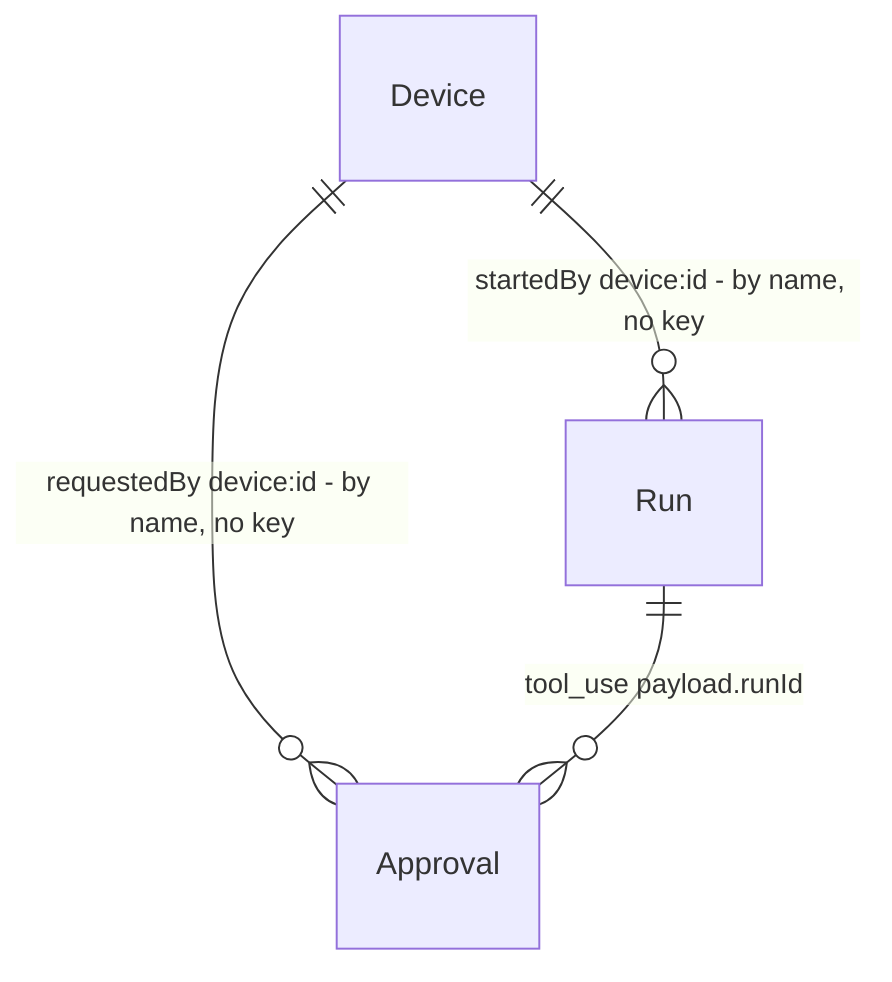

# Escopos de dispositivo — o telefone pareado deixa de ser uma chave da máquina

## Problem

Um dispositivo pareado (`core/src/security/devices.ts`) chama toda rota que não é `owner`: hoje 105 das 125 rotas
de `/api` (`apps/api/src/server.ts:325-334` só olha `config.scope === "owner"`). Um telefone perdido, ou um navegador
remoto pareado por quem viu o código, pode então: iniciar execuções em qualquer provedor, inclusive em modo escrita;
criar e editar skills (instruções que o agente obedece), rotinas (execução agendada), objetivos, fatos e diário da
memória (texto que as execuções seguintes leem); mandar mensagens pelo bot do Telegram; ler tudo que o dono lê; e
**aprovar a própria solicitação**: `POST /api/runs` em modo escrita cria o `write_run` e `POST /api/approvals/:id/resolve`
o aprova com o mesmo token, o que esvazia a revisão que o perfil `review_before_write` promete.

Duas execuções ainda leem o disco inteiro: o Codex em `--sandbox read-only` limita escrita e não leitura, e o Cursor não
tem sandbox. Um dispositivo que inicia uma execução nesses provedores alcança `config/token` por `cat`, mesmo com o `cwd`
fora do home (`.specs/STATE.md`, AD-011 e AD-012; `docs/security.md`, "Not covered").

O acesso remoto não exige TLS: com `remote.enabled` e `bindAddress` fora do loopback, o servidor escuta HTTP puro e o token
do dispositivo cruza a rede em claro (`server.ts:634`, `tls` é opcional em `settings.remote.tls.enabled`). O token também
vai em `?token=` nos dois fluxos SSE (`/api/events`, `/api/runs/:id/stream`), o que o põe em log de proxy e no histórico
do navegador; a api-v1 adiou o bilhete de uso único "para quando houver acesso fora da rede local"
(`.specs/features/api-v1/plan.md`, door 4), e esse momento é este.

Evidência: a análise do motor e a revisão crítica de 07/10/2026 (`review-arch`, item S2 do roteiro), o resíduo registrado em
AD-011/AD-012 e a lista de rotas lida do código desta sessão (125 rotas, 2 públicas, 18 `owner`).

Para o dono: um telefone pareado passa a ter quatro permissões que ele escolhe ao parear e muda depois (ver, ler conteúdo,
iniciar execução limitada, aprovar). O padrão não inclui aprovar. O que o telefone pede em escrita espera o dono (ou outro
canal); o que o telefone não precisa para isso fica só com o dono. Acesso remoto sem TLS ou túnel deixa de existir.

## Flow

Reutiliza o gancho `onRequest` de `server.ts` (exists), `req.routeOptions.config` como fonte da decisão (AD-001), o
envelope `errorBody()` (exists), `DeviceStore` (exists), `ApprovalStore` (exists), `RunManager.create` (exists), o
`gateWrite` do motor (exists), `SlidingWindow` (exists) e o par `tlsListenerFor`/`https.createServer` (exists).

1. Transporte -> `server.ts` `onRequest` (exists): antes de qualquer outra coisa, um par TCP que não é loopback e uma
   conexão que não é TLS recebem `403 tls_required` (door 6). O listener sem TLS escuta só o loopback; `bindAddress` fora do
   loopback vale para o listener TLS (`startServer`, exists).
2. Credencial -> `onRequest` (exists): o token local é o `owner`; um token de dispositivo vale `verify` (exists) e traz os
   escopos gravados (door 1); `?ticket=` troca por um principal gravado na emissão (door 5); `brk_` e `rc_` seguem com as
   listas fechadas que já têm.
3. Escopo -> `onRequest` (exists): a rota casada declara `config.scope` (door 2). Um dispositivo sem o escopo recebe
   `403 scope_required`; uma rota `owner`, `403 owner_only`.
4. Bilhete -> `POST /api/stream-tickets` (door 5, new route) emite; `GET /api/events` e `GET /api/runs/:id/stream` (exist)
   consomem `?ticket=`.
5. Início de execução -> as rotas de execução (exist) passam `startedBy` na entrada; `gateWrite` (exists) estaciona toda
   escrita pedida por dispositivo e grava `requestedBy` na aprovação (door 3); `RunManager.create` (exists) recusa um
   dispositivo em provedor que lê o disco inteiro (door 4), antes de criar a conversa quando é o caso (`assertMayStart`), e grava `started_by` na linha.
6. Aprovação -> `POST /api/approvals/tool` (exists) grava `requestedBy` = quem iniciou a execução; `resolveApproval` (exists)
   recusa um dispositivo que aprova o que ele mesmo pediu e qualquer tipo fora de `write_run` e `tool_use` (door 3).
7. Gestão -> `POST /api/pair/start` (exists) e `PATCH /api/devices/:id` (new, door 1), ambos `owner`, gravam os escopos; `POST /api/pair/claim` os herda.
8. Interface -> `apps/command-centre/src/api.ts` (exists) emite o bilhete antes de abrir cada SSE e reabre com um novo;
   `views/settings/security.tsx` (exists) mostra e edita os escopos.

## Impact

| Front       | What changes                                                                                                                                                                                                                                                                                                                                          |
| ----------- | ----------------------------------------------------------------------------------------------------------------------------------------------------------------------------------------------------------------------------------------------------------------------------------------------------------------------------------------------------- |
| domain      | novo termo: `escopo de dispositivo` - `monitor`, `content`, `run`, `approve`; fecho: `run` inclui `content`, `content` e `approve` incluem `monitor`; vive em `contracts`, é lido por `server.ts`, `routes/devices.ts` e pela tela de segurança                                                                                                       |
| domain      | termo que muda de sentido: `config.scope` da rota. Antes: ausente = o dispositivo pode, `"owner"` = não. Agora: obrigatório em toda rota `/api` não pública, e é um de `owner`/`monitor`/`content`/`run`/`approve`. Quem ramifica: `server.ts`, `openapi.ts`                                                                                          |
| domain      | novo termo: `startedBy`/`requestedBy` - o nome do principal (`owner`, `device:<id>`), o mesmo texto de `resolvedBy`; nulo para rotina, sentinela, CLI e o que existia antes                                                                                                                                                                           |
| domain      | `ProviderCapabilities` ganha `readConfinement` (`"workdir"`: a leitura do CLI fica no `cwd` e nas pastas adicionadas; `"none"`: lê o disco do usuário). Quem ramifica: `RunManager.create`, os três manifestos, `docs/adapters-guide.md`, `typetests`                                                                                                 |
| contrato    | API: todo dispositivo perde o que não tem escopo (`403 scope_required`); `?token=` de dispositivo em `/api/events` e `/api/runs/:id/stream` passa a `401`; todo par não loopback sem TLS passa a `403 tls_required`                                                                                                                                   |
| contrato    | API: rotas novas `POST /api/stream-tickets` e `PATCH /api/devices/:id`; `GET /api/devices`, `POST /api/pair/start`, `POST /api/pair/claim` trazem `scopes`; `Approval.requestedBy` e `RunRecord.startedBy` entram nos corpos                                                                                                                          |
| contrato    | quem lê `/api/events?token=<dispositivo>`: só a interface em um navegador pareado (corrigida aqui); um navegador pareado com a interface antiga em cache recebe `401` até recarregar                                                                                                                                                                  |
| stored data | migração 17, aditiva: `devices.scopes`, `approvals.requested_by`, `runs.started_by`, todas `TEXT NULL`. Dispositivos já pareados leem `NULL` como o padrão (`monitor`, `content`, `run`): perdem aprovar e as rotas `owner`; aprovações e execuções antigas leem `null`                                                                               |
| operations  | quem expunha o painel por HTTP puro na rede local (`bindAddress` `0.0.0.0` sem TLS) passa a escutar só o loopback e vê o aviso; precisa ligar `remote.tls.enabled` ou usar um túnel                                                                                                                                                                   |
| stored data | migração 18, aditiva: `push_subscriptions.device_id TEXT NULL` (o dispositivo que registrou; `NULL` é do dono e do que existia); migração 19, aditiva: `run_action_receipts.requested_by TEXT NULL` (o recibo de um repetir só vale para quem o fez; os de antes não valem para ninguém)                                                              |
| contrato    | API: `POST /api/push/subscribe` passa de `monitor` a `content` e recusa endpoint que não é `https` público (dispositivo: só os serviços de push dos navegadores) com `400 invalid_push_endpoint`; `POST /api/notifications/read` e `DELETE /api/notifications/:id` passam a `owner`; `GET /` não leva o token do dono a um pedido que nomeia um proxy |
| domain      | `CreateRunInput.startedBy` passa a obrigatório (`string \| null`); o gancho e `onRoute` guardam `/api` exato; cancelar uma escrita estacionada nega a aprovação dela; a aprovação mostra o pedido inteiro (payload e tela)                                                                                                                            |

## Relations

One-way constraints: nenhuma chave estrangeira de `started_by` e `requested_by` para `devices` (door 3): a linha de um
dispositivo revogado continua dizendo quem pediu. `devices.scopes` é o texto do conjunto já fechado (door 1).

## Surface

| Route                                                                                                                    | In                                                   | Out                                                                   | Status                                                                                          |
| ------------------------------------------------------------------------------------------------------------------------ | ---------------------------------------------------- | --------------------------------------------------------------------- | ----------------------------------------------------------------------------------------------- |
| `POST /api/stream-tickets`                                                                                               | `{ target: "events" }` ou `{ target: "run", runId }` | `{ ticket, expiresAt }`                                               | `200`, `400`, `401`, `403`, `429`                                                               |
| `GET /api/events?ticket=`, `GET /api/runs/:id/stream?ticket=`                                                            | o bilhete                                            | o fluxo SSE do principal que emitiu                                   | `200`, `401`                                                                                    |
| `PATCH /api/devices/:id`                                                                                                 | `{ scopes }`                                         | o dispositivo com `scopes`                                            | `200`, `400`, `403`, `404`                                                                      |
| `POST /api/pair/start`                                                                                                   | `{ name?, scopes? }`                                 | o de hoje mais `scopes`                                               | `200`, `400`, `403`                                                                             |
| `POST /api/pair/claim`                                                                                                   | o de hoje                                            | `{ token, device }` com `device.scopes`                               | `200`, `401`, `403`, `429` (os de hoje)                                                         |
| `GET /api/devices`                                                                                                       | -                                                    | `devices[].scopes`                                                    | `200`, `403`                                                                                    |
| `POST /api/approvals/:id/resolve`                                                                                        | `{ decision, answers? }`                             | a aprovação com `requestedBy`                                         | `200`, `403`, `404`, `409`                                                                      |
| `GET /api/approvals/:id`, `GET /api/approvals`                                                                           | -                                                    | `requestedBy`                                                         | `200`                                                                                           |
| `GET /api/runs/:id`, `GET /api/runs`                                                                                     | -                                                    | `startedBy`                                                           | `200`                                                                                           |
| `POST /api/runs`, `/api/runs/:id/children`, `/api/runs/:id/retry`, `/api/sessions/:id/continue`, `/api/skills/:slug/run` | o de hoje                                            | o de hoje; `202` estacionada quando o pedido é escrita de dispositivo | `200`, `202`, `403` (`device_provider_refused`, `scope_required`), `400`, `404`, `409`          |
| `POST /api/push/subscribe`                                                                                               | `{ subscription, label? }`                           | a assinatura (com `deviceId`)                                         | `200`, `400` (`invalid_push_endpoint`), `403` (`scope_required`), `409` (`push_endpoint_taken`) |
| `POST /api/push/unsubscribe`                                                                                             | `{ endpoint }`                                       | `{ removed }` (dispositivo: só a que ele registrou)                   | `200`, `400`                                                                                    |
| `POST /api/notifications/read`, `DELETE /api/notifications/:id`                                                          | o de hoje                                            | o de hoje                                                             | `200`, `403` (`owner_only`), `404`                                                              |
| `GET /`                                                                                                                  | -                                                    | a página; o token do dono só sem cabeçalho de proxy                   | `200`                                                                                           |
| toda rota `/api` não pública                                                                                             | -                                                    | `error.code` `scope_required` / `owner_only`                          | `403`                                                                                           |
| toda requisição de par não loopback sem TLS                                                                              | -                                                    | `error.code` `tls_required`                                           | `403`                                                                                           |

Detalhe das mensagens (o texto é o do envelope de erro único, `message` repete `error.message`):

- `scope_required`: "Este dispositivo não tem a permissão `<escopo>`; o dono a concede em Configurações › Segurança."
- `tls_required`: nomeia `remote.tls.enabled` (ou um túnel nesta máquina que repasse para `127.0.0.1:<porta>`) e `remote.allowedHosts`.
- `self_approval`: "Um dispositivo não aprova o que ele mesmo pediu; aprove no desktop, pelo Telegram ou em outro dispositivo."

## Landing

| One-way door                                                       | Literal shape                                                                                                                                                                                                                                                                                                                                                                                                                                                                                                                                                                                                                                                                                                                                                  | Alternative rejected                                                                                                                                                                                                                                                                                                  |
| ------------------------------------------------------------------ | -------------------------------------------------------------------------------------------------------------------------------------------------------------------------------------------------------------------------------------------------------------------------------------------------------------------------------------------------------------------------------------------------------------------------------------------------------------------------------------------------------------------------------------------------------------------------------------------------------------------------------------------------------------------------------------------------------------------------------------------------------------- | --------------------------------------------------------------------------------------------------------------------------------------------------------------------------------------------------------------------------------------------------------------------------------------------------------------------- |
| 1. Vocabulário de escopos do dispositivo                           | `contracts`: `DEVICE_SCOPES = ["monitor","content","run","approve"] as const`; `DeviceScope`; `closeDeviceScopes(scopes)` devolve o conjunto fechado na ordem de `DEVICE_SCOPES` (`run`→`content`→`monitor`, `approve`→`monitor`); `DEFAULT_DEVICE_SCOPES = ["monitor","content","run"]`. `devices.scopes TEXT NULL` guarda o JSON do conjunto fechado; `NULL` lê como o padrão. `DeviceRecord.scopes: DeviceScope[]`. O conjunto vazio é válido (dispositivo sem nenhuma permissão). O dono não é um escopo                                                                                                                                                                                                                                                   | Chaves por recurso e verbo (`runs:write`, `settings:read`): a api-v1 recusou a matriz que ninguém configura, e quatro nomes cobrem os papéis reais. Papéis fixos (`viewer`, `operator`): escondem quais rotas dão e não separam `aprovar` de `iniciar`                                                                |
| 2. Classificação por rota                                          | `config: { scope: "owner" \| "monitor" \| "content" \| "run" \| "approve" }` em toda rota `/api` sem `public`. O gancho `onRoute` lança ao registrar uma rota sem `scope` (o serviço não sobe, a mensagem nomeia método e caminho). Em uma requisição, `scope` ausente vale `owner` para o dispositivo. A decisão lê `req.routeOptions.config`, nunca a URL (AD-001). O `scope` aparece no OpenAPI como `x-mordomo-scope` em toda operação não pública                                                                                                                                                                                                                                                                                                         | Tabela central `rota -> escopo` em outro arquivo: uma segunda fonte que o roteador não vê, fácil de esquecer ao criar a rota e divergente do OpenAPI. Escopo padrão quando ausente (o comportamento de hoje): é a negação por padrão que falta                                                                        |
| 3. Quem pediu e quem iniciou                                       | `approvals.requested_by TEXT NULL` e `runs.started_by TEXT NULL` guardam o nome do principal (`owner`, `device:<id>`); `Approval.requestedBy`, `RunRecord.startedBy`. `PromptRunInput.startedBy` e `SkillRunInput.startedBy` são obrigatórios (`string \| null`) para o compilador forçar cada chamador a decidir. `resolveApproval` recusa `approved` quando `resolvedBy` é `device:<id>` e (`requestedBy === resolvedBy` -> `403 self_approval`) ou (o tipo não é `write_run` nem `tool_use` -> `403 owner_only`); `denied` passa. A aprovação `tool_use` herda `requestedBy` de `runs.started_by`                                                                                                                                                           | Um booleano `by_device`: não distingue o dispositivo A do B, que pode legitimamente aprovar o pedido de A. Chave estrangeira para `devices`: a linha some ou trava a revogação, e o histórico precisa sobreviver ao dispositivo                                                                                       |
| 4. Limite da execução iniciada por dispositivo                     | `ProviderCapabilities.readConfinement: "workdir" \| "none"` (Claude `workdir`, Codex `none`, Cursor `none`). `RunManager.create` recusa `403 device_provider_refused` quando `startedBy` começa por `device:` e o manifesto do provedor não declara `workdir` (ou não existe). `MordomoEngine.gateWrite` estaciona (`write_run`, `requestedBy` = o dispositivo) toda escrita pedida por dispositivo, qualquer que seja a decisão do perfil, e o perfil `read_only` continua recusando (`403 profile_refused`). Ninguém concede esses limites por dispositivo                                                                                                                                                                                                   | Restringir o `cwd` do dispositivo a uma pasta mínima: não impede o Codex e o Cursor de ler o disco. Uma lista de provedores por dispositivo: nada a configurar que a capacidade do manifesto não decida. Sandbox do sistema operacional: não portátil e fora do alcance deste repositório                             |
| 5. Bilhete de SSE                                                  | `POST /api/stream-tickets` -> `{ ticket: "tk_" + 24 bytes aleatórios em base64url, expiresAt }`. Vive 30 s, em memória, ligado ao principal que o emitiu e ao destino (`events` ou `run:<runId>`); a primeira apresentação o consome, valha ou não. No máximo 32 vivos por principal (`429 too_many_requests`). Aceito só como `?ticket=` em `GET /api/events` e `GET /api/runs/:id/stream` (`config: { ticket: true }`). Na apresentação o dispositivo é conferido de novo (vivo, com `monitor`). `?token=` de dispositivo nessas duas rotas é `401`; o do dono segue aceito. As duas rotas de arquivo (`artifacts/raw`, `skills/:slug/resource`) seguem com `?token=` (`` e `<video>` refazem a requisição, e um bilhete de uso único não serve a elas) | Cookie de sessão: o `EventSource` o envia sozinho, e com isso a credencial vira ambiente do navegador (CSRF). JWT curto: pede chave de assinatura e não é de uso único. Manter `?token=` por TLS: o token longo continua em log de proxy e no histórico. Bilhete também nas rotas de arquivo: quebra `Range` de vídeo |
| 6. Regra de transporte                                             | `onRequest`: `if (!isLoopbackAddress(req.socket.remoteAddress) && !(req.raw.socket as TLSSocket).encrypted) -> 403 tls_required`, antes do Host, do limite e da credencial. O listener sem TLS escuta `127.0.0.1` (ou o `bindAddress` já de loopback); o listener TLS escuta `bindAddress` quando `remote.enabled && remote.tls.enabled`. Um túnel é um processo desta máquina que repassa para `127.0.0.1:<porta>`: o par é loopback e o `Host` vem de `remote.allowedHosts`                                                                                                                                                                                                                                                                                  | Confiar em `X-Forwarded-Proto` (`trustProxy`): qualquer cliente forja o cabeçalho se o listener sem TLS é alcançável. Exigir TLS também do loopback: quebra a CLI, o broker MCP, o `launch` e a suíte e2e                                                                                                             |
| 7. Superfície de `@mordomo/contracts` (acrescentada na construção) | `contracts/src/devices.ts` exporta `DEVICE_SCOPES`, `DeviceScope`, `DEFAULT_DEVICE_SCOPES`, `closeDeviceScopes`, `DeviceRecord` e `isDeviceActor`, pelo ponto de entrada sem zod `@mordomo/contracts/policy` (e, por ele, pelo índice); campos novos: `Approval.requestedBy`, `RunRecord.startedBy`, `ProviderCapabilities.readConfinement` (obrigatório)                                                                                                                                                                                                                                                                                                                                                                                                      | Um terceiro ponto de entrada `./devices`: o C16 do contratos fixa dois pontos de entrada. Exportar só pelo índice: o navegador traria o zod para ler quatro nomes                                                                                                                                                     |
| 8. Assinatura de push (rodada 1)                                   | `POST /api/push/subscribe` é `content`; o endpoint é `https` na porta padrão, sem credenciais, sem nome local e todo endereço que resolve é público (`core/src/channels/pushEndpoint.ts`), conferido ao registrar e antes de cada envio, sem seguir redirecionamento; o dono pode qualquer endpoint público, um dispositivo só os serviços de push dos navegadores e nunca o endpoint de outro. `push_subscriptions.device_id` liga a assinatura ao dispositivo; revogar, expirar ou tirar `content` a apaga. As rotas de ler e apagar notificações são `owner`                                                                                                                                                                                                | Lista de permissão configurável de serviços de push (o dono põe o seu): fica para quando houver pedido, o `owner` já aceita qualquer endpoint público. Assinatura global sem vínculo ao dispositivo: era o que deixava um telefone revogado receber os avisos do dono                                                 |
| 9. Quem pediu não se perde (rodada 1)                              | `CreateRunInput.startedBy: string \| null` obrigatório (`typetests`); `startedByOf(req)` lança `500 principal_missing` sem principal; o recibo de `prompt_submissions` entra com o principal no hash e o de `run_action_receipts` ganha `requested_by` (`409 submission_conflict` para outro principal); cancelar a execução estacionada nega a aprovação (`resolvedBy: system`)                                                                                                                                                                                                                                                                                                                                                                               | Manter `startedBy` opcional e confiar na revisão: foi o que deixou o repetir de uma skill perder o ator sem que nenhum teste visse                                                                                                                                                                                    |

- Nothing else in this change is hard to reverse. (A tabela de escopos por rota é reversível rota a rota; o que não volta é o vocabulário da door 1, o formato do bilhete e o nome do erro.)

## Criteria

### S1: Cada rota diz quem a chama (P0)

Um dispositivo só alcança o que o escopo dele cobre; uma rota nova sem escopo não sobe.

**Acceptance Criteria**

1. IF a device calls a route whose `scope` it does not hold THEN the API SHALL answer `403` with `error.code` `scope_required` and the handler SHALL NOT run (nothing is created, changed or sent)
2. WHEN a device calls a route whose `scope` it holds THEN the API SHALL serve it as the owner is served
3. IF a device calls a route with `scope: "owner"` THEN the API SHALL answer `403 owner_only`; WHEN the owner token calls any route THEN the API SHALL serve it
4. IF a non-public `/api` route is registered without a `scope` THEN the service SHALL refuse to build, with a message naming the method and path
5. The `scope` of each of the 125 non-public `/api` routes SHALL be the one in the table of `docs/security.md`, and the OpenAPI document SHALL carry it as `x-mordomo-scope` on every non-public operation
6. The scopes stored for a device SHALL always be closed (`run` brings `content` and `monitor`, `content` and `approve` bring `monitor`); a device whose `scopes` column is `NULL` SHALL read as `monitor`, `content` and `run`
7. WHEN the owner starts a pairing with `scopes` THEN the device that claims the code SHALL hold exactly their closure; WHEN the owner sends none THEN it SHALL hold the default
8. WHEN the owner calls `PATCH /api/devices/:id` with `scopes` THEN the device's very next request SHALL be judged by the new set; IF the id is unknown or revoked THEN `404`, IF a scope is not one of the four THEN `400`
9. WHILE a device is revoked or expired, the API SHALL answer `401` to its token whatever its scopes
10. The `brk_` credential of a permission broker and the `rc_` credential of a memory run SHALL keep exactly the route lists they have today, whatever the `scope` of those routes

**Independent test:** parear um dispositivo com `monitor` apenas; ele lista execuções e leva `403 scope_required` em `POST /api/runs`.

### S2: O que o dispositivo inicia é limitado (P0)

O dispositivo inicia execuções só em provedor que prende a leitura ao `cwd`, e nunca escreve sem um humano.

**Acceptance Criteria**

11. WHEN a device holding `run` starts a read-only run on a provider whose manifest declares `readConfinement: "workdir"` THEN the API SHALL serve it and the run row SHALL record `startedBy` `device:<id>`
12. IF a device starts a run on a provider whose manifest does not declare `readConfinement: "workdir"`, by any of `POST /api/runs`, `POST /api/runs/:id/children`, `POST /api/runs/:id/retry`, `POST /api/sessions/:id/continue` or `POST /api/skills/:slug/run` THEN the API SHALL answer `403 device_provider_refused` and no run row SHALL be created
13. WHEN a device requests a write run and the profile is `review_before_write`, `controlled_write` or `approved_automation` THEN the API SHALL answer `202` with the run parked in `waiting_approval` and a `write_run` approval whose `requestedBy` is `device:<id>`, and no provider process SHALL start
14. IF a device requests a write run and the profile is `read_only` THEN the API SHALL answer `403 profile_refused`
15. WHEN the owner approves that approval THEN the parked run SHALL launch and keep `startedBy` `device:<id>`
16. WHEN the owner token starts a run THEN `startedBy` SHALL be `owner`; a run started by a routine, a sentinel or the CLI SHALL have `startedBy` `null`
17. The Codex and Cursor manifests SHALL declare `readConfinement: "none"` and the Claude manifest `workdir`

**Independent test:** um dispositivo com `run` pede uma execução no Codex: `403 device_provider_refused`; pede uma escrita no Claude sob `controlled_write`: `202`, parada.

### S3: Quem pediu não aprova (P0)

A aprovação que um dispositivo criou só é resolvida por outro principal.

**Acceptance Criteria**

18. IF a device resolves with `approved` an approval whose `requestedBy` is that same device THEN the API SHALL answer `403 self_approval` and the approval SHALL stay `pending`
19. WHEN that device resolves its own approval with `denied` THEN the API SHALL serve it and `resolvedBy` SHALL be `device:<id>`
20. WHEN the owner or another device holding `approve` approves it, or a Telegram person from `allowedUserIds` denies it THEN the API SHALL serve it
21. IF a device holding `approve` approves an approval whose kind is not `write_run` or `tool_use` THEN the API SHALL answer `403 owner_only` and the approval SHALL stay `pending`
22. WHEN the permission broker of a run started by device D raises a `tool_use` approval THEN `requestedBy` SHALL be `device:D`, D SHALL NOT be able to approve it, and the broker SHALL still be able only to deny its own run's approval (AD-002)
23. The approvals created before this feature SHALL read `requestedBy: null`, and runs created before it `startedBy: null`

**Independent test:** o dispositivo A pede uma escrita; A aprova e leva `403 self_approval`; o dono aprova e a execução sai.

### S4: Acesso remoto só com TLS ou túnel (P0)

**Acceptance Criteria**

24. IF a request's TCP peer is not loopback and the connection is not TLS THEN the API SHALL answer `403 tls_required` before it reads any credential, for `/api` paths, `/` and static files alike, and the message SHALL name `remote.tls.enabled` and the tunnel alternative
25. WHEN the peer is not loopback and the connection is TLS THEN the request SHALL be judged as today (Host, limits, credential, scope)
26. WHEN the peer is loopback THEN the request SHALL be judged as today, over plain HTTP, whatever its `Host`
27. The listener without TLS SHALL bind only loopback: with `bindAddress` outside loopback, it SHALL bind `127.0.0.1`, and the TLS listener SHALL bind `bindAddress` when `remote.enabled` and `remote.tls.enabled`
28. IF `bindAddress` is outside loopback and TLS is not enabled THEN the service SHALL start listening on loopback only, SHALL log and print a warning naming `remote.enabled`, `remote.tls.enabled` and the tunnel, and `mordomo doctor` SHALL report `warn` with the same text

**Independent test:** `app.inject` com `remoteAddress: "192.168.0.9"` responde `403 tls_required`; o mesmo pedido por um listener TLS real responde `200`.

### S5: Bilhete de SSE (P0)

**Acceptance Criteria**

29. WHEN the owner or a device holding `monitor` calls `POST /api/stream-tickets` with `{ target: "events" }` or `{ target: "run", runId }` THEN the API SHALL answer `200` with a `ticket` and an `expiresAt` 30 seconds ahead
30. WHEN `GET /api/events?ticket=T` or `GET /api/runs/:id/stream?ticket=T` (the same `runId`) presents a live ticket THEN the stream SHALL open as the principal that minted it, with no `x-mordomo-token`
31. IF a ticket is presented a second time, after 30 s, on the other stream, for another run, after its device was revoked or lost `monitor`, on any other route, or with a method other than `GET` THEN the API SHALL answer `401 unauthorized` with the same body in every case
32. IF a device token arrives in `?token=` on `GET /api/events` or `GET /api/runs/:id/stream` THEN the API SHALL answer `401` with a message that names the ticket; the owner token in `?token=` SHALL keep working there
33. IF a principal holds 32 live tickets and asks for another THEN the API SHALL answer `429 too_many_requests`
34. The request log SHALL show `ticket=[REDACTED]` as it shows `token=[REDACTED]`
35. The Command Centre SHALL open `/api/events` and `/api/runs/:id/stream` with a freshly minted ticket and no `token=` in the URL, and WHEN a stream closes THEN SHALL mint a new ticket and resume from the last event id it saw

**Independent test:** emitir um bilhete, abrir `/api/v1/events?ticket=` (200), repetir o mesmo URL (401).

### S6: A tela e o texto (P1)

**Acceptance Criteria**

36. WHEN the owner clicks "Show a code" in Settings › Security › Remote access THEN the screen SHALL send the scopes ticked in the permission group that sits between the pairing row and the code box (default `monitor`, `content`, `run` ticked, `approve` not), and ticking `run` SHALL tick and lock `content` and `monitor`, ticking `content` or `approve` SHALL tick and lock `monitor`
37. WHEN the Remote access card lists a device THEN each row SHALL show its permissions, and the "Permissions" button SHALL open the same group with Save, which sends `PATCH /api/devices/:id` and shows the server's message in an error toast on failure
38. WHILE remote access is on and TLS is off, the card SHALL say that a device outside this machine needs TLS or a tunnel
39. The table of routes and scopes in `docs/security.md` SHALL list exactly the registered routes with the scope each declares; `docs/security.md` SHALL state the limits this feature leaves (the page token, the file routes, `rc_` and `brk_` in the process environment, the tunnel's shared address)

**Independent test:** parear pela tela com `approve` marcado e ver o dispositivo listado com as quatro permissões.

### S7: Rodada 1 da verificação (P0)

O que a primeira verificação independente achou: o arranjo da lista de dispositivos, a assinatura de push como cliente HTTP do servidor, o inbox do dono, a revisão parcial do que o telefone pede, o proxy que reescreve o `Host` e os caminhos de segurança que nenhuma prova exercia.

**Acceptance Criteria**

40. WHILE the Remote access card lists devices, at 1440, 1100, 900, 800, 700, 500 and 390 px, in both shells and both languages, the device name SHALL keep a readable width, the text SHALL be whole and nothing in the row SHALL lie over anything else or leave the card
41. WHILE a permission box is locked by another permission, it SHALL be drawn and worded as locked (a shape and words, not a colour alone) and its cursor SHALL say it does not respond, in both shells
42. IF a device registers a push endpoint THEN the API SHALL require `content` and SHALL accept only `https` on the default port at a push service of the browsers, answering `400 invalid_push_endpoint` for a loopback, private, link-local, metadata or multicast address, a name that resolves to one, a local name or a service that is not a browser's, and the server SHALL post to none of them; the owner SHALL be able to register any endpoint that passes the address rules
43. WHEN a device is revoked, expires, or is left without `content` THEN its push subscriptions SHALL be deleted and never sent to; a device SHALL NOT replace or remove a subscription another principal registered; a name that resolves inside after it was subscribed SHALL be dropped at the next send, a name that cannot be resolved at send time SHALL count as a failed delivery (dropped only after the usual run of failures, never at the first), and a send SHALL NOT follow a redirect
44. IF a device calls `POST /api/notifications/read` or `DELETE /api/notifications/:id` THEN the API SHALL answer `403 owner_only` and the inbox SHALL not change
45. WHEN the approvals screens (Settings › Security, the inline approval card, the Núcleo's Resolver) show a held write run THEN they SHALL show who asked (a device by the name it was paired with; "unknown origin" when it was not recorded), the provider, model, mode (a skill's too) and folder, the whole prompt or every input of the skill, with the request before the buttons in the page's order, in boxes that scroll, that the keyboard reaches and whose names differ between two held writes, with nothing cut; the approval's payload SHALL carry the whole request and only its one-line description SHALL say how much of a long prompt it left out
46. IF a request carries a proxy or CDN header (`X-Forwarded-*`, `X-Original-Forwarded-*`, `Forwarded`, `Via`, `X-Real-IP`, `X-Client-IP`, `True-Client-IP`, `Fastly-Client-IP`, `X-Envoy-External-Address`, `CF-*`) THEN `GET /` SHALL NOT carry the owner token, and `docs/security.md` SHALL say that a proxy that adds none and rewrites `Host` cannot be told from the owner's browser
47. The service SHALL decide whether a connection is TLS and who the peer is from the socket and never from `X-Forwarded-Proto`, `X-Forwarded-For`, `Forwarded` or `X-Real-IP`, and `::` SHALL NOT be a loopback address
48. WHEN a write that waits for a human is cancelled THEN its approval SHALL be denied (`resolvedBy: system`) and a later approval SHALL answer `409` and start nothing; every one of the five routes that start a run, and the repeat of a skill run, SHALL park a device's write and keep `startedBy`
49. IF a caller of `RunManager.create` leaves `startedBy` out THEN it SHALL NOT compile; IF a handler reaches a start without a principal THEN it SHALL fail closed; IF a route is registered at exactly `/api` THEN it SHALL be held to the same scope rule as the ones under `/api/`
50. WHEN a `submissionId`, or the receipt of a repeat, is presented THEN the API SHALL replay it only for the principal that made it, and another principal with the same id SHALL get `409 submission_conflict` and nothing of the first run
51. IF a stream ticket is presented after its device expired or remote access was turned off, on `HEAD`, or at the wrong stream (which also spends it) THEN the API SHALL refuse it with the same `401`, and a ticket SHALL not reach the request log whether the stream opens or is refused
52. WHILE the Settings › Security card is drawn, the phone's HUD SHALL NOT ask `/api/devices`, the code box SHALL follow the permission group, and a device that may do nothing SHALL read `none` (`nenhuma`), in both languages
53. IF an approval is one a paired device chose (a write run it asked for, or a tool that a run it started asks to use) THEN the inbox tick SHALL open the review instead of approving, ⌘⇧A in the Núcleo SHALL open the Resolver instead of approving, Telegram SHALL offer Deny alone and refuse to approve it, naming where to read the request, and the screens SHALL show the tool's whole input before the buttons
54. WHILE a held request carries a word with no space of any length (64, 150 or 700 characters), the approval screens (Settings › Security, the inline card, the Núcleo's Resolver) SHALL keep Approve and Deny on screen and inside the card at 390, 800 and 1440 px, in both shells, and the page SHALL NOT scroll sideways
55. WHEN a device pairs THEN its name SHALL be cleaned (control characters and line breaks, invisible format and bidirectional characters, repeated spaces, 80 characters at most), a name already stored SHALL be cleaned when read, and the approval screens and the device list SHALL show the name with a short id (`Name · a1b2c3`)

**Independent test:** registrar `http://127.0.0.1:<porta>/x` como `monitor` e como `content`: `403` e `400`, e um serviço de escuta no loopback não recebe nada; ler o cartão em 800 px nos dois shells.

## Out of scope

| Excluded                                                             | Why                                                                                                                                                                                          |
| -------------------------------------------------------------------- | -------------------------------------------------------------------------------------------------------------------------------------------------------------------------------------------- |
| Handshake do lançador e cookie de sessão para o `GET /`              | quebra abrir a URL à mão, exige uma tela de "bloqueado" e plumbing no e2e; o ganho é limitado pelo `config/token` em disco (ver Assumptions, linha do `GET /`)                               |
| `rc_` e `brk_` fora do ambiente do processo                          | `/proc/<pid>/environ` e `ps eww` mostram o ambiente a processos do mesmo usuário; mover o segredo para um arquivo `0600` não muda quem o lê (o mesmo usuário)                                |
| Sandbox do sistema operacional para o Codex e o Cursor               | não portátil; a feature impede o dispositivo de usá-los, e o dono continua podendo iniciá-los no desktop                                                                                     |
| Aprovar escrita de dispositivo por uma lista de provedores ou pastas | o estacionamento já exige um humano, e a escolha de pasta é a do `cwd` que o motor já valida                                                                                                 |
| Executar rotina, objetivo e skill de escrita a partir do dispositivo | a rotina e o objetivo carregam perfil e escrita que o dono definiu; ficam `owner`. Pedir escrita de skill pelo dispositivo funciona pelo estacionamento (S2)                                 |
| Bilhete para `artifacts/raw` e `skills/:slug/resource`               | ``, `<video>` e `<iframe>` refazem a requisição (`Range`, subrecursos); o token do dispositivo continua na URL dessas duas rotas, dito em `docs/security.md`                            |
| Limite de tentativas por cliente atrás de um túnel                   | o túnel reparte o endereço `127.0.0.1`, e o limite de `401` ignora o loopback; o código de pareamento (5 tentativas, 10 por minuto) e tokens de 256 bits seguram, dito em `docs/security.md` |
| Vários donos, contas e papéis                                        | o MordomoOS é de um dono (api-v1, Out of scope)                                                                                                                                              |

## Assumptions

| Assumption                                                 | Chosen default                                                                                                                                                                | Rationale                                                                                                                                                                                                                              | Confirmed? |
| ---------------------------------------------------------- | ----------------------------------------------------------------------------------------------------------------------------------------------------------------------------- | -------------------------------------------------------------------------------------------------------------------------------------------------------------------------------------------------------------------------------------- | ---------- |
| Escopos do dispositivo novo e do que já estava pareado     | `monitor`, `content`, `run`; `approve` fora. Quem estava pareado lê `NULL` como o mesmo padrão e perde aprovar e as rotas `owner`                                             | menor privilégio que ainda deixa o telefone ver e pedir; o dono concede `approve` por dispositivo na tela. Pergunta ao dono em `STATE.md`                                                                                              | n          |
| Escrita pedida por dispositivo                             | estacionada para aprovação em todo perfil que permite escrever, mesmo em `controlled_write` e `approved_automation`                                                           | "o dispositivo propõe, o dono dispõe": é o que a separação de funções pede, e o perfil `read_only` continua recusando                                                                                                                  | n          |
| Claude `readConfinement: "workdir"`                        | declarado `workdir` pela documentação do Claude Code (leitura fora do `cwd` e das pastas adicionadas pede permissão, negada em execução sem terminal); não verificado aqui    | nenhum binário foi executado (como no `docs/security.md`, "Not covered"); o outro padrão seguro é nenhum provedor, que inutiliza `run`. Pergunta ao dono                                                                               | n          |
| Tipos de aprovação que um dispositivo com `approve` decide | `write_run` e `tool_use`; `expose_port`, `connector_write` e os demais ficam com o dono                                                                                       | `expose_port` muda o endereço de escuta, e decidi-lo de um telefone remoto é decidir a própria exposição                                                                                                                               | n          |
| O dispositivo nega a própria aprovação                     | permitido                                                                                                                                                                     | cancelar o próprio pedido não amplia nada                                                                                                                                                                                              | n          |
| Aprovações anteriores à migração (`requestedBy: null`)     | um dispositivo com `approve` pode aprová-las                                                                                                                                  | não há como atribuí-las; duram no máximo `approvalTtlDays`. Dito em `docs/security.md`                                                                                                                                                 | n          |
| `GET /` e o token do dono servido a um programa do usuário | sem mudança: segue a redução de `looksLikeBrowserNavigation` (AD-012), registrada como limite                                                                                 | o handshake é viável no servidor e no lançador (HMAC do token sem estado, cookie `HttpOnly`), mas quebra abrir a URL à mão e o e2e, pede uma tela de bloqueio, e o programa que lê a página também lê `config/token`. Pergunta ao dono | n          |
| `rc_` por dispositivo                                      | a execução iniciada por um dispositivo exige `run`, que inclui `content`; o `rc_` dela lê a memória que o dispositivo já lê. Nenhum `rc_` novo por dispositivo                | o escopo do dispositivo limita quem pode iniciar, e `rc_` morre com a execução (AD-012)                                                                                                                                                | n          |
| Quem pode nomear um endpoint de push                       | o dono, qualquer `https` público; um dispositivo, só os serviços de push dos navegadores (FCM, Mozilla, Apple, Windows) e só com `content`                                    | o endpoint é um URL para o qual o servidor faz `POST` com a própria chave VAPID: quem o nomeia escolhe o destino. A lista de nomes conhecidos é curta e muda pouco; um servidor próprio é coisa do dono. Pergunta ao dono              | n          |
| Proxy desta máquina que reescreve o `Host`                 | o token do dono sai da página quando o pedido nomeia um proxy; um proxy que reescreve o `Host` e não acrescenta nenhum cabeçalho continua indistinguível do navegador do dono | o par é loopback para qualquer proxy local; o que o serviço vê é o cabeçalho. Dito em `docs/security.md` e no manual, com a configuração do nginx                                                                                      | n          |
| Rotina, objetivo e "executar agora" a partir do telefone   | `owner`                                                                                                                                                                       | carregam perfil e escrita definidos pelo dono; é um corte fácil de reabrir com um escopo `manage`                                                                                                                                      | n          |
| Telefone que usava o HTTP puro da rede local               | recusado (`tls_required`); o dono liga `remote.tls.enabled` ou usa um túnel                                                                                                   | a regra pedida; o token longo não cruza a rede em claro. Dito no aviso de início e em `docs/user-manual.md`                                                                                                                            | n          |
| Padrão de `remote.tls.enabled`                             | continua `false`                                                                                                                                                              | ligar gera um certificado autoassinado e muda a URL do dispositivo; o dono liga com um clique e a mensagem diz como                                                                                                                    | n          |
| Mensagens de erro e da tela                                | em inglês no servidor (como as demais); a tela traduz em `en` e `pt-BR`                                                                                                       | segue o entorno                                                                                                                                                                                                                        | n          |

**Open questions:** none - all resolved or logged above.

## Observable

| Surface                                                             | Decision                            | Landing                                                                                                   |
| ------------------------------------------------------------------- | ----------------------------------- | --------------------------------------------------------------------------------------------------------- |
| API `POST /api/stream-tickets`                                      | response shape, codes, who may call | AC 29, 31, 33 (door 5)                                                                                    |
| API `POST /api/stream-tickets`                                      | versioning                          | existing - `/api/v1/` pelo `rewriteUrl` de `apiVersion.ts`                                                |
| API `PATCH /api/devices/:id`, `POST /api/pair/start`                | error shape and codes, who may call | AC 7, 8 (`owner`), `400`/`404` no envelope único                                                          |
| all new routes                                                      | rate limit                          | AC 33 (bilhetes); `PATCH /api/devices/:id` n/a - rota de dono, uma chamada por clique                     |
| all `/api` routes                                                   | who may call                        | AC 1-5 (doors 1, 2)                                                                                       |
| all `/api` routes                                                   | transport                           | AC 24-28 (door 6)                                                                                         |
| API run-starting routes                                             | who may call, what they refuse      | AC 11-17 (door 4)                                                                                         |
| API `POST /api/approvals/:id/resolve`                               | who may call, error codes           | AC 18-22 (door 3)                                                                                         |
| API `GET /api/approvals*`, `GET /api/runs*`                         | response shape                      | AC 11, 13, 22, 23 (`requestedBy`, `startedBy`)                                                            |
| screen Settings › Security › Remote access                          | empty state (nenhum dispositivo)    | existing - a lista só aparece com dispositivos ativos                                                     |
| screen Settings › Security › Remote access                          | loading state                       | existing - `useApiQuery` de `qk.devices`                                                                  |
| screen Settings › Security › Remote access                          | error state                         | AC 37 (toast com a mensagem do servidor)                                                                  |
| screen Settings › Security › Remote access                          | unauthorised state                  | n/a - a tela abre só no navegador do dono; um dispositivo recebe `403 owner_only` e o toast existente     |
| screen Settings › Security › Remote access                          | destructive action confirms         | existing - `useConfirm` na revogação; mudar permissões não destrói nada e não confirma                    |
| API `POST /api/push/subscribe`, `POST /api/push/unsubscribe`        | error shape and codes, who may call | AC 42, 43 (`400 invalid_push_endpoint`, `409 push_endpoint_taken`, `403 scope_required`)                  |
| API `POST /api/notifications/read`, `DELETE /api/notifications/:id` | who may call                        | AC 44 (`403 owner_only` para o dispositivo)                                                               |
| screen approvals (Settings › Security, run card, Resolver)          | what it shows, scrolling, keyboard  | AC 45; empty state existing; loading state existing; error state existing (toast); destructive action n/a |
| page `GET /`                                                        | who gets the token                  | AC 46                                                                                                     |
| screen Settings › Security › Remote access, at 390-1440 px          | layout, locked state                | AC 40, 41                                                                                                 |
| command `mordomo doctor`                                            | output when it fails                | AC 28 (`warn` com o texto)                                                                                |
| startup of the service                                              | output when it fails                | AC 28 (aviso no console e no log)                                                                         |
| document `docs/security.md`                                         | structure and what the reader does  | AC 39 (tabela de rotas e escopos, limites)                                                                |

## Sources

- `.specs/STATE.md` - AD-001, AD-002, AD-011, AD-012 e as dependências de `escopos-dispositivo`
- `.specs/features/api-v1/plan.md` - doors 3 e 4, de onde esta feature parte
- `docs/security.md` - "Authentication" e "Not covered"
