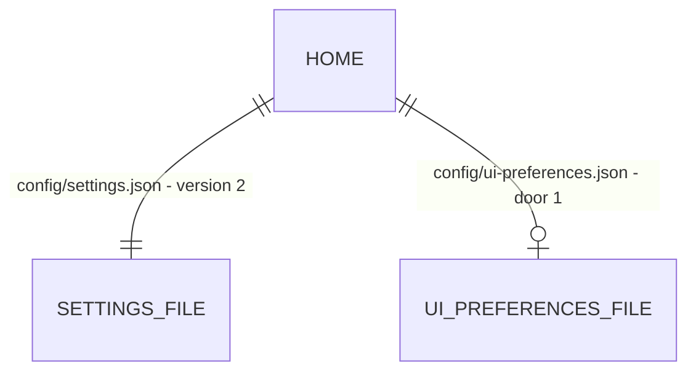

# Preferências da interface fora das configurações do motor

## Problem

O schema de configurações do motor (`SettingsSchema`, hoje em `contracts/src/settings.ts`) carrega
sete campos que só a interface usa. São eles: `themePreset`, `microApps`, `dashboardLayout`,
`spaces`, `activeSpace`, `hud` e `brain`. O motor não lê nenhum, com uma exceção: `PUT /api/settings`
faz a checagem de conflito de layout (`dashboardLayoutBase`). Por isso, cada ajuste de visual
reescreve o arquivo do motor e emite `settings.changed`. Esse evento chega a todos os ouvintes do
motor e da interface. Quem embute o motor herda esses campos no tipo `Settings` e no arquivo.

O schema também tem `version: 1`, mas ninguém lê esse número e não há migração. O zod descarta
chaves desconhecidas. Assim, um binário mais velho que salva as configurações apaga em silêncio os
campos que uma versão mais nova gravou. E tirar um campo do schema hoje apagaria o valor do usuário
na próxima leitura.

Quem paga: quem embute o motor (feature 3), que recebe estado de tela misturado com política; e o
usuário que volta para uma versão anterior e perde ajustes sem aviso. Evidência: mapeamento de
06/10/2026 (`contracts/src/settings.ts`, `core/src/config/store.ts`); não há relato de usuário.

## Flow

Reutiliza o `SettingsStore` (escrita atômica, cache por mtime) como modelo do store novo, os
sub-schemas que já existem (`MicroAppSchema`, `BrainSettingsSchema`, `DEFAULT_HUD`, o schema de
layout) e a checagem de conflito de layout que já existe em `PUT /api/settings`.

1. Leitura das configurações → `core/src/config/store.ts` (exists) `load()`: lê o JSON cru; se
   `version` < 2, chama a migração 1→2 (door 2), que copia os sete campos para
   `config/ui-preferences.json` (door 1) quando esse arquivo ainda não existe e regrava
   `settings.json` com `version: 2` e sem eles.
2. Gravação das configurações → `save()`: recusa sobrescrever um arquivo com `version` maior que a
   que o motor conhece (door 3).
3. Preferências → `UiPreferencesStore` em `core/src/config/` (door 1), com o mesmo padrão de
   escrita atômica; `contracts/src/preferences.ts` (door 1) guarda o schema.
4. Rotas → `apps/api/src/routes/system.ts` (exists): `GET`/`PUT /api/ui-preferences`; a checagem de
   conflito de layout muda de `PUT /api/settings` para cá; `PUT /api/settings` com um dos sete
   campos responde `400`.
5. Backup e restauração → `core/src/backup.ts` (exists) copiam e devolvem `ui-preferences.json`
   junto com `settings.json`. Um backup sem `ui-preferences.json` (feito antes desta feature) apaga
   o arquivo vivo na restauração, e a próxima leitura migra as preferências que o `settings.json` v1
   do backup traz.
6. Interface → `apps/command-centre/src/api.ts` (exists) ganha `uiPreferences`/`putUiPreferences`
   e `putSettings`, a única escrita de `/api/settings` na interface, cujo tipo de patch recusa os
   sete campos; `request()`, por onde passa toda requisição da interface, recusa em execução uma
   escrita em `/api/settings` com um deles (AC 24), e o lint proíbe `fetch` cru fora de `api.ts`;
   a query de configurações é tipada como `SettingsDoc` exato (AC 25);
   as telas que liam esses campos de `settings` passam a ler das preferências (`App.tsx`,
   `views/settings/theme.tsx`, `views/settings/desktop.tsx`, `views/Setup.tsx`,
   `desktop/console/Console.tsx`, `views/SecondBrain.tsx`, `nucleo/scenes/BrainScene.tsx`,
   `brain/useBrainState.ts`, all exist).

## Impact

| Front       | What changes                                                                                                                                                                                               |
| ----------- | ---------------------------------------------------------------------------------------------------------------------------------------------------------------------------------------------------------- |
| domain      | novo termo: `UiPreferences` - o que só a interface lê e grava; vive em `contracts/src/preferences.ts` e em `config/ui-preferences.json`                                                                    |
| domain      | termo existente: `Settings` perde `themePreset`, `microApps`, `dashboardLayout`, `spaces`, `activeSpace`, `hud`, `brain`; quem lia: as telas listadas no Flow 6 e `PUT /api/settings` (conflito de layout) |
| domain      | termo existente: `settings.version` era decorativo, passa a decidir a migração e a recusa de gravação                                                                                                      |
| stored data | migração na leitura: um `settings.json` com `version` 1 (sem `version` ou abaixo de 1) é migrado na primeira leitura por qualquer processo; o original fica copiado como `settings.json.v1.bak`            |
| contrato    | `GET /api/settings` deixa de trazer os sete campos; `PUT /api/settings` com eles responde `400 moved_to_ui_preferences`; rotas novas `GET`/`PUT /api/ui-preferences`                                       |

## Relations

One-way constraints: `settings.json` com `version` 2 nunca contém os sete campos (door 2); o motor
não grava sobre `version` maior que a sua (door 3).

## Surface

| Route                     | In                                                     | Out                                                                                               | Status                            |
| ------------------------- | ------------------------------------------------------ | ------------------------------------------------------------------------------------------------- | --------------------------------- |
| `GET /api/ui-preferences` | -                                                      | `themePreset`, `microApps`, `dashboardLayout`, `spaces`, `activeSpace`, `hud`, `brain`, `version` | `200`                             |
| `PUT /api/ui-preferences` | qualquer subconjunto dos campos, `dashboardLayoutBase` | as preferências inteiras                                                                          | `200`, `400`, `409`               |
| `PUT /api/settings`       | um dos sete campos                                     | envelope de erro                                                                                  | `400` (`moved_to_ui_preferences`) |
| `GET /api/settings`       | -                                                      | configurações sem os sete campos                                                                  | `200`                             |

## Landing

| One-way door                        | Literal shape                                                                                                                                                                                                                                                  | Alternative rejected                                                                                                                                      |
| ----------------------------------- | -------------------------------------------------------------------------------------------------------------------------------------------------------------------------------------------------------------------------------------------------------------- | --------------------------------------------------------------------------------------------------------------------------------------------------------- |
| 1. Arquivo e schema de preferências | `config/ui-preferences.json`; `UiPreferencesSchema = z.object({ version: z.literal(1).default(1), themePreset, microApps, dashboardLayout, spaces, activeSpace, hud, brain })` com os mesmos sub-schemas e padrões de hoje, exportado por `@mordomo/contracts` | Guardar no `localStorage` do navegador: some ao trocar de navegador, não entra no backup e um dispositivo pareado não veria o mesmo layout                |
| 2. Migração de configurações 1→2    | lista `SETTINGS_MIGRATIONS = [{ from: 1, to: 2, run(raw, paths) }]` em `core/src/config/migrations.ts`; aplicada em ordem enquanto `raw.version < CURRENT_SETTINGS_VERSION` (2); antes de regravar, copia o arquivo para `settings.json.v<from>.bak`           | Ler os campos antigos com `.catch` e ignorá-los: o valor do usuário se perde na primeira gravação                                                         |
| 3. Recusa de arquivo mais novo      | `save()` lança `Error` com `code: "settings_newer"` quando o arquivo em disco tem `version` > 2; o arquivo fica intacto                                                                                                                                        | `.passthrough()` no schema: preserva chaves desconhecidas, mas não impede um binário velho de gravar um valor que a versão nova interpreta de outro jeito |

- Nothing else in this change is hard to reverse

## Criteria

### S1: Migração sem perder nada (P1)

**Acceptance Criteria**

1. WHEN the engine loads a `settings.json` with `version` 1 holding `themePreset` `"jarvis"`, one micro app, a `brain` object and a `hud` THEN `config/ui-preferences.json` SHALL hold those four values and `settings.json` SHALL have `version` 2 and none of the seven fields
2. WHEN that migration runs THEN the original file SHALL be kept as `config/settings.json.v1.bak`, byte for byte
3. IF `config/ui-preferences.json` already exists THEN the migration SHALL NOT change it, and SHALL still remove the seven fields from `settings.json`
4. WHEN the engine loads an already migrated `settings.json` THEN the file SHALL NOT be rewritten (same mtime and content)
5. IF `settings.json` on disk has `version` 3 THEN `save()` SHALL throw with `code` `"settings_newer"` and the file SHALL stay byte for byte unchanged
6. The schema `SettingsSchema` SHALL have none of the keys `themePreset`, `microApps`, `dashboardLayout`, `spaces`, `activeSpace`, `hud`, `brain`, and SHALL default `version` to 2

**Independent test:** gravar um `settings.json` v1 com `themePreset: "jarvis"`, montar o motor, ler os dois arquivos.

### S2: Rotas das preferências (P1)

**Acceptance Criteria**

7. WHEN `GET /api/ui-preferences` is called on a new home THEN the API SHALL answer `200` with the schema defaults (`themePreset` `"hud-orange"`)
8. WHEN `PUT /api/ui-preferences` sends `{ themePreset: "forest" }` THEN the API SHALL answer `200`, persist it, and keep the other fields as they were
9. IF `PUT /api/ui-preferences` sends `{ themePreset: "nope" }` THEN the API SHALL answer `400` with `error.code` `"validation"`
10. IF `PUT /api/ui-preferences` sends a `dashboardLayout` with a `dashboardLayoutBase` different from the stored layout THEN the API SHALL answer `409` and keep the stored layout
11. IF `PUT /api/settings` sends any of the seven fields THEN the API SHALL answer `400` with `error.code` `"moved_to_ui_preferences"` and change nothing
12. WHEN `GET /api/settings` is called THEN the body SHALL contain none of the seven fields
13. WHEN a backup is created and then restored THEN `config/ui-preferences.json` SHALL come back with its content

**Independent test:** `curl -X PUT /api/ui-preferences -d '{"themePreset":"forest"}'` e `GET` de volta.

### S3: A interface lê das preferências (P1)

**Acceptance Criteria**

14. The UI type `SettingsDoc` SHALL have none of the seven fields, and `npm run typecheck` SHALL exit `0`
15. The UI SHALL read `themePreset`, `microApps`, `activeSpace`, `hud` and `brain` through `GET /api/ui-preferences` and write them through `PUT /api/ui-preferences` (no `settings.data?.<field>` read and no `put({ <field> … })` on `/api/settings` remains in `apps/command-centre/src`)
16. WHEN a preference is saved THEN the UI preferences query SHALL be refreshed without a reload (the existing settings-change refresh path covers preferences too)

**Independent test:** trocar o tema visual em Ajustes e recarregar: o preset escolhido continua.

### Rodada 2 - lacunas da primeira verificação (P1)

Acrescentada depois do FAIL da rodada 1 (`verification.md`): comportamento que o plano não nomeava
(backup antigo, versão abaixo de 1, campo inválido na migração, estados da aba Desktop) e a metade
do AC 16 que fica no servidor.

**Acceptance Criteria**

17. IF a restored backup has `config/settings.json` and no `config/ui-preferences.json` (a backup made before this feature) THEN the restore SHALL remove the live `config/ui-preferences.json`, the next load SHALL bring back that backup's `themePreset`, `activeSpace` and `brain`, and the existing `config/settings.json.v1.bak` SHALL stay unchanged (it is the only copy of the pre-upgrade file; the restored one is still in the backup directory)
18. WHEN `PUT /api/ui-preferences` saves THEN the engine SHALL emit `settings.changed` once
19. IF a `settings.json` v1 holds one invalid UI field (`themePreset: "nope"`) THEN the migration SHALL keep the other fields in `config/ui-preferences.json`, SHALL use the default (`"hud-orange"`) for the invalid one, and SHALL NOT fail
20. IF `settings.json` has `version` 0 or a negative `version` THEN the engine SHALL migrate it as version 1 once and SHALL NOT rewrite it on later loads
21. The UI SHALL send every `PUT /api/settings` through `api.putSettings`, whose patch type refuses the seven fields; WHEN the in-UI setup finishes THEN `themePreset` and `hud` SHALL go through `PUT /api/ui-preferences` and none of the seven fields through `PUT /api/settings`
22. WHILE `GET /api/ui-preferences` has not answered, the `Ajustes › Desktop` tab SHALL show a skeleton; IF it fails THEN the tab SHALL show the error box with a retry button, the same pattern the Settings page uses

**Independent test:** restaurar um backup feito antes desta feature e recarregar: o tema do backup volta.

### Rodada 3 - lacunas da segunda verificação (P1)

Acrescentada depois do FAIL da rodada 2 (`verification.md`): o caso de backup que o plano não
decidia e a recusa da escrita na própria interface, que o AC 21 pedia só pelo tipo.

**Acceptance Criteria**

23. IF a restored backup has neither `config/settings.json` nor `config/ui-preferences.json` THEN the restore SHALL leave the live `config/ui-preferences.json` and `config/settings.json` byte for byte unchanged (`createBackup` always copies `settings.json` when it exists, so this is not the pre-feature shape of AC 17)
24. IF the UI sends a request other than `GET` to `/api/settings` (any spelling of the path: query string, trailing or doubled slash, absolute URL) whose body carries one of the seven fields THEN the UI SHALL refuse it before sending, with `code` `"moved_to_ui_preferences"` and a message naming the field; requests without those fields, and requests to other routes, SHALL go out unchanged
25. The settings query result in the UI (`useOsSettings`, the Settings page query) SHALL be typed as exactly `SettingsDoc`, with no index signature, so reading one of the seven fields from it does not compile; the settings tabs' write (`Put`) SHALL take the same patch type as `api.putSettings`

**Independent test:** no console do navegador, `api.put(url, { themePreset: "jarvis" })` com `url = "/api/settings"` rejeita sem chegar à rede.

## Out of scope

| Excluded                                                          | Why                                                                                                                                            |
| ----------------------------------------------------------------- | ---------------------------------------------------------------------------------------------------------------------------------------------- |
| Remover `dashboardLayout`, `spaces` e `hud`, que ninguém mais usa | feature 12 `limpeza-legado`; aqui eles só mudam de casa, com valor e padrão                                                                    |
| `language`, `theme` e `accentColor`                               | o motor os usa (`/api/meta` antes da interface subir, textos da CLI); ficam nas configurações                                                  |
| `areas` e `favoriteSkills`                                        | o motor os lê (roteamento de memória, rotas de skills)                                                                                         |
| Evento próprio para preferências                                  | a interface já reage a `settings.changed`; as preferências usam o mesmo caminho de invalidação na interface (AC 16) sem um tipo de evento novo |

## Assumptions

| Assumption                                | Chosen default                                                                                                          | Rationale                                                                                                                                                                                                                           | Confirmed? |
| ----------------------------------------- | ----------------------------------------------------------------------------------------------------------------------- | ----------------------------------------------------------------------------------------------------------------------------------------------------------------------------------------------------------------------------------- | ---------- |
| Quem dispara a migração                   | o primeiro `load()` de qualquer processo (serviço ou CLI)                                                               | a migração é idempotente e atômica; esperar o `start()` deixaria a CLI lendo um arquivo v1 com chaves que o schema não conhece                                                                                                      | n          |
| Arquivo sem `version`                     | tratado como `version` 1                                                                                                | todos os arquivos gravados até hoje têm `version: 1` por padrão do schema                                                                                                                                                           | n          |
| `PUT /api/settings` com os campos antigos | `400` em vez de redirecionar                                                                                            | interface e API saem juntas; redirecionar esconderia um cliente desatualizado                                                                                                                                                       | n          |
| As duas gravações do `Setup`              | aceitas como duas chamadas: `PUT /api/ui-preferences` primeiro, `PUT /api/settings` (com `setupCompleted: true`) depois | não há rota que grave os dois arquivos numa transação; nessa ordem o setup só fica concluído quando as duas gravaram; se a segunda falhar, as preferências já salvas ficam, a tela mostra o erro e concluir de novo regrava as duas | n          |

**Open questions:** none - all resolved or logged above.

## Observable

| Surface                              | Decision                | Landing                                                                                        |
| ------------------------------------ | ----------------------- | ---------------------------------------------------------------------------------------------- |
| API `GET /api/ui-preferences`        | response shape          | AC 7                                                                                           |
| API `PUT /api/ui-preferences`        | error shape and codes   | AC 9, AC 10                                                                                    |
| API `/api/ui-preferences*`           | who may call it         | existing - regra de auth da feature 1 (rota não pública)                                       |
| API `/api/ui-preferences*`           | versioning, rate limits | n/a - `version` dentro do documento (door 1); rate limit é da feature 7                        |
| API `PUT /api/settings`              | error for moved fields  | AC 11                                                                                          |
| screen `Ajustes › Tema`              | error state             | existing - o toast de erro de gravação que a tela já usa                                       |
| screen `Ajustes › Tema`              | empty, loading          | existing - a tela já espera a query de configurações; passa a esperar também a de preferências |
| screen `Ajustes › Desktop`           | loading, error          | AC 22                                                                                          |
| stored data backup antigo            | restauração             | AC 17                                                                                          |
| stored data backup sem configurações | restauração             | AC 23                                                                                          |
| stored data `settings.json`          | migration and rollback  | AC 1-5 (backup `.v1.bak`, recusa de arquivo mais novo)                                         |

## Sources

- Mapeamento de 06/10/2026 (nesta sessão) - campos de interface no schema e quem os lê
- `.specs/features/contratos/plan.md` - `Out of scope` que adiou esta separação
